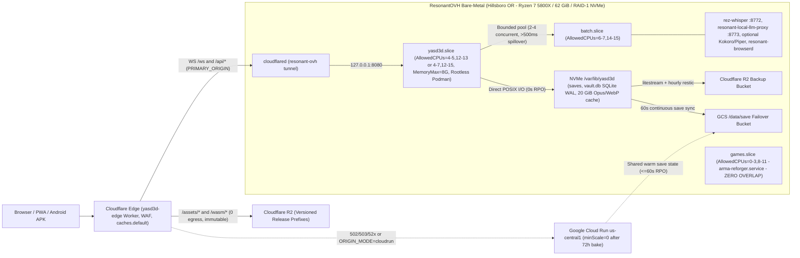

# YASD 3D — ResonantOVH Migration, 9-Panel Optimization & Anti-Regression Master Plan

- **Baseline**: `v13.2.1` (`main` @ `f7c8861`)
- **Canonical Domain**: `https://yasd3d.com`
- **Primary Target**: `ResonantOVH` (OVH Bare-Metal, Hillsboro, OR — AMD Ryzen 7 5800X `8C/16T` @ `4.85 GHz`, `62 GiB` RAM / `54 GiB` free, Dual Samsung PM983 `960 GB` NVMe RAID-1 / `767 GiB` free, Dual Intel X550 `10GbE`, `4.6 ms` ping to Cloudflare `1.1.1.1` vs `328 ms` current `yasd3d.com/health` TTFB)
- **Audit Depth**: Synthesizes a **3-Round, 9-Specialist Panel Review iterated to diminishing returns** across 3D Graphics, Backend/VPS, Client Latency/WASM/Audio, UI/CSS/Web Platform, Creatures/Bestiary, Items/Weapons/Viewmodels, Interactions/Actions/Menus, Living Chronicle/Original-Game Intent, and World Terrain/C-Bridge Parity (zero remaining unaudited surfaces).
- **Epistemic Standard**: Claims backed by direct file/command observation are tagged `⊢ PROVED`; projections/benchmarks not yet run live on target are tagged `⊬ HYPOTHESIS`.

---

## 1. Live Wave Progress Dashboard

| Wave | Title | Branch | Rollback Tag | Primary Risk | Status | Gate Receipt |
| :--- | :--- | :--- | :--- | :--- | :--- | :--- |
| `Pre-0` | Immutable Baseline & Golden Oracle Snapshot | `main` | `pre-ovh-v13.2.1` | Missing baseline diff / GCS save snapshot | `[x]` Done | Tag `pre-ovh-v13.2.1` @ `f7c8861`; Cloud Run `angband3d-cloud-00217-2cl`; CF Worker `19b77267-81f5-495b-a8e7-0f6978fa8845`; `tools/rollback_prod.ps1 -WhatIf` OK |
| `Wave 0` | Security, Accidental-YASD, Exploits, Broken Routes & WS Compression | `wave-0-hardening` | `pre-ovh-v13.2.1` / `post-wave-0` | Save routes, keymap remaps, or WS framing | `[x]` Done (`v13.2.2`) | `fast` `46/46`, `server_test` `24/24`, `smoke_test` `11/11`, `pre_push_ci_gate` PASS, `e2e` `4/4`, `test_save_download_upload` PASS, `check_loc_budget` `21 PASS / 0 exceeded` (`server.js` `4644/4700`), `check_version_sync` `13.2.2` |
| `Wave 1` | Cloudflare R2 Static Offload + `ResonantOVH` Parallel Staging & Cutover | `wave-1-ovh-r2` | `pre-wave-1` / `post-wave-1` | Origin cutover, save parity, or Arma CPU bleed | `[x]` Done (`v13.3.0`) | OVH `yasd3d.service` active (`4-5,12-13`, `MemoryMax=8G`, `arma-reforger` on `0-3,8-11` unaffected); `312` GCS saves mirrored + restic `99eaba79`; 9/9 staging realms PASS; save roundtrip + `vault.db` (`8` rows) PASS; Worker `190c5e49-a5e1-4c78-8358-b97e7e39638e` (`X-YASD-Origin: primary-ovh`, TTFB `0.327s`); live Cloud Run failover (`13.2.1`) & recovery PASS; `fast` + `test_wave1_vps_infra` PASS (R2 pending Dashboard enable) |
| `Wave 2` | C Bridges & Protocol v1.3 (`2A`), 3D/Bestiary/Items/Terrain (`2B`), Audio/Boot/Sil-Q WASM/Tier-2 Soul (`2C`) | `wave-2-perf-3d-audio` | `pre-wave-2` / `post-wave-2a` / `post-wave-2b1` / `post-wave-2` | C bridge ABI drift, GLTF material/anim regression | `[~]` In Progress (`Wave 2A` + `Wave 2B-1` Done; `2B-2` next) | Wave 2A (`⊢ PROVED`): 4/4 v1.3 C/C++ bridges compiled + hardened `--read-only` gameplay-delta (`82.7%`–`96.7%` reduction) & `save` verified (`yasd3d.service` Sil-Q/FCB `--tmpfs` fix); `test_wave2a_protocol_parity` `53` assertions, `fast` `48/48`, `server_test` `24/24`, `check_loc_budget` `21 PASS / 0 exceeded`; `9/9` staging realms WS PASS, `yasd3d.com/health` `primary-ovh` `200`, `arma-reforger` (`0-3,8-11`) & `yasd3d` (`4-5,12-13`) isolated. **Wave 2B-1** (`v13.3.0-w2b1`, tag `post-wave-2b1`, `⊢ PROVED`): Instanced hit sparks, world PBR `cacheTag` sharing, `FrontSide` culling + upgraded `swampMaterial`, `_shadersPrewarmed` `renderer.compile`, bounded `64`-entry LRU + `GlbPrototypePool` disposal + `_tintedMatPool` `_refCount`, outdoor `1024px` `sunLight` shadows + `sunColor` + `cur_light=0` darkness + `light_fuel<=500` sputter, `#yasd-compass-tape` + 5-pill badges + Mixamo shared clips (`_sharedMixamoClips`) + sighted X-ray ESP, 7 new terrain `InstancedMesh`es (traps/webs/runes/door locks/shop doors/Sil-Q amber shafts), `hybrid` item renderer + rarity plinths + `pile_count` badges + off-hand light + dual-wield swings, `hud.js` `frontFeat===2` door pulse, `torch_pbr.glb` / `skull.gltf`; `build_client.js` PASS (`3849.5 KB`), `precompress_assets` (`br 3.42 MB` / `gz 4.34 MB`), `test_wave2b_3d_world` PASS, `fast` `49/49`, `server_test` `24/24`, `smoke_test.py` `11/11`, `check_loc_budget` `PASS` (`dungeon3d.js` `13888/14500`, `proc-textures.js` `2648/2650`), `check_version_sync` `13.3.0`; live `ResonantOVH` `localhost/yasd3d:v13.3.0-w2b1` (`d0b8d06abf81`), `yasd3d.com/health` `200` (`primary-ovh`), `dungeon3d.js` `200`, `9/9` live WS realms `hello+frame` PASS, `arma-reforger` (`0-3,8-11`) & `yasd3d` (`4-5,12-13`) isolated |
| `Wave 3` | Menus/Controls/JS Perf/A11y (`3A`), `@layer` Tokens (`3B`), Native Primitives & AAA Polish (`3C`) | `wave-3-ui-platform` | `pre-wave-3` / `post-wave-3` | CSS cascade breakage or mobile viewport clip | `[ ]` Pending | `verify_visual_and_perf_gate.js` 5-viewport diff + Gate 7 |
| `Wave 4` | Three.js `r128` -> `r17x+` ESM Parity (`4A`), `KTX2`/`BatchedMesh`/PMREM (`4B`), HDR PostFX/WebGPU (`4C`) | `wave-4-three-r17x` | `pre-wave-4` / `post-wave-4` | Shader chunk breaks or Intel UHD 620 regression | `[ ]` Pending | WebGL parity gate + `verify_visual_and_perf_gate.js` + Gate 7 |
| `Wave 5` | ResonantOVH "To The Moon" Social & AI Platform (`5A`–`5E`) | `wave-5-moonshots` | `pre-wave-5` / `post-wave-5` | CPU-LLM queue contention or replay desync | `[ ]` Deferred (User Request) | Deferred per user instruction |

---

## 2. Target Topology

---

## 3. How We Maximize This Plan: The 6-Pillar Anti-Regression & Rollback Fortress

### Pillar 1 — Immutable Pre-Flight Anchor (`Pre-0`)
Before touching a single line of application code or server config:
1. Create an annotated Git tag `pre-ovh-v13.2.1` on `main` (`f7c8861`) and push it to both `origin` and the OVH bare-Git mirror.
2. Snapshot the production GCS `/data/save` bucket to a versioned cold-backup prefix before mirroring any player save to OVH NVMe.
3. Record exact rollback identifiers: active Cloud Run revision + container image digest (`gcloud run services describe angband3d-cloud --region us-central1`) and active Cloudflare Worker deployment ID (`wrangler deployments list -c edge/wrangler.yasd3d.toml`).
4. Run and archive the Golden Baseline Gate (`run_tests.js --tier fast`, `server_test.js`, `smoke_test.py`, `check_loc_budget.js`, `check_version_sync.js`, plus 5-viewport baseline screenshots and perf numbers via `verify_visual_and_perf_gate.js`).

### Pillar 2 — Strangler-Fig Parallel Staging (Zero Big-Bang Cutover)
1. Stand up `ResonantOVH` + Cloudflare R2 first on an isolated staging endpoint (`staging.yasd3d.com` or CF Access-gated preview) while live `https://yasd3d.com` stays untouched on Cloud Run.
2. Execute the full 9-realm parity matrix, save round-trip checks, 5-viewport visual/perf oracle (`BASE_URL=https://staging.yasd3d.com`), and an `arma-reforger.service` (`games.slice`) zero-jitter stress test against staging.
3. Run a **live failover & rollback rehearsal** on staging (`ORIGIN_MODE=cloudrun`, `wrangler rollback`, container `:previous` tag swap) **before** pointing production traffic to OVH.
4. Keep Cloud Run `us-central1` at `minScale=1` for a **72-hour post-cutover bake window** (instant `0s` cold-start rollback) before scaling it down to `` `$0/mo` `` `minScale=0`.

### Pillar 3 — Guaranteed `<30-Second` Reversible Path Backwards at Every Layer
Every layer has an independent, tested escape hatch:

| Layer | Rollback Mechanism | Target RTO | Data Loss (RPO) |
| :--- | :--- | :--- | :--- |
| **Traffic / Edge** | `wrangler rollback -c edge/wrangler.yasd3d.toml` OR toggle `ORIGIN_MODE=cloudrun` in Worker env/KV | `<15s` | `0` |
| **Saves & Vault** | Native binary `.sav` / `.F##` files remain authoritative on NVMe (`vault.db` SQLite WAL is strictly a rebuildable metadata index) + continuous `60s` sync back to GCS `/data/save` | `0s` | `<=60s` on failover to Cloud Run |
| **OVH Container** | Immutable release tags (`yasd3d:v13.2.1`, `yasd3d:v13.3.0-w1`, ...) + `:previous` alias -> `podman tag` + `systemctl restart yasd3d.service` | `<10s` | `0` |
| **R2 Static Assets** | Versioned immutable prefixes (`/v13.3.0/...`), never deleting prior release prefixes so rolled-back Workers/clients resolve untouched files | `<10s` | `0` |
| **Runtime Kill Switches** | Env/feature flags (`DEPLOY_TARGET`, `WS_DEFLATE`, `PROTOCOL_DELTA`, `LOCAL_AI_ENABLED`, `AUDIO_HRTF_3D`, `RENDERER_THREE_V2`, `SILQ_WASM_LOCAL`, `FEATURE_*`) disable any subsystem without a redeploy | `<5s` | `0` |
| **Repo & Scripted Prod Rollback** | New `tools/rollback_prod.ps1 -Target worker|ovh|git|all` automating verified rollback + `/health` check | `<30s` | `0` |

### Pillar 4 — The Mandatory 7-Gate Verification Pipeline
Every wave branch must pass **all applicable gates with exit code `0`** before merging or promoting:
1. **Gate 1 — Unit, Security & Engine Smoke**:
   - `node tools/run_tests.js --tier fast` (`46+` tests + new regression tests for every bug fixed)
   - `node server/test/server_test.js` (`24+` tests)
   - `python tools/smoke_test.py` (`11/11`)
2. **Gate 2 — LOC Budget, Version Sync & Clean-Checkout CI**:
   - `node tools/check_loc_budget.js` (**Critical constraint (`⊢ PROVED`)**: [server.js](file:///c:/Dev/angband3d/server/src/server.js) is at `4,567 / 4,700` lines — only **`133` lines of headroom** — and [dungeon3d.js](file:///c:/Dev/angband3d/server/public/js/dungeon3d.js) is `13,501 / 14,500` lines. Therefore, **all** new VPS, SQLite, NVMe cache, Spectator, Replay, PostFX, and KTX2/BatchedMesh subsystems **must** live in clean sibling modules!)
   - `node tools/check_version_sync.js` (after `node tools/bump_version.js <ver>` on any `server/public/` change)
   - `node tools/pre_push_ci_gate.js`
3. **Gate 3 — E2E Multi-Realm & Save Parity**:
   - `node tools/run_tests.js --tier e2e`
   - `node tools/test_save_download_upload.js`
   - `node tools/test_9realm_parity_matrix.js`
   - `node tools/audit_9realm_bestiary_exhaustive.js`
4. **Gate 4 — 5-Viewport Visual, Contrast, Layout & Perf Oracle**:
   - `node tools/verify_visual_and_perf_gate.js --screenshots-dir <tmp_dir>` across `360x640`, `390x844`, `844x390`, `768x1024`, `1440x900` (enforcing `0` overlaps, `>=44px` mobile touch targets, two-sided WCAG AA `>=4.5:1` / scotopic `<=13.8:1` contrast, `0` live `backdrop-filter` blurs, and asset/perf ceilings) + screenshot visual diff against the previous wave.
5. **Gate 5 — OVH Live Canary & Arma Isolation**:
   - `uptime-kuma` (`127.0.0.1:3001`) `/health` check + `resonant-browserd` synthetic Playwright boot -> step -> save -> reload canary.
   - Verify `games.slice` (`arma-reforger.service`, Cores `0-3, 8-11`) experiences **`0%` CPU steal** under 100-session YASD 3D load.
6. **Gate 6 — 24–72h Bake & Memory/Error Audit**:
   - Zero Node/engine RSS slope leak, zero WS drop spikes, zero `5xx` errors, and a verified NVMe/R2/GCS save restore drill.
7. **Gate 7 — Post-Wave Diminishing-Return Panel Review Loop**:
   - After Gates 1–6 pass on a wave, run a targeted cross-surface verification pass across the touched surfaces (9-realm parity, 5-viewport screenshots, tactical/visual cues, input/menu round-trips, perf telemetry).
   - **Hard stopping rule**: Iterate ONLY if net-new `P0` or `P1` findings `> 0`; stop and seal the wave as soon as consecutive passes report **`0` P0/P1 findings** (prevents endless polish loops while guaranteeing zero blind spots).

### Pillar 5 — Hard Limits 4-Bucket Policy (`DEPLOY_TARGET=ovh`)
Moving to `ResonantOVH` removes artificial Cloud Run/GCS limits while enforcing bare-metal physics and spend safety:

| Bucket | Policy on `ResonantOVH` | Concrete Parameters (`⊢ PROVED` Baseline -> Target) |
| :--- | :--- | :--- |
| **1. Artificial Cloud Run / GCS FUSE Limits** | **Eliminate or Raise 10–50×** | `MAX_CONCURRENT_GAMES`: `36` ([server.js:769](file:///c:/Dev/angband3d/server/src/server.js#L769)) -> `500`; `MAX_QUEUE_SIZE`: `100` -> `500`; `3600s` WS cutoff -> **Unlimited**; `IDLE_TIMEOUT_MS`: `15m` ([server.js:768](file:///c:/Dev/angband3d/server/src/server.js#L768)) -> `3h`; `DISCONNECT_GRACE_PERIOD_MS`: `90s` play / `20s` setup -> `15m` play / `2m` setup; eliminate `tmpfs` staging, `15s` mirror RPO, `12`-cmd/`3.5s` save debounce, `60s` sweep, and `30s` stale save cache via direct NVMe + SQLite WAL (`0s` RPO); volatile RAM caches (`48 MiB` TTS / `128` sketches) -> `10–20 GiB` persistent NVMe Opus/WebP LRU; `64 KiB` WS dropper -> `perMessageDeflate` + `256 KiB` keep-latest coalescing; remove `4 MiB` HTTP 206 chunk cap ([server.js:2612](file:///c:/Dev/angband3d/server/src/server.js#L2612)); `MAX_CRYPT_ENTRIES=40` ([yasd-autopsy.js:19](file:///c:/Dev/angband3d/server/public/js/yasd-autopsy.js#L19)) -> unlimited SQLite archive. |
| **2. AI & Participation Limits** | **Uncap Cache & Local AI; Keep External Spend Caps** | Check NVMe TTS/Sketch cache **before** rate limiters so hits are uncapped (`<2 ms`); lift client `MAX_RPM=10` lock ([chronicle-llm.js:126-127](file:///c:/Dev/angband3d/server/public/js/chronicle/chronicle-llm.js#L126-L127)) and raise `maxOutputTokens=350` -> `700+` when `DEPLOY_TARGET=ovh` local/cached mode is active; route non-BYOK prose/architect/STT/TTS to OVH local stack first; **KEEP** strict global + per-IP daily spend caps exclusively on external paid Gemini API cache misses (now exact on 1 host instead of `40×` Cloud Run leak). |
| **3. Bare-Metal Physical & Coexistence Limits** | **Enforce Strictly via Cgroups & Bounds** | Isolate YASD 3D in `yasd3d.slice` off sacred `games.slice` (`arma-reforger.service`, Cores `0-3, 8-11`); `MemoryMax=8G`, `--pids-limit=1024`, per-child `prlimit` RAM/CPU limits; **bounded CPU-only local AI pool (`2–4` concurrent inferences)** with `>500 ms` spillover to Gemini/procedural fallback (no discrete GPU on OVH); keep `MAX_WS_PER_IP=32` ([rate-limit.js:25](file:///c:/Dev/angband3d/server/src/rate-limit.js#L25)), `UPLOAD`/`SYNC` limiters, CF WAF, and **add missing auth + rate/size caps to `/api/ryod/*`**; keep Cloud Run `minScale=0` as viral burst/failover valve. |
| **4. Client Device Limits** | **Preserve Until GPU Headroom Is Reclaimed** | Keep `HardwareGpuProfile` + `DemandRenderGovernor` ([dungeon3d-lightmap.js:29-250](file:///c:/Dev/angband3d/server/public/js/dungeon3d-lightmap.js#L29-L250)); reclaim `2–3×` GPU headroom in Waves 2 & 4 (remove 9-tap UV shader, kill `~170 MB` dead `monster_atlas` VRAM, add Meshopt/KTX2/`BatchedMesh`/instanced sparks) **before** promoting `integrated` to full PBR; relax `3.5s` WASM boot watchdog ([local_bridge.js:356](file:///c:/Dev/angband3d/server/public/js/local_bridge.js#L356)) to `10s` with a progress bar. |

### Pillar 6 — Micro-PR Slicing & Cross-Panel Conflict Resolutions
Large refactors never land in one monolithic PR:
- **Wave 2** is split into **`2A`** (C/C++ bridges + Protocol v1.3) -> **`2B`** (3D World, Bestiary, Items, Viewmodels & Terrain) -> **`2C`** (3D HRTF Audio, Opus Music, Splash Boot Split, Sil-Q WASM & Tier-2 Soul).
- **Wave 3 (UI/CSS)** is split into **`3A`** (Menus/Controls/JS DOM perf & a11y, zero CSS cascade change) -> **`3B`** (`@layer` wrapping + unified Basalt & Tarnished Brass tokens, verified by 5-viewport pixel diff) -> **`3C`** (native `<dialog>`, Popover/Anchor, Container Queries, View Transitions, AAA HUD & mobile polish).
- **Wave 4 (Three.js `r17x+`)** is split into **`4A`** (ESM bundle + `window.THREE` shim + GLSL chunk/color-space/light parity matching `r128` visually) -> **`4B`** (`KTX2Loader` + `BatchedMesh` + `compileAsync()` + per-biome `128x64` PMREM + restored glTF extensions) -> **`4C`** (tier-gated HDR Bloom/GTAO + Fresnel Water/Voronoi Lava + optional `WebGPURenderer` flag).

**Resolved Cross-Panel Architectural Conflicts (`⊢ PROVED`)**:

| Conflict | Resolution & Invariant Preserved |
| :--- | :--- |
| **`monster_atlas` vs `item_atlas`** | Lazy-load `monster_atlas.webp`/`monster_normal.webp` (`~170 MB` dead WebGL VRAM at [dungeon3d.js:7195](file:///c:/Dev/angband3d/server/public/js/dungeon3d.js#L7195)) **only** when `createMonsterBillboardMesh` is called (keep `monster_atlas.json` for CSS 2D portraits). Fix `createItem3DEntity` ([dungeon3d.js:12499](file:///c:/Dev/angband3d/server/public/js/dungeon3d.js#L12499)) to honor `GRAPHICS_CONFIG.itemRenderer` and introduce a **Hybrid** default: 3D GLBs for weapons/armor/chests/gold/corpses + 498-sprite Shockbolt PBR atlas for flavored potions/scrolls/rings/school spellbooks. |
| **Viewmodel Yaw (`L60`) vs Duplicate `+0.68` & Inverted `actZ`** | Preserve `L60` `innerPivot.rotation.y += Math.PI * 0.86` ([AGENTS.md](file:///c:/Dev/angband3d/AGENTS.md#L11)), while removing ONLY the stacked rogue `mesh.rotation.y += 0.68` wrist-twisting hack ([dungeon3d.js:3079-3083](file:///c:/Dev/angband3d/server/public/js/dungeon3d.js#L3079-L3083), which also skipped `claymore`) and negating inverted camera-space `actZ` ([dungeon3d.js:13090-13176](file:///c:/Dev/angband3d/server/public/js/dungeon3d.js#L13090-L13176)) so thrusts lunge forward (`-Z`) instead of clipping the lens. |
| **LOC Budget (`check_loc_budget.js`)** | [server.js](file:///c:/Dev/angband3d/server/src/server.js) has only `133` lines left (`4,567 / 4,700`) — all new VPS/SQLite/Cache/Spectator/Leaderboard/STT/Chronicle persistence modules MUST live in sibling files under `server/src/`. Deleting the **1,503 lines of dead legacy `resolveMonster3DConfig`** ([dungeon3d.js:9694-11196](file:///c:/Dev/angband3d/server/public/js/dungeon3d.js#L9694-L11196)) frees ~2,500 lines of headroom in `dungeon3d.js`. |
| **Enceladus Narrator (`L57`) vs Streaming TTS & Speed** | Keep British RP `'Enceladus'` as the default narrator persona while upgrading transport to streaming `gemini-3.8-flash-tts` (retiring `gemini-2.5-*` before Dec 1, 2026), persistent NVMe Opus caching, honoring `edge`/local Kokoro fallback, passing `playbackRate`/`reqRate`, and splitting Japanese `。！？` sentences. |

---

## 4. 9-Panel Domain Coverage & Top Findings Matrix (`⊢ PROVED`)

| Panelist | Domain Audited | Top `⊢ PROVED` Smoking Guns (`file:line`) | Target Wave |
| :--- | :--- | :--- | :--- |
| **1** | **3D Graphics, Shaders & VRAM** | Three.js `r128`; `0/156` models use Meshopt despite decoder loaded; 9-tap `-1.0` LOD UV shader ([dungeon3d.js:8512](file:///c:/Dev/angband3d/server/public/js/dungeon3d.js#L8512)); `cacheTag` `mat.id` breaks program sharing ([dungeon3d-tactical.js:1926](file:///c:/Dev/angband3d/server/public/js/dungeon3d-tactical.js#L1926)); 27-mesh uninstanced hit sparks ([dungeon3d-vfx.js:233](file:///c:/Dev/angband3d/server/public/js/dungeon3d-vfx.js#L233)); frozen shadows on 0-turn yaw ([dungeon3d.js:14049](file:///c:/Dev/angband3d/server/public/js/dungeon3d.js#L14049)); `sunLight.castShadow=false`. | `Wave 2B` + `Wave 4` |
| **2** | **Backend, Save Vault & OVH Migration** | `MAX_CONCURRENT_GAMES=36`, `15s` tmpfs RPO, `perMessageDeflate: false` + `>64 KiB` dropper vs `87-105 KiB` frames ([server.js:2842,4053](file:///c:/Dev/angband3d/server/src/server.js#L2842)); broken `/upload` & `/download` client routes ([save-vault-client.js:317,363](file:///c:/Dev/angband3d/server/public/js/save-vault-client.js#L317)); unauth `/api/ryod/*`; `K_SERVICE` `statSync`/`gcloud` traps; root Docker UID. | `Wave 0` + `Wave 1` |
| **3** | **Client Latency, WASM & Audio** | `sw.js:4-76` `?v=` precache double-fetch (`~625 KB .br`); `650.9 KB .br` blocking cold JS; throwaway `w.terminate()` prewarm ([local_bridge.js:660](file:///c:/Dev/angband3d/server/public/js/local_bridge.js#L660)); `120.97 MB` MP3 audio; **dead 3D HRTF `PannerNode` audio** ([audio.js:1498-1570](file:///c:/Dev/angband3d/server/public/js/audio.js#L1498)); `sync_android_assets.js` `+130 MB` APK bloat; Sil-Q 48-file C engine ready for WASM. | `Wave 0` + `Wave 2C` |
| **4** | **UI/CSS, Web Platform & Moonshots** | `18,585/18,611` CSS lines unlayered -> `3,814 !important`, 6 palettes, `189` `#ffd700` + `68` `#fff` scotopic violations; `hud.js:413-439` N-reflow message loop + 20 unmemoized frame writes; `ryod-forge.js:176` `backdrop-filter: blur(8px)`; `30px` mobile bar & `31.8%` portrait 3D height; `:focus-visible { outline: none }`. | `Wave 3` + `Wave 5` |
| **5** | **Bestiary, Creatures & Animations** | Morgoth/Gothmog/Witch-King/Oberon/Sil-Q Balrogs misresolved (`master-bestiary.js:159,398,1186`); `Bullroarer -> orc`; `57,216`-tri rat; `8/9` char GLBs 0-anim (`6` share `guard.glb` 41-bone Mixamo rig!); `upgradeAllMonsterEntities` drops combat clips ([dungeon3d.js:7897](file:///c:/Dev/angband3d/server/public/js/dungeon3d.js#L7897)); sleeping dragons keep flapping; `m.attr` multi-hued respawn thrash; missing Pet/Peaceful/Unwary/Stun/Paralyzed/Summon/ESP cues; `~170 MB` dead `monster_atlas` VRAM. | `Wave 0` + `Wave 2B` + `Wave 4` |
| **6** | **Items, Weapons & 1st-Person Viewmodels** | Inverted `actZ` pulls thrusts into camera lens ([dungeon3d.js:13090-13176](file:///c:/Dev/angband3d/server/public/js/dungeon3d.js#L13090)); `ph_katana` `roughness=2.8`; Angband 4.2.6 vs legacy `tval` collisions ([item-sheet.js:38-40](file:///c:/Dev/angband3d/server/public/js/item-sheet.js#L38)); `corpse -> bread.glb` (`skull.gltf` unused); `createItem3DEntity` ignores `itemRenderer`; dead `itemPlinthGeo`/`torchLowColor`; `GrimoireDeck` missing `sp`/`au` & sub-slot deltas. | `Wave 0` + `Wave 2B` + `Wave 3A` + `Wave 4` |
| **7** | **Interactions, Actions, Menus & Input** | `0 HP` false-death modal in C engines ([input.js:1154](file:///c:/Dev/angband3d/server/public/js/input.js#L1154)); `fromVanilla()` drops Sil-Q/FCB/Hengband keys (`s/a/z/t/p/0/U`); WASD hijacks 16 keys w/o `!e.shiftKey`; `,`/`.`/`[`/`e` hijacks; distant-monster LMB dead; broken mobile `⏹ Stop Walk` (`mobile-console.js:74`); dead `PromptMirror` (`app.js:6980` `mirror3d: false`); un-ACKed Grimoire bursts & tautological `|| true` Dispatcher steps; unwired desktop `QuickActions`; `RadialMenu` stuck on `'angband'`. | `Wave 0` + `Wave 2A` + `Wave 3A` |
| **8** | **Living Chronicle & Original-Game Intent** | `generateChapter` & `StoryWeaver.recordStoryBeat` 100% dead; 6s ledger purge drops boss kills/level-ups ([chronicle-manager.js:1599](file:///c:/Dev/angband3d/server/public/js/chronicle/chronicle-manager.js#L1599)); Sil-Q Songs misattributed as spells; NetHack infinite `#pray`/`#loot`/`#enhance`; RYOD broken Chimera permalinks + infinite anvil `+2`; `CWE-79` Chronicle HTML export; honest Tier-1 vs Tier-2 framing (`HONESTY-01`); Brogue gas/fire & DCSS Orb Run soul gaps. | `Wave 0` + `Wave 2C` + `Wave 5` |
| **9** | **World Terrain, Stores & 4 C-Bridge Parity** | Sil-Q lethal traps `43/44` rendered/labeled as **High Altar & Magic Fountain** ([dungeon3d.js:5830](file:///c:/Dev/angband3d/server/public/js/dungeon3d.js#L5830)); spider webs (`%`) & runes (`;`) invisible; Angband hallucination `g.m_idx=1` phantom clones + race spoilers; dead `#compass-canvas`; inverted `hud.js:2695` closed-door pulse; Hengband missing chasm `41` & JP veins; FCB/Hengband broken doors collapsed; special building doors `32–40` wrong numerals; missing `setvbuf(stdout, 128 KB)`, `--seed`, floor `artifact`/`ego`/`cursed`/`count`, monster `paralyzed`/`attr_multi`/`lore.spells`. | `Wave 0` + `Wave 2A` + `Wave 2B` |

---

## 5. Detailed Wave-by-Wave Runbooks

### `Pre-0` — Immutable Baseline & Golden Oracle Snapshot
- **Goal**: Lock in an indisputable golden reference and instant rollback anchor before any change.
- **Files**: None modified; outputs stored in temporary/backup locations and Git tags.
- **Checklist**:
  - [ ] Verify clean working tree on `main` (`f7c8861`), create annotated tag `pre-ovh-v13.2.1`, and push to `origin` + OVH bare Git mirror.
  - [ ] Snapshot GCS `/data/save` bucket to `gs://<bucket>-backup/pre-ovh-v13.2.1/`.
  - [ ] Record active Cloud Run revision (`angband3d-cloud`, `us-central1`) and Cloudflare Worker deployment ID (`edge/wrangler.yasd3d.toml`).
  - [ ] Run Gates 1–4 locally and archive baseline 5-viewport screenshots and metrics in `<tmp>/yasd-baseline-v13.2.1/`.
- **Verification**: Gates 1–4 exit `0`; tag + GCS snapshot + Worker ID recorded.
- **Rollback**: N/A (this is the baseline).

---

### `Wave 0` — Security, Accidental-YASD, Exploits, Broken Routes & WS Compression (`wave-0-hardening`)
- **Goal**: Eliminate live security holes, silent save/protocol failures, accidental-YASD input bugs, fatal trap/boss visual lies, Tier-2 infinite exploits, stale Gemini `2.5` models (Dec 1, 2026 sunset), Service Worker double-downloads, and Android APK bloat **before** infrastructure cutover.
- **Checklist**:
  - **Backend, Edge, SW, APK & WS**:
    - [ ] Fix [save-vault-client.js:317,363](file:///c:/Dev/angband3d/server/public/js/save-vault-client.js#L317) (`uploadSaveFile` -> `POST /api/saves/upload` and `download` route fix) + [save-vault-routes.js:1297-1305](file:///c:/Dev/angband3d/server/src/save-vault-routes.js#L1297) (`handleDeleteSave` verify every matched path).
    - [ ] Add `ownerToken` + rate-limit + disk quota to `/api/ryod/*` ([server.js:2252-2376](file:///c:/Dev/angband3d/server/src/server.js#L2252)); fix unguarded `new URL(req.url, ...)` crash ([L1191](file:///c:/Dev/angband3d/server/src/server.js#L1191)) & escape `host` at [L2833](file:///c:/Dev/angband3d/server/src/server.js#L2833) (`CWE-79`); move WS `session.<id>` into `Sec-WebSocket-Protocol` ([network.js:237](file:///c:/Dev/angband3d/server/public/js/network.js#L237)) + Priority-1 resume owner check ([server.js:4195](file:///c:/Dev/angband3d/server/src/server.js#L4195)); fail-closed `EDGE_PROXY_SECRET` ([rate-limit.js:41](file:///c:/Dev/angband3d/server/src/rate-limit.js#L41)).
    - [ ] Enable `perMessageDeflate` level 1 (`-98.1%`) + `256 KiB` keep-latest coalescing ([server.js:2842,4053](file:///c:/Dev/angband3d/server/src/server.js#L2842)) + head-slice `dead` check ([L3962](file:///c:/Dev/angband3d/server/src/server.js#L3962)).
    - [ ] Fix [sw.js:4-81](file:///c:/Dev/angband3d/server/public/sw.js#L4) (`?v=` precache mismatch, remove `{ cache: 'reload' }`, add `mobile-console.min.css`, LRU cap `ASSET_CACHE`); fix [sync_android_assets.js:22-28](file:///c:/Dev/angband3d/tools/sync_android_assets.js#L22) (exclude `.gz`, raw `js/`, raw `css/`, streamed music MP3s -> `>130 MB` APK trim).
    - [ ] Retire `gemini-2.5-*` before Dec 1, 2026 ([sketch-service.js:65](file:///c:/Dev/angband3d/server/src/sketch-service.js#L65), [chronicle-llm.js:17-18](file:///c:/Dev/angband3d/server/public/js/chronicle/chronicle-llm.js#L17)); add optional streaming `gemini-3.8-flash-tts`.
    - [ ] Create `tools/rollback_prod.ps1` (`-Target worker|ovh|git|all`).
  - **Zero-Accidental-YASD Input & Control Fixes (`Panelist 7`)**:
    - [ ] Share `SC.isPlayerDead(frame, realm)` (`isCEngine ? hp < 0 : hp <= 0`) to fix `0 HP` false-death modal lockout ([input.js:1154,2952](file:///c:/Dev/angband3d/server/public/js/input.js#L1154)).
    - [ ] Fix `fromVanilla()` ([action-catalog.js:226-256](file:///c:/Dev/angband3d/server/public/js/action-catalog.js#L226), [input.js:2002](file:///c:/Dev/angband3d/server/public/js/input.js#L2002)) so native `silq` (`s/a/z/t/p/0`) and `frogcomposband`/`hengband` (`U/p/s`) keys are preserved.
    - [ ] Fix WASD Shift-sprint hijack (`!e.shiftKey` at [input.js:1906](file:///c:/Dev/angband3d/server/public/js/input.js#L1906)), `,`/`.` hijack ([1984](file:///c:/Dev/angband3d/server/public/js/input.js#L1984)), `[`/`]` minimap hijack ([1811](file:///c:/Dev/angband3d/server/public/js/input.js#L1811) -> `Alt+[`/`Alt+]`), HUD Eat `'e'->'E'` NetHack Engrave bug ([2189](file:///c:/Dev/angband3d/server/public/js/input.js#L2189)), and `command-palette-input` ID typo ([1032](file:///c:/Dev/angband3d/server/public/js/input.js#L1032)).
    - [ ] Fix distant-monster LMB click ([input.js:3216](file:///c:/Dev/angband3d/server/public/js/input.js#L3216) / [input-autonav.js:86](file:///c:/Dev/angband3d/server/public/js/input-autonav.js#L86) -> path to adjacent walkable square), re-check `liveTile.isTrap` + `!walkable` inside `dispatchStep` ([485-496](file:///c:/Dev/angband3d/server/public/js/input-autonav.js#L485)), honor `diagonalDoorwayBlocked`, send `open`+dir in non-bump realms, and fix `mobile-console.js:74-75` `⏹ Stop Walk` (`stopMinimapAutoNav`).
    - [ ] Gate `gamepad.js:126` on `ItemSheet.isOpen()`, ignore bare modifiers in `dispatcher.cancel` ([input.js:1181](file:///c:/Dev/angband3d/server/public/js/input.js#L1181)), and clear `_pending*` latches on Escape.
  - **3D Traps, Viewmodel, Items & Bestiary P0 (`Panelists 5, 6, 9`)**:
    - [ ] Fix Sil-Q lethal traps `43/44` rendering/labeling as High Altar & Magic Fountain ([silq-src/src/main-bridge.c:817](file:///c:/Dev/angband3d/variants/silq-src/src/main-bridge.c#L817) / [dungeon3d.js:5830-5900](file:///c:/Dev/angband3d/server/public/js/dungeon3d.js#L5830)).
    - [ ] Fix inverted camera-space `actZ` weapon thrust/bow/hurt math ([dungeon3d.js:13090-13176](file:///c:/Dev/angband3d/server/public/js/dungeon3d.js#L13090)), remove stacked `+0.68` yaw hack ([3079-3083](file:///c:/Dev/angband3d/server/public/js/dungeon3d.js#L3079)), fix `ph_katana` `roughness=2.8 -> 0.28` ([12242](file:///c:/Dev/angband3d/server/public/js/dungeon3d.js#L12242)), and expose `ph_estoc` / `item_goblin_sword` in `HELD_TO_VIEWMODEL`.
    - [ ] Centralize realm-aware `normalizeTval(tval, realm)` fixing Angband 4.2.6 vs legacy `tval` collisions ([item-sheet.js:38-40](file:///c:/Dev/angband3d/server/public/js/item-sheet.js#L38), [action-catalog.js:468,473](file:///c:/Dev/angband3d/server/public/js/action-catalog.js#L468), [quick-actions.js:44-45](file:///c:/Dev/angband3d/server/public/js/quick-actions.js#L44)), fix `REALM_ITEM_GLYPHS.angband` (`(`/`)`/`~`/`&` at [master-item-registry.js:267](file:///c:/Dev/angband3d/server/public/js/master-item-registry.js#L267)), and fix `item_atlas.json` `'|'` (`food -> sword`).
    - [ ] Fix `master-bestiary.js` pan-Angband unique boss table (`Morgoth`, `Gothmog`, Sil-Q Balrogs `159`, `Bullroarer` `398`, `Scatha`, `Ungoliant`, `Witch-King`, `Oberon`, `isElementalHound`, move `\b(king|lord|prince|captain)\b` to humanoid glyphs only, remove double-scaling), fix `dungeon3d.js:11661` multi-hued `m.attr` entity thrash, fix `bumpType: 'scales' -> 'scale'` ([9059](file:///c:/Dev/angband3d/server/public/js/dungeon3d.js#L9059)), and lazy-load `~170 MB` VRAM `monster_atlas` WebGL textures ([7195](file:///c:/Dev/angband3d/server/public/js/dungeon3d.js#L7195)).
  - **Chronicle, Exploits & Honesty P0 (`Panelist 8`)**:
    - [ ] Persist Chronicle milestones immediately regardless of TTS queue/mute (`chronicle-manager.js:1343,1599`), fix `FLOOR_DESCEND -> FLOOR_CHANGE` ([1303](file:///c:/Dev/angband3d/server/public/js/chronicle/chronicle-manager.js#L1303)), fix Sil-Q Song `sp`-drop spell misattribution & `\bdestroyed\b` fake kills (`chronicle-filter.js:239,405`), wire `archetype` branching in `chronicle-grounder.js:4110` & strip Tolkien bleed.
    - [ ] Patch NetHack infinite `#pray`/`#loot`/`#enhance` ([nethack-bridge.js:2382-2612](file:///c:/Dev/angband3d/variants/nethack/bin/nethack-bridge.js#L2382)), cap RYOD anvil `+2` smithing ([ryod-systems.js:210](file:///c:/Dev/angband3d/server/src/cartridges/ryod-systems.js#L210)), encode Chimera flags in `encodePermalink` ([ryod-compiler.js:365](file:///c:/Dev/angband3d/server/public/js/ryod-compiler.js#L365)), fix `yendor_relic_ascent` dead IDs (`835`), and fix DCSS `'o'` / RYOD `'e'` / `Alt+L` hotkey clashes.
    - [ ] HTML-escape & Markdown-render `chronicle-store.js:333` export (`CWE-79`), scrub trademark/artist names from sketch prompts (`chronicle-manager.js:3770`), fix `drawerEl -> windowEl` (`3975`), and align Codex copy (`adventurer-guide.js:572,599,710`) honestly (`HONESTY-01`).
- **Feature Flags**: `WS_DEFLATE=1`, `STRICT_EDGE_SECRET=1`.
- **Verification**: Gates 1, 2, 3, 7.
- **Rollback (`<30s`)**: `git revert` / redeploy `pre-ovh-v13.2.1` or toggle `WS_DEFLATE=0`.

---

### `Wave 1` — Cloudflare R2 Static Offload + `ResonantOVH` Parallel Staging & Cutover (`wave-1-ovh-r2`)
- **Goal**: Move static media/WASM (`244.96 MiB`) to Cloudflare R2 and cut over live backend, saves, and WebSockets to `ResonantOVH` with zero save loss and Cloud Run kept warm as cold failover.
- **Exact Files / New Modules** (respecting `server.js` `133`-line LOC headroom):
  - **New sibling server modules**:
    - `server/src/vps-config.js` (`DEPLOY_TARGET=ovh|cloudrun` Bucket 1–3 caps, bounded CPU-AI pool)
    - `server/src/vault-sqlite.js` (SQLite WAL `vault.db` metadata index for saves & RYOD blueprints + atomic `temp + fsync + rename` writers)
    - `server/src/media-cache-nvme.js` (persistent `10–20 GiB` NVMe LRU cache for Opus TTS & WebP sketches, checked **before** rate limiters)
  - [server.js](file:///c:/Dev/angband3d/server/src/server.js) & [save-vault-routes.js](file:///c:/Dev/angband3d/server/src/save-vault-routes.js) (thin wiring to new modules; fix `K_SERVICE` traps at `server.js:450,2475`, async `/api/help` memoization, drop `4 MiB` Range cap when served via R2)
  - [server/Dockerfile](file:///c:/Dev/angband3d/server/Dockerfile) (add non-root `USER yasd3d`, slim `<60 MB` image when R2-backed)
  - [edge/worker.js](file:///c:/Dev/angband3d/edge/worker.js) & [wrangler.yasd3d.toml](file:///c:/Dev/angband3d/edge/wrangler.yasd3d.toml) (R2 binding for `/assets/*` & `/wasm/*`, `caches.default` keyed by host, cache `/api/help` & non-BYOK `/api/tts`, `PRIMARY_ORIGIN` / `FALLBACK_ORIGIN` / `ORIGIN_MODE`, disable `workers_dev=true`, bake self-hosted font `<style>` in `index.html`)
  - **OVH Infrastructure**: `yasd3d.slice` (`AllowedCPUs=4-5,12-13` or `4-7,12-15`, `MemoryMax=8G`, zero overlap with `games.slice` `0-3,8-11`), Rootless Podman Quadlet `yasd3d.service` (`--read-only`, `--cap-drop=ALL`, `--security-opt=no-new-privileges`, `--pids-limit=1024`, per-child `prlimit`, `127.0.0.1:8080`), `cloudflared` ingress (`staging.yasd3d.com` -> `yasd3d.com`), `uptime-kuma` `:3001`, `litestream`/hourly `restic` to R2 + `60s` sync to GCS failover bucket.
- **Checklist**:
  - [ ] Upload `server/public/assets/` & `wasm/` (`244.96 MiB`) to R2 under versioned prefix `/v13.3.0/`.
  - [ ] Stand up `yasd3d.slice` + `yasd3d.service`; migrate GCS saves cleanly (consistent `0.` UID strip).
  - [ ] Expose `staging.yasd3d.com`; run Gates 1–5 + Arma `games.slice` zero-jitter stress test + live rollback rehearsal (`ORIGIN_MODE=cloudrun` + `wrangler rollback`).
  - [ ] Switch `yasd3d.com` `PRIMARY_ORIGIN` to OVH; monitor `72h` bake (Gate 6 + Gate 7) with Cloud Run `us-central1` at `minScale=1`, then drop Cloud Run to `minScale=0` and retire redundant mirrors (`angband3d`, `angband3d-web`, `us-east1`).
- **Verification**: Gates 1–7 (`BASE_URL=https://staging.yasd3d.com` then `https://yasd3d.com`).
- **Rollback (`<15s`)**: `.\tools\rollback_prod.ps1 -Target worker` (flips traffic back to warm Cloud Run with `<=60s` RPO synced saves).

---

### `Wave 2` — Protocol v1.3, 3D World/Creatures/Items, Spatial Audio & Sil-Q WASM (`wave-2-perf-3d-audio`)

#### `Wave 2A` — Native C/C++ Bridge Parity, `--seed`, `setvbuf` & Protocol v1.3 Deltas
- **Files**: `engine-patch/0001-bridge-frontend.patch`, `variants/silq-src/src/main-bridge.c`, `variants/frogcomposband-src/src/main-bridge.c`, `variants/hengband-src/src/main-bridge.cpp`, [server.js:3935-4060](file:///c:/Dev/angband3d/server/src/server.js#L3935), [network.js](file:///c:/Dev/angband3d/server/public/js/network.js), [input.js:1756,1904](file:///c:/Dev/angband3d/server/public/js/input.js#L1756).
- **Checklist**:
  - [ ] Add `setvbuf(stdout, buf, _IOFBF, 131072)` in `init_bridge()`/`main()` across all 4 engines (single `write()` syscall/frame).
  - [ ] Wire deterministic `--seed <uint32>` (`5–12` LOC per engine) across all 4 C/C++ bridges.
  - [ ] Align floor `emit_objects` parity (`artifact`, `ego`, `cursed`, `count`, consistent `pile`/`pile_count`, full name in Angband instead of `ODESC_BASE`) and `emit_monsters` parity (`attitude`, `paralyzed`, `afraid`, `fast`/`slow`, `attr_multi`/`flicker`, `lore.spells` summoner/breather flags).
  - [ ] Fix Angband hallucination `g.m_idx = 1` phantom clones & true-identity spoilers (`cave-map.c`/`0001-bridge-frontend.patch`); expose Sil-Q `image_r_idx`, `m->stance == STANCE_FLEEING`, `p_ptr->image`/`stun`/`cut`/`entranced`.
  - [ ] Fix Hengband missing chasm (`41`), Hengband JP-locale vein detection, FCB/Hengband broken-door (`4`) collapse, and emit locked/jammed door wire flag across all 4 bridges.
  - [ ] Implement Protocol v1.3 dirty-row `map_delta`/`term_delta` + omit `term.rows` in 3D play (opt-in `delta on`), paired with **mandatory `server.js:3944` reconnect guard** (send `frame\n` full keyframe on WS resume instead of replaying a cached delta `lastFrame`).
  - [ ] Fix `input.js:1756` non-Angband walkability guard & `L1904` `moveSeqPending` Cloud stride pipelining.
- **Flags**: `PROTOCOL_DELTA=1|0`.

#### `Wave 2B` — 3D World, Terrain, Creatures, Items & Viewmodels
- **Files**: [dungeon3d.js](file:///c:/Dev/angband3d/server/public/js/dungeon3d.js), [dungeon3d-tactical.js](file:///c:/Dev/angband3d/server/public/js/dungeon3d-tactical.js), [dungeon3d-environment.js](file:///c:/Dev/angband3d/server/public/js/dungeon3d-environment.js), [dungeon3d-vfx.js](file:///c:/Dev/angband3d/server/public/js/dungeon3d-vfx.js), [dungeon3d-town.js](file:///c:/Dev/angband3d/server/public/js/dungeon3d-town.js), [dungeon3d-model-governor.js](file:///c:/Dev/angband3d/server/public/js/dungeon3d-model-governor.js), [master-bestiary.js](file:///c:/Dev/angband3d/server/public/js/master-bestiary.js), [master-item-registry.js](file:///c:/Dev/angband3d/server/public/js/master-item-registry.js), [hud.js:2695](file:///c:/Dev/angband3d/server/public/js/hud.js#L2695), **new** `tools/dilate_glb_uvs.js`.
- **Checklist**:
  - **Perf & Assets**: Run `gltf-transform optimize --compress meshopt --simplify` (`-60–75%` 3D download, `⊬ HYPOTHESIS`; decimate `57,216`-tri `street_rat.gltf` -> `<=2,500`, `37k` `wasp.glb` -> `<=4k`, `301`-bone `MountainLion.glb` -> `<=45` bones, merge `376`-bone `werewolf.glb`). Run offline `+8px` UV gutter dilation and delete 9-tap `_applyUvSeamBleedFix` (`-89%` GLTF albedo taps). Fix `cacheTag` `_${mat.id}` thrash + `renderer.compile()`, instance `_initHitSparkPool` (`27–81 -> 2` draws), fix duplicate water/lava UV scroll, switch floor/water `DoubleSide -> FrontSide`, fix `GlbPrototypePool` disposal + cap template caches + ref-count `_tintedMatPool`, and delete `1,503` lines of dead legacy `resolveMonster3DConfig` ([dungeon3d.js:9694-11196](file:///c:/Dev/angband3d/server/public/js/dungeon3d.js#L9694)).
  - **Lighting & Shadows**: Fix `0`-turn yaw shadow freeze ([14049-14059](file:///c:/Dev/angband3d/server/public/js/dungeon3d.js#L14049)), enable Town `sunLight` & wall shadow casters, unify Town twilight/golden-hour sky, fix `cur_light === 0` floor clamp (`4782`), and wire `player.light_fuel <= 500` dynamic torch color (`torchLowColor`) + sputter flicker.
  - **Creatures & Tactical Readability (`Panelist 5`)**: Share `guard.glb` 41-bone Mixamo clips onto 6 0-anim character GLBs (`0 KB` download!); fix `upgradeAllMonsterEntities` dropped `_attackAction`/`_hitAction`/`_deathAction` (`7897`), `inOneShotCombat` (`3621`), `slap` regex (`8659`), and full death animation duration (`11857`); slice single-track packed reels & gate wolf/hound run loops; add procedural idle/locomotion for 11 frozen templates. Add attitude ground rings & nameplate borders (Pet/Peaceful/Boss), Sil-Q `unwary`, separate `Stunned`/`Paralyzed`/`Slow`/`Summon`/`Breather` cues, sleeping posture/`Zzz`/stop wing flapping, fleeing turn-away, sighted Telepathy/ESP X-ray outlines (`3117`), hallucination shimmer FX, bespoke Morgoth/Sauron/Balrog silhouettes/auras, ceiling-safe scaling + dynamic boss nameplates, centipede/spider `minHeight` floor, and unified contact shadows.
  - **Terrain, Doors, Traps & Stores (`Panelist 9`)**: Render 3D spider webs (`%`), runes of protection (`;`), and distinct trap silhouettes (recessed pit vs glowing rune vs mechanical plate); add locked/jammed door cues; fix special-building doors/signs (`32–40`) & raw-vs-translated `featureDefs` mismatch; replace dead `#compass-canvas` with top-center 360° compass tape; fix `hud.js:2695` closed-door pulse (`feat === 2`); upgrade Swamp (`31`) material & Sil-Q 2-floor shaft markers.
  - **Items & Viewmodels (`Panelist 6`)**: Hybrid `itemRenderer` honoring `GRAPHICS_CONFIG.itemRenderer`; instantiate `itemPlinthGeo` rarity/BUC floor rings + `pile_count` badges; wire unused `skull.gltf` (corpses instead of `bread.glb`!), `torch_pbr.glb`, `treasure_chest`; add `item_book` to `isAlwaysTintedKey`; add off-hand lantern/torch & spell-weave/scroll/potion animations + bow draw & dual-wield off-hand swing.

#### `Wave 2C` — 3D HRTF Audio, Opus Music, Boot Split, Sil-Q WASM & Tier-2 Soul
- **Files**: [audio.js](file:///c:/Dev/angband3d/server/public/js/audio.js), [chronicle-audio.js](file:///c:/Dev/angband3d/server/public/js/chronicle/chronicle-audio.js), [build_client.js](file:///c:/Dev/angband3d/tools/build_client.js), [local_bridge.js](file:///c:/Dev/angband3d/server/public/js/local_bridge.js), [variants/brogue/bin/brogue-bridge.js](file:///c:/Dev/angband3d/variants/brogue/bin/brogue-bridge.js), [variants/dcss/bin/dcss-bridge.js](file:///c:/Dev/angband3d/variants/dcss/bin/dcss-bridge.js), [variants/rogue/bin/rogue-bridge.js](file:///c:/Dev/angband3d/variants/rogue/bin/rogue-bridge.js), [cartridge-core.js](file:///c:/Dev/angband3d/server/src/cartridges/cartridge-core.js).
- **Checklist**:
  - [ ] Wire `dungeon3d.js` camera pose to `audio.updateListener()` and pass `{ worldSpace: true, x, y, z, hasLos }` (`audio.js:1498-1570`) to activate 3D HRTF audio; make `generateSfxLibrary()` lazy per-cue.
  - [ ] Transcode `57` MP3 tracks (`119.62 MB`) -> `56–64 kbps` Opus (`.ogg`/`.webm`, `~45–52 MB`).
  - [ ] Fix narrator `edge`/local toggle (`chronicle-audio.js:778`, `server.js:1891`), pass `reqRate`/`playbackRate`, add Japanese `。！？` sentence splitting (`1035,1362`), guard `prewarmUtterance` with cooldown + `AbortController`.
  - [ ] Split `three.min.js` + `dungeon3d*.js` + `demo-player.js` off Splash critical path (`<120 KB .br` initial JS, `⊬ HYPOTHESIS`), minify `cartridges-worker-bundle.js`, keep prewarm Worker alive (`local_bridge.js:660`) & relax watchdog `3.5s -> 10s`.
  - [ ] Compile **Sil-Q** (`48` C files, `665 KB` lib) to lazy WASM (`~450–550 KB .br`, `⊬ HYPOTHESIS`, flag `SILQ_WASM_LOCAL`).
  - [ ] Elevate Tier-2 soul: **Brogue** (port `ryod-systems.js` living gas/wildfire hazards + evolving allies + self-recharging staves + unidentified consumables), **DCSS** (port `relic_ascent` pursuit into true **Orb Run to D:1** + 5 distinct god kits/wrath + 3-choice branch forks), **Rogue 5.4** (wasted-read Scare Monster trap + 6 signature monster specials + Discoveries).
- **Verification**: Gates 1–4 + Gate 7.
- **Rollback**: Flip `PROTOCOL_DELTA=0` / `AUDIO_HRTF_3D=0` / `SILQ_WASM_LOCAL=0` or swap Podman tag + R2 prefix.

---

### `Wave 3` — Menus, Controls, UI/CSS Modernization & AAA Polish (`wave-3-ui-platform`)

- **`Wave 3A` — Dual-Reality Menus, Controls, JS Perf & A11y (Zero CSS Cascade Change)**:
  - [ ] Enable selective 3D `PromptMirror` (`yesno`, `quantity`, `string`, `spell`, eligible `item` with `[Tab] CRT` toggle at [app.js:6980,7671](file:///c:/Dev/angband3d/server/public/js/app.js#L6980)); route Grimoire/MenuRouter through frame-verified `CommandDispatcher` (remove `|| true` tautologies, fix Home `g` Get & `'explore'`); wire `QuickActions` `Alt+1..4` desktop+mobile+gamepad & unify storage schema; fix `RadialMenu` realm resolution & icon tokens; upgrade `EntityMenu` to coordinate-targeted dispatch (fixing Sil-Q `f`/`t`, RYOD altar, bogus `'/'` recall).
  - [ ] Add `wear`/`puton`/`remove` (`W`/`P`/`R`), BUC warnings, `!k`/`!d`/`!*` safety locks, & FCB dynamic monster slots to `ItemSheet`; seed `GrimoireDeck` sub-slot deltas & pass `sp`/`au` vitals + `hasQuiver`; add NetHack `#` Quick Ritual Bar; upgrade `BirthReview` to realm-native stats + Hengband JP Shift-JIS.
  - [ ] Batch `hud.js:413-439` combat appends in `DocumentFragment` + `rAF`; memoize ~20 unmemoized `hud.js:update()` writes; cache minimap `getBoundingClientRect()`; remove dead `#reticle-target-card` updates; kill `ryod-forge.js:176` `backdrop-filter: blur(8px)`; fix `:focus-visible { outline: none }` (`realm-cards.css`); restore `44x44px` handheld top-bar buttons (`mobile-console.css:113-126`); bind Enter/Space on Grimoire cards; fix `chronicle.css:319-332` `::-webkit-scrollbar` with `scrollbar-width`/`scrollbar-color` + `@supports not`; load `mobile-console.min.css` via media query.
- **`Wave 3B` — Layered `@layer` & Basalt/Brass Token Unification**:
  - [ ] Unify 6 palettes into layered `@layer reset, tokens, base, layout, components, hud, modals, overrides;` in [tokens.css](file:///c:/Dev/angband3d/server/public/css/tokens.css); eliminate `3,814 !important`, `#fff`/`#ffd700` scotopic glare, `*` reset (`dungeon.css:64`), `83 transition: all`, `22/41` non-composited `@keyframes`, and `143` sub-`11px` fonts; enforce `tabular-nums`.
- **`Wave 3C` — Native Web Primitives & AAA Ergonomics**:
  - [ ] Convert 10 `
` modals -> native `<dialog closedby="any">` (+ Safari fallback); flyouts -> `popover="auto"` + `commandfor`/`command` + `@supports (anchor-name: --x)`; named `inline-size` Container Queries on resizable HUD panels; `content-visibility: hidden` + `inert` tab caching; `document.startViewTransition` on `[Tab]` 3D↔CRT & Realm Cards; collapse `#top-right-bar` to 4 controls, replace 22-button emoji wall with 8-slot SVG hotbar, 1-row Chronicle Folio, drop `STEP 1/2` SaaS pills, expand portrait phone 3D viewport from `31.8%` -> `~52%`, add 3-step diegetic first-run coach, gamepad L3/R3/LB/RB & camera-relative Vi-key polish.
- **Verification**: Gates 1, 2, 4, 7 after **each** sub-wave `3A`/`3B`/`3C`.
- **Rollback**: Revert sub-wave PR / swap container tag & R2 asset prefix (`<15s`).

---

### `Wave 4` — Next-Gen 3D Engine: Three.js `r128` -> `r17x+` / WebGPU (`wave-4-three-r17x`)
Sliced behind `RENDERER_THREE_V2`:
- **`Wave 4A` — Drop-In `r17x+` ESM Parity**: Bundle Three.js `r17x+` via `esbuild` (+ `window.THREE` shim), update GLSL chunks (`vMapUv`, remove `mapTexelToLinear`), `addUpdateRange()`, `outputColorSpace`, recalibrate `~π` biome lighting to **1:1 visual parity** with `r128`.
- **`Wave 4B` — `KTX2/BasisU`, `BatchedMesh`, PMREM & Missing Species GLBs**: `KTX2Loader` (UASTC/ETC1S, `4–6×` VRAM savings), `THREE.BatchedMesh` for town gables/shop props & re-hydrated dungeon set-dressing (`dungeon3d-tactical.js:3438`), `renderer.compileAsync()`, per-biome `128x64` PMREM IBL, restore `KHR_materials_specular`/`emissive_strength`/`ior`; add 6 new item GLBs (halberd, crossbow, flail, phial, metal chest, food) & replacement monster GLBs (Balrog replacing Anubis, Minotaur/Centaur replacing stone golem, Corvid/Raptor replacing Parrot, Feline replacing 301-bone MountainLion, Mûmak replacing Bear).
- **`Wave 4C` — Selective HDR PostFX, Shaders & WebGPU Path**: Tier-gated half-res HDR Bloom + GTAO (`performance`/`ultra`), custom Fresnel Water & Voronoi Lava shaders, promote `integrated` tier to full PBR after verifying Intel UHD 620 headroom, optional `WebGPURenderer` flag with WebGL2 fallback.
- **Verification**: Gates 1, 4, 7 + multi-device WebGL2/WebGPU smoke across `integrated`/`performance`/`ultra`.
- **Rollback**: Flip `RENDERER_THREE_V2=0` (or revert sub-wave R2 prefix).

---

### `Wave 5` — ResonantOVH "To The Moon" Platform (`wave-5-moonshots`)
Independent sibling modules behind per-feature flags:
- **`5A` — Live Chronicle LLM, StoryWeaver Memory, Global Hall of Fame & `/morgue/<slug>` OG Cards** (`FEATURE_MORGUE_ARCHIVE`, `server/src/chronicle-persistence.js`): Wire `chronicle-llm.js` (`local-proxy` -> `:8773` with bounded `2–4` pool + Gemini spillover, `maxOutputTokens: 700`) for milestone chapters (`generateChapter` activated!) + StoryWeaver cross-session Nemesis memory (`vault.db`); persistent Ironman/Checkpoint Hall of Fame + `resonant-browserd` `1200x630` OpenGraph memorial cards + "Avenge This Seed" + illustrated HTML/PDF Chronicle Tome export.
- **`5B` — `.yasdrec` Replays & Verified Daily Seed Leaderboards** (`FEATURE_DAILY_VERIFY`, `server/src/daily-leaderboard.js`): Record `[turn, key, dtMs, yaw]` (`~8–20 KB .br` vs `275 MB` WebM), `<200 ms` Ryzen 5800X headless replay verification, Daily streaks & RYOD Arcade badges, interactive 3D Replay Cinema + FFmpeg 15s 1080p MP4 Death Highlights.
- **`5C` — Bones/Bloodstains & Live 3D WebTiles Spectator Mode** (`FEATURE_SPECTATE_BONES`): Ironman deaths leave 3D tombstones/ghost holograms; `/ws?spectate=<id>` fan-out for live 60fps 3D/CRT spectating + "Active Delvers" lobby.
- **`5D` — RYOD Forge Community Hub & Mechanical Boss Parley** (`FEATURE_RYOD_HUB`): Persistent `/api/ryod/gallery` with auto-computed mortality stats & 1-click remix; local LLM Architect (`:8773`); Unique/Boss Parley producing real mechanical outcomes (bribe/intimidate/taunt/secret).
- **`5E` — Universal Voice Play (`rez-whisper :8772`), Local Neural TTS & Cross-Device Vault Sync** (`FEATURE_VOICE_SYNC`, `server/src/stt-route.js`): MediaRecorder -> `/api/stt` -> `rez-whisper` hands-free dungeon commands & Lorekeeper Q&A; optional Kokoro/Piper local TTS; Passkey or 6-word Recovery Phrase syncing Web PWA, Android APK, and Desktop/Steam Deck vaults.

---

## 6. Baseline & Wave-by-Wave Metrics Ledger

| Metric | `v13.2.1` Baseline (`⊢ PROVED`) | Target After `Wave 1` | Target After `Wave 2` | Target After `Waves 3–4` |
| :--- | :--- | :--- | :--- | :--- |
| **Assets on Disk (`server/public/assets`)** | `244.96 MB` (`739` files) | `244.96 MB` (offloaded to R2) | `~105–130 MB` (`⊬ HYPOTHESIS`, Meshopt + Opus) | `~75–100 MB` (`⊬ HYPOTHESIS`, + KTX2) |
| **Dead `monster_atlas` WebGL VRAM** | `~170 MB` (`4096²` unused textures) | `~170 MB` | **`0 MB`** (lazy-loaded only if billboard used) | `0 MB` |
| **Critical Cold Boot (`.br`)** | `650.9 KB` (`3.14 MB` min) | `~640 KB` (no SW double-fetch) | `<220 KB` (`⊬ HYPOTHESIS`, Splash split) | `<180 KB` (`⊬ HYPOTHESIS`, `-45%` CSS) |
| **WS `198x66` Turn Frame** | `86.8–105 KiB` raw (`drop >64 KiB`) | `~1.7–10 KiB` (`perMessageDeflate`) | `~0.5–4 KiB` (Protocol v1.3 deltas) | `~0.5–4 KiB` |
| **`yasd3d.com/health` TTFB (from OVH)** | `328 ms` (Cloud Run `us-central1`) | `<25 ms` (`⊬ HYPOTHESIS`, local/CF Edge) | `<25 ms` | `<25 ms` |
| **Android APK `public/` Footprint** | `498.54 MB` | `~350 MB` (`sync_android_assets` fixed) | `~160–200 MB` (streamed music + Meshopt) | `~140–180 MB` |
| **Animated Character GLBs / Max Rat Tris** | `1/9` char GLBs / `57,216` tris | `1/9` / `57,216` tris | **`7/9` (`0 KB` cost) / `<=2,500` tris** | `9/9` / `<=2,500` tris |
| **3D `PromptMirror` / Live Chronicle LLM** | `0%` (`mirror3d: false`) / `0%` (`generateChapter` dead) | `0%` / `0%` | `0%` / `0%` | **`yesno/qty/spell/string/item`** / **OVH `:8773` in `5A`** |
| **CSS Raw / `!important` Count** | `571.9 KB` / `3,814` | `571.9 KB` / `3,814` | `571.9 KB` / `3,814` | `~260–310 KB` / `<50` (`⊬ HYPOTHESIS`) |
| **Max Native C/C++ Concurrent Games** | `36` (`15m` idle, `3600s` cap) | `500` (`3h` idle, unlimited WS) | `500+` (`Sil-Q` offloaded to WASM) | `500+` + Spectator fan-out |
| **Save RPO / Metadata Latency** | `15s` `tmpfs` RPO / `30s` FUSE cache | `0s` RPO / `<0.3 ms` SQLite WAL | `0s` RPO / `<0.3 ms` | `0s` RPO / `<0.3 ms` |
| **Automated Gate Counts** | Fast `46` / Server `24` / Smoke `11` | `>=46` / `>=26` / `11` | `>=52` / `>=28` / `11` + Bestiary | `>=58` / `>=30` / `11` + 5-VP Oracle + Gate 7 |
