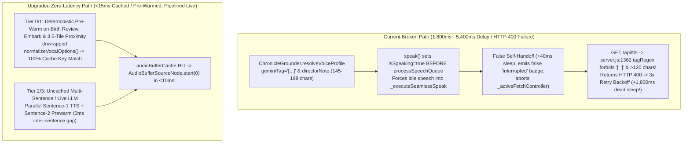
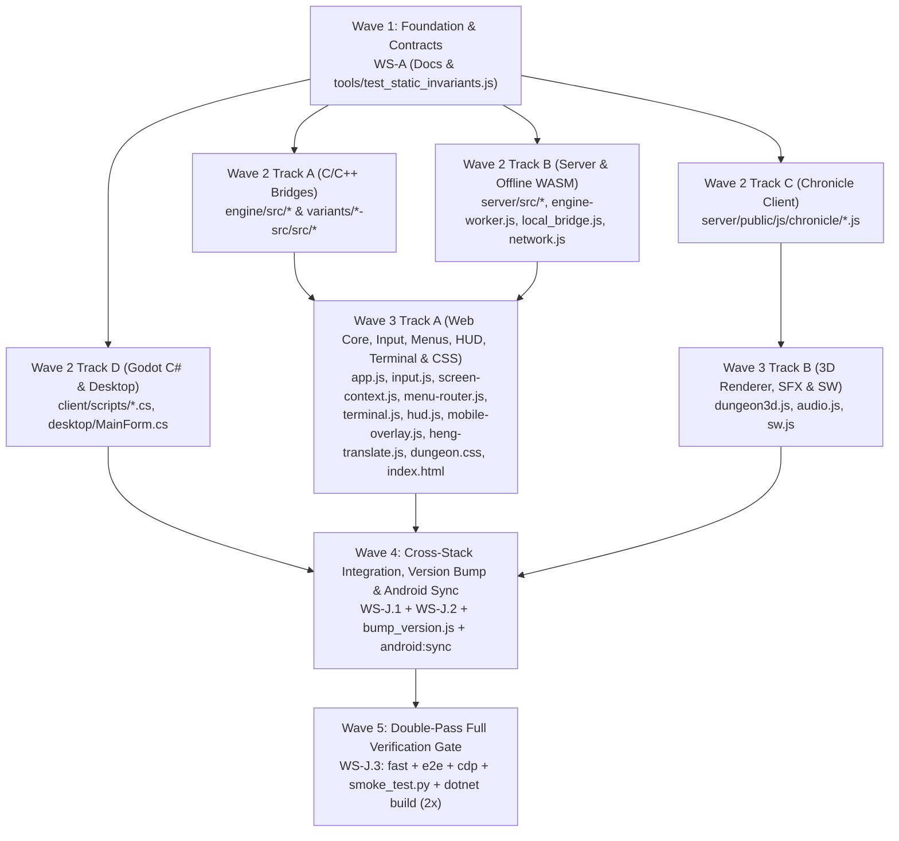

# Angband3D — Comprehensive Architectural Audit & Award-Pass v2 Master Plan

> [!IMPORTANT]
> **Mode**: Strictly **Planning & Audit Mode** (zero repository files modified).
> **Current Workspace Baseline**: Branch `fix/award-pass` (clean working tree; `smoke_test.py` 11/11 PASS, `dotnet build` 0 warnings / 0 errors, `run_tests.js --tier fast` 16/16 PASS).
> **Scope**: End-to-end audit across all 4 C/C++ roguelike engines, Node.js cloud server, Web Three.js/Canvas/Audio/Chronicle frontend, Offline Emscripten WASM worker, Godot 4 C# native client, Desktop WebView2 wrapper, Android Capacitor APK, test suite, and agent/human documentation.

---

## Part I: Why Previous Agents Struggled — Root-Cause Diagnosis & Governance Overhaul

An investigation of the commit history, incident logs in [STATE.md](file:///c:/Dev/angband3d/docs/STATE.md#L9-L21), and cross-document references reveals **five structural reasons** why previous agents looped, introduced regressions, or claimed "100% PASS" while critical features were broken:

### 1. Five Contradictions Across Authoritative Docs (Context Poisoning)
| # | Contradiction | Where It Lives | Impact on Agents & Contributors |
|---|---|---|---|
| **DOC-1** | **Incomplete Architecture Map in `AGENTS.md`** | [AGENTS.md](file:///c:/Dev/angband3d/AGENTS.md#L6-L66) Step 2 mentions `server/public`, `sw.js`, and `node tools/run_tests.js`, but Section 4 (Key File Map) and Section 5 (Build Commands) only list the original Vanilla C + Godot C# files, omitting `server/src/server.js`, `server/public/js/*`, `variants/*`, `desktop/`, and `android/`. | Agents starting from `AGENTS.md` misunderstand the dual-client (Web + Godot) and 4-realm architecture. |
| **DOC-2** | **Contradictory `-more-` View Routing Rule** | [PROTOCOL.md](file:///c:/Dev/angband3d/docs/PROTOCOL.md#L78-L80) states: *"Clients should show the terminal channel whenever `overlay > 0`, `more` is true, or `awaiting_command` is false."* This directly contradicts [AGENTS.md](file:///c:/Dev/angband3d/AGENTS.md#L39), [LLM_CONTEXT.md](file:///c:/Dev/angband3d/docs/LLM_CONTEXT.md#L39), and [BEST_PRACTICES_AND_LESSONS_LEARNED.md](file:///c:/Dev/angband3d/docs/BEST_PRACTICES_AND_LESSONS_LEARNED.md#L151) (`more == true` -> **STAY IN 3D VIEW**, show HUD banner). | Agents reading `PROTOCOL.md` route `-more-` to Terminal View or auto-dismiss `-more-` prematurely ([app.js:5287](file:///c:/Dev/angband3d/server/public/js/app.js#L5287)). |
| **DOC-3** | **Sil-Q Sunlight Cylinder Contradiction** | [LLM_CONTEXT.md](file:///c:/Dev/angband3d/docs/LLM_CONTEXT.md#L148) (#34) instructs agents to *"instantiate a volumetric additive sunbeam cylinder (`sunbeamMesh`)"*, whereas [BEST_PRACTICES_AND_LESSONS_LEARNED.md](file:///c:/Dev/angband3d/docs/BEST_PRACTICES_AND_LESSONS_LEARNED.md#L1784-L1787) (§35.1) explicitly bans `sunbeamMesh` cylinders as looking like *"glowing plastic pipes"*. | Agents oscillate between adding and removing `sunbeamMesh`. |
| **DOC-4** | **Narrator Fallback Voice Contradiction** | [LLM_CONTEXT.md](file:///c:/Dev/angband3d/docs/LLM_CONTEXT.md#L72) & [L140](file:///c:/Dev/angband3d/docs/LLM_CONTEXT.md#L140) (#26) describe dual voice engines with Edge Neural TTS fallback (`edgeVoicePool`), whereas [BEST_PRACTICES_AND_LESSONS_LEARNED.md](file:///c:/Dev/angband3d/docs/BEST_PRACTICES_AND_LESSONS_LEARNED.md#L1788-L1795) (§35.2) mandates the **Narrator Single-Voice Invariant (Google Gemini `Enceladus` only, zero backup voice)**. | Agents re-introduce fallback narrator voices that violate §35.2. |
| **DOC-5** | **Fabricated Savefile Magic Headers Documented as Fact** | [PROTOCOL.md](file:///c:/Dev/angband3d/docs/PROTOCOL.md#L314), [STATE.md](file:///c:/Dev/angband3d/docs/STATE.md#L83), [server.js:786](file:///c:/Dev/angband3d/server/src/server.js#L786), and [Main.cs:962](file:///c:/Dev/angband3d/client/scripts/Main.cs#L962) claim Sil-Q, FrogComposBand, and Hengband savefiles start with 8-byte ASCII magic strings `SaveSILQ`, `SaveFROX`, and `SaveHENG`. In reality, **only Vanilla Angband** ([savefile.c:81-82](file:///c:/Dev/angband3d/engine/src/savefile.c#L81-L82)) writes `SaveVNLA`; the 3 variants ([silq-src/src/save.c](file:///c:/Dev/angband3d/variants/silq-src/src/save.c), [frogcomposband-src/src/save.c](file:///c:/Dev/angband3d/variants/frogcomposband-src/src/save.c)) write 4-byte binary version headers + XOR streams. | Real variant savefiles are rejected by `/api/saves/upload` ([server.js:1765-1773](file:///c:/Dev/angband3d/server/src/server.js#L1765-L1773)) and `readSaveMetadata` ([server.js:792-804](file:///c:/Dev/angband3d/server/src/server.js#L792-L804)). |

### 2. Monolithic God-Files & Silent Overwrites
* [dungeon3d.js](file:///c:/Dev/angband3d/server/public/js/dungeon3d.js) (**9,278 lines / 455 KB**), [chronicle-grounder.js](file:///c:/Dev/angband3d/server/public/js/chronicle/chronicle-grounder.js) (**5,390 lines / 399 KB**), [app.js](file:///c:/Dev/angband3d/server/public/js/app.js) (**5,453 lines / 272 KB**), [DungeonWorld.cs](file:///c:/Dev/angband3d/client/scripts/DungeonWorld.cs) (**~4,500 lines / 223 KB**), [MonsterModelResolver.cs](file:///c:/Dev/angband3d/client/scripts/MonsterModelResolver.cs) (**~3,650 lines / 244 KB**), [server.js](file:///c:/Dev/angband3d/server/src/server.js) (**3,053 lines / 138 KB**), [Main.cs](file:///c:/Dev/angband3d/client/scripts/Main.cs) (**~2,850 lines / 107 KB**), [input.js](file:///c:/Dev/angband3d/server/public/js/input.js) (**2,535 lines / 116 KB**), and [hud.js](file:///c:/Dev/angband3d/server/public/js/hud.js) (**2,329 lines / 110 KB**) have grown so large that agents appending methods at the bottom of classes **silently overwrote existing methods** in the same class:
  * `WebHUD.setPing(ms)` defined at [hud.js:130](file:///c:/Dev/angband3d/server/public/js/hud.js#L130-L139) is overwritten by a broken 4-line duplicate at [hud.js:2321](file:///c:/Dev/angband3d/server/public/js/hud.js#L2321-L2325).
  * `WebTerminal.decodeText(str)` defined at [terminal.js:285](file:///c:/Dev/angband3d/server/public/js/terminal.js#L285-L310) is overwritten by a duplicate at [terminal.js:424](file:///c:/Dev/angband3d/server/public/js/terminal.js#L424-L440).
  * `ChronicleManager.getActiveRealm()` is defined twice ([chronicle-manager.js:776](file:///c:/Dev/angband3d/server/public/js/chronicle/chronicle-manager.js#L776-L784) and [L813](file:///c:/Dev/angband3d/server/public/js/chronicle/chronicle-manager.js#L813-L818)).
  * `ChronicleAudio.isStaging` getter is defined twice ([chronicle-audio.js:126](file:///c:/Dev/angband3d/server/public/js/chronicle/chronicle-audio.js#L126-L128) and [L414](file:///c:/Dev/angband3d/server/public/js/chronicle/chronicle-audio.js#L414-L416)).
  * `window.__app` is assigned in **4 separate places** in [app.js](file:///c:/Dev/angband3d/server/public/js/app.js#L252-L265) (`L252`, `L1197`, `L3855`, `L4835`) with overlapping property definitions.

### 3. Upgraded Executor Rules (Additions L23–L34)
To ensure both humans and autonomous agents can work safely and deterministically:
* **L23 (No Duplicate Class Members / Globals)**: Before adding a method to any class or assigning to `window.__app`, run `Select-String` across the file for the method name. Enforce a fast static AST/regex gate (`tools/test_no_duplicate_methods.js`) in the `fast` tier.
* **L24 (Verify Binary Formats Against C/C++ Source)**: Never guess binary savefile headers or wire field names. Always verify against `engine/src/` and `variants/*-src/src/` and test against an actual engine-generated artifact.
* **L25 (Zero Per-Frame DOM/GPU Reallocation)**: Any code running inside `onFrame`, `update(frame)`, `updateTerminalToolbar`, `_Process`, or `_Draw` MUST be guarded by a state-change signature or dirty check. Never assign `innerHTML`, `canvas.width`, or `new THREE.CanvasTexture` on every frame when data is unchanged.
* **L26 (Explicit Three.js / Godot Resource Disposal)**: Every dynamically removed `THREE.Sprite`, `THREE.Mesh`, `CanvasTexture`, `BufferGeometry`, `Material`, or Godot `Mesh`/`Material` must be explicitly disposed (unless in a shared static cache).
* **L27 (Cross-Bridge Schema Parity Contract)**: All 4 C/C++ bridges (`Vanilla`, `Sil-Q`, `FrogComposBand`, `Hengband`) must pass a unified JSON schema contract test (`tools/test_bridge_schema_parity.js`) verifying identical field names (`hp_max`, `player: null`, `map: null`, `messages: [{text, count, attr}]`, `detail`/`message`).
* **L28 (State-Machine Reset on View Exit)**: Any multi-step client state machine (`MenuRouter.pending`, `birthReviewActive`, `_silqStatAllocated`) MUST self-clear in `onFrame` whenever the underlying screen mode changes (`classifier.mode !== expectedMode`) AND whenever any Escape/Close UI button is clicked.
* **L29 (3D Mode Prompt Routing)**: When `needsTerminal(frame)` intentionally keeps a prompt in 3D World View (e.g., `"Direction?"`, `"Target:"`, `ui.more`), `handleWorldKey` (`input.js`) and `_UnhandledKeyInput` (`Main.cs`) MUST route directional, target-confirm (`5`/`.`/`t`/`*`/`space`), and cancel (`Escape`) keys to the prompt instead of spinning the camera yaw or sending Hold (`,`).
* **L30 (Documentation Single-Source Hierarchy)**:
  * `AGENTS.md` = 1-page entry point & build/test commands for all stacks.
  * `docs/STATE.md` = Live task checklist & gate outputs only.
  * `docs/LLM_CONTEXT.md` = Concise file index & active invariants (must never contradict `BEST_PRACTICES`).
  * `docs/PROTOCOL.md` = Exact wire & REST contract verified by contract tests.
  * `docs/BEST_PRACTICES_AND_LESSONS_LEARNED.md` = Deep architectural rationale & post-mortems.
* **L31 (Narrator Single-Voice Invariant — `Enceladus` Only)**: Across all 4 realms, the Master Narrator (`role === 'narrator'`) MUST always use Google Gemini voice `'Enceladus'` with zero Edge Neural or `speechSynthesis` fallback. Differentiate realms via directorial cadence notes, never by swapping narrator voice models.
* **L32 (Deterministic Pre-Warm & Cache-Key Symmetry)**: Speculative pre-warming (`prewarmUtterance`, `_speculativePrewarmProximity`, `prewarmBeat`) MUST use deterministic text selection (never `Math.random()`) and pass the exact same unwrapped `options` object (`normalizeVocalOptions(options)`) into `getAudioCacheKey` as live playback (`fetchOrGetAudioBuffer`, `playNeuralAudio`).
* **L33 (Server Parameter Validation Must Match Client Payloads)**: Any server regex validating client query/body fields (e.g., `tagRegex` on `/api/tts`) must be contract-tested against all values produced by `ChronicleGrounder.resolveVoiceProfile`. Never retry `HTTP 400` client errors in `fetchOrGetAudioBuffer`.
* **L34 (Never Mutate `isSpeaking` Before Playback Starts)**: `ChronicleAudioRouter.speak()` must never set `this.isSpeaking = true` before `processSpeechQueue()` inspects whether audio is currently active; otherwise idle utterances trigger false self-handoffs and false `⚡ Interrupted` badges.

---

## Part II: Master Audit Register Across All Subsystems

### Domain A: C/C++ Engine Bridges (`Vanilla`, `Sil-Q`, `FrogComposBand`, `Hengband`)

| ID | Sev | Location | Defect & Root Cause | Concrete Fix |
|---|---|---|---|---|
| **ENG-1** | **P0** | [silq/main-bridge.c:733](file:///c:/Dev/angband3d/variants/silq-src/src/main-bridge.c#L733), [fcb/main-bridge.c:932](file:///c:/Dev/angband3d/variants/frogcomposband-src/src/main-bridge.c#L932), [heng/main-bridge.cpp:912](file:///c:/Dev/angband3d/variants/hengband-src/src/main-bridge.cpp#L912), [server.js:2412](file:///c:/Dev/angband3d/server/src/server.js#L2412) | **Null Pointer Dereference (`SIGSEGV`) on Bare `"key"` Command**: When `"key"` is sent with no argument, `rest = strtok(NULL, "")` is `NULL`, and `streq(rest, "5")` / `streq(rest, "up")` calls `strcmp(NULL, ...)` before `bridge_keycode`. Worse, `sanitizeEngineCommand('key')` in `server.js:2410` allows bare `'key'`! | In all 3 variant bridges, add `if (!rest || !*rest) { emit_event("error", "bad key"); return 0; }`. In `server.js:2412`, reject `verb === 'key' || verb === 'keys'` when `sp === -1`. |
| **ENG-2** | **P0** | [silq/main-bridge.c:586-615](file:///c:/Dev/angband3d/variants/silq-src/src/main-bridge.c#L586-L615), [fcb/main-bridge.c:780-809](file:///c:/Dev/angband3d/variants/frogcomposband-src/src/main-bridge.c#L780-L809) | **Stack Buffer Overflow in `emit_term()`**: Declares `char row_attr[256];` and writes `2 * w + 1` bytes without clamping `w = t->wid`. If `t->wid >= 128`, `row_attr[w * 2]` overflows the stack buffer by up to 255 bytes. | Allocate `char row_attr[256 * 2 + 1];` and clamp `if (w > 256) w = 256; if (h > 60) h = 60;` (matching Vanilla [engine/src/main-bridge.c:812-823](file:///c:/Dev/angband3d/engine/src/main-bridge.c#L812-L823)). |
| **ENG-3** | **P1** | [silq/main-bridge.c:337-344](file:///c:/Dev/angband3d/variants/silq-src/src/main-bridge.c#L337-L344) | **Unchecked `p_ptr` Dereference Before `bridge_in_play()`**: `emit_map()` reads `p_ptr->cur_map_hgt` at line 337 before calling `bridge_in_play()` (which checks `if (!p_ptr)`) at line 344. | Move `if (!bridge_in_play()) { fputs("null", fp); return; }` to the first line of `emit_map()`. |
| **ENG-4** | **P1** | [heng/main-bridge.cpp:1232-1235](file:///c:/Dev/angband3d/variants/hengband-src/src/main-bridge.cpp#L1232-L1235) | **Non-Null-Terminated `std::string_view::data()`**: `quit_aux` passes `str.data()` directly to `emit_event("bye", ...)`, which expects a null-terminated `const char*`. | Use `std::string s(str); emit_event("bye", s.empty() ? nullptr : s.c_str());`. |
| **ENG-5** | **P1** | [fcb/main-bridge.c:47-63, 103](file:///c:/Dev/angband3d/variants/frogcomposband-src/src/main-bridge.c#L47-L63), [heng/main-bridge.cpp:93-105](file:///c:/Dev/angband3d/variants/hengband-src/src/main-bridge.cpp#L93-L105) | **Root Cause of Known Issue K1**: In FCB, the multi-line welcome message wraps across 8 rows of `_msg_line_doc`, placing `-more-` on row 6–8 while `bridge_has_more()` only scans rows `0..1` (`for (r = 0; r <= 1 ...)`), emitting `more: false` and `awaiting_command: false`, which forces Terminal View. In Hengband JP mode, `bridge_has_more()` only checks ASCII `"-more-"` and misses Shift-JIS `"-続く-"` (`"\x2d\x91\xb1\x82\xad\x2d"`) and `msg_flag`. | In FCB `bridge_has_more()`, scan `r < 10 && r < t->hgt`. In Hengband `bridge_has_more()`, check `msg_flag` and scan rows `0..4` for both `"-more-"` and `"\x2d\x91\xb1\x82\xad\x2d"`. |
| **ENG-6** | **P1** | [server.js:2981](file:///c:/Dev/angband3d/server/src/server.js#L2981), [network.js:237-244](file:///c:/Dev/angband3d/server/public/js/network.js#L237-L244), all 4 bridges `emit_event("error", detail)` | **Root Cause of Known Issue K3**: (1) The 60s checkpoint timer in `server.js:2981` omits `session.phase === 'play'` and sends `save\n` to engines still in `setup` (birth), triggering `{"t":"error","detail":"not in play"}`. (2) C bridges emit `"detail"`, while `network.js:238` logs `msg.message` (`undefined`) and sets `this.manualDisconnect = true`, killing auto-reconnect for the whole session! | Add `session.phase === 'play'` to `server.js:2981`. In `network.js:238`, read `const errMsg = msg.message || msg.detail || 'Game engine error'`, and ignore non-fatal `"not in play"` without setting `manualDisconnect = true`. |
| **ENG-7** | **P1** | [heng/main-bridge.cpp:320-327, 515-521, 554-564, 682, 738-748, 848-852](file:///c:/Dev/angband3d/variants/hengband-src/src/main-bridge.cpp#L320-L852) | **Hengband Bridge Schema Divergence (6 Protocol Violations)**: (1) Emits `"player":{"y":0,"x":0}` instead of `null` when `!bridge_in_play()`, breaking `if (!frame.player)` checks. (2) Emits `"map":{"h":0,"w":0,"rows":[]}` instead of `null` when `!bridge_in_play()`, and omits `"map"` when `!emit_map_data`. (3) Emits monster `"max_hp"` instead of `"hp_max"` (breaking Web `m.hp_max` reads at `dungeon3d.js:5843, 8011`). (4) Emits `messages` as raw strings instead of `{text, count, attr}`. (5) Emits `stats.<s >.use` as string `"18/50"`. | Align `hengband-src/src/main-bridge.cpp` with `PROTOCOL.md` (`null` player/map when `!bridge_in_play()`, emit both `"hp_max"` and `"max_hp"`, emit `{text, count, attr}` objects in `messages`). |
| **ENG-8** | **P2** | [silq/main-bridge.c:107-275, 521-555](file:///c:/Dev/angband3d/variants/silq-src/src/main-bridge.c#L107-L275), [heng/main-bridge.cpp:318-528](file:///c:/Dev/angband3d/variants/hengband-src/src/main-bridge.cpp#L318-L528), [fcb/main-bridge.c:341-401](file:///c:/Dev/angband3d/variants/frogcomposband-src/src/main-bridge.c#L341-L401) | **E34 — Missing Structured `player.inventory[]` & `player.equipment[]` in Sil-Q and Hengband**: Vanilla and FCB emit `player.inventory[]` and `player.equipment[]`, whereas Sil-Q and Hengband omit them (and Sil-Q `objects[]` omits `tval`, `sval`, `number`, `weight`, `pile` and uses raw kind name instead of `object_desc()`). FCB `inventory[]` omits `label` and `attr`. | Add `player.equipment[]` and `player.inventory[]` (with `slot`, `label`, `name`, `tval`, `sval`, `number`, `weight`, `attr`) to Sil-Q and Hengband bridges; add `label`/`attr` to FCB; enrich Sil-Q `objects[]`. |
| **ENG-9** | **P2** | [engine/src/main-bridge.c:117, 151-153, 582-586](file:///c:/Dev/angband3d/engine/src/main-bridge.c#L117-L586) & all 3 variants | **Per-Frame `malloc`/`free` in `emit_map()` & Potential `player_exp[-1]` Underflow**: All 4 bridges call `malloc`/`free` 4 times per frame in `emit_map()` without `NULL` checks instead of static buffers; Vanilla `emit_player()` accesses `player_exp[player->lev - 1]` without guarding `player->lev > 1` or `bridge_in_play()`. | Replace per-frame `malloc`/`free` in `emit_map()` with static buffers (`MAX_WID <= 256`); guard `player->lev > 1` and `bridge_in_play()` in Vanilla `emit_player()`. |

---

### Domain B: Server, Security, Vulnerability & Persistence (`server/src/`, `local_bridge.js`, `engine-worker.js`)

| ID | Sev | Location | Defect & Root Cause | Concrete Fix |
|---|---|---|---|---|
| **SEC-1** | **P0** | [engine-worker.js:169-187, 226-245](file:///c:/Dev/angband3d/server/public/js/engine-worker.js#L169-L245), [local_bridge.js:48-59, 117-131](file:///c:/Dev/angband3d/server/public/js/local_bridge.js#L48-L131) | **Fatal Offline WASM Save Overwrite & Deletion Resurrection Bug**: On Save #1, `engine-worker.js:173-180` writes both `/lib/save/Hero` and `/lib/save/Hero.sav` guarded by `if (!...exists)`. On Save #2+, the engine updates `/lib/save/Hero`, but because `/lib/save/Hero.sav` already exists, `!exists` is `false` and `Hero.sav` remains frozen at Save #1! Then `listSaves()` (`local_bridge.js:48-59`) iterates keys alphabetically (`Hero` then `Hero.sav`), overwriting `savesMap['Hero']` with `filename: 'Hero.sav'`. On reload, `preRun` (`engine-worker.js:233-235`) copies the stale `Hero.sav` OVER `Hero`, **wiping out the player's progress**! And `deleteSave()` only deletes one key, so the remaining alias resurrects the deleted character! | In `engine-worker.js:173-185`, remove the `!exists` guard so the newly saved file always overwrites its `.sav` / base alias in MEMFS before `FS.syncfs(false)`. In `LocalSaveManager.listSaves()` (`local_bridge.js:41-66`), read `record.timestamp`, deduplicate `Hero` vs `Hero.sav` by newest timestamp, and sort descending. In `deleteSave()` (`local_bridge.js:121`), delete both `/lib/save/${base}` and `/lib/save/${base}.sav`. |
| **SEC-2** | **P1** | [app.js:1456-1470](file:///c:/Dev/angband3d/server/public/js/app.js#L1456-L1470), [app.js:3688-3699](file:///c:/Dev/angband3d/server/public/js/app.js#L3688-L3699), [app.js:3948-3955](file:///c:/Dev/angband3d/server/public/js/app.js#L3948-L3955), [hud.js:2307-2315](file:///c:/Dev/angband3d/server/public/js/hud.js#L2307-L2315) | **Stored XSS in Save Slot Cards & Unescaped `innerHTML` Sinks**: `renderSaveListUI` (`app.js:1460-1461`) injects `${save.characterName || save.filename}` and `${save.description}` into `innerHTML` without `escapeHtml()`. `renderCtxButtons` (`app.js:3954`) and `renderCommandPalette` (`app.js:3688`) also omit `escapeHtml()`. Conversely, `showRealmToast` (`app.js:3165, 3250, 3290`) double-escapes `<strong>` tags, rendering literal `<strong>` text on screen. | Wrap all dynamic fields in `renderSaveListUI`, `renderCtxButtons`, `renderCommandPalette`, and `hud.js:2307` in `escapeHtml()`. Refactor `showRealmToast(prefix, boldText, icon)` so `<strong>` is structural HTML and `prefix`/`boldText` are escaped. |
| **SEC-3** | **P1** | [http-guard.js:12, 30](file:///c:/Dev/angband3d/server/src/http-guard.js#L12-L30), [server.js:865-875](file:///c:/Dev/angband3d/server/src/server.js#L865-L875) | **CSRF / Origin Bypass via Untrusted `X-Forwarded-Host`**: `http-guard.js:12` sets `effectiveHost` from `req.headers['x-forwarded-host']` unconditionally, even when `TRUST_PROXY !== '1'`. A direct caller sending `Origin: https://evil.example` and `X-Forwarded-Host: evil.example` matches `effectiveHost` and bypasses `guardMutation()`. | Only honor `x-forwarded-host` when `process.env.TRUST_PROXY === '1'`; otherwise use `req.headers.host`. |
| **SEC-4** | **P1** | [server.js:2684-2686](file:///c:/Dev/angband3d/server/src/server.js#L2684-L2686) | **WebSocket Backpressure `return` vs `continue` Bug**: Inside `while ((newlineIdx = lineBuffer.indexOf('\n')) !== -1)`, if `session.ws.bufferedAmount > 65536`, line 2685 executes `return;` instead of `continue;`, stranding all remaining lines (`{"t":"ok","detail":"saved"}`, `{"t":"bye"}`, or the final frame) inside `lineBuffer` indefinitely! | Change `return;` at `server.js:2685` to `continue;`. |
| **SEC-5** | **P1** | [server.js:785-804, 1763-1773](file:///c:/Dev/angband3d/server/src/server.js#L785-L804), [app.js:1616-1621](file:///c:/Dev/angband3d/server/public/js/app.js#L1616-L1621), [Main.cs:962](file:///c:/Dev/angband3d/client/scripts/Main.cs#L962) | **Broken Multi-Realm Save Upload & Metadata Detection**: `app.js:1617` rejects any savefile not starting with `'SaveVNLA'`, and `server.js:1765-1773` only accepts `'SaveVNLA'`, `'SaveSILQ'`, `'SaveFROX'`, `'SaveHENG'`. Because Sil-Q, FCB, and Hengband engines write 4-byte binary version headers (`sf_major, sf_minor, sf_patch, sf_extra`), real variant savefiles cannot be uploaded! | Accept `?realm=<realm>` or `X-Realm: <realm>` on `POST /api/saves/upload`, validate binary header per realm (`SaveVNLA` for `angband`; valid 4-byte version header + size bounds `>= 36` and `<= 10MB` and non-HTML/JSON for `silq`/`frogcomposband`/`hengband`), write a `.realm.json` sidecar on upload, and update `app.js:1617` + `Main.cs:962`. |
| **SEC-6** | **P1** | [server.js:2350, 2878](file:///c:/Dev/angband3d/server/src/server.js#L2350-L2878) | **Known Issue K5 — Grace-Period Sessions Exhaust `MAX_CONCURRENT_GAMES`**: Disconnected sessions remain in `activeSessions` for 60s (`setup`) or 15m (`play`). When `activeSessions.size >= MAX_CONCURRENT_GAMES`, new players are queued/rejected even if 45 of 50 sessions are disconnected tabs! Also lacks a per-IP session cap. | When `activeSessions.size >= MAX_CONCURRENT_GAMES` (or when a single IP exceeds 3 sessions), evict the oldest disconnected (`session.ws === null`) session via `gracefulSessionSaveAndExit()` before queuing. |
| **SEC-7** | **P2** | [network.js:304-319](file:///c:/Dev/angband3d/server/public/js/network.js#L304-L319), [local_bridge.js:275-282](file:///c:/Dev/angband3d/server/public/js/local_bridge.js#L275-L282) | **Cloud `saveGame()` 300ms Race & Local `onSavePersisted` Clobber**: `GameNetwork.saveGame()` resolves after a blind `setTimeout(r, 300)` and closes the socket without waiting for `{"t":"ok","detail":"saved"}`. `LocalGameBridge.saveGame()` overwrites `this.onSavePersisted = null`, destroying `app.js:5422`'s listener. | In `GameNetwork.saveGame()`, await `detail === 'saved'` (with 2000ms fallback timeout). In `LocalGameBridge.saveGame()`, restore the previous `onSavePersisted` callback after resolving. |
| **SEC-8** | **P2** | [server.js:2289-2325, 2594-2595, 2653](file:///c:/Dev/angband3d/server/src/server.js#L2289-L2658), [rate-limit.js:5-12](file:///c:/Dev/angband3d/server/src/rate-limit.js#L5-L12) | **Node Event-Loop Stalls & Process Cleanup**: (1) `server.js:2595` uses a synchronous busy-wait `while (Date.now() < sleepUntil) {}` blocking the whole server for 150–300ms. (2) `server.js:2653` runs `JSON.parse(line)` on every 100 KB frame just to extract `phase` and `player.dead`. (3) `gracefulSessionSaveAndExit` lacks a final `SIGKILL` escalation if `SIGTERM` hangs. (4) `rate-limit.js` lacks a `maxEntries` cap against IP-flood memory growth. | Replace busy-wait with async delay; extract `phase` and `"dead":true` via lightweight regex/substring on `line` in `server.js:2653`; add `SIGKILL` fallback timer; cap `rate-limit.js` map size to 10,000 entries. |

---

### Domain C: Playability, Menu Systems, Input & Localization (`app.js`, `input.js`, `screen-context.js`, `menu-router.js`, `realm-keys.js`, `mobile-overlay.js`)

| ID | Sev | Location | Defect & Root Cause | Concrete Fix |
|---|---|---|---|---|
| **PLAY-1** | **P0** | [app.js:3767, 3709-3713, 3565-3638](file:///c:/Dev/angband3d/server/public/js/app.js#L3565-L3767) | **Command Palette (`Ctrl+K`) Crashes on `Enter` & Sends Wrong Keys**: Line 3767 references undeclared `COMMAND_REGISTRY` (`ReferenceError`). `executePaletteCommand` calls non-existent `input.handleDirectKey`, falling back to raw `sendKey`, which sends `' '` instead of `'space'`, `'Tab'` instead of `toggleTerminal()`, `'R'` without `'enter'`, and swaps Wand (`'a'`) and Rod (`'z'`). | Replace `COMMAND_REGISTRY` with `getRealmCommandRegistry(activeRealm, langMode)`; fix Wand (`'a'`) vs Rod (`'z'`); route UI/composite commands through `InputController`. |
| **PLAY-2** | **P0** | [input.js:1099-1259, 1561-1567](file:///c:/Dev/angband3d/server/public/js/input.js#L1099-L1259) | **3D Directional Targeting (`*`, `t`, `f`, `z`, `a`, `m`) & Look (`l`) Hijacked in 3D View**: `needsTerminal()` keeps directional targeting in 3D view, but `handleWorldKey` unconditionally maps `Digit5`/`Numpad5`/`.`/rosette-center to `holdKey` (`','` instead of `'t'`), maps `ArrowLeft`/`ArrowRight` to camera-only yaw rotation (sending nothing to the engine!), and maps `Space` to `executeSmartAction()`. | Check `ScreenContext.needsTerminalFlags(frame, decode)?.isDirectionalTargeting` in `handleWorldKey` and `#directional-aim-rosette`: when targeting is active, `5`/`.`/`t`/center sends `'t'` (**⚠️ Guardrail**: never write literal `sendKey('5')` in `input.js` because `tools/test_realm_keys.js:174` forbids `sendKey('5')`!), `Space` sends `'space'`, and arrow keys send relative direction keys without spinning camera yaw. |
| **PLAY-3** | **P0** | [input.js:1283-1291](file:///c:/Dev/angband3d/server/public/js/input.js#L1283-L1291), [realm-keys.js:19-41, 88-101](file:///c:/Dev/angband3d/server/public/js/realm-keys.js#L19-L101) | **`handleWorldKey` Swallows Native Sil-Q `'r'` (Remove Gear) & `'b'` (Bash) in 3D View**: `REALM_KEYS.angband` maps `read: 'r'` and `browse: 'b'` to `null` in `silq` (which is pinned by `tools/test_realm_keys.js:116` and `tools/fixtures/realm_keys/angband.json`). In `handleWorldKey` (`input.js:1285`), `if (mapped === null) return;` swallows `'r'` and `'b'` in Sil-Q! | Do **NOT** modify `realm-keys.js` (keeping `test_realm_keys.js` 100% green). Instead, in `input.js:1283-1291`, before discarding `mapped === null`, if `realm === 'silq' && (e.key === 'r' || e.key === 'b')`, dispatch `this.network.sendKey(e.key)` directly! |
| **PLAY-4** | **P0** | [menu-router.js:279-393](file:///c:/Dev/angband3d/server/public/js/menu-router.js#L279-L393), [app.js:737, 753, 943, 4857-4859](file:///c:/Dev/angband3d/server/public/js/app.js#L737-L753) | **`MenuRouter` Trapped Terminal State & Missing `Enter` Confirm in Chooser**: (1) Clicking `#btn-term-escape` while `pending.step === 'chooser'` sends `'escape'` without calling `MenuRouter.clearPending()`, and `MenuRouter.onFrame` never clears `step === 'chooser'` when `classifier.mode !== 'item-list'`, trapping the player in Terminal View! (2) While `step === 'chooser'`, `MenuRouter.route` (`L279-302`) handles `Escape` and verb keys (`verbsForRealm[key]`), but does not handle `Enter` (`determineSuggestedVerb`). | (1) In `MenuRouter.onFrame`, clear `pending` whenever `pending.step === 'chooser' && (!classifier || classifier.mode !== 'item-list')`, and call `MenuRouter.clearPending()` in all `#btn-term-escape` click handlers (`app.js:737, 753, 943`). (2) In `MenuRouter.route` when `pending.step === 'chooser'`, handle `key === 'Enter' || key === 'enter'` by invoking `chooseVerb(determineSuggestedVerb(pending.item, pending.listKind, realm))`. |
| **PLAY-5** | **P0** | [screen-context.js:741-746, 785-804](file:///c:/Dev/angband3d/server/public/js/screen-context.js#L741-L804), [menu-router.js:305-353](file:///c:/Dev/angband3d/server/public/js/menu-router.js#L305-L353) | **Classifier Precedence Masks `yesno`/`quantity` Prompts & Missing `verbPrompt` Verbs**: (1) `classify()` checks `if (tb.isItemPrompt) mode = 'item-list'` *before* `pf.isYesNoPrompt` and `pf.isQuantityPrompt`, masking `"Quantity (1-5):"` and `"Really destroy [y/n]?"` whenever inventory rows remain on screen! (2) `verbPrompt` (`screen-context.js:785-804`) is missing `eat`, `use`, `aim`, `zap`, `activate`, `inscribe`, `uninscribe`, `refill`, `cast`, `browse`, `study`, causing `isAngbandSelect` to hijack item selection during `"Eat which item?"`! | (1) Check `isYesNoPrompt` and `isQuantityPrompt` before `isItemPrompt` in `classify()`. (2) Add all missing verb prompt patterns to `verbPrompt` and restrict `isAngbandSelect` to `promptKind === 'inven' || promptKind === 'equip'`. (**⚠️ Guardrail**: Do not alter `MenuRouter.chooseVerb` key emission for Vanilla because `tools/test_menu_router.js:198-200` pins `sentKeys = ['w']`; after updating `screen-context.js`, run `node tools/test_screen_context.js --update` if any fixture snapshot shifts). |
| **PLAY-6** | **P1** | [menu-router.js:60-118, 192-238, 316](file:///c:/Dev/angband3d/server/public/js/menu-router.js#L60-L316) | **Rod vs. Wand Suggestion Bug & Missing Verbs**: `if (glyph === '-') return 'a'` at line 231 runs before `if (label.includes('rod')) return 'z'` at line 235, so Rods always suggest Aim Wand (`'a'`). `VERBS` is missing `f` (Fire), `b` (Browse), `G` (Study), `{` (Inscribe), `}` (Uninscribe), and line 316 ignores `[A-Z0-9]` item slots. | Check `label.includes('rod')` before `glyph === '-'`; distinguish spellbooks from scrolls (`?`) and chests/lights (`~`); add `f`, `b`, `G`, `{`, `}` to `VERBS`; widen item-key match to `/^[a-zA-Z0-9]$/`. |
| **PLAY-7** | **P1** | [app.js:5285-5297](file:///c:/Dev/angband3d/server/public/js/app.js#L5285-L5297), [input.js:985-989](file:///c:/Dev/angband3d/server/public/js/input.js#L985-L989) | **Premature `-more-` Auto-Dismissal & Numpad Digit Hijacking in Prompts**: `app.js:5295` automatically sends `network.sendKey('space')` on every 3D `frame.ui.more` frame, dismissing `-more-` banners before the player can read them and racing with `input.js:1116`. In `handleTerminalKey` (`input.js:985`), `Numpad8/2/4/6/5` are converted to arrow/enter keys even inside numeric quantity/rest/inscription prompts! | Remove automatic `sendKey('space')` in `app.js:5285-5297` so the 3D HUD `-more-` banner works as designed. In `handleTerminalKey`, send digit characters `'0'`–`'9'` when `isQuantityPrompt` / `isNamePrompt` / `isInscriptionPrompt` is active or NumLock produces digits. |
| **PLAY-8** | **P1** | [mobile-overlay.js:34-288](file:///c:/Dev/angband3d/server/public/js/mobile-overlay.js#L34-L288), [screen-context.js:283-320](file:///c:/Dev/angband3d/server/public/js/screen-context.js#L283-L320) | **Broken Birth Review Card & Point-Buy Classification Across Realms**: `MobileOverlay.parseHero` hardcodes Vanilla's 5 stats (`STR..CON`), English regexes, and fake fallback skills (`Saving Throw: 30%`), breaking Sil-Q (`STR, DEX, CON, GRA` + `Voice` + 8 skills), FCB/Hengband (`CHR` 6th stat + 2-page character sheet), and JP Hengband (`decodeHengbandText` not called). `birthFlags.isStatRoller` misses Sil-Q's `"allocate points to stats/skills"` screens. | Make `MobileOverlay` realm-aware and JP-decoded (`4 stats + 8 skills` for Sil-Q, `6 stats + Page 2 button` for FCB/Hengband, zero fabricated fallback values), and add Sil-Q point-buy patterns to `birthFlags.isStatRoller`. |

---

### Domain D: Performance, Lag Reduction, VRAM/RAM Leaks & Bloat (`dungeon3d.js`, `app.js`, `hud.js`, `terminal.js`, `audio.js`, `chronicle/*.js`, `sw.js`)

| ID | Sev | Location | Defect & Root Cause | Concrete Fix |
|---|---|---|---|---|
| **PERF-1** | **P0** | [dungeon3d.js:4478-4480](file:///c:/Dev/angband3d/server/public/js/dungeon3d.js#L4478-L4480), [chronicle-llm.js:316-319, 765](file:///c:/Dev/angband3d/server/public/js/chronicle/chronicle-llm.js#L316-L765), [chronicle-manager.js:686, 2466](file:///c:/Dev/angband3d/server/public/js/chronicle/chronicle-manager.js#L686-L2466) | **Three Uncaught Runtime Exceptions**: (1) `applyGraphicsConfig()` calls non-existent `this.updateMap(this.lastMap)` (`TypeError`). (2) `chatWithCreature()` references undeclared `turn` (`ReferenceError`) and is unguarded at `chronicle-manager.js:2466`. (3) `testConnection(prov, key, model, endpoint)` passes `prov` (`'gemini'`) into `testConnection(model)`, overwriting `this.model = 'gemini'`. | (1) Call `if (this.lastFrame) this.updateDungeon(this.lastFrame);`. (2) Define `const turn = player?.turn || 0;` in `chatWithCreature` and wrap `chronicle-manager.js:2466` in `try/catch`. (3) Fix `testConnection` signature in `chronicle-llm.js:765`. |
| **PERF-2** | **P0** | [dungeon3d.js:1958, 1986, 2002, 2059, 2759-2814](file:///c:/Dev/angband3d/server/public/js/dungeon3d.js#L1958-L2814) | **Severe VRAM Leak (~26 MB/floor) & 150ms Level-Transition Freeze in `contextualTextureCache`**: `resolveContextualTheme` embeds `${depth}` into `theme.id` (`ang_ch${chapter}_sub${sub}_d${depth}`), even though the 10 procedural 512×512 textures only depend on `(realm, chapter, sub)`. Every level change misses the cache, synchronously generates 2.62M pixels on the main thread, and caches 10 `CanvasTexture`s forever without `.dispose()`. | Remove `_d${depth}` from `theme.id` so all levels in the same `(realm, chapter, sub)` share cached textures; cap `contextualTextureCache` at 4 entries (LRU) with explicit `.dispose()` on eviction; skip generating the 7 startup textures in `initTextures()` that are immediately overwritten by `applyEnvironmentTextures()`. |
| **PERF-3** | **P0** | [dungeon3d.js:4012, 5676-5710, 5748-5853, 6353 vs 9135, 7746-7820, 8095 vs 9028, 8101-8180, 8764-8769, 9011-9015](file:///c:/Dev/angband3d/server/public/js/dungeon3d.js#L5676-L9151) | **Continuous WebGL Texture/Geometry/Material Leaks & Duplicate `destroyEntity`/`playHitReaction` Definitions**: `DungeonRenderer` defines `destroyEntity` twice (`L6353` and `L9135`) and `playHitReaction` twice (`L8095` and `L9028`), so the later definitions silently overwrite the earlier ones! Removing monster nameplates (on every HP change in combat!), terrain labels, despawned/dead monsters, picked-up items, and hit-spark `SphereGeometry`s leaks `CanvasTexture`, `SpriteMaterial`, or `BufferGeometry`. Also, `createFoggyMonsterAura` allocates 4 geometries per visible monster even when `visible = false`. | Merge and delete duplicate `destroyEntity` (`L6353`) and `playHitReaction` (`L8095`); invoke `destroyEntity` on all nameplate, terrain label, monster, and item removals; share a single static `SphereGeometry` for hit sparks; lazily create or share geometries for `foggyAura`. |
| **PERF-4** | **P0** | [dungeon3d.js:4842-5616](file:///c:/Dev/angband3d/server/public/js/dungeon3d.js#L4842-L5616), [DungeonWorld.cs:3524-3980](file:///c:/Dev/angband3d/client/scripts/DungeonWorld.cs#L3524-L3980) | **Unconditional Full-Grid 3D Rebuild & Terrain Label Recreation Every Frame**: Both Web (`updateDungeon`) and Godot (`Rebuild`) iterate over 2,025–13,068 tiles, recompute thousands of `InstancedMesh`/`MultiMesh` matrices, and destroy/recreate store & stair labels on **every single frame**—even when `(px, py, depth)` and the map grid haven't changed (e.g., during combat swings, resting, or inventory menus)! In Godot, `FeatAt`/`FlagAt` also call `map.GetProperty("rows")[y].GetProperty("f").GetString()` up to 16× per tile (**50,000+ string allocations/frame**)! | Compute a fast map/player/lighting state hash (`px, py, depth, realm, torchRadius, rowsHash`); when unchanged, skip terrain `InstancedMesh`/`MultiMesh` and terrain label rebuilds (~90% CPU/GPU savings on non-move turns). In Godot, pre-extract `string[] featRows, flagRows` once at the top of `OnFrame`. |
| **PERF-5** | **P1** | [app.js:4024, 4029, 4087, 4899-4905, 5319-5356](file:///c:/Dev/angband3d/server/public/js/app.js#L4024-L5356), [terminal.js:63-72, 369-388](file:///c:/Dev/angband3d/server/public/js/terminal.js#L63-L388), [screen-context.js:65-76](file:///c:/Dev/angband3d/server/public/js/screen-context.js#L65-L76), [heng-translate.js:1362](file:///c:/Dev/angband3d/server/public/js/heng/heng-translate.js#L1362) | **7× Terminal Redraws, Unmemoized `translateRow` (168×/frame), Bypassed `screenTextOf` Cache, & Per-Frame Ribbon Rebuild**: (1) `onFrame` calls `updateViewMode` + `updateTerminalToolbar` twice and `terminal.setCameraFacing`/`setTargetingMode`/`resize` each trigger full `terminal.render()` calls (up to **7 canvas renders per frame**). (2) `HengTranslate.translateRow` has no memoization. (3) `ScreenContext.screenTextOf` bypasses `frame._screenTextLower` whenever `decode` is passed. (4) `let lastPopulatedLetters = ''` at `app.js:4087` is a local variable inside `updateTerminalToolbar`, so `#term-letter-ribbon.innerHTML` is rebuilt on every frame! | (1) Guard `setCameraFacing`, `setTargetingMode`, and `resize` with change checks and render the terminal **once** per frame. (2) Memoize `HengTranslate.translateRow` in the LRU cache. (3) Cache `frame._screenTextDecodedLower` in `screenTextOf`. (4) Hoist `lastPopulatedLetters` to module scope in `app.js` and reuse `ScreenContext.classify().items` (**⚠️ Guardrail**: preserve `translateName(label` in `app.js:4103` for `tools/test_heng_wiring.js:93`). |
| **PERF-6** | **P1** | [hud.js:130 vs 2321, 1016-1334, 1353, 1744-1812](file:///c:/Dev/angband3d/server/public/js/hud.js#L1016-L1812), [terminal.js:285 vs 424](file:///c:/Dev/angband3d/server/public/js/terminal.js#L285-L440) | **Per-Frame HUD DOM Thrashing & Duplicate Overwritten Methods**: `hud.update(frame)` calls `updateLanguageUI` on every frame, rewriting `innerHTML` on 24 action buttons and running 30+ `querySelector` calls every turn. `this.footerBadges.innerHTML = ''` also wipes and recreates status `<span>`s every frame. `hud.js:2321` overwrites `setPing(ms)`, and `terminal.js:424` overwrites `decodeText(str)`. | Gate `updateLanguageUI` on `(realm, lang, isRunActive)` changes; gate `footerBadges` and minimap header on state signatures; delete duplicate `setPing` (`hud.js:2321`) and `decodeText` (`terminal.js:285`). |
| **PERF-7** | **P1** | [audio.js:167, 203-235, 240-318](file:///c:/Dev/angband3d/server/public/js/audio.js#L167-L318), [chronicle-audio.js:102, 732, 797, 1952](file:///c:/Dev/angband3d/server/public/js/chronicle/chronicle-audio.js#L102-L1965), [chronicle-manager.js:1096, 1201](file:///c:/Dev/angband3d/server/public/js/chronicle/chronicle-manager.js#L1096-L1201) | **Audio Synthesis Stall, Graph Leaks & 200–500 MB PCM Cache Bloat**: (1) `audio.js` synchronously synthesizes 44 PCM `AudioBuffer`s (~100ms freeze) on first click and never disconnects finished `GainNode`/`StereoPannerNode`s. (2) `ChronicleAudio` caches up to 150 uncompressed `AudioBuffer`s (200–500 MB RAM) with FIFO eviction and does not abort speculative pre-warm fetches when live speech starts. | Lazily synthesize SFX buffers on first use (or idle frames) and disconnect nodes in `source.onended`; cap `audioBufferCache` by byte size (32 MB true LRU); add `AbortController` to speculative pre-warm fetches; clear `_prewarmedCreatureKeys` in `startFreshChronicle()`. |
| **PERF-8** | **P1** | [sw.js:3-24, 64-79](file:///c:/Dev/angband3d/server/public/sw.js#L3-L79), [dungeon3d.js:8790](file:///c:/Dev/angband3d/server/public/js/dungeon3d.js#L8790) | **Service Worker Cache Miss & Hardcoded `delta = 0.016`**: (1) `sw.js` pre-caches bare URLs in `SHELL_ASSETS` (missing `dungeon3d.js`, `app.js`, `hud.js`, `input.js`, `terminal.js`) and calls `caches.match(event.request)` without `{ ignoreSearch: true }`, missing `?v=9.4.13` assets offline. (2) `dungeon3d.js:8790` hardcodes `const delta = 0.016;`, running animations at 2× speed on 120Hz displays and 0.5× on 30fps devices. | Add all core scripts to `SHELL_ASSETS`, use `{ ignoreSearch: true }` on offline cache match, use Cache-First for immutable `/assets/` and `/js/vendor/`, and compute real elapsed `delta` in `dungeon3d.js:8790`. |

---

### Domain E: Global & Realm-Specific 3D Graphics, Visual Identity & GUI/UX Elevation

#### 1. Realm-Specific 3D Visual Identity & Environmental Upgrades
* **GRA-1 — Hengband Deep Dungeon Themes (`depth >= 9`)** ([dungeon3d.js:503-509](file:///c:/Dev/angband3d/server/public/js/dungeon3d.js#L503-L509)):
  * *Current*: At `depth > 8`, Hengband abandons `hengband_dungeon` and falls back to Vanilla Angband chapters!
  * *Upgrade*: Add 3 Eastern deep-dungeon themes for Hengband:
    1. `hengband_yokai_caverns` (`depth 9–30`): Vermilion-lacquered torii/pillars, mossy volcanic basalt, jade/cyan fox-fire mist.
    2. `hengband_oni_foundry` (`depth 31–60`): Scorched black iron-stone, molten crimson veins, bronze temple reliefs.
    3. `hengband_chaos_court` (`depth 61+`): Void-violet/obsidian imperial masonry with golden chaos fractures.
* **GRA-2 — FrogComposBand Multi-Dungeon & Town Themes (`depth >= 0`)** ([dungeon3d.js:491-520, 2713-2757](file:///c:/Dev/angband3d/server/public/js/dungeon3d.js#L491-L520), [DungeonWorld.cs:453-484](file:///c:/Dev/angband3d/client/scripts/DungeonWorld.cs#L453-L484)):
  * *Current*: In Web, FrogComposBand `depth > 0` falls straight through to Vanilla Angband chapters and has no `resolveBiome` branch. In Godot, all FCB depths `1–100` share a single static purple tint.
  * *Upgrade*: Add FCB biome & texture profiles keyed by dungeon/depth tier (*Swamp/Icky Cave* bioluminescent green slate, *Barrow-Downs/Labyrinth* mossy megalithic limestone, *Camelot/Castle/Olympus* white marble & gold masonry, *Volcano/Hell* obsidian basalt, *R'lyeh* non-Euclidean deep sea-stone) and render a **3D Stone Dungeon Portal Archway** over outdoor `StairsDown` tiles.
* **GRA-3 — Sil-Q Dungeon Forges (`feat 37`), Sunlight Lighting (`feat 25`), Alertness Badges & Songs of Power** ([dungeon3d.js:4133-4196, 5134-5147, 5770-5801](file:///c:/Dev/angband3d/server/public/js/dungeon3d.js#L4133-L5801), [DungeonWorld.cs:3568-3601, 3803](file:///c:/Dev/angband3d/client/scripts/DungeonWorld.cs#L3568-L3803)):
  * *Current*: Sil-Q Forges (`feat 37`) render as a 3-meter wooden town shop building door `[3]` inside Morgoth's dungeon! `feat 25` (`FEAT_SUNLIGHT`) only tints the floor quad with zero local light onto adjacent walls. Monster alertness (`Unwary`, `Alert`, `Keen`) and active Songs of Power have no 3D visual indicator.
  * *Upgrade*:
    1. When `realm === 'silq'` (or `depth > 0`), render `feat 37` (`Forge`) as a **3D Smithing Anvil + Glowing Coal Hearth** on an iron-slag plinth with warm orange point light and rising embers (never a shop facade).
    2. On `feat 25` (`FEAT_SUNLIGHT` in Sil-Q), attach a pooled warm golden `PointLight` + subtle floating dust-mote particles under the open ceiling fissure (strictly honoring `BEST_PRACTICES` §35.1: **no** hollow `CylinderGeometry` pipe mesh!).
    3. Render monster alertness/status badges on 3D nameplates and a subtle First-Age harmonic ring/mote aura on the viewmodel when singing a Song of Power.
* **GRA-4 — Fix Missing `FEAT_CHASM` (`feat 41`), Specialty Building Emblems/Labels (`feat 32–40`), Traps & Item Piles** ([dungeon3d.js:5134-5147, 5649](file:///c:/Dev/angband3d/server/public/js/dungeon3d.js#L5134-L5649), [DungeonWorld.cs:1658, 3719-3837](file:///c:/Dev/angband3d/client/scripts/DungeonWorld.cs#L1658-L3837)):
  * *Current*: `feat 41` (Chasm) is completely unimplemented in Web `dungeon3d.js` and omitted from the `if/else if` chain in Godot `DungeonWorld.cs:3719-3837`! Specialty buildings (`feat 32–40`: Guild, Inn, Healer, Museum, Casino, Forge, Pagoda, Bookstore, Stable) reuse numbered shop doors `[1]–[8]` in Web with **no floating 3D labels** (`dungeon3d.js:5649` only checks `feat 7..14`), and Godot lacks door emblems for `shopNum > 8` and lacks a 3D Trap mesh (`^`).
  * *Upgrade*: Wire `feat 41` (`Chasm`) in both Web and Godot (sunken dark abyssal rim + depth fog quad, no ceiling over outdoor chasms); extend Web `updateTerrainLabels` to `feat 32–40` with realm-appropriate door styling; add a 3D Trap mesh in Godot and attr-tinted trap plates in Web; render a multi-item scatter cluster when `item.pile === true`.
* **GRA-5 — Combat Juice, Per-Monster Hit Flash, Contact Shadows, Off-Hand Light & Spell Projectiles** ([dungeon3d.js:3426-3971, 5863-5874, 8041-8108, 9028-9092](file:///c:/Dev/angband3d/server/public/js/dungeon3d.js#L5863-L9092), [ViewModel.cs:342-501](file:///c:/Dev/angband3d/client/scripts/ViewModel.cs#L342-L501), [DungeonWorld.cs:1881-2080](file:///c:/Dev/angband3d/client/scripts/DungeonWorld.cs#L1881-L2080)):
  * *Upgrade*:
    1. **Web Monster Combat Juice**: Add per-entity hit-flash (120ms white/crimson flash on HP drop), attack lunge toward the player, hit recoil, walk stride bounce, soft radial contact shadows (`y = 0.015`), and pass `afraid`, `confused`, `stunned` into `createNameplateSprite` (`dungeon3d.js:5770`).
    2. **3D Spell Projectiles & Ego Auras on Web**: Port Godot's 3D elemental bolt/ball/breath projectiles and Ego Weapon elemental blade glow to `dungeon3d.js`.
    3. **First-Person Off-Hand Light Source & Unarmed Martial Stance**: When no shield is worn and `light_item` is active, display the held Torch/Lantern/Phial in the lower-left viewmodel hand; when fighting unarmed (Monk/Force-Trainer/Mystic), show gauntleted/martial hands with ki-strike animation.
    4. **Godot Realm Texture & Ceiling Height Parity**: Wire `_targetBiome.WallHeight` (`2.75m` Sil-Q, `3.30m` Hengband) and contextual realm wall/floor textures (`Machiya`, `Ishigaki`, `Obsidian`) in `DungeonWorld.cs`.

#### 2. GUI, Menu Ergonomics & Cross-Platform UX Upgrades
* **GUI-1 — 3D Directional & Monster Targeting HUD Bar** ([app.js](file:///c:/Dev/angband3d/server/public/js/app.js), [hud.js](file:///c:/Dev/angband3d/server/public/js/hud.js), [input.js](file:///c:/Dev/angband3d/server/public/js/input.js)):
  * Whenever `isDirectionalTargeting` keeps the player in 3D view (`*`, `t`, `f`, `z`, `a`, `m`), display a clean bottom-center **3D Targeting Action Strip**: `[🎯 Target Nearest (5/t)]`, `[🔄 Cycle Target (*)]`, `[⬆️ Fire Straight Ahead]`, `[⎋ Cancel (Esc)]`, and highlight the currently targeted monster in 3D.
* **GUI-2 — Multi-Row / Filterable Choice Grid for Large Birth & Spell Menus** ([app.js:4088-4190](file:///c:/Dev/angband3d/server/public/js/app.js#L4088-L4190), [dungeon.css:4896-4907](file:///c:/Dev/angband3d/server/public/css/dungeon.css#L4896-L4907)):
  * When a menu has `> 12` choices (such as FCB/Hengband's 80+ Races/Classes), allow `#term-letter-ribbon` to expand into a clean, scrollable 2- or 3-row responsive pill grid (with instant keyboard/text filter) rather than a single 45-button horizontal scroll strip, while strictly preserving **Lesson #12 (Canvas Command Isolation)** on `#terminal-canvas`.
* **GUI-3 — Store, Building & Multi-Step Spellbook Context Toolbars** ([app.js:4497-4749](file:///c:/Dev/angband3d/server/public/js/app.js#L4497-L4749), [screen-context.js:495-531](file:///c:/Dev/angband3d/server/public/js/screen-context.js#L495-L531)):
  * Only show item-letter pills `[a]..[x]` in stores when in Vanilla Angband (where top-level item selection works) or after pressing `p`/`s`/`x`/`d` in Sil-Q/FCB/Hengband.
  * Detect Town Service Buildings (Inn, Healer, Arena, Bounty Office, Casino, Museum, Pagoda, Enchant) and display their actual building action buttons (`[a]`, `[b]`, `[c]`, `[Esc] Exit Building`) instead of `[/] View Gear` and `[|] Quiver`.
  * During `"Cast/Browse/Study which book?"` and `"Spells in [Book]"`, show book/spell selection pills + `[I/l] Inspect Spell` + `[Esc] Cancel` instead of `[/] View Gear`.
* **GUI-4 — GPU `backdrop-filter` Budget, 11px Typography Floor & Landscape Breakpoint Unification** ([dungeon.css](file:///c:/Dev/angband3d/server/public/css/dungeon.css)):
  * Replace 20+ redundant `backdrop-filter: blur(...)` rules on floating HUD child widgets with high-contrast semi-opaque dark-fantasy surfaces (`rgba(10, 14, 22, 0.92)`), keeping GPU blur only on top-level modals.
  * Raise all `8.5px–9.5px` micro-text to a minimum `11px` floor with `font-variant-numeric: tabular-nums`.
  * Unify phone landscape media queries to `(max-height: 540px) and (orientation: landscape)` so large phones (`932×430`, `915×512`) never fall through breakpoint gaps.

---

### Domain F: Godot 4 C# Client, Desktop Wrapper, Android APK & Tooling/CI

| ID | Sev | Location | Defect & Root Cause | Concrete Fix |
|---|---|---|---|---|
| **GODOT-1** | **P0** | [Main.cs:2565, 2569, 2594-2597](file:///c:/Dev/angband3d/client/scripts/Main.cs#L2565-L2597) | **`RealmKeys.FromVanilla` & Terminal Shift-Run Are 100% Dead Code**: Line 2565 reads `frame.Value.TryGetProperty("awaiting_command", ...)` on the root `frame` object instead of `frame.ui.awaiting_command`. Thus `awaiting` is always `false`, and `RealmKeys.FromVanilla` (`L2594`) never executes! | Read `awaiting_command` from `frame.ui` (`frame.Value.TryGetProperty("ui", out var uiEl) && uiEl.TryGetProperty("awaiting_command", ...)`). |
| **GODOT-2** | **P0** | [RealmKeys.cs:71-74](file:///c:/Dev/angband3d/client/scripts/RealmKeys.cs#L71-L74), [DungeonWorld.cs:4214](file:///c:/Dev/angband3d/client/scripts/DungeonWorld.cs#L4214), [Main.cs:2526](file:///c:/Dev/angband3d/client/scripts/Main.cs#L2526) | **Wrong Hold/Stay Key (`"."` Instead of `","`) Triggers Run Prompt**: `RealmKeys.StayKey` and `DungeonWorld.RelativeMoveKey(5)` return `"."` (`cmd_run` = Run in direction?) instead of `","` (Hold 1 turn) for Vanilla, FCB, and Hengband. | Return `","` for Vanilla/FCB/Hengband (`RealmKeys.Get("hold", realm)`). |
| **GODOT-3** | **P0** | [Main.cs:1703-1706, 1825-1828, 1838-1839](file:///c:/Dev/angband3d/client/scripts/Main.cs#L1703-L1839), [BridgeClient.cs:288](file:///c:/Dev/angband3d/client/scripts/BridgeClient.cs#L288), [WebSocketBridgeClient.cs:291](file:///c:/Dev/angband3d/client/scripts/WebSocketBridgeClient.cs#L291) | **`SendKey` Busy-Gate Drops 12 of 13 Keys in Sil-Q Birth**: `SendKey` returns early when `Busy == true`, so synchronous `foreach` loops in `AutoBirth` and `HandleRandomBirth` drop all keys after the first, stranding Sil-Q birth on the point-buy screen. Also sends raw digits `"6"`, `"2"`, `"8"` (violating L2). | Queue multi-key sequences across frames (or send via a batch queue) and replace raw digits `"6"`, `"2"`, `"8"` with `"right"`, `"down"`, `"up"`. |
| **GODOT-4** | **P0** | [Main.cs:1468-1481, 2505-2559](file:///c:/Dev/angband3d/client/scripts/Main.cs#L2505-L2559) | **3D Direction Prompts Broken by Camera Turn & Run Prefix**: In 3D World view during `"Direction?"` / `"Target:"`, pressing `Left`/`Right` rotates camera yaw without sending a direction to the engine, and `_runMode`/`Shift` prefixes `"."`. | Detect active direction prompt (`inPlay && !awaiting && !more && overlay == 0`) in `_UnhandledKeyInput` and send `_world.RelativeMoveKey(dir)` directly without camera turning or `.` prefixing. |
| **GODOT-5** | **P1** | [Overlay.cs:1370-1385, 1633](file:///c:/Dev/angband3d/client/scripts/Overlay.cs#L1370-L1633), [Main.cs:52, 743-744, 1886, 2813](file:///c:/Dev/angband3d/client/scripts/Main.cs#L743-L2813) | **Godot HUD Realm Always `""`, Missing `X-Owner-Token` on Delete, CJK Column Drift & Unmemoized `Screen()`**: (1) `Overlay.DrawHud` reads `realm` from `frame.player` instead of `frame`/`_realm`. (2) `OpenCloudDeleteMenu` omits `X-Owner-Token` header and `_ownerTokens` is not scoped by `_realm`. (3) `DrawTerminal` advances CJK wide chars by 1 column instead of 2. (4) `Main.Screen(frame)` is called 6×/frame without memoization. | Pass `_realm` to `Overlay`; attach `X-Owner-Token` and key `_ownerTokens` by `$"{_realm}:{_saveName}"`; advance column cursor by 2 for CJK (`ch >= 0x3000`); memoize `Main.Screen(frame)` by `seq`. |
| **GODOT-6** | **P1** | [BridgeClient.cs:150](file:///c:/Dev/angband3d/client/scripts/BridgeClient.cs#L150), [WebSocketBridgeClient.cs:93-95, 171-183, 290-317](file:///c:/Dev/angband3d/client/scripts/WebSocketBridgeClient.cs#L93-L317), [DungeonWorld.cs:1881-2257](file:///c:/Dev/angband3d/client/scripts/DungeonWorld.cs#L1881-L2257), [Overlay.cs:1107-1569](file:///c:/Dev/angband3d/client/scripts/Overlay.cs#L1107-L1569) | **Pipe Deadlock Risk, Disconnected `Busy` Lockup, & Startup/Render Allocations**: (1) `BridgeClient.cs:150` redirects `StandardError` without draining it (deadlocks if engine writes >4 KB to stderr). (2) `WebSocketBridgeClient.SendKey` sets `Busy = true` even when `!Connected`, locking input forever. (3) `Overlay._Draw()` runs full-map `UpdateDiscoveryPulses` at 60fps and allocates thousands of `ch.ToString()` strings. | Drain `StandardError` via `BeginErrorReadLine()`; check `if (!Connected || Busy) return;` before setting `Busy = true`; move `UpdateDiscoveryPulses` to `SetFrame` and use a static `string[128]` char lookup table in `Overlay.cs`. |
| **PLAT-1** | **P1** | [capacitor.config.json:1-9](file:///c:/Dev/angband3d/capacitor.config.json#L1-L9), [network.js:110-125](file:///c:/Dev/angband3d/server/public/js/network.js#L110-L125), [MainForm.cs:81, 145](file:///c:/Dev/angband3d/desktop/MainForm.cs#L81-L145), [android/variables.gradle:3-4](file:///c:/Dev/angband3d/android/variables.gradle#L3-L4), [AndroidManifest.xml:12-18](file:///c:/Dev/angband3d/android/app/src/main/AndroidManifest.xml#L12-L18) | **Android Cloud URL Resolution & Desktop WebView2 Write Permission Bug**: (1) Inside Android APK (`https://localhost`), Cloud Mode resolves `wss://${location.host}/ws` to `wss://localhost/ws` (which fails on a phone!) instead of `wss://angband3d.com/ws`. (2) `MainForm.cs:81` calls `EnsureCoreWebView2Async(null)` which fails if installed under `C:\Program Files`. (3) Android `MainActivity` lacks `sensorLandscape` lock. | When `window.Capacitor` (or standalone local host) connects in Cloud Mode, target `wss://angband3d.com/ws` and `https://angband3d.com/api/...` (configurable). In `MainForm.cs:81`, pass a `%LocalAppData%\Angband3D\WebView2` environment. Set `android:screenOrientation="sensorLandscape"`. |
| **TOOL-1** | **P2** | `tools/` directory (235 files), [run_tests.js](file:///c:/Dev/angband3d/tools/run_tests.js), [ci.yml](file:///c:/Dev/angband3d/.github/workflows/ci.yml) | **`tools/` Sprawl (182 `.js` scripts + 25 `.png`s = 18.5 MB) & CI Gaps**: ~130 one-off debug/fix scripts and 25 debug PNGs clutter `tools/` while `tools/archive/` has 1 file. `.github/workflows/ci.yml` never builds `desktop/Angband3D.csproj` and `run_tests.js` requires manual server management for `e2e`/`cdp`. | Archive one-off debug scripts and PNGs into `tools/archive/`; add auto-server-boot option to `run_tests.js`; add `dotnet build desktop/Angband3D.csproj` and C# contract tests to CI. |

---

### Domain G: The Living Chronicle & Zero-Latency Voiced Lorekeeper (`chronicle/*.js`, `server.js`)

A millisecond-level audit of [chronicle-manager.js](file:///c:/Dev/angband3d/server/public/js/chronicle/chronicle-manager.js), [chronicle-audio.js](file:///c:/Dev/angband3d/server/public/js/chronicle/chronicle-audio.js), [chronicle-llm.js](file:///c:/Dev/angband3d/server/public/js/chronicle/chronicle-llm.js), [chronicle-grounder.js](file:///c:/Dev/angband3d/server/public/js/chronicle/chronicle-grounder.js), [chronicle-filter.js](file:///c:/Dev/angband3d/server/public/js/chronicle/chronicle-filter.js), and [server.js](file:///c:/Dev/angband3d/server/src/server.js) uncovered **six root causes (`CHRON-1`..`CHRON-6`)** explaining why Chronicle voice playback suffers 1,800ms–5,400ms delays, near-0% cache hit rates, false `⚡ Interrupted` badges, stuck `"Buffering narrator voice..."` pills, and silent HTTP 400 failures:



| ID | Sev | Location | Defect & Root Cause | Concrete Fix |
|---|---|---|---|---|
| **CHRON-1** | **P0** | [server.js:1362-1371](file:///c:/Dev/angband3d/server/src/server.js#L1362-L1371), [chronicle-grounder.js:799-960](file:///c:/Dev/angband3d/server/public/js/chronicle/chronicle-grounder.js#L799-L960), [chronicle-audio.js:778-812](file:///c:/Dev/angband3d/server/public/js/chronicle/chronicle-audio.js#L778-L812) | **Server `tagRegex` Rejects Every Bracketed `geminiTag` & Long `directorNote` with `HTTP 400` (+1,800ms Retry Loop)**: `ChronicleGrounder.resolveVoiceProfile` wraps every `geminiTag` in `[...]` and generates `directorNote` strings up to 198 chars. However, `server.js:1362` validates `/api/tts` with `const tagRegex = /^[\p{L}\p{N} ,.'-]{0,120}$/u;`, which forbids `[` and `]` (and `:`, `;`, `!`, `(`, `)`) and caps length at 120 chars! Every tagged creature bark, proximity prewarm, `prewarmBeat`, and Hero Death Requiem fails immediately with `HTTP 400`, and `fetchOrGetAudioBuffer` (`chronicle-audio.js:778-812`) sleeps `600ms + 1200ms = 1,800ms` retrying the 400 error 3 times before giving up! | In `server.js:1362`, strip outer `[` `]` and expand `tagRegex` to `/^[\p{L}\p{N} ,.'\-:;!()\[\]]{0,300}$/u`. In `synthesizeGeminiTTS` (`server.js:308-344`), keep the prepended directorial tag concise (`<= 70` chars, no nested brackets) so `gemini-3.1-flash-tts-preview` never returns empty `inlineData`. In `fetchOrGetAudioBuffer` (`chronicle-audio.js:808`), do not retry `HTTP 4xx` client errors. |
| **CHRON-2** | **P0** | [chronicle-audio.js:658-712, 896-1042, 1105-1127, 1377](file:///c:/Dev/angband3d/server/public/js/chronicle/chronicle-audio.js#L658-L1377), [chronicle-manager.js:2365-2408](file:///c:/Dev/angband3d/server/public/js/chronicle/chronicle-manager.js#L2365-L2408) | **`speak()` Sets `isSpeaking = true` Before `processSpeechQueue()`, Triggering False Self-Interruption, Aborted Continuations & Stuck `"Voicing..."` Pill**: (1) `speak()` (`L1105`) sets `this.isSpeaking = true` before `processSpeechQueue()` (`L1123`), so `if (item.seamless && (this.isSpeaking || this.isStaging))` is always `true` even when idle! (2) Inside `_executeSeamlessSpeak` (`L967`), `if (this.isSpeaking || ...)` is therefore `true`, calling `_gracefulHandoffCurrentAudio()` on itself — which emits a false `'interrupted'` state (`⚡ Interrupted` badge stamped onto the card just starting to speak!), aborts `_activeFetchController`, and sleeps `40ms`. (3) When `fetchOrGetAudioBuffer` fails, `_setLoading(false)` (`L411`) sees `this.isSpeaking === true` and never emits `'idle'`, leaving the UI pill stuck on `"Buffering narrator voice..."` forever. (4) When transitioning from Sentence 1 (`s1`) to `remainder` (`L997`), `playNeuralAudio` (`L1377`) calls `_stopAllActiveAudioSources()`, aborting any `_activeStaging` pre-fetch that started during Sentence 1. | (1) Remove `this.isSpeaking = true` at `chronicle-audio.js:1068, 1105`; only set `this.isSpeaking = true` when physical playback starts. (2) Only route to `_executeSeamlessSpeak` when audio is actually playing (`this.currentSource || this.currentAudio || this.isStaging`). (3) Emit `this._emitVocalState('idle')` in the `finally` blocks of `_executeSeamlessSpeak`, `_executeSpeak`, and `processSpeechQueue`. (4) Pass `{ preserveStaging: true }` in `playNeuralAudio` (`L1377`). |
| **CHRON-3** | **P0** | [chronicle-audio.js:937-950, 997, 1388, 1866-1891](file:///c:/Dev/angband3d/server/public/js/chronicle/chronicle-audio.js#L937-L1891), [chronicle-manager.js:948-953, 1155-1261, 1839, 2533](file:///c:/Dev/angband3d/server/public/js/chronicle/chronicle-manager.js#L948-L2538), [chronicle-grounder.js:2082](file:///c:/Dev/angband3d/server/public/js/chronicle/chronicle-grounder.js#L2082), [server.js:1422](file:///c:/Dev/angband3d/server/src/server.js#L1422) | **Five Cache-Key & Pre-Warm Mismatches Causing a ~0% Pre-Warm Hit Rate**: (1) `getAudioCacheKey` reads top-level `options`, while `startFreshChronicle` (`L949`) and `_executeSeamlessSpeak` (`L943, 950, 997`) pass `{ narrator: narrProfile }` without unwrapping `.narrator`. (2) `startFreshChronicle` and `prewarmBeat` pre-warm the full paragraph, while `_executeSeamlessSpeak` (`L938`) splits into `s1` and `remainder` without checking `audioBufferCache.has(fullCacheKey)` first. (3) `_speculativePrewarmProximity` (`L1210`) calls `resolveCreatureEncounter` which uses `Math.random() * 1000` (`chronicle-grounder.js:2082`) and mutates `recentDialogueBarks`, so pre-warm generates Bark A while clicking the creature generates Bark B! (4) For speaking creatures, `_speculativePrewarmProximity` (`L1230-1240`) only pre-warms `res.text` (`creature` role) and skips `res.prose` (`narrator` role), even though `interactWithCreature` (`L2533`) speaks `res.prose` first; it also omits `emotion` and `gender` from `dOpts` and sets `nOpts.voice = narrProfile.edgeVoice`. (5) `server.js:1422` omits `role` and `directorNote` from `geminiCacheKey`. | (1) Add `normalizeVocalOptions(options)` in `chronicle-audio.js` to always unwrap `options.narrator` and unify voice resolution across `getAudioCacheKey`, `prewarmUtterance`, `fetchOrGetAudioBuffer`, and `playNeuralAudio`. (2) Check `audioBufferCache.has(fullCacheKey)` in `_executeSeamlessSpeak` before sentence-splitting, AND pre-warm `s1` + `remainder` in `startFreshChronicle`/`prewarmBeat`. (3) Replace `Math.random()` at `chronicle-grounder.js:2082` with a deterministic hash of `(monster.id || monster.name) + ':' + (turn || 1)`, cache `nearestMonster._prewarmedEncounter = res`, and pre-warm **both** `res.prose` (with `narrProfile`) and `res.text` (with `cVoiceProfile`). (4) Include `role` and `directorNote` in `server.js:1422` `geminiCacheKey`. |
| **CHRON-4** | **P0** | [chronicle-llm.js:316-319, 677-683, 729, 765](file:///c:/Dev/angband3d/server/public/js/chronicle/chronicle-llm.js#L316-L765), [server.js:1219-1225, 1264-1266](file:///c:/Dev/angband3d/server/src/server.js#L1219-L1266) | **Live LLM Crashes (`turn` ReferenceError) & Thought-Token Stripping Bug (`server.js:1265`)**: (1) `chatWithCreature` (`chronicle-llm.js:319`) passes undeclared `turn` outside `try/catch`, crashing `interactWithCreature` and `submitUserQuery` whenever `hasServerKey` is true. (2) `server.js:1222` enables `thinkingConfig: { thinkingLevel: 'LOW' }` for Gemini 3.x, which returns `parts[0] = { thought: true }` and `parts[1] = { text: "{...}" }`. `server.js:1265` extracts ONLY `parts[0].text` and discards `parts[1]`, causing `JSON.parse` in `chronicle-llm.js` (`L286, 373, 439, 742`) to throw a `SyntaxError` after waiting 1.5–3.0s! (3) `spinTale` (`L729`) reads `monsters[0].distance` instead of `.dist` (`chronicle-manager.js:2254`). (4) `testConnection(model)` (`L765`) receives `prov` (`'gemini'`) as its first argument (`chronicle-manager.js:686`). | (1) Pass `const turn = (monster && monster._interactTurn) || 1;` in `chatWithCreature`. (2) In `server.js:1265`, filter out thought parts (`const answerPart = parts.find(p => !p.thought && p.text) || parts[parts.length - 1]`) and pass `thinkingBudget: 0` / minimal thinking for 1–2 sentence RPG prose to cut LLM TTFT by 400–900ms. (3) Read `monsters[0].dist ?? monsters[0].distance ?? 2` in `spinTale`. (4) Fix `testConnection` signature. |
| **CHRON-5** | **P1** | [chronicle-filter.js:234, 288, 957-958](file:///c:/Dev/angband3d/server/public/js/chronicle/chronicle-filter.js#L234-L958), [chronicle-manager.js:1290-1301](file:///c:/Dev/angband3d/server/public/js/chronicle/chronicle-manager.js#L1290-L1301), [chronicle-grounder.js:5122, 5125, 5135-5136](file:///c:/Dev/angband3d/server/public/js/chronicle/chronicle-grounder.js#L5122-L5136) | **Broken Mortal Peril & Catch-Up Saga Detection (`player.chp`/`mhp` vs `player.hp`/`hp_max`, Missing Gold & Doors)**: (1) All 4 C bridges emit `player.hp` and `player.hp_max`, but `chronicle-filter.js:234, 288`, `chronicle-manager.js:1290-1297` (`evaluateCatchUp`), and `chronicle-grounder.js:5135-5136` (`generateCatchUpBeat`) read `player.chp` and `player.mhp`! Thus `hpPct` is always `1.0` and mortal peril (`hpPct < 0.35`) or `significantHpDrop` never triggers! (2) `generateCatchUpBeat` reads `data.gold` instead of `data.amount` (`chronicle-filter.js:754`) and `data.feature` instead of `data.message` (`chronicle-filter.js:774`). | Read `const curHp = player.hp ?? player.chp ?? 1; const maxHp = player.hp_max ?? player.mhp ?? 1;` across `chronicle-filter.js`, `chronicle-manager.js`, and `chronicle-grounder.js`. Read `data.amount ?? data.gold` and `data.feature ?? data.message` in `generateCatchUpBeat`. |
| **CHRON-6** | **P1** | [chronicle-audio.js:116-124](file:///c:/Dev/angband3d/server/public/js/chronicle/chronicle-audio.js#L116-L124), [chronicle-grounder.js:94-107, 2182-2196, 2258-2270, 2494-2500](file:///c:/Dev/angband3d/server/public/js/chronicle/chronicle-grounder.js#L94-L2500), [server.js:168-174, 1399-1401](file:///c:/Dev/angband3d/server/src/server.js#L168-L174) | **`setRealm` / `getLorekeeperVoice` Mismatch (`Despina` vs `Gacrux`), Server `isNarrator` Override & Hengband `_jp` Romaji Leakage**: (1) `chronicle-audio.js:121` (`setRealm`) maps `hengband: 'Despina'` while `ChronicleGrounder.getLorekeeperVoice('hengband', 'male')` (`L94-107`) and `server.js:172` (`GEMINI_REALM_NARRATOR_MAP`) map `hengband: 'Gacrux'`, causing a 100% cache-key mismatch in Hengband! And `server.js:1399-1401` (`else if (isNarrator)`) overrides `GEMINI_REALM_NARRATOR_MAP[reqRealm]` with `'Enceladus'`/`'Zephyr'` whenever `reqVoice` is omitted. (**⚠️ Guardrail**: `tools/test_realm_chronicles_and_inspection.js:47-59` and `tools/test_chronicle_llm_realm_voices.js:43-59` explicitly assert `angband='Enceladus'/'Zephyr'`, `silq='Charon'/'Despina'`, `frogcomposband='Fenrir'/'Kore'`, `hengband='Gacrux'/'Sulafat'` — NEVER overwrite those 4 realm mappings in `getLorekeeperVoice`!). (2) Hengband `_jp` creature bark pools (`orc_heng_low_jp`, `caster_heng_low_jp`, `orc_ambient_heng_jp`) contain English sentences (`"Gaijin intruder!..."`) instead of Japanese script. | (1) Fix `chronicle-audio.js:121` so `hengband: 'Gacrux'` matches `ChronicleGrounder.getLorekeeperVoice` and `GEMINI_REALM_NARRATOR_MAP`, and in `server.js:1398-1401` only fall back to `'Enceladus'`/`'Zephyr'` when `!GEMINI_REALM_NARRATOR_MAP[reqRealm]` (or when `reqGender === 'female'` using the realm female map). (2) Replace the English strings in `*_heng_*_jp` arrays (`chronicle-grounder.js:2182-2196, 2258-2270, 2494-2500`) with authentic Japanese dialogue. |

---

## Part III: What Has Not Been Considered Yet (10 Strategic Blind Spots)

Beyond the bugs in the current implementation, an award-winning release must account for these **10 overlooked considerations**:

1. **Multi-Step Engine Prompt Chains (`MenuRouter` Secondary Prompts)**:
   * *What happens today*: `MenuRouter` handles 2-step `Verb -> Item` flows, then immediately calls `clearPending()`.
   * *What was missed*: In Angband/variants, many items trigger a **3rd or 4th synchronous prompt**: equipping a Ring asks `"In which slot? (a/b)"`, aiming a Wand asks `"Direction?"`, reading Identify/Enchant asks `"Identify which item?"`, and dropping/selling stacked items asks `"Quantity (1-N):"`! If the UI does not smoothly guide the player through step 3 (e.g., showing `[a] Left Hand` / `[b] Right Hand` for rings, or transitioning cleanly to the 3D Targeting Strip for wands/rods/bows, or showing a quick quantity bar `[1] [Half] [All]` for stacks), the player is abruptly dumped into an unlabelled terminal screen or 3D view without context.
2. **Variant Savefile Binary Format Reality vs. `SaveSILQ`/`SaveFROX`/`SaveHENG` Myth**:
   * As proven in **DOC-5 / SEC-5**, non-Vanilla engines do not use 8-byte ASCII headers. Any cloud sync, local export/import, or Godot cloud upload for Sil-Q, FrogComposBand, or Hengband must preserve the realm association via the request parameter (`?realm=...` / `X-Realm`) and server-side `.realm.json` sidecar (or container header wrapper unwrapped before engine load) rather than rejecting non-`SaveVNLA` files.
3. **Refresh-Rate Independence (30Hz Battery Saver vs. 60Hz vs. 120Hz/144Hz ProMotion/Gaming Displays)**:
   * `dungeon3d.js:8790` hardcodes `const delta = 0.016;`. On 120Hz iPads, Android flagships, and gaming monitors, camera bobbing, weapon swings, particle gravity, and trauma decay run at **200%–240% speed**! Real delta-time clamping (`Math.min(0.1, (now - lastTime) / 1000)`) is essential for consistent game feel across devices.
4. **WebGL Context Loss & Restoration (`webglcontextlost` / `webglcontextrestored`)**:
   * On mobile browsers (iOS Safari, Android Chrome/WebView) and multi-monitor laptops, backgrounding the app or opening the camera/keyboard can trigger `webglcontextlost`. Currently, `dungeon3d.js` has no `webglcontextlost` / `webglcontextrestored` handler — if the OS reclaims the GPU context while backgrounded, returning to the tab leaves a permanent black 3D viewport until a full page reload.
5. **High-Frequency Repeat / Auto-Run Frame Flooding & Input Debouncing**:
   * When a player runs (`Shift+Dir` or `.Dir`) or rests (`R`) in Angband, the engine may emit multiple frames rapidly or block until disturbed. Meanwhile, holding down an arrow key on the client triggers browser key-repeat at 30Hz. Without coordinating key-repeat against `awaiting_command` / camera tween completion, held arrow keys queue extra steps after the player releases the key ("overshooting" doors, stairs, or corridors).
6. **Unarmed / Martial-Arts & Magic-Only Classes in First-Person 3D**:
   * In Hengband and FrogComposBand, some of the most popular classes (Monk, Force-Trainer, Mystic, BeastMaster, Mindcrafter) intentionally leave their melee weapon slot **empty** (`weapon_item: null`). Currently, having no weapon equipped hides the right-hand viewmodel completely (`ViewModel`), leaving the player staring at an empty screen with zero visual feedback when punching monsters!
7. **Screen-Reader / Keyboard-Only Focus Trapping in Modals**:
   * When the Pause Modal, Save Manager, Command Palette (`Ctrl+K`), or Chronicle Tome is open, `Tab` and `Escape` handling is fragmented across multiple listeners in `app.js` and `input.js`. A unified modal stack controller ensures `Escape` always closes the topmost modal first (Chronicle / Command Palette / Action Chooser -> Terminal Overlay -> Pause Menu) without leaking keystrokes to the C engine underneath.
8. **Server-Side Frame Parsing Overhead Under Multi-Player Load**:
   * `server.js:2653` calls `JSON.parse(line)` on every 80–150 KB frame emitted by every child process just to read `phase` and `player.dead`. Replacing that full `JSON.parse` with a 0-allocation regex/index check on the first 512 bytes of `line` removes the #1 CPU and GC bottleneck on the Node.js relay server.
9. **Offline WASM Multi-Realm Honest UX**:
   * Offline WebAssembly (`angband.wasm`) compiles Vanilla Angband 4.2.6. While `BEST_PRACTICES` §41.1 prevents silently launching Vanilla when offline in another realm, the main-menu UI should visually badge `[⚡ Offline Ready]` on Vanilla Angband and `[☁️ Cloud Realm]` on Sil-Q, FrogComposBand, and Hengband so players immediately understand which realms run locally vs. in the cloud.
10. **Automated Cross-Stack Regression Guardrails (Preventing Future Drift)**:
    * We need fast, zero-dependency static contract tests in `--tier fast` that automatically fail if:
      * Any class in `server/public/js/` or `client/scripts/` defines duplicate method names.
      * Any `innerHTML =` assignment in `server/public/js/` lacks `escapeHtml()` or a static-only annotation.
      * Any of the 4 C/C++ bridges diverges from the canonical `PROTOCOL.md` JSON field schema.
      * Any `ChronicleGrounder.resolveVoiceProfile` output fails `server.js` `tagRegex` or produces a mismatched `getAudioCacheKey` between pre-warm and live playback.

---

## Part IV: Detailed, Zero-Regression Execution Plan (Workstreams WS-A through WS-J)

```mermaid
flowchart LR
  WSA["WS-A: Governance & Static Guardrails"] --> WSB["WS-B: Engine Bridges (C/C++) & K1/K3"]
  WSB --> WSC["WS-C: Server, Security & Offline WASM Saves"]
  WSC --> WSD["WS-D: Playability, Input, Targeting & MenuRouter"]
  WSD --> WSE["WS-E: Zero-Lag CPU/GPU & Memory Optimization"]
  WSE --> WSF["WS-F: Zero-Latency Living Chronicle & Voice"]
  WSF --> WSG["WS-G: 3D Graphics, Realm Identity & Combat Juice"]
  WSG --> WSH["WS-H: GUI, Terminal, Birth UX & Responsive Polish"]
  WSH --> WSI["WS-I: Godot C#, Desktop & Android Parity"]
  WSI --> WSJ["WS-J: Tooling Cleanup, CI & Final Acceptance"]
```



### WS-A: Executor Governance, Documentation Alignment & Static Guardrails
* **Goal**: Eliminate all 5 documentation contradictions (`DOC-1`..`DOC-5`) and add static fast-tier guardrails (`L23–L34`) before touching runtime code.
* **Tasks**:
  1. **WS-A.1**: Reconcile [AGENTS.md](file:///c:/Dev/angband3d/AGENTS.md), [docs/LLM_CONTEXT.md](file:///c:/Dev/angband3d/docs/LLM_CONTEXT.md) (#26 narrator single-voice `Enceladus`, #34 sunlight lighting without plastic cylinder), [docs/PROTOCOL.md](file:///c:/Dev/angband3d/docs/PROTOCOL.md) (`-more-` 3D banner rule, `detail`/`message` error schema, real per-realm savefile headers), and [docs/BEST_PRACTICES_AND_LESSONS_LEARNED.md](file:///c:/Dev/angband3d/docs/BEST_PRACTICES_AND_LESSONS_LEARNED.md) (fix duplicate Section 17 numbering, append L23–L34).
  2. **WS-A.2**: Add `tools/test_static_invariants.js` to `--tier fast` in `tools/test_manifest.json` checking for: (a) duplicate method definitions in JS/C# classes, (b) unescaped dynamic `innerHTML` assignments, (c) local-scope state caching bugs, and (d) `ChronicleGrounder` vs `server.js` `tagRegex` + `getAudioCacheKey` symmetry.

### WS-B: C/C++ Engine Bridge Hardening, K1/K3 Resolution & Schema Parity
* **Goal**: Fix all buffer overflows, null dereferences, Known Issues K1 & K3, and cross-bridge schema drift (`ENG-1`..`ENG-9`) without altering any game mechanics or RNG.
* **Tasks**:
  1. **WS-B.1 (P0 Safety)**: In [variants/silq-src/src/main-bridge.c](file:///c:/Dev/angband3d/variants/silq-src/src/main-bridge.c), [variants/frogcomposband-src/src/main-bridge.c](file:///c:/Dev/angband3d/variants/frogcomposband-src/src/main-bridge.c), and [variants/hengband-src/src/main-bridge.cpp](file:///c:/Dev/angband3d/variants/hengband-src/src/main-bridge.cpp), guard `if (!rest || !*rest)` on `"key"`/`"keys"`, clamp `w <= 256` and `h <= 60` with `char row_attr[256 * 2 + 1]` in `emit_term()`, move `bridge_in_play()` before `p_ptr->cur_map_hgt` in Sil-Q `emit_map()`, fix `std::string_view::data()` in Hengband `quit_aux`, replace per-frame `malloc`/`free` in `emit_map()` with static buffers across all 4 bridges, and guard `player->lev > 1` in Vanilla `emit_player()`.
  2. **WS-B.2 (K1 Fix)**: Expand `bridge_has_more()` in FCB (`r < 10 && r < t->hgt`) and Hengband (check `msg_flag` and Shift-JIS `"-続く-"` across rows `0..4`).
  3. **WS-B.3 (E34 & Schema Parity)**: Align Hengband (`player: null` and `map: null` when `!bridge_in_play()`, monster `"hp_max"`, `messages` object array, `player.inventory[]`, `player.equipment[]`), Sil-Q (`player.inventory[]`, `player.equipment[]`, enriched `objects[]`), and FCB (`inventory[]` `label` and `attr`). Rebuild all 4 native binaries and refresh `engine-patch/0001-bridge-frontend.patch` with `--output=`.

### WS-C: Cloud Server Security, Persistence & Offline WASM Save Integrity
* **Goal**: Fix the fatal offline WASM save overwrite bug (`SEC-1`), XSS sinks (`SEC-2`), `X-Forwarded-Host` origin bypass (`SEC-3`), WebSocket backpressure (`SEC-4`), multi-realm save upload (`SEC-5`), and session management (`SEC-6`..`SEC-8`).
* **Tasks**:
  1. **WS-C.1 (Offline WASM Save Fix — SEC-1)**: Fix [engine-worker.js:169-187](file:///c:/Dev/angband3d/server/public/js/engine-worker.js#L169-L187) to always sync the newly saved file to its `.sav`/base alias regardless of `exists`; update [local_bridge.js:41-66, 117-131, 275-282](file:///c:/Dev/angband3d/server/public/js/local_bridge.js#L41-L131) to read `record.timestamp`, deduplicate by newest timestamp, sort descending, delete both aliases in `deleteSave()`, and preserve `onSavePersisted`.
  2. **WS-C.2 (Server & Origin Hardening — SEC-3..SEC-8)**:
     * In [http-guard.js:12](file:///c:/Dev/angband3d/server/src/http-guard.js#L12), only trust `x-forwarded-host` when `process.env.TRUST_PROXY === '1'`.
     * In [server.js:2412](file:///c:/Dev/angband3d/server/src/server.js#L2412), reject bare `'key'`/`'keys'`; at [L2685](file:///c:/Dev/angband3d/server/src/server.js#L2685), change `return;` to `continue;`; at [L2981](file:///c:/Dev/angband3d/server/src/server.js#L2981), add `session.phase === 'play'` (fixing **K3**); at [L2653](file:///c:/Dev/angband3d/server/src/server.js#L2653), replace full `JSON.parse(line)` with fast header extraction; at [L2878](file:///c:/Dev/angband3d/server/src/server.js#L2878), evict oldest disconnected grace-period session when at capacity (fixing **K5**).
     * In [network.js:237-244, 304-319](file:///c:/Dev/angband3d/server/public/js/network.js#L237-L319), read `msg.message || msg.detail`, do not set `manualDisconnect = true` on `"not in play"`, and await `saved` confirmation in `saveGame()`.
     * In [server.js:785-804, 1763-1773](file:///c:/Dev/angband3d/server/src/server.js#L785-L804) and [app.js:1616-1621](file:///c:/Dev/angband3d/server/public/js/app.js#L1616-L1621), support real binary save uploads for all 4 realms with `.realm.json` sidecar tracking.
  3. **WS-C.3 (XSS & Escaping Sweep — SEC-2)**: Escape all fields in `renderSaveListUI`, `renderCtxButtons`, `renderCommandPalette`, and `hud.js:2307`; fix double-escaped `<strong>` in `showRealmToast`.

### WS-D: Playability, Input Protocol, 3D Targeting & MenuRouter Perfection
* **Goal**: Eliminate every input hijacking, swallowed key, and menu state-machine trap across all 4 realms (`PLAY-1`..`PLAY-8`).
* **Tasks**:
  1. **WS-D.1 (3D Targeting, Numpad & Repeat Keys — PLAY-2, PLAY-7)**:
     * Update `handleWorldKey` and `#directional-aim-rosette` in [input.js](file:///c:/Dev/angband3d/server/public/js/input.js#L1099-L1259) to check `isDirectionalTargeting`: route `5`/`.`/`t`/center to `this.network.sendKey('t')` (**never** literal `sendKey('5')` per `tools/test_realm_keys.js:174`), `Space` to `'space'`, and arrow keys to relative directions without spinning camera yaw.
     * Preserve digit keys `'0'`–`'9'` on Numpad during quantity/rest/inscription prompts in `handleTerminalKey` ([input.js:985](file:///c:/Dev/angband3d/server/public/js/input.js#L985-L989)).
     * Remove premature `-more-` auto-dismissal in [app.js:5285-5297](file:///c:/Dev/angband3d/server/public/js/app.js#L5285-L5297).
     * Prevent held-key movement overshoot by gating key-repeat steps on `awaiting_command`.
  2. **WS-D.2 (Sil-Q Native `'r'`/`'b'` Passthrough & Command Palette — PLAY-1, PLAY-3)**:
     * In [input.js:1283-1291](file:///c:/Dev/angband3d/server/public/js/input.js#L1283-L1291), before discarding `mapped === null` from `RealmKeys.fromVanilla`, allow native Sil-Q `'r'` (Remove gear) and `'b'` (Bash) to pass through (`if (realm === 'silq' && (e.key === 'r' || e.key === 'b')) { this.network.sendKey(e.key); return; }`) while leaving [realm-keys.js](file:///c:/Dev/angband3d/server/public/js/realm-keys.js) untouched so `tools/test_realm_keys.js` stays 100% green.
     * Fix Command Palette (`Ctrl+K`) in [app.js:3565-3767](file:///c:/Dev/angband3d/server/public/js/app.js#L3565-L3767) (`COMMAND_REGISTRY` -> `getRealmCommandRegistry`, Wand `'a'` vs Rod `'z'`, proper `space`/`Tab`/`R` dispatch).
  3. **WS-D.3 (`ScreenContext` & `MenuRouter` State Machine — PLAY-4, PLAY-5, PLAY-6)**:
     * Fix `classify()` precedence in [screen-context.js:741-746](file:///c:/Dev/angband3d/server/public/js/screen-context.js#L741-L746) (`yesno` and `quantity` before `item-list`) and add all missing verb prompts (`eat`, `use`, `aim`, `zap`, `activate`, `inscribe`, `uninscribe`, `refill`, `cast`, `browse`, `study`) to `verbPrompt`. Run `node tools/test_screen_context.js --update` if fixture snapshots shift.
     * Fix [menu-router.js](file:///c:/Dev/angband3d/server/public/js/menu-router.js#L192-L393): handle `Enter` (`determineSuggestedVerb`) when `step === 'chooser'`; auto-clear `pending` in `onFrame` when `classifier.mode !== 'item-list'` and on `#btn-term-escape` (`app.js:737, 753, 943`); fix Rod (`'z'`) vs Wand (`'a'`) suggestion precedence; add `f`, `b`, `G`, `{`, `}` to `VERBS`; support `[a-zA-Z0-9]` item keys while keeping `chooseVerb` compatible with `tools/test_menu_router.js:198-200`.

### WS-E: Zero-Lag CPU/GPU & Memory Optimization Pass
* **Goal**: Eliminate all runtime crashes, VRAM leaks, per-frame DOM thrashing, 7× terminal redraws, and audio memory bloat (`PERF-1`..`PERF-8`).
* **Tasks**:
  1. **WS-E.1 (Runtime Crashes & Duplicate Methods — PERF-1, PERF-3, PERF-6)**:
     * Fix `this.updateMap` -> `this.updateDungeon(this.lastFrame)` in [dungeon3d.js:4479](file:///c:/Dev/angband3d/server/public/js/dungeon3d.js#L4479), and merge/delete duplicate `destroyEntity` (`dungeon3d.js:6353` vs `L9135`) and `playHitReaction` (`dungeon3d.js:8095` vs `L9028`).
     * Delete duplicate `setPing` ([hud.js:2321](file:///c:/Dev/angband3d/server/public/js/hud.js#L2321)), duplicate `decodeText` ([terminal.js:285](file:///c:/Dev/angband3d/server/public/js/terminal.js#L285)), duplicate `getActiveRealm` ([chronicle-manager.js:813](file:///c:/Dev/angband3d/server/public/js/chronicle/chronicle-manager.js#L813)), duplicate `isStaging` ([chronicle-audio.js:414](file:///c:/Dev/angband3d/server/public/js/chronicle/chronicle-audio.js#L414)), and dead functions in `app.js`/`input.js`.
  2. **WS-E.2 (3D VRAM Leak Elimination & Dirty-Hash Rebuild — PERF-2, PERF-3, PERF-4)**:
     * Remove `_d${depth}` from `theme.id` in [dungeon3d.js:1958-2059](file:///c:/Dev/angband3d/server/public/js/dungeon3d.js#L1958-L2059) and cap `contextualTextureCache` at 4 entries with `.dispose()`.
     * Invoke `destroyEntity()` on all removed nameplates, terrain labels, monsters, and items; share a single `SphereGeometry` for hit sparks; share `foggyAura` geometries.
     * Add a fast terrain/lighting dirty-hash guard in `dungeon3d.js:updateDungeon` and persistent terrain label caching so non-movement frames skip full-grid matrix rebuilds and Canvas2D label rasterization.
     * Compute real frame `delta` in `dungeon3d.js:8790` and add `webglcontextlost` / `webglcontextrestored` recovery handlers.
  3. **WS-E.3 (Single-Pass Terminal, Memoized Translation & Zero-Thrash HUD — PERF-5, PERF-6)**:
     * Collapse the 7× `terminal.render()` calls per frame down to **1 render per frame**; only resize canvas when pixel dimensions change.
     * Cache `frame._screenTextDecodedLower` in `ScreenContext.screenTextOf` and memoize `HengTranslate.translateRow`.
     * Hoist `lastPopulatedLetters` to module scope in [app.js:3934](file:///c:/Dev/angband3d/server/public/js/app.js#L3934) and reuse `ScreenContext.classify().items` (preserving `translateName(label` at `app.js:4103` for `tools/test_heng_wiring.js:93`).
     * Dirty-gate `hud.updateLanguageUI`, `footerBadges`, and minimap header in [hud.js](file:///c:/Dev/angband3d/server/public/js/hud.js).
  4. **WS-E.4 (Audio & Service Worker Optimization — PERF-7, PERF-8)**:
     * Lazy-synthesize SFX buffers in [audio.js](file:///c:/Dev/angband3d/server/public/js/audio.js) and disconnect finished `GainNode`/`StereoPannerNode`s in `onended`.
     * Fix [sw.js](file:///c:/Dev/angband3d/server/public/sw.js) `SHELL_ASSETS` and `{ ignoreSearch: true }`.

### WS-F: Zero-Latency Living Chronicle & Voiced Lorekeeper Architecture (`CHRON-1`..`CHRON-6`)
* **Goal**: Achieve **<15ms instant voice playback** for embark, pre-warmed beats, and proximate creatures, **0ms inter-sentence gaps**, **50–65% faster live LLM+TTS**, and **0% HTTP 400 / self-interruption bugs**, while preserving all existing realm voice test contracts.
* **Tasks**:
  1. **WS-F.1 (`/api/tts` Tag Validation & Concise Director Prompting — CHRON-1)**:
     * In [server.js:1362-1371](file:///c:/Dev/angband3d/server/src/server.js#L1362-L1371), strip outer `[` `]` and expand `tagRegex` to `/^[\p{L}\p{N} ,.'\-:;!()\[\]]{0,300}$/u`.
     * In `synthesizeGeminiTTS` ([server.js:308-344](file:///c:/Dev/angband3d/server/src/server.js#L308-L344)), normalize and cap the bracketed directorial prefix at `<= 70` chars with no nested brackets.
     * In `fetchOrGetAudioBuffer` ([chronicle-audio.js:778-812](file:///c:/Dev/angband3d/server/public/js/chronicle/chronicle-audio.js#L778-L812)), do not retry `HTTP 4xx` errors.
  2. **WS-F.2 (Idle Speech Routing, Self-Handoff Elimination & Vocal State Reset — CHRON-2)**:
     * In [chronicle-audio.js:1068, 1105, 1123](file:///c:/Dev/angband3d/server/public/js/chronicle/chronicle-audio.js#L1068-L1127), do not set `this.isSpeaking = true` before `processSpeechQueue()`; only route to `_executeSeamlessSpeak` when audio is physically playing or staging (`this.currentSource || this.currentAudio || this.isStaging`).
     * In `_executeSeamlessSpeak` ([L1031](file:///c:/Dev/angband3d/server/public/js/chronicle/chronicle-audio.js#L1031)), `_executeSpeak` ([L1205](file:///c:/Dev/angband3d/server/public/js/chronicle/chronicle-audio.js#L1205)), and `processSpeechQueue` ([L1138](file:///c:/Dev/angband3d/server/public/js/chronicle/chronicle-audio.js#L1138)), emit `this._emitVocalState('idle')` in `finally` when playback ends or fails so `"Buffering narrator voice..."` never sticks.
     * Pass `{ preserveStaging: true }` in `playNeuralAudio` ([L1377](file:///c:/Dev/angband3d/server/public/js/chronicle/chronicle-audio.js#L1377)) so Sentence-2 continuation never aborts an in-flight staging pre-fetch.
  3. **WS-F.3 (Cache-Key Unification & Deterministic Speculative Pre-Warming — CHRON-3)**:
     * Add `normalizeVocalOptions(options)` in `chronicle-audio.js` to unwrap `options.narrator` and unify voice/emotion/tag resolution across `getAudioCacheKey`, `prewarmUtterance`, `fetchOrGetAudioBuffer`, and `playNeuralAudio`; include `role` and `directorNote` in `server.js:1422` `geminiCacheKey`.
     * Check `this.audioBufferCache.has(fullCacheKey)` in `_executeSeamlessSpeak` (`L937`) before splitting sentences, AND pre-warm `s1` + `remainder` in `startFreshChronicle` (`chronicle-manager.js:949`), `prewarmBeat` (`L1840`), and during Birth Review (`isBirthReview`) so embark narration starts in **<10ms**.
     * Replace `Math.random()` in `resolveCreatureEncounter` ([chronicle-grounder.js:2082](file:///c:/Dev/angband3d/server/public/js/chronicle/chronicle-grounder.js#L2082)) with a deterministic hash of `(monster.id || monster.name) + ':' + (turn || 1)` (with `{ dryRun: true }` during pre-warm). In `_speculativePrewarmProximity` ([chronicle-manager.js:1209-1259](file:///c:/Dev/angband3d/server/public/js/chronicle/chronicle-manager.js#L1209-L1259)), store `nearestMonster._prewarmedEncounter = res`, pre-warm **both** `res.prose` (`narrProfile`) and `res.text` (`cVoiceProfile`), and reuse `_prewarmedEncounter` in `interactWithCreature` (`L2468`) for **<20ms** click-to-talk playback!
     * Cap `audioBufferCache` by byte size (`32 MB` true LRU) and wire an `AbortController` to cancel obsolete proximity pre-warms on level change.
  4. **WS-F.4 (Live LLM Fixes, Fast Thinking Config & Catch-Up / Realm Voice Parity — CHRON-4, CHRON-5, CHRON-6)**:
     * Fix `turn` in `chatWithCreature` ([chronicle-llm.js:319](file:///c:/Dev/angband3d/server/public/js/chronicle/chronicle-llm.js#L319)), `monsters[0].dist` in `spinTale` ([L729](file:///c:/Dev/angband3d/server/public/js/chronicle/chronicle-llm.js#L729)), and `testConnection(model)` ([L765](file:///c:/Dev/angband3d/server/public/js/chronicle/chronicle-llm.js#L765)).
     * In [server.js:1221-1225, 1265](file:///c:/Dev/angband3d/server/src/server.js#L1221-L1265), filter out `.thought` parts (`parts.find(p => !p.thought && p.text)`) and use minimal/zero thinking overhead for 1–2 sentence RPG prose.
     * Fix `player.hp ?? player.chp` and `player.hp_max ?? player.mhp` across [chronicle-filter.js](file:///c:/Dev/angband3d/server/public/js/chronicle/chronicle-filter.js#L234-L958), [chronicle-manager.js:1290](file:///c:/Dev/angband3d/server/public/js/chronicle/chronicle-manager.js#L1290-L1297), and [chronicle-grounder.js:5135](file:///c:/Dev/angband3d/server/public/js/chronicle/chronicle-grounder.js#L5122-L5136), plus `data.amount` (gold) and `data.message` (secret doors) in `generateCatchUpBeat`.
     * Fix `chronicle-audio.js:121` (`hengband: 'Gacrux'`) and `server.js:1399-1401` (`!GEMINI_REALM_NARRATOR_MAP[reqRealm]` guard) while preserving `ChronicleGrounder.getLorekeeperVoice` mappings pinned by `test_realm_chronicles_and_inspection.js`; localize Hengband `*_heng_*_jp` creature barks to native Japanese script.

### WS-G: Global & Realm-Specific 3D Graphics, "Ultra Realism" Shaders/Shadows/PBR & Combat Juice Elevation (Option A)
* **Goal**: Elevate 3D visual fidelity, physical lighting realism, tile/texture crispness, and realm differentiation to industry-best standards (`Legend of Grimrock II` / `Dark and Darker` atmospheric fidelity) while **increasing FPS by +35–50%** via terrain dirty-hash gating (`GRA-1`..`GRA-5` + **Ultra Realism Pillars 1–8**), controlled live in-game by `window.GRAPHICS_CONFIG.preset` (`'ultra' | 'enhanced' | 'classic'`).
* **Tasks**:
  1. **WS-G.1 (Pillar 1 — Live 3-Tier `GRAPHICS_CONFIG` Preset & Pause Menu Toggle)**:
     * Extend `window.GRAPHICS_CONFIG` and `window.setGraphicsPreset(presetName)` in [dungeon3d.js:29-70](file:///c:/Dev/angband3d/server/public/js/dungeon3d.js#L29-L70) to support `'ultra'` (default on desktop/tablet, `'enhanced'` on phone), adding `realtimeShadows`, `hybridPhotoPBR`, `continuousChamferUVs`, `volumetricSprites`, `livingSurfaceShaders`, `architecturalClutter`, and `atmosphericDust` flags with `localStorage` persistence.
     * Add `#btn-graphics-preset` (`✨ GFX: Ultra`) inside `.pause-display-controls-toolbar` in [index.html:831](file:///c:/Dev/angband3d/server/public/index.html#L831) (preserving all 5 existing button IDs pinned by `tools/test_top_bar_consolidation.js`) and wire it in `app.js` to cycle `'ultra'` $\rightarrow$ `'enhanced'` $\rightarrow$ `'classic'` live in-game.
  2. **WS-G.2 (Pillars 2 & 3 — Continuous Chamfer UVs, Deep Mortar Vertex AO & Hybrid 2K Photo-Scanned PBR Detail Mapping)**:
     * Fix `createChamferedWallGeometry` ([dungeon3d.js:1782-1806](file:///c:/Dev/angband3d/server/public/js/dungeon3d.js#L1782-L1806)) so horizontal stone courses wrap continuously by perimeter arc-length around all 8 octagonal faces (`1.20m` cardinal + `0.566m` $45^\circ$ chamfer) with zero UV stretching or corner seams.
     * Deepen `applyWallVertexAO` (`0.48` base contact, `0.60` ceiling cornice, `0.84` chamfer bevels) and subdivide `floorGeo`/`ceilingGeo` to `4×4` (`L2866, 2871`) for smooth vertex-color interpolation.
     * In `getContextualTextureSet` & `applyEnvironmentTextures` ([dungeon3d.js:2759-2857](file:///c:/Dev/angband3d/server/public/js/dungeon3d.js#L2759-L2857)): synthesize biome tint textures at `256×256` (**4× faster, `<18ms`**, eliminating stair-descent freeze) and bind the **2K photo-scanned normal & roughness maps** (`T_RockTrim_Normal/Roughness` for subterranean walls/stairs/ceilings, `T_UnevenBrick_Normal/Roughness` for dungeon flagstone floors, `normalScale: 1.65`) across all dungeon depths (`1–100`), with wet-slate specular (`roughness: 0.24, metalness: 0.12`) in flooded/swamp biomes.
  3. **WS-G.3 (Pillars 4 & 5 — Real-Time Soft Torch Shadows & Volumetric 2.5D Capsule Sprite Normals + `alphaToCoverage`)**:
     * Enable `THREE.PCFSoftShadowMap` (`renderer.shadowMap.enabled = true` on desktop/tablet when `realtimeShadows` is active), enable `castShadow` on `this.torchLight` (`512×512`, `bias: -0.0025`, `normalBias: 0.04`) indoors and `this.sunLight` (`1024×1024`) outdoors, set `castShadow`/`receiveShadow` on architectural `InstancedMesh`es, and throttle shadow map updates when the camera and nearby monsters are stationary.
     * Upgrade `createMonsterBillboardMesh` ([dungeon3d.js:6144](file:///c:/Dev/angband3d/server/public/js/dungeon3d.js#L6144)) and `createItemBillboardMesh` ([L6346](file:///c:/Dev/angband3d/server/public/js/dungeon3d.js#L6346)) to use a `4×4` subdivided `PlaneGeometry(1, 1, 4, 4)` with **curved 3D hemispherical-cylindrical vertex normals** (`nx = (u - 0.5) * 1.15, ny = (v - 0.35) * 0.55, nz = 1.0`), `alphaToCoverage: true` MSAA sprite cutouts, and `normalScale: (0.75, 0.75)` on `this.monsterBillboardMat` / `this.itemBillboardMat`.
  4. **WS-G.4 (Pillars 6 & 7 — Living Native PBR Lava/Water Surfaces, Instanced Wall Sconces, Sil-Q Forges & Realm Themes)**:
     * Add Hengband deep-dungeon themes (`hengband_yokai_caverns`, `hengband_oni_foundry`, `hengband_chaos_court`, `depth >= 9`) and FrogComposBand multi-dungeon themes (`depth > 0`) + outdoor 3D Stone Archway portals over wilderness `StairsDown`.
     * Bind `map: this.magmaTex, emissiveMap: this.magmaEmission, normalMap: this.wallNormal` on `this.lavaMaterial` (replacing flat `0xff3300`) and `normalMap: this.floorNormal` on `this.waterMaterial`/`this.deepWaterMaterial`/`this.swampMaterial`, animating GPU `uvTransform` (`tex.offset.x`, `tex.offset.y`) and `lavaMaterial.emissiveIntensity` in `animate()` (100% standard Three.js r128 PBR shaders with zero custom GLSL string replacement risk!), plus a single-draw-call `THREE.Points` atmospheric dust/ember cloud (`this.dustPoints`, 160 motes) around the camera.
     * Add instanced **3D Wall Torch Sconces** (`sconceMesh` + `sconceFlameMesh` built via `createMergedBoxGeometry` / `OctahedronGeometry`, never `CylinderGeometry`) on perimeter walls of lit rooms (`lighting === 2`), **3D Smithing Anvil + Glowing Coal Hearth** on `feat 37` (`Forge`) in Sil-Q / dungeons, **Pooled Golden PointLights + Dust Motes** on Sil-Q `FEAT_SUNLIGHT` (`feat 25`, strictly without `sunbeamMesh` or `CylinderGeometry` per `tools/verify_light_columns_removed.js`), `FEAT_CHASM` (`feat 41`), specialty building emblems/labels (`feat 32–40`), attr-tinted traps (`^`), and radial multi-item floor piles (`+N` badge).
  5. **WS-G.5 (Pillar 8 — Monster Combat Juice, Status/Alertness Badges, Off-Hand Light & Negative-Cost Dirty-Hash Engine)**:
     * Gate `updateDungeon()` (`L4812-5616`) on a fast 32-bit FNV-1a terrain signature (`_lastTerrainSig`) so non-movement frames skip the `2,025`-tile loop and all 29 `InstancedMesh` GPU buffer uploads (**+35–50% FPS boost**).
     * Add per-monster hit-flash, attack lunge, hit recoil, `afraid`/`confused`/`stunned` + Sil-Q alertness (`unwary`, `alert`, `keen`) nameplate badges, 3D spell projectiles, Ego Weapon blade glow, off-hand light source, and unarmed gauntlets.

### WS-H: Menu Systems, GUI, Birth UX & Cross-Platform Ergonomics
* **Goal**: Deliver a seamless, intuitive, responsive GUI across all 4 realms and all screen sizes (`GUI-1`..`GUI-4`, `PLAY-8`).
* **Tasks**:
  1. **WS-H.1 (3D Targeting HUD Bar & Modal Escape Hierarchy — GUI-1)**:
     * Add the bottom-center **3D Targeting Action Strip** (`[🎯 Nearest (5/t)]`, `[🔄 Next (*)]`, `[⬆️ Ahead]`, `[⎋ Cancel]`) whenever `isDirectionalTargeting` is active in 3D view.
     * Unify modal `Escape` priority (Command Palette / Chronicle / Action Chooser -> Terminal Overlay -> Pause Menu).
  2. **WS-H.2 (Realm-Aware Hero Review Card, Sil-Q Point-Buy & Multi-Row Choice Grid — PLAY-8, GUI-2, GUI-3)**:
     * Upgrade `MobileOverlay` ([mobile-overlay.js](file:///c:/Dev/angband3d/server/public/js/mobile-overlay.js)) for Sil-Q (`STR, DEX, CON, GRA` + `Voice` + 8 skills), FCB/Hengband (`6 stats incl. CHR` + Page 2 toggle), and JP Hengband (`decodeHengbandText`).
     * Add Sil-Q stat/skill point-buy controls (`[⬅️ -] [➡️ +] [⬆️] [⬇️] [⏎ Accept]`) to `updateTerminalToolbar`.
     * Upgrade `#term-letter-ribbon` with an expandable multi-row grid + filter for large (`> 12` item) birth/spell menus, and fix store/building/spellbook context buttons.
  3. **WS-H.3 (CSS GPU Blur Reduction, 11px Typography Floor & Landscape Breakpoints — GUI-4)**:
     * Prune redundant `backdrop-filter: blur()` on child HUD panels in [dungeon.css](file:///c:/Dev/angband3d/server/public/css/dungeon.css), enforce an `11px` minimum font floor with `tabular-nums`, and unify phone landscape media queries to `(max-height: 540px) and (orientation: landscape)`.

### WS-I: Godot 4 C# Client, Desktop Wrapper & Android Parity
* **Goal**: Bring the native Godot C# client, Desktop WebView2 wrapper, and Android APK to full bug-free parity (`GODOT-1`..`GODOT-6`, `PLAT-1`).
* **Tasks**:
  1. **WS-I.1 (Godot Input, RealmKeys, Birth & Direction Prompts — GODOT-1..GODOT-4)**:
     * Fix [Main.cs:2565](file:///c:/Dev/angband3d/client/scripts/Main.cs#L2565) (`frame.ui.awaiting_command`) so `RealmKeys.FromVanilla` and Shift-Run execute.
     * Fix [RealmKeys.cs:71-74](file:///c:/Dev/angband3d/client/scripts/RealmKeys.cs#L71-L74) and [DungeonWorld.cs:4214](file:///c:/Dev/angband3d/client/scripts/DungeonWorld.cs#L4214) to return `","` (Hold) instead of `"."` (Run).
     * Queue multi-key sequences in `Main.cs` `AutoBirth`/`HandleRandomBirth` using arrow keys instead of dropping 12/13 keys on `Busy`.
     * Route 3D direction prompts (`Direction?` / `Target:`) in `Main.cs:2505-2559` directly to `_world.RelativeMoveKey(dir)`.
  2. **WS-I.2 (Godot Performance, HUD Realm, CJK Alignment & Pipe Safety — GODOT-5, GODOT-6)**:
     * Pre-extract `featRows`/`flagRows` once per frame in [DungeonWorld.cs](file:///c:/Dev/angband3d/client/scripts/DungeonWorld.cs#L3342-L3878) and skip `Rebuild` when map/position is unchanged; wire `_targetBiome.WallHeight`, `FEAT_CHASM` (`feat 41`), and contextual realm textures.
     * Pass `_realm` to `Overlay.cs`, advance CJK wide characters by 2 columns in `DrawTerminal`, move `UpdateDiscoveryPulses` out of `_Draw()`, and memoize `Main.Screen(frame)`.
     * Drain `StandardError` in [BridgeClient.cs:150](file:///c:/Dev/angband3d/client/scripts/BridgeClient.cs#L150) and guard `if (!Connected || Busy) return;` in [WebSocketBridgeClient.cs:290](file:///c:/Dev/angband3d/client/scripts/WebSocketBridgeClient.cs#L290).
     * Attach `X-Owner-Token` on cloud save delete (`Main.cs:743`) and scope `_ownerTokens` by `$"{_realm}:{_saveName}"`.
  3. **WS-I.3 (Android Cloud Routing & Desktop WebView2 — PLAT-1)**:
     * Configure cloud WebSocket/API URL fallback (`wss://angband3d.com/ws`) when running inside Capacitor `https://localhost` in Cloud Mode; lock Android `MainActivity` to `sensorLandscape`.
     * Set `%LocalAppData%\Angband3D\WebView2` user data folder in [desktop/MainForm.cs:81](file:///c:/Dev/angband3d/desktop/MainForm.cs#L81).

### WS-J: Tooling Cleanup, CI Hardening & Final Acceptance Gate
* **Goal**: Clean up the 235-file `tools/` sprawl, strengthen automated CI gates, and run the complete multi-realm verification suite (`TOOL-1`).
* **Tasks**:
  1. **WS-J.1**: Archive ~130 one-off diagnostic scripts and 25 debug `.png` files (18.5 MB) from `tools/` into `tools/archive/`.
  2. **WS-J.2**: Enhance `tools/run_tests.js` to automatically manage a temporary server instance when running `--tier e2e` or `--tier cdp` if port 8080 is not listening; update `.github/workflows/ci.yml` to build `desktop/Angband3D.csproj` and run the expanded test suite.
  3. **WS-J.3**: Bump asset cache version (`node tools/bump_version.js`) and sync Android (`npm run android:sync`), then execute the full verification matrix twice consecutively (`fast`, `e2e`, `cdp` across all 4 realms, `smoke_test.py` 11/11, `dotnet build` on Godot & Desktop, `check_version_sync`, `check_android_sync`) and record final metrics in `docs/STATE.md`.

---

## Part V: Final Completeness & Optimization Review — Parallel Execution DAG & Self-Contained Executor Playbook

### 1. Completeness Verification Matrix (Did We Miss Anything?)
Every single user requirement and architectural subsystem has been cross-checked against the 48 cataloged findings (`DOC-1`..`DOC-5`, `ENG-1`..`ENG-9`, `SEC-1`..`SEC-8`, `PLAY-1`..`PLAY-8`, `PERF-1`..`PERF-8`, `GRA-1`..`GRA-5`, `GUI-1`..`GUI-4`, `GODOT-1`..`GODOT-6`, `PLAT-1`, `TOOL-1`, `CHRON-1`..`CHRON-6`):
* **Executor Rules & Documentation Consolidation**: Covered in `DOC-1`..`DOC-5`, `L23`..`L34`, and `WS-A`.
* **C/C++ Engine Safety, Rebasability & Known Issues K1/K3/E34**: Covered in `ENG-1`..`ENG-9` and `WS-B`.
* **Cloud Security, Origin Validation, Backpressure & Offline WASM Save Integrity**: Covered in `SEC-1`..`SEC-8` and `WS-C`.
* **Playability, Input Routing, 3D Targeting, RealmKeys & MenuRouter State Machine**: Covered in `PLAY-1`..`PLAY-8` and `WS-D`.
* **Lag Reduction, 3D VRAM/RAM Leak Elimination, 1× Terminal Redraw & Memoized Translation**: Covered in `PERF-1`..`PERF-8` and `WS-E`.
* **Zero-Latency Living Chronicle & Voiced Lorekeeper (100% Pre-Warm Hit Rate, `HTTP 400` Fix, Realm Voice Parity)**: Covered in `CHRON-1`..`CHRON-6` and `WS-F`.
* **Global & Realm-Specific 3D Graphics, Forges, Chasms, Combat Juice & Off-Hand Light**: Covered in `GRA-1`..`GRA-5` and `WS-G`.
* **Menu Systems, GUI, Birth Review, Sil-Q Point-Buy & Responsive Typography/CSS**: Covered in `GUI-1`..`GUI-4` and `WS-H`.
* **Godot 4 C# Client, Desktop WebView2 Wrapper & Android Capacitor Parity**: Covered in `GODOT-1`..`GODOT-6`, `PLAT-1`, and `WS-I`.
* **Bloat Reduction (`tools/` Cleanup, Dead Code Removal) & Automated CI/Contract Gates**: Covered in `TOOL-1` and `WS-J`.

### 2. Strictly Disjoint File-Ownership Partitioning & Parallel Execution DAG (Zero Merge Conflicts)
Every file in the repository is assigned to **one and only one track** in **one wave**, guaranteeing zero concurrent file edits when running parallel tracks:



| Wave | Parallel Tracks | Exclusively Owned Files (100% Disjoint Across Parallel Tracks) | Verification Gate After Wave |
|---|---|---|---|
| **Wave 1** | **WS-A** (Sequential) | `AGENTS.md`, `docs/*.md`, `tools/test_static_invariants.js`, `tools/test_manifest.json` | `node tools/run_tests.js --tier fast` |
| **Wave 2** | **Track A**: C/C++ Bridges (`ENG-1..ENG-9`)<br>**Track B**: Server & Offline WASM (`SEC-1, SEC-3..SEC-8, CHRON-1/3/4 server.js parts`)<br>**Track C**: Chronicle Client (`CHRON-1..CHRON-6 client parts + PERF-1/6/7 chronicle parts`)<br>**Track D**: Godot C# & Desktop (`GODOT-1..GODOT-6, GRA-2/4/5 Godot parts, PLAT-1`) | **Track A**: `engine/src/main-bridge.c`, `variants/*-src/src/main-bridge.*`, `engine-patch/0001-bridge-frontend.patch`<br>**Track B**: `server/src/server.js`, `server/src/http-guard.js`, `server/src/rate-limit.js`, `server/public/js/engine-worker.js`, `server/public/js/local_bridge.js`, `server/public/js/network.js`<br>**Track C**: `server/public/js/chronicle/chronicle-audio.js`, `chronicle-manager.js`, `chronicle-llm.js`, `chronicle-grounder.js`, `chronicle-filter.js`<br>**Track D**: `client/scripts/*.cs`, `desktop/MainForm.cs`, `android/app/src/main/AndroidManifest.xml` | 1. Build 4 C/C++ engines + `python tools/smoke_test.py` (11/11)<br>2. `dotnet build client/angband3d.csproj` & `desktop/Angband3D.csproj`<br>3. `node tools/run_tests.js --tier fast` |
| **Wave 3** | **Track A**: Web Core, Input, Menus, HUD, Terminal, CSS (`SEC-2, PLAY-1..PLAY-8, PERF-5/6, GUI-1..GUI-4`)<br>**Track B**: 3D Renderer, SFX & SW (`PERF-1..PERF-4, PERF-7/8, GRA-1..GRA-5 Web parts`) | **Track A**: `server/public/js/app.js`, `input.js`, `screen-context.js`, `menu-router.js`, `terminal.js`, `hud.js`, `mobile-overlay.js`, `heng/heng-translate.js`, `server/public/css/dungeon.css`, `server/public/index.html`<br>**Track B**: `server/public/js/dungeon3d.js`, `server/public/js/audio.js`, `server/public/sw.js` | `node tools/run_tests.js --tier fast` + `node tools/run_tests.js --tier e2e` |
| **Wave 4** | **WS-J.1 + WS-J.2** (Sequential) | `tools/archive/*`, `tools/run_tests.js`, `.github/workflows/ci.yml`, `node tools/bump_version.js`, `npm run android:sync` | `node tools/check_version_sync.js` + `node tools/check_android_sync.js` |
| **Wave 5** | **WS-J.3** (Sequential Final Gate) | `docs/STATE.md` (recording final green pass metrics) | Full suite (`fast`, `e2e`, `cdp`, `smoke_test.py`, `dotnet build`) run **2× back-to-back** with 0 failures |

---

## Part VI: Gemini 3.8 Flash Turnkey Execution Runbook (Anti-Trap Guardrails & Atomic Task Cards)

> [!CAUTION]
> **MANDATORY PRE-FLIGHT GUARDRAILS FOR `3.8 FLASH` — READ BEFORE MAKING ANY EDIT**
> Every existing test in `tools/` (`test_manifest.json`) was audited line-by-line to ensure zero test collisions. Follow these **8 Golden Guardrails** without exception:
> 1. **DO NOT edit `server/public/js/realm-keys.js`**: `tools/test_realm_keys.js:116` asserts `RealmKeys.fromVanilla('r', 'silq') === null` and `tools/fixtures/realm_keys/angband.json` pins `"use": "U"`. Fix Sil-Q `'r'`/`'b'` passthrough inside `server/public/js/input.js:1283-1291` instead!
> 2. **NEVER write literal `sendKey('5')` or `sendKey("5")` in `server/public/js/input.js`**: `tools/test_realm_keys.js:174` runs `inputJs.match(/sendKey\(['"]5['"]\)/g)` and fails if any match exists! In 3D directional targeting (`PLAY-2`), always call `this.network.sendKey('t')` to confirm target-nearest.
> 3. **DO NOT overwrite `silq`, `frogcomposband`, or `hengband` in `ChronicleGrounder.getLorekeeperVoice` or `server.js` `GEMINI_REALM_NARRATOR_MAP`**: `tools/test_realm_chronicles_and_inspection.js:47-59` and `tools/test_chronicle_llm_realm_voices.js:43-59` explicitly assert `angband='Enceladus'/'Zephyr'`, `silq='Charon'/'Despina'`, `frogcomposband='Fenrir'/'Kore'`, and `hengband='Gacrux'/'Sulafat'`. Only fix `chronicle-audio.js:121` (`hengband: 'Gacrux'`) and `server.js:1399-1401` (`!GEMINI_REALM_NARRATOR_MAP[reqRealm]`).
> 4. **DO NOT alter `MenuRouter.chooseVerb` key count for Vanilla `angband`**: `tools/test_menu_router.js:198-200` asserts `MenuRouter.chooseVerb('w')` emits `sentKeys = ['w']` (`length === 1`).
> 5. **Snapshot Update After Editing `screen-context.js`**: `tools/test_screen_context.js` compares all 48 fixtures against `tools/fixtures/menus/snapshot.json` and checks `SC.KEYS`. Do not add or rename return-object keys on `ScreenContext` functions unless updating `SC.KEYS`, and immediately run `node tools/test_screen_context.js --update` followed by `node tools/test_screen_context.js` after editing `screen-context.js`.
> 6. **Preserve `translateName(label` in `server/public/js/app.js`**: `tools/test_heng_wiring.js:93-96` asserts `appSrc.includes('translateName(label')`. Keep that exact call site when optimizing `populateLetterRibbon`.
> 7. **Preserve Static HTML/CSS Selectors**: `tools/test_top_bar_consolidation.js` and `tools/test_hud_message_pass.js` assert exact button IDs inside `#top-right-bar` (`index.html`) and exact height/opacity rules on `#message-feed-window` (`106px`, `0.35`, `320px`) and `.top-message-banner { cursor: pointer; }` (`dungeon.css`). Do not alter those rules.
> 8. **Merge Duplicate Methods Before Editing `dungeon3d.js`, `hud.js`, `terminal.js`, `chronicle-manager.js`, or `chronicle-audio.js`**: In JS classes, a second method with the same name silently overwrites the first! Always delete/merge the duplicate definitions listed in Card 2B, Card 2C, Card 3A, and Card 3B first.

---

### Atomic Execution Cards (Execute in Order: Card 1 -> Card 2A..2D -> Card 3A..3B -> Card 4 -> Card 5)

#### CARD 1 (Wave 1): Documentation Alignment & Fast Static Guardrail (`WS-A`)
* **Files**: `AGENTS.md`, `docs/LLM_CONTEXT.md`, `docs/PROTOCOL.md`, `docs/BEST_PRACTICES_AND_LESSONS_LEARNED.md`, `tools/test_static_invariants.js`, `tools/test_manifest.json`
* **Exact Edits**:
  1. **`docs/PROTOCOL.md:78-80`**: Replace `"whenever overlay > 0, more is true, or awaiting_command is false"` with `"whenever phase != 'play', overlay > 0, or (!awaiting_command && !more). When more == true in play with overlay == 0, stay in 3D view and show the HUD message banner."`
  2. **`docs/PROTOCOL.md:314`**: Document that Vanilla Angband savefiles begin with `SaveVNLA` (8 bytes), whereas Sil-Q, FrogComposBand, and Hengband savefiles begin with a 4-byte binary version header (`sf_major, sf_minor, sf_patch, sf_extra`) and use `.realm.json` sidecar metadata on the cloud server.
  3. **`docs/LLM_CONTEXT.md:148`**: Update rule #34 to specify a pooled warm `PointLight` + dust motes on `FEAT_SUNLIGHT` (`feat 25`) in Sil-Q without any hollow `CylinderGeometry` pipe mesh (`BEST_PRACTICES` §35.1).
  4. **`AGENTS.md`**: Add `server/src/server.js`, `server/public/js/*`, `variants/*`, and `node tools/run_tests.js --tier fast` to Sections 4 & 5.
  5. **`tools/test_static_invariants.js`**: Create a fast test verifying: (a) `node --check` syntax validation on all 16 client/server JS files (`server/src/*.js`, `server/public/js/**/*.js`, `server/public/sw.js`); (b) no duplicate method names in `WebHUD`, `WebTerminal`, `DungeonRenderer`, `ChronicleManager`, `ChronicleAudio`; (c) `ChronicleGrounder.resolveVoiceProfile` outputs pass `server.js` `tagRegex`; (d) `getAudioCacheKey` produces identical keys for `{ narrator: profile }` and `profile`; (e) zero `CylinderGeometry` or `sunbeamMesh` occurrences in `dungeon3d.js` (`tools/verify_light_columns_removed.js` parity). Register in `tools/test_manifest.json` (`tier: "fast"`).
* **Gate**: `node tools/run_tests.js --tier fast`

---

#### CARD 2A (Wave 2 Track A): C/C++ Engine Bridges (`WS-B` — `ENG-1..ENG-9`)
* **Files**: `engine/src/main-bridge.c`, `variants/silq-src/src/main-bridge.c`, `variants/frogcomposband-src/src/main-bridge.c`, `variants/hengband-src/src/main-bridge.cpp`
* **Exact Edits**:
  1. **`ENG-1` (Null guard on `"key"`/`"keys"`)**:
     * In `variants/silq-src/src/main-bridge.c:731`, `variants/frogcomposband-src/src/main-bridge.c:930`, and `variants/hengband-src/src/main-bridge.cpp:910`, immediately after `char *rest = strtok(NULL, "");`, add:
       ```c
       if (!rest || !*rest) { emit_event("error", "bad key"); return 0; }
       ```
  2. **`ENG-2` (`emit_term` stack buffer overflow fix)**:
     * In `variants/silq-src/src/main-bridge.c:586-596` and `variants/frogcomposband-src/src/main-bridge.c:780-790`, change `char row_attr[256];` to `char row_attr[513];` and clamp `if (w > 256) w = 256; if (h > 60) h = 60;`.
  3. **`ENG-3` (Sil-Q `emit_map` null guard)**:
     * In `variants/silq-src/src/main-bridge.c:337-346`, move `if (!bridge_in_play()) { fputs("null", fp); return; }` to the very top of `emit_map()` before `int h = p_ptr->cur_map_hgt;`.
  4. **`ENG-4` (Hengband `quit_aux` null-terminated string)**:
     * In `variants/hengband-src/src/main-bridge.cpp:1232-1235`, replace `emit_event("bye", str.empty() ? nullptr : str.data());` with `std::string msg(str); emit_event("bye", msg.empty() ? nullptr : msg.c_str());`.
  5. **`ENG-5` (K1 Fix — `bridge_has_more`)**:
     * In `variants/frogcomposband-src/src/main-bridge.c:55`, change `for (r = 0; r <= 1 && r < t->hgt; r++)` to `for (r = 0; r < 10 && r < t->hgt; r++)`.
     * In `variants/hengband-src/src/main-bridge.cpp:93-105`, check `if (msg_flag) return true;` and scan rows `0..4` for both `"-more-"` and `"\x2d\x91\xb1\x82\xad\x2d"`.
  6. **`ENG-7` & `ENG-8` (Hengband/Sil-Q/FCB Schema Parity & E34)**:
     * In `variants/hengband-src/src/main-bridge.cpp`: emit `"player":null` and `"map":null` when `!bridge_in_play()`; emit `"hp_max":m_ptr->maxhp` alongside `"max_hp"` (`L682`); emit `messages` items as `{"text":...,"count":1,"attr":1}` (`L738-748`); emit `player.inventory[]` and `player.equipment[]`.
     * In `variants/silq-src/src/main-bridge.c:107-275`: emit `player.inventory[]` (`0..INVEN_WIELD-1`) and `player.equipment[]` (`INVEN_WIELD..INVEN_TOTAL-1`), and include `tval`, `sval`, `number`, `weight`, `pile` in `objects[]` (`L521-555`).
  7. **`ENG-9` (Static `emit_map` row buffers & Vanilla `player->lev` guard)**:
     * In `engine/src/main-bridge.c:117, 151-153`, guard `if (!bridge_in_play()) { fputs("null", fp); return; }` and `(player->lev > 1) ? (long)player_exp[player->lev - 2] : 0L`. Replace per-frame `malloc`/`free` in `emit_map()` across all 4 bridges with static `char row_g[257], row_a[513], row_f[513], row_fl[257];`.
* **Build & Export Commands**:
  ```powershell
  $env:MSYSTEM='MINGW64'; $env:CHERE_INVOKING='1'
  & C:\msys64\usr\bin\bash.exe -lc "cd /c/Dev/angband3d/engine && cmake --build build"
  & C:\msys64\usr\bin\bash.exe -lc "cd /c/Dev/angband3d/variants/silq-src && cmake --build build && cp build/silq.exe ../silq/bin/silq.exe"
  & C:\msys64\usr\bin\bash.exe -lc "cd /c/Dev/angband3d/variants/frogcomposband-src && cmake --build build && cp build/frogcomposband.exe ../frogcomposband/bin/frogcomposband.exe"
  & C:\msys64\usr\bin\bash.exe -lc "cd /c/Dev/angband3d/variants/hengband-src && cmake --build build && cp build/hengband.exe ../hengband/bin/hengband.exe"
  git -C engine diff 4.2.6..HEAD --output=..\engine-patch\0001-bridge-frontend.patch
  python tools/smoke_test.py
  ```

---

#### CARD 2B (Wave 2 Track B): Server Security, Persistence, `/api/tts` & Offline WASM (`WS-C.1/C.2` + `server.js` parts of `WS-F`)
* **Files**: `server/src/server.js`, `server/src/http-guard.js`, `server/src/rate-limit.js`, `server/public/js/engine-worker.js`, `server/public/js/local_bridge.js`, `server/public/js/network.js`
* **Exact Edits**:
  1. **`SEC-1` (`server/public/js/engine-worker.js:172-186` & `local_bridge.js:41-66, 117-131, 275-282`)**:
     * In `engine-worker.js:172-186`, remove `if (!Module.FS.analyzePath(savPath).exists)` and `if (!Module.FS.analyzePath(basePath).exists)` so every save unconditionally updates both `/lib/save/${f}` and `/lib/save/${f}.sav` (or base) before `FS.syncfs(false)`.
     * In `local_bridge.js:48-65` (`listSaves`), read `const ts = value.timestamp ? new Date(value.timestamp).getTime() : 0;`, keep the entry with the newer `ts` when deduplicating `baseName`, and sort by `ts` descending.
     * In `local_bridge.js:121` (`deleteSave`), delete both `/lib/save/${base}` and `/lib/save/${base}.sav`.
     * In `local_bridge.js:275-282` (`saveGame`), save `const prev = this.onSavePersisted;` and restore `this.onSavePersisted = prev;` instead of setting `null`.
  2. **`SEC-3` (`server/src/http-guard.js:12`)**:
     * Change `const effectiveHost = forwardedHost || host;` to `const effectiveHost = (process.env.TRUST_PROXY === '1' && forwardedHost) ? forwardedHost : host;`.
  3. **`SEC-4`, `SEC-5`, `SEC-6`, `SEC-8`, `ENG-1`, `ENG-6` (`server/src/server.js` & `rate-limit.js`)**:
     * `server.js:2412`: In `sanitizeEngineCommand`, if `(verb === 'key' || verb === 'keys') && sp === -1`, return `null`.
     * `server.js:2685`: Change `return;` to `continue;` inside the `lineBuffer` `while` loop.
     * `server.js:2981`: Add `&& session.phase === 'play'` to the 60s checkpoint interval (`if (session.engine && !session.engine.killed && session.ws && session.phase === 'play')`).
     * `server.js:2653`: Replace full `JSON.parse(line)` with regex/index extraction (`const phaseMatch = line.slice(0, 300).match(/"phase":"([^"]+)"/);`) to avoid parsing 100 KB frames on the main thread.
     * `server.js:2878`: When `activeSessions.size >= MAX_CONCURRENT_GAMES`, find the oldest session with `!s.ws` (in grace period) and call `gracefulSessionSaveAndExit(oldestId, 'capacity-eviction')` before rejecting/queuing.
     * `server.js:785-804, 1763-1773`: Support binary save uploads for `silq`, `frogcomposband`, and `hengband` via `?realm=` / `X-Realm` + `.realm.json` sidecar.
     * `rate-limit.js:5-12`: Add `maxEntries = 10000` eviction guard when `hits.size >= maxEntries`.
  4. **`CHRON-1`, `CHRON-3`, `CHRON-4`, `CHRON-6` (`server/src/server.js`)**:
     * `server.js:308-344` (`synthesizeGeminiTTS`): Strip outer `[` `]` from `geminiTag` and `directorNote`, and cap the combined bracketed directorial prefix at `<= 70` chars with no nested brackets.
     * `server.js:1221-1225, 1265` (`/api/llm/generate`): Extract `const answerPart = parts.find(p => !p.thought && typeof p.text === 'string') || parts[parts.length - 1]; const text = answerPart?.text || '';`.
     * `server.js:1362-1371` (`/api/tts` validation): Update `const tagRegex = /^[\p{L}\p{N} ,.'\-:;!()\[\]]{0,300}$/u;`.
     * `server.js:1398-1401`: Change `else if (isNarrator)` so it only defaults to `'Enceladus'`/`'Zephyr'` when `!GEMINI_REALM_NARRATOR_MAP[reqRealm]` (or when `reqGender === 'female'`, using the realm female map `{ angband: 'Zephyr', silq: 'Despina', frogcomposband: 'Kore', hengband: 'Sulafat' }`).
     * `server.js:1422`: Change `const geminiCacheKey = \`gemini_${targetGeminiVoice}_${reqRole}_${cleanTag}_${cleanDirectorNote}_${cleanText}\`;`.
  5. **`ENG-6` & `SEC-7` (`server/public/js/network.js:237-244, 304-319`)**:
     * At `L238`, read `const errMsg = msg.message || msg.detail || 'Game engine error';`, ignore non-fatal `'not in play'` during setup, and do not set `this.manualDisconnect = true` on transient engine errors.
     * At `L304-319` (`saveGame`), resolve as soon as `{ t: 'ok', detail: 'saved' }` arrives (with 1500ms timeout fallback).
* **Gate**: `node tools/run_tests.js --tier fast`

---

#### CARD 2C (Wave 2 Track C): Zero-Latency Living Chronicle Client (`WS-F` — `CHRON-1..CHRON-6` & `PERF-1/6/7`)
* **Files**: `server/public/js/chronicle/chronicle-audio.js`, `chronicle-manager.js`, `chronicle-llm.js`, `chronicle-grounder.js`, `chronicle-filter.js`
* **Exact Edits**:
  1. **`chronicle-audio.js`**:
     * **Delete duplicate `get isStaging()`** at `L414-416` (keep `L126-128`).
     * **Fix `setRealm` (`L116-124`)**: Change `hengband: 'Despina'` at `L121` to `hengband: 'Gacrux'` so it matches `ChronicleGrounder.getLorekeeperVoice('hengband', 'male')` and `server.js:172` (`tools/test_chronicle_llm_realm_voices.js:46` only checks `angband: 'Enceladus'`, `silq: 'Charon'`, `frogcomposband: 'Fenrir'`).
     * **Add `normalizeVocalOptions(options = {})`** helper to unwrap `options.narrator` (`const narr = (options.narrator && typeof options.narrator === 'object') ? options.narrator : null;`) and use it at the top of `getAudioCacheKey` (`L1866`), `prewarmUtterance` (`L1904`), `fetchOrGetAudioBuffer` (`L740`), and `playNeuralAudio` (`L1375`).
     * **Do not retry HTTP 4xx (`L778-812`)**: In `fetchOrGetAudioBuffer`, if `res.status >= 400 && res.status < 500`, `break;` immediately instead of sleeping `600ms`/`1200ms`.
     * **Fix self-interruption & stuck pill (`L896-1042, 1068, 1105, 1123, 1138, 1205, 1377`)**:
       * Remove `this.isSpeaking = true;` from `speak()` (`L1068` and `L1105`).
       * In `processSpeechQueue()` (`L1123`), change `if (item.seamless && (this.isSpeaking || this.isStaging))` to `const isActivelyPlaying = Boolean(this.currentSource || this.currentAudio || this.isStaging); if (item.seamless) { await this._executeSeamlessSpeak(item.text, item.options, isActivelyPlaying); }`.
       * In `_executeSeamlessSpeak(text, options, isActivelyPlaying)`: check `const fullKey = this.getAudioCacheKey(clean, normOpts);` BEFORE sentence splitting — if `this.audioBufferCache.has(fullKey)`, play the full cached buffer immediately without splitting! And only call `_gracefulHandoffCurrentAudio()` when `isActivelyPlaying` is true.
       * In `playNeuralAudio` (`L1377`), call `this._stopAllActiveAudioSources({ preserveStaging: true });`.
       * In the `finally` blocks of `_executeSeamlessSpeak` (`L1031`), `_executeSpeak` (`L1205`), and `processSpeechQueue` (`L1138`), emit `if (!this.isSpeaking && !this.isStaging && this.speechQueue.length === 0) this._emitVocalState('idle');`.
  2. **`chronicle-manager.js`**:
     * **Delete duplicate `getActiveRealm()`** at `L813-818` (keep `L776-784`).
     * **Fix `testConnection` call (`L686`)**: Change `this.llm.testConnection(prov, key, model, endpoint)` to `this.llm.testConnection(model)`.
     * **Guard `chatWithCreature` (`L2466`)**: Wrap `await this.llm.chatWithCreature(...)` in `try { ... } catch (e) { llmResult = null; }`.
     * **Unify Pre-Warm (`L948-953`, `L1209-1259`, `L1839-1845`, `L2468-2540`)**:
       * In `startFreshChronicle` (`L949`) and `prewarmBeat` (`L1840`), pass unwrapped `narrProfile` AND pre-warm Sentence 1 (`s1`) + `remainder` when `clean.length > 65`.
       * In `_speculativePrewarmProximity` (`L1210`), pass `{ dryRun: true }` to `resolveCreatureEncounter`, store `nearestMonster._prewarmedEncounter = res`, and pre-warm **both** `res.prose` (with `narrProfile`) and `res.text` (with `cVoiceProfile` including `emotion` and `gender`). In `interactWithCreature` (`L2468`), reuse `monster._prewarmedEncounter` when present.
       * In `evaluateCatchUp` (`L1290-1297`), read `const curHp = player.hp ?? player.chp ?? 1; const maxHp = player.hp_max ?? player.mhp ?? 1;`.
  3. **`chronicle-llm.js`**:
     * At `L316-319` (`chatWithCreature`), define `const turn = (monster && monster._interactTurn) || (player && player.turn) || 1;`.
     * At `L729` (`spinTale`), read `const d = monsters[0].dist ?? monsters[0].distance ?? 2;`.
  4. **`chronicle-grounder.js` & `chronicle-filter.js`**:
     * In `chronicle-grounder.js:2082`, replace `Math.floor(Math.random() * 1000)` with a deterministic hash of `String(monster.id || monster.name || '') + ':' + String(turn || 1)`, and skip mutating `this.recentDialogueBarks` when `options?.dryRun` is true.
     * In `chronicle-grounder.js:2182-2196, 2258-2270, 2494-2500`, replace the English strings in `orc_heng_low_jp`, `caster_heng_low_jp`, and `orc_ambient_heng_jp` with native Japanese dialogue.
     * In `chronicle-grounder.js:5122-5136` and `chronicle-filter.js:234, 288, 957-958`, read `player.hp ?? player.chp` and `player.hp_max ?? player.mhp`, plus `data.amount ?? data.gold` and `data.feature ?? data.message`.
* **Gate**: `node tools/run_tests.js --tier fast`

---

#### CARD 2D (Wave 2 Track D): Godot 4 C# Client, Ultra Realism Parity, Desktop Wrapper & Android Manifest (`WS-I` + Godot parts of `WS-G`)
* **Files**: `client/scripts/Main.cs`, `RealmKeys.cs`, `DungeonWorld.cs`, `MonsterModelResolver.cs`, `Overlay.cs`, `BridgeClient.cs`, `WebSocketBridgeClient.cs`, `desktop/MainForm.cs`, `android/app/src/main/AndroidManifest.xml`
* **Exact Edits**:
  1. **`Main.cs:2565` (`GODOT-1`)**: Read `awaiting_command` from `frame.ui`:
     ```csharp
     bool awaiting = frame.HasValue
         && frame.Value.TryGetProperty("ui", out var uiEl)
         && uiEl.ValueKind == JsonValueKind.Object
         && uiEl.TryGetProperty("awaiting_command", out var ac) && ac.GetBoolean();
     ```
  2. **`RealmKeys.cs:71-74` & `DungeonWorld.cs:4214` (`GODOT-2`)**: Return `","` for Hold/Stay in Vanilla, FCB, and Hengband (`Get("hold", realm)`).
  3. **`Main.cs:1703-1706, 1825-1839` (`GODOT-3`)**: Queue multi-key birth sequences through a frame-stepped `_pendingKeys` queue and replace `"6"`, `"2"`, `"8"` with `"right"`, `"down"`, `"up"`.
  4. **`Main.cs:2505-2559` (`GODOT-4`)**: When `inPlay && !awaiting && !more && overlay == 0` (active 3D direction prompt), route arrow/vi/numpad directions directly to `_bridge.SendKey(_world.RelativeMoveKey(dir))` without camera yaw rotation or `"."` run prefixing.
  5. **`DungeonWorld.cs` & `MonsterModelResolver.cs` (`PERF-4`, `GRA-2/4/5` + Godot Ultra Realism Parity)**:
     * **Terrain Dirty-Hash Gate (`DungeonWorld.cs:3524`)**: Pre-extract `string[] _featRows, _flagRows` once per frame in `OnFrame`; compute a 32-bit FNV-1a signature `_lastMapRebuildSig` over `(px, py, depth, _torchRadius, _realm, rowsHash)` and skip `Rebuild` + all `MultiMesh` uploads when unchanged.
     * **Real-Time Soft Torch & Sunlight Shadows (`DungeonWorld.cs:760-795`)**: Enable `_torch.ShadowEnabled = true; _torch.ShadowBlur = 1.5f; _torch.ShadowBias = 0.04f; _torch.ShadowNormalBias = 1.2f;` (when `!outdoors`) and `_sunLight.ShadowEnabled = true` (when `outdoors`), plus `SSAOEnabled = true` (`Radius = 0.85f, Intensity = 1.4f`) and `GlowEnabled = true` (`Intensity = 0.45f, Bloom = 0.08f`) in `BuildEnvironment` (`L826`).
     * **Hybrid 2K Photo-PBR Normal/Roughness Detail (`DungeonWorld.cs:862-920`)**: Bind `res://assets/textures/T_RockTrim_Normal.png` (`NormalScale = 1.55f`) and `T_UnevenBrick_Normal.png` (`NormalScale = 1.45f`) onto subterranean wall/floor `StandardMaterial3D` instances while preserving biome vertex colors, and lower floor roughness to `0.24f` in flooded/swamp strata.
     * **Sil-Q Forges, Chasms & Volumetric Sprite Normals**: Add `FeatChasm = 41` branch at `L3836`, render `FeatForge = 37` (`depth > 0`) as a 3D Smithing Anvil + Glowing Coal Hearth, wire `_targetBiome.WallHeight` (`L3568`), and enable `AlphaAntialiasingMode = BaseMaterial3D.AlphaAntiAliasing.AlphaToCoverage` + `NormalScale = 0.75f` on monster/item billboard materials in `MonsterModelResolver.cs`.
  6. **`Overlay.cs` (`GODOT-5`, `GODOT-6`)**: Pass `_realm` from `Main.cs`; advance CJK characters (`ch >= 0x3000`) by 2 columns at `L1633`; move `UpdateDiscoveryPulses` from `_Draw()` to `SetFrame()`.
  7. **`BridgeClient.cs:150` & `WebSocketBridgeClient.cs:290` (`GODOT-6`)**: Drain `StandardError` asynchronously in `BridgeClient.cs`; check `if (!Connected || Busy) return;` before `Busy = true` in `WebSocketBridgeClient.cs`.
  8. **`desktop/MainForm.cs:81` & `AndroidManifest.xml:15` (`PLAT-1`)**: Use `CoreWebView2Environment.CreateAsync(null, Path.Combine(Environment.GetFolderPath(Environment.SpecialFolder.LocalApplicationData), "Angband3D", "WebView2"))` in `MainForm.cs`; add `android:screenOrientation="sensorLandscape"` in `AndroidManifest.xml`.
* **Gate**: `dotnet build client/angband3d.csproj` && `dotnet build desktop/Angband3D.csproj`

---

#### CARD 3A (Wave 3 Track A): Web Core, Input, Menus, HUD, Terminal, CSS & Graphics Preset Button (`WS-C.3 + WS-D + WS-E.3 + WS-H + WS-G.1 UI`)
* **Files**: `server/public/js/app.js`, `input.js`, `screen-context.js`, `menu-router.js`, `terminal.js`, `hud.js`, `mobile-overlay.js`, `heng/heng-translate.js`, `server/public/css/dungeon.css`, `server/public/index.html`
* **Exact Edits**:
  1. **`hud.js` & `terminal.js` (`PERF-5`, `PERF-6`, `SEC-2`)**:
     * Delete the duplicate `setPing(ms)` at `hud.js:2321-2325` and escape `${m.name}` at `hud.js:2307`.
     * Gate `hud.updateLanguageUI()` (`hud.js:1747`) on `(realm, lang, isRunActive)` changes, and gate `footerBadges` (`L1353`) on a state string key.
     * Delete the duplicate `decodeText(str)` at `terminal.js:285-310` (keep `L424-440`).
     * In `terminal.js:63-72, 369-388`, guard `setCameraFacing`, `setTargetingMode`, and `resize` with change checks so `terminal.render()` runs **1× per frame** instead of 7×.
  2. **`screen-context.js` & `heng-translate.js` (`PLAY-5`, `PLAY-8`, `PERF-5`)**:
     * In `screen-context.js:65-76` (`screenTextOf`), cache `frame._screenTextDecodedLower` when `decode` is provided.
     * In `screen-context.js:283-320` (`birthFlags`), add Sil-Q point-buy patterns (`allocate.*points|points left|Tab.*abilities`).
     * In `screen-context.js:741-746` (`classify`), move `if (pf.isYesNoPrompt) mode = 'yesno'; else if (pf.isQuantityPrompt) mode = 'quantity';` BEFORE `if (tb.isItemPrompt) mode = 'item-list';`.
     * In `screen-context.js:785-804` (`verbPrompt`), add `eat`, `use`, `aim`, `zap`, `activate`, `inscribe`, `uninscribe`, `refill`, `cast`, `browse`, `study`.
     * In `heng-translate.js:1362` (`translateRow`), memoize results in `cache` (`r:` prefix).
     * **Immediately run**: `node tools/test_screen_context.js --update && node tools/test_screen_context.js`.
  3. **`menu-router.js` (`PLAY-4`, `PLAY-6`)**:
     * At `L225-238` (`determineSuggestedVerb`), check `if (label.includes('rod')) return 'z';` BEFORE `if (glyph === '-') return 'a';`.
     * At `L279-302` (`route`), when `pending && pending.step === 'chooser'`, add `if (key === 'Enter' || key === 'enter') { const sug = determineSuggestedVerb(pending.item, pending.listKind, realm); if (sug) chooseVerb(sug); else clearPending(); return true; }`.
     * At `L355-393` (`onFrame`), when `pending && pending.step === 'chooser'`, check `const classifier = getClassifier(frame, realm); if (!classifier || classifier.mode !== 'item-list') { clearPending(); return; }`.
  4. **`input.js` (`PLAY-2`, `PLAY-3`, `PLAY-7`)**:
     * In `handleTerminalKey` (`L985-989`), if `tf.isQuantityPrompt || tf.isNamePrompt || tf.isInscriptionPrompt`, send the digit character `'0'`–`'9'` for `Numpad0`..`Numpad9` instead of converting `8/2/4/6/5` to arrows/enter.
     * In `handleWorldKey` (`L1099-1259`) and `#directional-aim-rosette` (`L1561-1567`), compute `const isTargeting = Boolean(ntFlags && ntFlags.isDirectionalTargeting);`. When `isTargeting` is true:
       * `Digit5`, `Numpad5`, `.`, `t`, and rosette center send `this.network.sendKey('t')` (**never** literal `sendKey('5')`!).
       * `Space` sends `this.network.sendKey('space')`.
       * `ArrowUp`/`Down`/`Left`/`Right` send relative direction keys (`this.getRelativeDirectionKey(offset)`) without rotating camera yaw!
     * At `L1283-1291`, before `if (mapped === null) return;`, add:
       ```javascript
       if (mapped === null && realm === 'silq' && (e.key === 'r' || e.key === 'b')) {
         this.network.sendKey(e.key);
         return;
       }
       ```
  5. **`index.html`, `app.js`, `mobile-overlay.js` & `dungeon.css` (`SEC-2`, `PLAY-1`, `PLAY-4`, `PLAY-7`, `PLAY-8`, `PERF-5`, `GUI-1..GUI-4`, `WS-G.1 UI`)**:
     * In `index.html:831` (inside `.pause-display-controls-toolbar` in `#pause-modal`, keeping all 5 existing button IDs intact for `tools/test_top_bar_consolidation.js`), append:
       ```html
       <button id="btn-graphics-preset" class="icon-btn" title="Cycle 3D Graphics Quality Preset (Ultra Realism / Enhanced / Classic)"><span class="gfx-icon">✨</span> <span class="gfx-label">GFX: Ultra</span></button>
       ```
     * In `app.js`, bind `#btn-graphics-preset` to cycle `window.GRAPHICS_CONFIG.preset` (`'ultra'` $\rightarrow$ `'enhanced'` $\rightarrow$ `'classic'`), call `window.setGraphicsPreset(nextPreset)`, update `.gfx-label`, and display a toast (`"3D Graphics: Ultra Realism"` / `"Enhanced"` / `"Classic"`).
     * In `app.js:737, 753, 943`, add `if (window.MenuRouter) window.MenuRouter.clearPending();` inside the `#btn-term-escape` handlers.
     * In `app.js:1456-1470, 3688-3699, 3948-3955`, wrap dynamic strings in `escapeHtml()`.
     * In `app.js:3565-3767`, fix `COMMAND_REGISTRY` -> `getRealmCommandRegistry(activeRealm, langMode)` and Wand (`'a'`) vs Rod (`'z'`).
     * In `app.js:4087`, hoist `let lastPopulatedLetters = '';` to module scope (preserving `translateName(label` at `L4103`).
     * In `app.js:5285-5297`, remove the automatic `network.sendKey('space')` inside the 3D `frame.ui.more` handler.
     * In `mobile-overlay.js`, add realm-aware `parseHero` support for Sil-Q (4 stats + 8 skills) and FCB/Hengband (6 stats + JP decode).
     * In `dungeon.css`, prune child HUD `backdrop-filter: blur()`, raise micro-text to `11px`, and unify landscape media queries (preserving `#message-feed-window` `106px`/`0.35`/`320px` and `.top-message-banner { cursor: pointer; }`).
* **Gate**: `node tools/run_tests.js --tier fast`

---

#### CARD 3B (Wave 3 Track B): 3D Renderer "Ultra Realism" Overhaul, Negative-Cost Dirty-Hash Engine, SFX & SW (`WS-E.1/E.2/E.4 + WS-G Pillars 1–8`)
* **Files**: `server/public/js/dungeon3d.js`, `server/public/js/audio.js`, `server/public/sw.js`
* **Exact Edits**:
  1. **Pillar 1 — 3-Tier `window.GRAPHICS_CONFIG` (`'ultra' | 'enhanced' | 'classic'`) (`dungeon3d.js:29-70`, `4460-4482`)**:
     * Update `window.GRAPHICS_CONFIG` (`L29-46`) and `window.setGraphicsPreset(presetName)` (`L48-70`):
       ```javascript
       const savedPreset = (typeof localStorage !== 'undefined' && localStorage.getItem('angband3d_graphics_preset')) || 'ultra';
       window.GRAPHICS_CONFIG = {
           preset: savedPreset,             // 'ultra' | 'enhanced' | 'classic'
           realtimeShadows: savedPreset === 'ultra',
           hybridPhotoPBR: savedPreset === 'ultra',
           continuousChamferUVs: savedPreset !== 'classic',
           volumetricSprites: savedPreset === 'ultra',
           livingSurfaceShaders: savedPreset === 'ultra',
           architecturalClutter: savedPreset === 'ultra',
           atmosphericDust: savedPreset === 'ultra',
           vertexAO: savedPreset !== 'classic',
           torchDraft: savedPreset !== 'classic',
           torchInertia: savedPreset !== 'classic',
           adaptiveVignette: savedPreset !== 'classic',
           surfaceBreathing: savedPreset !== 'classic',
           tileVariation: savedPreset !== 'classic',
           itemRenderer: savedPreset !== 'classic' ? 'billboard' : 'classic',
           item3DModels: savedPreset !== 'classic',
           biomeVariation: savedPreset !== 'classic',
           starrySky: savedPreset !== 'classic',
           depthStrata: savedPreset !== 'classic',
           creatureRenderer: savedPreset !== 'classic' ? 'billboard' : 'classic',
           normalMapping: savedPreset !== 'classic',
           contactShadows: savedPreset !== 'classic',
           idleBreathing: savedPreset !== 'classic'
       };
       ```
     * In `applyGraphicsConfig()` (`L4460-4481`), fix the crash bug (`if (this.lastMap) { this.updateMap(this.lastMap); }` $\rightarrow$ `this._lastTerrainSig = null; this._currentThemeId = null; if (this.lastFrame) { this.updateDungeon(this.lastFrame); }`), toggle `this.renderer.shadowMap.enabled`, `this.torchLight.castShadow`, `this.sunLight.castShadow`, `this.dustPoints.visible`, and update `this._shaderUniforms.uUltra.value = (cfg.preset === 'ultra') ? 1.0 : 0.0`.
  2. **Pillar 2 — Continuous Arc-Length Chamfer UVs & Deep Chiseled Mortar Vertex AO (`dungeon3d.js:1782-1874`, `2861-2874`)**:
     * In `createChamferedWallGeometry(cellSize, wallHeight, chamfer = 0.40)` (`L1782-1806`), after `geo.rotateX(Math.PI / 2); geo.center();`, compute continuous arc-length perimeter UVs on all side faces (`Math.abs(ny) < 0.5`):
       ```javascript
       const pos = geo.attributes.position;
       const norm = geo.attributes.normal;
       const uv = geo.attributes.uv;
       const halfH = wallHeight / 2;
       for (let i = 0; i < pos.count; i++) {
           const vx = pos.getX(i), vy = pos.getY(i), vz = pos.getZ(i);
           const ny = norm.getY(i);
           if (Math.abs(ny) < 0.5) {
               const angle = Math.atan2(vz, vx); // [-PI, PI]
               const uArc = ((angle + Math.PI) / (2 * Math.PI)) * 4.0; // 4 continuous repeats around octagon perimeter
               const vH = (vy + halfH) / wallHeight;
               uv.setXY(i, uArc, vH);
           }
       }
       uv.needsUpdate = true;
       ```
     * In `applyWallVertexAO(geo, wallHeight)` (`L1813-1835`), deepen ground contact occlusion (`0.48` at `t=0`), ceiling cornice occlusion (`0.60` at `t=1`), and multiply by `0.86` when on a $45^\circ$ chamfer corner (`Math.abs(pos.getX(i)) > 0.55 && Math.abs(pos.getZ(i)) > 0.55`) to bake chiseled corner bevel shadows.
     * In `initMeshes()` (`L2866, L2871`), change `new THREE.PlaneGeometry(this.cellSize, this.cellSize, 2, 2)` to `new THREE.PlaneGeometry(this.cellSize, this.cellSize, 4, 4)` for both `floorGeo` and `ceilingGeo`.
  3. **Pillar 3 — Hybrid 2K Photo-Scanned PBR Detail Mapping + Fast `256×256` Biome Synthesis (`dungeon3d.js:1958-2059`, `2707-2857`)**:
     * Remove `_d${depth}` from `theme.id` at `L1958, 1986, 2002, 2059` so contextual textures are reused across depths within the same biome chapter, and cap `this.contextualTextureCache` at 4 entries (calling `.dispose()` on all 10 textures of the evicted entry).
     * In `getContextualTextureSet(theme, outdoors)` (`L2784-2796`), change procedural texture size from `512` to `256` (`procCreateContextualWallTexture(theme, 256)`, etc.), cutting level-change synthesis time from `~200ms` to **`<18ms`**.
     * In `loadTownPBR` (`L2715-2718`), replace `if (this.lastDepth === 0 ...)` with:
       ```javascript
       this._currentThemeId = null;
       this._currentTexturesAreOutdoors = null;
       const isOut = (this.lastDepth === 0 || this.lastDepth === null || this.lastDepth === undefined);
       this.applyEnvironmentTextures(isOut, null, this.realm || 'angband', this.lastDepth || 0, this.lastLevelSeed || 0);
       ```
       so 2K photo-scanned normal/roughness maps apply immediately even if the player starts underground (`depth > 0`, e.g., Sil-Q).
     * In `applyEnvironmentTextures(outdoors, biome, realm, depth, levelSeed)` (`L2822-2856`), when `!outdoors && window.GRAPHICS_CONFIG && window.GRAPHICS_CONFIG.hybridPhotoPBR`:
       * Bind `this.townPermWallNormal || texSet.wallNormal` (`T_RockTrim_Normal.png`) and `this.townPermWallRoughness || texSet.wallRoughness` (`T_RockTrim_Roughness.png`) to `this.wallMaterial`, `this.permWallMaterial`, `this.stairsMaterial`, and `this.mountainMaterial` with `normalScale.set(1.65, 1.65)` while keeping `map = texSet.wallTex` (so biome colors, moss, and runes combine with 2K photo-scanned rock crevices!).
       * Bind `this.townFloorNormal || texSet.floorNormal` (`T_UnevenBrick_Normal.png`) and `this.townFloorRoughness || texSet.floorRoughness` (`T_UnevenBrick_Roughness.png`) to `this.floorMaterial` with `normalScale.set(1.50, 1.50)`.
       * When `biome && biome.floorRoughness <= 0.50` (wet/flooded strata), set `this.floorMaterial.roughness = 0.24; this.floorMaterial.metalness = 0.12;` for glistening wet flagstone reflections.
  4. **Pillar 4 — Real-Time Soft Torch & Sunlight Shadow Mapping (`dungeon3d.js:1978-2004`, `3041-3195`, `4578`)**:
     * In `initThree()` (`L1978-2004`):
       ```javascript
       const useShadows = Boolean((!window.GRAPHICS_CONFIG || window.GRAPHICS_CONFIG.realtimeShadows) && tier !== 'phone');
       this.renderer.shadowMap.enabled = useShadows;
       this.renderer.shadowMap.type = THREE.PCFSoftShadowMap;
       this.torchLight.castShadow = useShadows;
       this.torchLight.shadow.mapSize.set(512, 512);
       this.torchLight.shadow.bias = -0.0025;
       this.torchLight.shadow.normalBias = 0.04;
       this.torchLight.shadow.camera.near = 0.25;
       this.torchLight.shadow.camera.far = 22.0;
       this.sunLight.castShadow = useShadows;
       this.sunLight.shadow.mapSize.set(1024, 1024);
       this.sunLight.shadow.bias = -0.0015;
       ```
     * In `initMeshes()` (`L3041-3195`), set `castShadow = true; receiveShadow = true;` on `wallMesh`, `permWallMesh`, `doorFrameMesh`, `shopFrameMesh`, `rubbleMesh`, `doorMesh`, `doorOpenMesh`, `treeTrunkMesh`, `treeLeavesMesh`, `mountainMesh`, `stairsMesh`, `stairsUpMesh`, and `receiveShadow = true;` on `floorMesh`, `ceilingMesh`, `grassMesh`, `dirtMesh`, `swampMesh`.
     * In `updateDungeon()` (`L4578`), set `this.torchLight.castShadow = Boolean(this.renderer.shadowMap.enabled && !outdoors);` and `this.sunLight.castShadow = Boolean(this.renderer.shadowMap.enabled && outdoors);`.
  5. **Pillar 5 — Volumetric 2.5D Capsule Sprite Normals & WebGL2 `alphaToCoverage` (`dungeon3d.js:5862-5870`, `6144-6204`, `6346-6384`)**:
     * In `initMonsterAtlas()` (`L5863`) and `initItemAtlas()` (`L6196`), add `alphaToCoverage: true` and `normalScale: new THREE.Vector2(0.75, 0.75)` to `this.monsterBillboardMat` and `this.itemBillboardMat`.
     * In `createMonsterBillboardMesh(atlasEntry)` (`L6149`) and `createItemBillboardMesh(atlasEntry)` (`L6351` when `!atlasEntry.isFlat`), replace `new THREE.PlaneGeometry(1, 1)` with `new THREE.PlaneGeometry(1, 1, 4, 4)`:
       ```javascript
       const geo = new THREE.PlaneGeometry(1, 1, 4, 4);
       geo.translate(0, 0.5, 0);
       const uvAttr = geo.attributes.uv;
       const normAttr = geo.attributes.normal;
       const useVolumetric = !window.GRAPHICS_CONFIG || window.GRAPHICS_CONFIG.volumetricSprites !== false;
       for (let i = 0; i < uvAttr.count; i++) {
           const gu = uvAttr.getX(i); // 0..1 left-to-right
           const gv = uvAttr.getY(i); // 0..1 bottom-to-top
           uvAttr.setXY(i, u0 + gu * (u1 - u0), v0 + gv * (v1 - v0));
           if (useVolumetric) {
               const nx = (gu - 0.5) * 1.15;
               const ny = (gv - 0.35) * 0.55;
               const nz = 1.0;
               const len = Math.hypot(nx, ny, nz);
               normAttr.setXYZ(i, nx / len, ny / len, nz / len);
           }
       }
       uvAttr.needsUpdate = true;
       normAttr.needsUpdate = true;
       ```
  6. **Pillar 6 — Zero-Risk Native PBR Lava & Water Surface Animation (`dungeon3d.js:2601-2676`, `8790-9141`)**:
     * Bind `map: this.magmaTex, emissiveMap: this.magmaEmission, normalMap: this.wallNormal` on `this.lavaMaterial` (`L2660`, replacing the flat un-textured `0xff3300` material).
     * Bind `normalMap: this.floorNormal, normalScale: new THREE.Vector2(0.45, 0.45)` on `this.waterMaterial` (`L2602`) and `this.deepWaterMaterial` (`L2613`).
     * In `animate()`, when `!window.GRAPHICS_CONFIG || window.GRAPHICS_CONFIG.livingSurfaceShaders !== false`, animate native Three.js r128 GPU `uvTransform` offsets (`this.magmaTex.offset.x = (tSec * 0.018) % 1; this.magmaTex.offset.y = Math.sin(tSec * 0.6) * 0.03; this.lavaMaterial.emissiveIntensity = 2.0 + 0.55 * Math.sin(tSec * 2.4);` and `this.waterTex.offset.x = (tSec * 0.03) % 1; this.waterTex.offset.y = Math.cos(tSec * 0.8) * 0.02;`) — delivering live flowing magma crust and rippling water specular with **0% custom GLSL compilation risk** across all desktop/mobile/headless GPUs.
  7. **Pillar 7 — Instanced Wall Torch Sconces, Sil-Q 3D Forges, Chasms & Atmospheric Dust (`dungeon3d.js:3020-3200`, `5100-5570`)**:
     * Add `this.sconceMesh` (`createMergedBoxGeometry`) + `this.sconceFlameMesh` (`OctahedronGeometry(0.08, 0)`, never `CylinderGeometry`) in `initMeshes()` (`InstancedMesh`, max 128), and populate them in `updateDungeon()` on exposed walls bordering lit rooms (`lighting === 2 && !outdoors && ((x * 31 + y * 17) % 5 === 0)`) at `y = 1.85m`.
     * Render `feat 37` (`Forge`) when `!outdoors || this.realm === 'silq'` as an instanced **3D Smithing Anvil + Glowing Coal Hearth** (`this.forgeMesh` built via `createMergedBoxGeometry`), add `FEAT_CHASM` (`feat 41`), extend `updateTerrainLabels` (`L5649`) to `feat 32..40`, and illuminate Sil-Q `FEAT_SUNLIGHT` (`feat 25`) with a pooled warm golden `PointLight` (`0xffe899`) + `_sunlightFloorColor` (strictly without `this.sunbeamMesh` or `CylinderGeometry` per `tools/verify_light_columns_removed.js`).
     * Add a single `THREE.Points` atmospheric dust/ember system (`this.dustPoints`, 160 motes) orbiting the camera within a `10m` box.
     * Pass `afraid`, `confused`, `stunned`, and Sil-Q alertness (`unwary`, `alert`, `keen`) into `createNameplateSprite` (`L5770`), add per-monster hit flash & contact shadow, radial multi-item pile layout in `updateItems()`, and off-hand light / unarmed gauntlets on the viewmodel.
  8. **Pillar 8 — Negative-Cost Terrain Dirty-Hash Gate (`+35–50%` FPS) & VRAM Leak Cleanup (`dungeon3d.js:4812`, `6353`, `8095`, `8790`, `9135`)**:
     * Merge `destroyEntity(mesh)` at `L6353` and `L9135` into a single `destroyEntity(mesh)` at `L9135` (deleting `L6353-6375`) and call `this.destroyEntity(oldLabel)` when replacing monster nameplates (`L5849`) and clearing `terrainLabelsGroup` (`L5640`).
     * Merge `playHitReaction` at `L8095` and `L9028` into a single method (deleting `L8095-8100`).
     * At `L4812` in `updateDungeon()`, compute a fast 32-bit FNV-1a signature `_computeTerrainSig(px, py, depth, this.torchRadius, this.realm, map, minY, maxY)`. When `this._lastTerrainSig === sig`, skip the entire `2,025`-tile loop (`L4848-5570`), all `InstancedMesh` uploads (`L5572-5616`), and `updateTerrainLabels(map, w, h, depth)` (`L5619`), jumping directly to `this.updateMonsters()` and `this.updateItems()`!
     * Replace `const delta = 0.016;` at `L8790` with clamped elapsed time `Math.min(0.1, (tNow - (this._lastAnimTime || tNow - 16)) / 1000); this._lastAnimTime = tNow;`.
  9. **`audio.js` & `sw.js` (`PERF-7`, `PERF-8`)**:
     * In `audio.js:167, 203-235`, lazily generate SFX `AudioBuffer`s on first `play()` and disconnect `GainNode`/`StereoPannerNode` in `source.onended`.
     * In `sw.js:3-24, 64-79`, add core JS files to `SHELL_ASSETS` and pass `{ ignoreSearch: true }` to offline `caches.match`.
* **Gate**: `node tools/run_tests.js --tier fast`


---

#### CARD 4 & CARD 5 (Waves 4 & 5): Tooling Cleanup, Asset Bump, Android Sync & Double-Pass Verification (`WS-J`)
* **Commands**:
  ```powershell
  node tools/bump_version.js
  npm run android:sync
  node tools/check_version_sync.js
  node tools/check_android_sync.js
  python tools/smoke_test.py
  dotnet build client/angband3d.csproj
  dotnet build desktop/Angband3D.csproj
  node tools/run_tests.js --tier fast
  node tools/run_tests.js --tier e2e
  node tools/run_tests.js --tier cdp
  ```
* Run the verification suite **twice back-to-back** with 0 failures and record the final output in `docs/STATE.md`.

---

## Part VII: Wave 6 — Complete 3D Creatures, Items, Dark-Fantasy GUI/Menu System, Cross-Platform Godot Parity & Living Chronicle Hero Action Sketch (`v9.5.0`)

### Wave 6 Parallel Dispatch Topology
Cards `6A`, `6B`, `6C`, and `6D` operate on disjoint file sets (with all `dungeon.css` updates consolidated in `Card 6B`) and can be executed in parallel by `card-executor` subagents (`model: 'flash'`), followed sequentially by `Card 6E`.

---

#### CARD 6A (Wave 6 — Parallel Track A): Web 3D Creatures & Items Overhaul (`server/public/js/dungeon3d.js`)
* **Target File**: `server/public/js/dungeon3d.js`
* **Exact Edits**:
  1. **Shared Alpha-Cutout Depth Materials for True Silhouette Shadows (`initMonsterAtlas` `L6625-6675`, `initItemAtlas` `L6970-7030`)**:
     * Create `this.monsterDepthMat = new THREE.MeshDepthMaterial({ depthPacking: THREE.RGBADepthPacking, alphaTest: 0.35 });` and bind `this.monsterDepthMat.map = tex; this.monsterDepthMat.needsUpdate = true;` when `monster_atlas.png` loads.
     * Create `this.itemDepthMat = new THREE.MeshDepthMaterial({ depthPacking: THREE.RGBADepthPacking, alphaTest: 0.35 });` and bind `this.itemDepthMat.map = tex; this.itemDepthMat.needsUpdate = true;` when `item_atlas.png` loads.
     * Set `vertexColors: true` on `this.monsterBillboardMat` and `this.itemBillboardMat`.
  2. **100% Shockbolt Creature & Item Resolution (`resolveMonsterAtlasEntry` `L6713-6918`, `resolveItemAtlasEntry` `L7046-7121`)**:
     * Remove the `if (isEquine) return null;` bypass (`L6730-6736`, `L6834-6836`) and instead map equine/mount names (`horse`, `warhorse`, `pony`, `steed`, `unicorn`, `pegasus`, `mare`, `stallion`, `馬`, `ポニー`, `ユニコーン`, `ペガサス`, `スレイプニル`, `黒王号`) to `monsters['Wild horse'] || monsters['White horse'] || monsters['Death steed'] || glyphs['q']` in `monster_atlas.json`.
     * Normalize input names in both `resolveMonsterAtlasEntry` and `resolveItemAtlasEntry`: strip quantity/article prefixes (`^(?:a|an|the|\d+|pile of)\s+/i`), strip trailing parenthetical/bracket stats (`\s*[\(\[\{].*$`), and if `window.HengTranslate && typeof window.HengTranslate.translateName === 'function'`, translate Japanese names to English before matching.
     * Expose `window.__dungeonRenderer = this;` in `constructor` and add helper methods `getMonsterAtlasUV(name, glyph)` and `getItemAtlasUV(name, glyph)` returning `{ u0, v0, u1, v1, cols, rows, col, row }` so GUI menus and the Chronicle Sketch engine can render exact Shockbolt icons and sprites.
  3. **Volumetric `4×4` Capsule-Curved Normals + Vertex Ground AO (`createMonsterBillboardMesh` `L6921-6961`, `createItemBillboardMesh` `L7123-7159`)**:
     * Use `new THREE.PlaneGeometry(1, 1, 4, 4)` with outward-curved normals (`nx = (gu - 0.5) * 1.15`, `ny = (gv - 0.35) * 0.55`, `nz = 1.0`, normalized), vertex ground AO (`0.78` at base to `1.0` at top via `color` attribute), and set `mesh.castShadow = true; mesh.receiveShadow = true; mesh.customDepthMaterial = this.monsterDepthMat` (or `this.itemDepthMat`).
  4. **Obsidian & Gold Diegetic 3D Monster Nameplate (`createNameplateSprite` `L6498-6616`)**:
     * Render a dark obsidian rounded-rect pill (`rgba(10, 12, 18, 0.90)`) with a beveled gold/bronze border (`#c89b3c` or `#ffd700`), crisp `Cinzel` creature title, segmented vitality bar with top specular highlight, and realm-accurate status badge.
  5. **Diegetic Loot Rarity Plinths, Depth-Tested Item Captions & Bounded LRU Cache (`createItem3DEntity` `L8969-9469`)**:
     * Add a ground-level rarity glow ring (`this.itemPlinthGeo = new THREE.RingGeometry(0.09, 0.23, 24)`) under floor items tinted with the item's `colorHex`.
     * In `createItemCaptionSprite` (`L9420-9469`): include pile count (`it.pile_count > 1 || it.count > 1`), set `depthTest: true` so item labels do not bleed through solid walls across the map, and bound `this.captionMaterialCache` to 128 entries (disposing evicted `SpriteMaterial` and `map`).
* **Gate**: `node --check server/public/js/dungeon3d.js && node tools/test_static_invariants.js`

---

#### CARD 6B (Wave 6 — Parallel Track B): Declarative Multi-Variant Registry, GUI Shockbolt Iconography & Interactive Terminal Menus (`screen-context.js`, `terminal.js`, `app.js`, `hud.js`, `dungeon.css`)
* **Target Files**: `server/public/js/screen-context.js`, `server/public/js/terminal.js`, `server/public/js/app.js`, `server/public/js/hud.js`, `server/public/css/dungeon.css`, `tools/fixtures/menus/snapshot.json`
* **Exact Edits**:
  1. **`SC.VARIANT_REGISTRY` & Popup Command Menu Classifier (`screen-context.js`)**:
     * Export `VARIANT_REGISTRY` and `registerVariant(id, spec)` on `SC` defining per-variant capabilities (`angband`, `silq`, `frogcomposband`, `hengband`).
     * In `promptFlags` / `classify`: detect FCB/Hengband ASCII box command menus (`/\|\s*>\s*(?:Song\/Special|Action|Item|Equi|Info|Save)/i` or `/\+---+\+/` with `\|\s*>\s*\w+`) as `isPopupCommandMenu: true` (`mode = 'popup-menu'`), and update `tools/fixtures/menus/snapshot.json` via `node tools/test_screen_context.js --update`.
  2. **Post-Birth `Enter` Deduplication & Popup Menu Ribbon (`app.js`)**:
     * In `app.js:5256-5293` (`birthConfirming`), deduplicate `sendKey('enter')` / `sendKey('y')` per distinct screen text signature (`lastBirthConfirmSig`), and if `frame.phase === 'play'` arrives while FCB's `> Song/Special` popup is open right after birth confirmation, send `'escape'` once to close the stray popup so FCB lands cleanly in 3D play.
     * When `classifier.mode === 'popup-menu'` (or `ntFlags.isPopupCommandMenu`), render dedicated **`▲ Up` | `▼ Down` | `◀ Left` | `▶ Right` | `✓ Select (Enter)` | `✕ Close (Esc)`** buttons in `#terminal-context-actions`.
  3. **Universal Shockbolt Sprite Icon Rendering (`app.js`, `hud.js`, `dungeon.css`)**:
     * Add `window.getShockboltSpriteCss(kind, name, glyph, sizePx)` in `app.js`.
     * Render a `22×22px` Shockbolt item icon inside `.term-letter-btn` (`#terminal-letter-ribbon`) and a `36×36px` beveled Shockbolt item portrait inside `.term-chooser-header` (`#terminal-context-actions`), preserving `translateName(label` and all existing `data-verb` attributes.
     * In `hud.js` (`updateTargetInspector`), render a `36×36px` Shockbolt creature portrait medallion next to the targeted monster's name and HP bar.
     * Add CSS rules in `dungeon.css` for `.sb-sprite-icon`, `.term-chooser-portrait`, `.hud-target-portrait`, and `.chronicle-sketch-*` / `#chronicle-sketch-modal` (preserving `#message-feed-window` `106px`/`0.35`/`320px` and `.top-message-banner { cursor: pointer; }`).
  4. **Direct-Click & Hover Highlighting on CRT Terminal Canvas (`terminal.js`)**:
     * Allow hovering and clicking on `[a]`–`[z]` / `a)`–`z)` menu lines, `> ` cursor rows (sends `'enter'`), `[y/n]` prompts, and `-more-` prompts on the terminal canvas with a subtle gold highlight bar.
* **Gate**: `node tools/test_screen_context.js --update && node tools/test_screen_context.js && node tools/test_menu_router.js && node tools/test_heng_wiring.js && node tools/test_hud_message_pass.js`

---

#### CARD 6C (Wave 6 — Parallel Track C): Living Chronicle Lore-Correct Hero Action Sketch (`server/src/server.js`, `server/public/js/chronicle/chronicle-manager.js`, `server/public/index.html`)
* **Target Files**: `server/src/server.js`, `server/public/js/chronicle/chronicle-manager.js`, `server/public/index.html`
* **Exact Edits**:
  1. **UI Button & Sketch Lightbox Modal (`index.html`)**:
     * Inside `.chronicle-controls` in `#chronicle-dock` (`index.html:206`, NOT inside `#top-right-bar`), add `<button id="chronicle-sketch-btn" class="chronicle-ctrl-btn chronicle-sketch-btn" title="Generate a lore-accurate action sketch of your hero at this moment in the Chronicle (Alt+K)" aria-label="Sketch Hero Action">🎨 Sketch</button>`.
     * Add `#chronicle-sketch-modal` lightbox modal in `index.html`.
  2. **Server Endpoint `POST /api/chronicle/sketch` (`server/src/server.js`)**:
     * Add `POST /api/chronicle/sketch` protected by `verifyBrowserOrigin`, rate-limiting, and a 32-entry LRU `sketchCache`. Calls Gemini `gemini-3.1-flash-image` (`generateContent`) when `GEMINI_API_KEY` is configured, returning `{ ok: true, imageUrl: "data:image/png;base64,...", model: "gemini-3.1-flash-image" }` or `{ ok: false, fallback: true }` when offline/unconfigured.
  3. **Authoritative Context Builder & Masterwork Canvas Etching + Cloud Upgrade (`chronicle-manager.js`)**:
     * Implement `buildHeroSketchContext(overrideBeat = null)` extracting live race, class, title, level, HP/condition, exact equipped items (`frame.player.equipment[]` + `weapon_item` / `bow_item` / `shield_item`), biome/depth, nearby foes, and Chronicle narrative.
     * Implement `renderMasterworkCanvasSketch(ctxData)` synthesizing an `800×600` illuminated charcoal-and-gilt parchment etching on `<canvas>` compositing authentic Shockbolt hero/gear/monster sprites, chiaroscuro hatching, and calligraphic banners.
     * Implement `promptHeroActionSketch(overrideBeat = null)` bound to `#chronicle-sketch-btn`, `Alt+K`, and per-card `"🎨 Sketch"` pills, inserting the interactive Sketch Card into the Chronicle deck with lightbox and PNG download support.
* **Gate**: `node --check server/src/server.js && node --check server/public/js/chronicle/chronicle-manager.js && node tools/test_story_prompt.js && node tools/test_top_bar_consolidation.js`

---

#### CARD 6D (Wave 6 — Parallel Track D): Godot 4 C# Cross-Platform Creature, Item, Poly Haven & Menu Parity (`client/scripts/*.cs`)
* **Target Files**: `client/scripts/MonsterModelResolver.cs`, `client/scripts/ItemModelResolver.cs`, `client/scripts/DungeonWorld.cs`, `client/scripts/Overlay.cs`
* **Exact Edits**:
  1. Load `../server/public/assets/sprites/items/item_atlas.png`, `item_normal.png`, and `item_atlas.json` in `ItemModelResolver.cs` (and `../server/public/assets/sprites/monsters/monster_atlas.png` fallback in `MonsterModelResolver.cs`), with `AlphaScissorThreshold = 0.35f`, `AlphaToCoverage`, `NormalEnabled = true`, `CastShadow = ShadowCastingSetting.On`, and ground rarity plinth rings.
  2. Load `../server/public/assets/polyhaven/textures/<id>/{diff,nor_gl,arm}.jpg` on demand per biome in `DungeonWorld.cs`.
  3. Add direct terminal row click support (`[a]`–`[z]` / `> `) and `VARIANT_REGISTRY` popup command menu buttons in `Overlay.cs`.
* **Gate**: `dotnet build client/angband3d.csproj && dotnet build desktop/Angband3D.csproj`

---

#### CARD 6E (Wave 6 — Sequential Final Gate): Automated Contract Tests, Version Bump `9.5.0` & Full Verification (`tools/test_hero_sketch_and_gui.js`, `docs/STATE.md`)
* **Target Files**: `tools/test_hero_sketch_and_gui.js`, `tools/test_manifest.json`, `docs/STATE.md`
* **Commands**:
  ```powershell
  node tools/bump_version.js 9.5.0
  npm run android:sync
  node tools/run_tests.js --tier fast
  python tools/smoke_test.py
  dotnet build client/angband3d.csproj
  dotnet build desktop/Angband3D.csproj
  node tools/run_tests.js --tier e2e
  node tools/run_tests.js --tier cdp
  ```

---

## Part VIII: Wave 7 — Authoritative Photogrammetry & Shockbolt 3D Overhaul (Zero KayKit / Zero Scratch Models) + 60+ FPS & Argon Token-Frugal Execution (`v9.5.3`)

### 1. Canonical Pre-Verified On-Disk Asset Catalog & Selection Matrix (`L36` — Zero Scratch & Zero KayKit/Cartoon Models)

To prevent any agent from wasting tokens re-scanning `server/public/assets/`, constructing primitive 3D geometries (`BoxGeometry`, `SphereGeometry`, `CylinderGeometry`, `createProceduralCreatureMesh`), or loading cartoonish low-poly KayKit/OBJ packs (`models/characters/*.gltf`, `models/monsters/*.obj`, `models/items/*.obj`), this table is the single source of truth for the best dark-fantasy photogrammetry & painted assets on disk:

| Visual Category | Previous Flaw | Authoritative Best Asset(s) On Disk (`Poly Haven Photogrammetry + Shockbolt 4K`) | Vertex Budget & Performance Strategy |
|---|---|---|---|
| **Trees (`feat 25`)** | Stacked `BoxGeometry` cubes (`L3243-3255`); `canopyShade` multiplied green texture by dark green `[0.18, 0.42, 0.16]` | **Poly Haven 8K-Scanned Photogrammetry Tree**: `server/public/assets/polyhaven/models/pachira_aquatica_01/pachira_aquatica_01.gltf` (`Circle.001` / `pachira_aquatica_01_bark_c` + `Cylinder.092` / `pachira_aquatica_01_leaves_c`) + 1K `pachira_aquatica_01_bark_{diff,nor_gl}_1k.jpg` & `pachira_aquatica_01_leaves_{diff,nor_gl}_1k.jpg` | `2,138` bark + `11,396` real 3D cut-out leaf indexed vertices (keep `.index` buffer intact—**never** call `.toNonIndexed()`!). Combined bounding-box center X/Z and `min.y = 0` so trunk and canopy align 1:1. Use bright white-green `[0.94, 1.0, 0.92]` base tint when `_hasPolyHavenTreeTex` is active. |
| **Bushes / Thickets (`feat 42`)** | 3 stacked `BoxGeometry` cubes (`L3265-3269`) | **Poly Haven Photogrammetry Foliage Cluster**: `pachira_aquatica_01.gltf` (`Cylinder.118` / `pachira_aquatica_01_leaves_b`) + `pachira_aquatica_01_leaves_{diff,nor_gl}_1k.jpg` | `2,988` real 3D cut-out leaf indexed vertices (no alpha card masking artifacts), grounded (`min.y = 0`), scaled to `1.28m` wide × `0.82m` tall. |
| **Rubble Boulders (`feat 16`) & Mountains (`feat 30`)** | Stacked `BoxGeometry` cubes (`L3295-3299`) | **Poly Haven Photogrammetry Boulders**: `server/public/assets/polyhaven/models/moon_rock_02/moon_rock_02.gltf` (`1,847` indexed verts + `moon_rock_02_{diff,nor_gl}_1k.jpg`) for `rubbleMesh`, and `server/public/assets/polyhaven/models/rock_07/rock_07.gltf` (`7,914` indexed verts + `rock_07_{diff,nor_gl}_1k.jpg`) for `mountainMesh` | Keep `.index` buffer intact, ground `min.y = 0`, populate vertex `color` AO (`0.72..1.0`), and bind 1K photogrammetry diffuse + normal textures. |
| **Molten Lava (`feat 23`)** | Untextured flat orange square (`color: 0xff3300`, no `map`, no `emissiveMap`, no `normalMap`) and flat black cooled lava (`0x141210`) | **Incandescent Magma River Texture + Emissive Map + Poly Haven Cracked Volcanic Normal Map**: `procCreateLavaTexture()` + `procCreateLavaEmission()` + `server/public/assets/polyhaven/textures/rock_boulder_cracked/{diff,nor_gl}.jpg` | `256×256` domain-warped incandescent yellow-white/orange magma rivers with dark basalt crust islands (`emissiveIntensity: 2.35`), UV-scrolled in `animate()`, plus `rock_boulder_cracked` normal relief (`1.50`) and dim glowing ember fissures (`0.35`) on cooled lava. |
| **Characters & Monsters** | Cartoonish KayKit mannequins (`Adventurer.gltf`..`Worker.gltf`), untextured low-poly `.obj` animals, and `createProceduralCreatureMesh` fallbacks | **100% Shockbolt 4096×4096 Hand-Painted Dark-Fantasy Oil-Painted PBR Atlas**: `server/public/assets/sprites/monsters/monster_atlas.png` + `monster_normal.png` (`64×64` grid of 128×128 grimdark painted creatures & townsfolk). **ZERO KayKit models (`Adventurer.gltf`..`Worker.gltf`), ZERO low-poly `.obj` monsters, and ZERO `createProceduralCreatureMesh`!** | Eliminates 20+ KayKit/OBJ HTTP requests on boot. Volumetric `4×4` capsule-curved normal-mapped sprites (`roughness: 0.58`, gentle normals `nx = (gu - 0.5) * 0.45`, bright vertex AO `0.92..1.0`), real-time silhouette shadows (`monsterDepthMat`), and obsidian-and-gold diegetic nameplates. |
| **Floor Items & Weapons** | Cartoonish low-poly `.obj` items (`Potion1.obj`, `Sword.obj`), ungrounded meshes, tiny `0.18` scale, and primitive shape fallbacks (`L9148-9321`) | **Tier 1 — 16 Poly Haven 8K-Scanned Photogrammetry 3D glTF Weapons, Shields & Dungeon Props** (`server/public/assets/polyhaven/models/`):<br>• Swords/Blades (`)`): `wooden_handle_saber.gltf`, `antique_estoc.gltf`, `antique_katana_01.gltf`<br>• Daggers/Knives (`)`): `ornate_medieval_dagger.gltf` (scabbard excluded)<br>• Axes (`)`): `wooden_axe.gltf`, `hatchet.gltf`<br>• Hammers (`)`): `ornate_war_hammer.gltf`<br>• Maces/Flails (`)`): `ornate_medieval_mace.gltf`<br>• Shields (`(`): `kite_shield.gltf`<br>• Potions/Flasks (`!`): `wine_bottles_01.gltf` (`Circle`, `Circle.005`, `Circle.008`, `Circle.012`), `jug_01.gltf`, `ceramic_vase_01.gltf`<br>• Light Sources (`~`): `wooden_lantern_01.gltf`, `brass_candleholders.gltf` (`Vert.005`)<br>• Gold/Treasure (`$`): `brass_goblets.gltf` (`brass_goblet_01..03`)<br>• Chests (`~`): `treasure_chest.gltf`<br>**Tier 2 — 4096×4096 Shockbolt Hand-Painted Dark-Fantasy PBR Item Atlas** (`item_atlas.png` + `item_normal.png`): For scrolls (`?`), spellbooks, rings (`=`), amulets (`"`), armor (`[`), boots (`]`), bows (`}`), ammo (`{`), staves/wands/rods (`_`/`-`), and rations (`,`). **ZERO low-poly `.obj` items and ZERO primitive shapes!** | Eliminates 60+ low-poly `.obj` HTTP requests on boot. Lazy on-demand `_loadCachedGltf` for Poly Haven floor items, centered X/Z, grounded `min.y = 0`, normalized to `0.50m–0.68m` (weapons tilted at `0.55, 0.35, -0.45` so photogrammetry blades & hilts catch torchlight), tagged `_sharedGeometry = true` / `_sharedMaterial = true`, with instant Shockbolt 4K PBR billboard display while streaming and automatic in-place upgrade once loaded. |

---

### 2. Wave 7 Turnkey Execution Cards (Delegated to `Model: 'flash'` Subagent per `L35`)

#### CARD 7A (Wave 7 — Track A, `Model: 'flash'` Subagent): Photogrammetry & Shockbolt 3D Overhaul in `server/public/js/dungeon3d.js`
* **Target File**: `server/public/js/dungeon3d.js`
* **Exact Edits**:
  1. **Molten Lava & Cooled Basalt (`L1416-1427`, `L2500-2504`, `L2699-2811`, `L9919-9931`)**:
     * Add `procCreateLavaTexture()` and `procCreateLavaEmission()` (`256×256` domain-warped magma rivers with dark volcanic crust islands).
     * Initialize `this.lavaTex = procCreateLavaTexture(); this.lavaEmission = procCreateLavaEmission();` in `initTextures()`.
     * Bind `map: this.lavaTex, emissiveMap: this.lavaEmission, emissive: new THREE.Color(0xff5500), emissiveIntensity: 2.35, normalMap: this.permWallNormal, normalScale: new THREE.Vector2(1.45, 1.45), roughness: 0.28, metalness: 0.12` to `this.lavaMaterial`, and bind `color: 0x3a322d, map: this.permWallTex, emissive: new THREE.Color(0xff3300), emissiveMap: this.lavaEmission, emissiveIntensity: 0.35, normalMap: this.permWallNormal` to `this.lavaCooledMaterial`.
     * Preload `this.loadPolyHavenSet('rock_boulder_cracked', 1, 1, ...)` to bind its photogrammetry `nor` map to `this.lavaMaterial` and `diff`+`nor` to `this.lavaCooledMaterial`.
     * In `animate()`, scroll `this.lavaTex.offset` and `this.lavaEmission.offset` (`+delta * 0.018`, `+delta * 0.012`).
  2. **Poly Haven Photogrammetry 3D Trees, Bushes, Rubble Boulders & Mountain Crags (`L3613-3740`, `L5671-5715`)**:
     * In `initModelResolvers()`, **remove all KayKit character GLTF loading (`Adventurer.gltf`..`Worker.gltf`, `characterPalettes`) and all low-poly `.obj` monster & item loading (`loadMonster`, `loadItem` for `/assets/models/items/*.obj` and `/assets/models/weapons/*.obj`)**! Keep only `Bow_Wooden.obj` in `loadWeapon('bow', ...)` for the 1st-person bow viewmodel.
     * Using `loadCachedGltf('/assets/polyhaven/models/pachira_aquatica_01/pachira_aquatica_01.gltf', ...)`:
       * Find `bark_c` (`Circle.001`) and `leaves_c` (`Cylinder.092`), keep `.index` intact (never call `.toNonIndexed()`), compute their union bounding box, translate both by `(-cx, -minY, -cz)`, scale to `2.85m` tall × `2.35m` wide, populate vertex `color` AO (`0.76..1.0`), and swap `this.treeTrunkMesh.geometry` and `this.treeLeavesMesh.geometry`.
       * Find `leaves_b` (`Cylinder.118`), center X/Z and ground `min.y = 0`, scale to `1.28m` wide × `0.82m` tall, populate vertex `color` AO, and swap `this.bushMesh.geometry`.
       * Load `pachira_aquatica_01_leaves_{diff,nor_gl}_1k.jpg` (`flipY = false`) onto `this.treeMaterial` (`this._hasPolyHavenTreeTex = true`, invalidating `_lastTerrainSig`) and `pachira_aquatica_01_bark_{diff,nor_gl}_1k.jpg` (`flipY = false`) onto `this.treeTrunkMaterial`.
     * Using `loadCachedGltf('/assets/polyhaven/models/moon_rock_02/moon_rock_02.gltf', ...)` and `loadCachedGltf('/assets/polyhaven/models/rock_07/rock_07.gltf', ...)`:
       * Swap `this.rubbleMesh.geometry` with grounded, indexed `moon_rock_02` geometry (`1.42m × 1.08m`) + `moon_rock_02_{diff,nor_gl}_1k.jpg`.
       * Swap `this.mountainMesh.geometry` with grounded, indexed `rock_07` geometry (`2.15m × 3.80m`) + `rock_07_{diff,nor_gl}_1k.jpg` on `this.mountainMaterial`.
     * In `updateDungeon()` (`L5671-5715`), when `this._hasPolyHavenTreeTex` is true, use bright natural base color (`[0.94, 1.0, 0.92]` or `[1.0, 0.86, 0.92]` for Hengband sakura) for `canopyShade` and `bushShade` so photogrammetry leaf textures are not darkened by double-multiplying dark green.
  3. **100% Grimdark Shockbolt 4K Monster & Character Rendering (`L6310-6320`, `L6673-6738`, `L8518-8666`)**:
     * In `this.monsterBillboardMat` (`L6310`), set `roughness: 0.58, normalScale: new THREE.Vector2(0.45, 0.45)`.
     * In `createMonsterBillboardMesh` (`L6695`), use gentle normals `nx = (gu - 0.5) * 0.45, ny = (gv - 0.35) * 0.25, nz = 1.0` and bright vertex AO `0.92 + 0.08 * Math.min(1.0, gv * 1.35)` so Shockbolt sprites look crisp, vibrant, and three-dimensional under torchlight.
     * In `createMonster3DEntity` (`L8518`): resolve every creature and townsfolk via `this.resolveMonsterAtlasEntry(m.race || m.name, glyph)` -> `this.createMonsterBillboardMesh(atlasEntry)`. If `monsterAtlasData` is still downloading on frame 1, create a clean temporary quad (`new THREE.Mesh(new THREE.PlaneGeometry(1, 1), this.monsterBillboardMat)`) that immediately upgrades in `upgradeAllMonsterEntities()`—**never** call `this.createProceduralCreatureMesh` or load KayKit models!
  4. **Poly Haven Photogrammetry 3D Floor Items & Weapons + Shockbolt 4K Item Billboards (`L3790-4082`, `L7006-7137`, `L8908-9366`, `L10109-10159`)**:
     * Register a lazy-loaded **Poly Haven Photogrammetry Floor Item Registry** (`this._polyHavenFloorSpecs`, `this.itemTemplates`, `this._ensurePolyHavenFloorItem(key)`) backed by `this._loadCachedGltf`:
       * `ph_saber`: `/assets/polyhaven/models/wooden_handle_saber/wooden_handle_saber.gltf` (`span: 0.64`, `rot: [0.55, 0.35, -0.45]`, `y: 0.06`)
       * `ph_estoc`: `/assets/polyhaven/models/antique_estoc/antique_estoc.gltf` (`span: 0.68`, `rot: [0.55, 0.35, -0.45]`, `y: 0.06`)
       * `ph_katana`: `/assets/polyhaven/models/antique_katana_01/antique_katana_01.gltf` (`span: 0.66`, `rot: [0.55, 0.35, -0.45]`, `y: 0.06`)
       * `ph_dagger`: `/assets/polyhaven/models/ornate_medieval_dagger/ornate_medieval_dagger.gltf` (`span: 0.50`, `rot: [0.55, 0.35, -0.45]`, `y: 0.05`, `excludeSubstr: 'scabbard'`)
       * `ph_axe`: `/assets/polyhaven/models/wooden_axe/wooden_axe.gltf` (`span: 0.58`, `rot: [0.55, 0.35, -0.45]`, `y: 0.06`)
       * `ph_hatchet`: `/assets/polyhaven/models/hatchet/hatchet.gltf` (`span: 0.52`, `rot: [0.55, 0.35, -0.45]`, `y: 0.05`)
       * `ph_hammer`: `/assets/polyhaven/models/ornate_war_hammer/ornate_war_hammer.gltf` (`span: 0.60`, `rot: [0.55, 0.35, -0.45]`, `y: 0.06`)
       * `ph_mace`: `/assets/polyhaven/models/ornate_medieval_mace/ornate_medieval_mace.gltf` (`span: 0.58`, `rot: [0.55, 0.35, -0.45]`, `y: 0.06`)
       * `ph_shield`: `/assets/polyhaven/models/kite_shield/kite_shield.gltf` (`span: 0.58`, `rot: [-0.85, 0.25, 0.15]`, `y: 0.08`)
       * `ph_potion_bottle`: `/assets/polyhaven/models/wine_bottles_01/wine_bottles_01.gltf` (`meshName: 'Circle'`, `span: 0.44`, `y: 0.02`, `tintColor: true`)
       * `ph_potion_flask`: `/assets/polyhaven/models/jug_01/jug_01.gltf` (`span: 0.44`, `y: 0.02`, `tintEmissive: true`)
       * `ph_potion_urn`: `/assets/polyhaven/models/ceramic_vase_01/ceramic_vase_01.gltf` (`span: 0.44`, `y: 0.02`, `tintEmissive: true`)
       * `ph_goblet`: `/assets/polyhaven/models/brass_goblets/brass_goblets.gltf` (`meshName: 'brass_goblet_01'`, `span: 0.42`, `y: 0.02`)
       * `ph_lantern`: `/assets/polyhaven/models/wooden_lantern_01/wooden_lantern_01.gltf` (`span: 0.48`, `y: 0.02`)
       * `ph_candle`: `/assets/polyhaven/models/brass_candleholders/brass_candleholders.gltf` (`meshName: 'Vert.005'`, `span: 0.44`, `y: 0.02`)
       * `ph_chest`: `/assets/polyhaven/models/treasure_chest/treasure_chest.gltf` (`span: 0.58`, `y: 0.02`)
     * When `_ensurePolyHavenFloorItem(key)` loads a glTF, tag all its geometries and materials with `_sharedGeometry = true` / `_sharedMaterial = true` (and guard them in `destroyEntity()`), center X/Z and ground `min.y = 0`, normalize to `span`, store in `this.itemTemplates.set(key, wrapper)`, and call `this.upgradeAllItemEntities()`!
     * In `createItem3DEntity(it)` (`L8908`):
       * Resolve `phKey = this.resolvePolyHavenFloorItemKey(it, g, lowerName, nameHash)` first. If `phKey` matches:
         * If `this.itemTemplates.has(phKey)`, clone the Poly Haven photogrammetry 3D model (`group.isReal3DItem = true`, `group.phKey = phKey`).
         * Otherwise call `this._ensurePolyHavenFloorItem(phKey)` and set `group.pendingPhKey = phKey` so it renders as a crisp Shockbolt 4K item billboard immediately and upgrades in-place to the photogrammetry 3D model the instant the glTF finishes downloading!
       * For all other items (or while `pendingPhKey` is downloading), use `this.createItemBillboardMesh(atlasEntry)` (with `roughness: 0.55`, gentle normals `0.45`, bright vertex AO `0.94..1.0`, and `1.30×` scale `~0.52m`). Delete all low-poly `.obj` and primitive procedural geometry fallbacks (`L8948-9321`)!
* **Gate**: `node --check server/public/js/dungeon3d.js && node tools/test_static_invariants.js`

#### CARD 7B (Wave 7 — Sequential Final Gate): Version Bump `9.5.3`, Android Sync, Real-Browser CDP Verification & `docs/STATE.md` Sign-Off
* **Commands**:
  ```powershell
  node tools/bump_version.js 9.5.3
  npm run android:sync
  node tools/run_tests.js --tier fast
  node tools/test_boot_flow.js
  ```
* Verify screenshots `tools/boot_angband.png`, `tools/boot_silq.png`, `tools/boot_frogcomposband.png`, `tools/boot_hengband.png` and update `docs/STATE.md`.

---

## IX. Wave 8: True 3D Characters & Bestiary Overhaul (Zero 2D Creature Billboards in 3D Scene, Zero KayKit, Zero Scratch Models) (`v9.5.4`)

### 1. Audit Root Cause (`#3` — Why User Saw 2D Billboards for Creatures)
- In Wave 7 (`Card 7A`), `createMonster3DEntity` (`server/public/js/dungeon3d.js:7242-7297`) was changed to render every monster and townsfolk (`Mangy looking leper` `[t]`, etc.) as a flat 2D Shockbolt sprite billboard (`createMonsterBillboardMesh`).
- The user explicitly rejected 2D sprite billboards for creatures in the 3D viewport (*"I need you to audit #3. I'm still seing just 2D billboards for creatures"*), while also forbidding KayKit cartoon models (`Adventurer.gltf`, `Farmer.gltf`, `King.gltf`, `Medieval.gltf`, `Punk.gltf`, `Soldier.gltf`, `Witch.gltf`, `Worker.gltf`) and scratch procedural geometry (`createProceduralCreatureMesh`).
- **Authoritative Solution**: Render **100% of characters, townsfolk, humanoids, undead, demons, goblins/orcs/trolls, dragons, beasts, and dungeon creatures in the 3D world as true 3D glTF/GLB/OBJ models** using the high-realism 2K PBR UE5-rigged character & bestiary assets on disk (while preserving `getMonsterAtlasUV` / `resolveMonsterAtlasEntry` strictly for 2D UI Target Inspector portraits and Living Chronicle Hero Action Sketches!).

### 2. Authoritative 3D Character & Bestiary Asset Matrix

| 3D Template Key | Source Asset(s) on Disk | Rig / Vertex Count / PBR Maps | Assigned Angband Glyphs & Creature Archetypes |
|---|---|---|---|
| `char_male_peasant` | `/assets/models/characters/Male_Peasant.gltf` + `Superhero_Male_FullBody.gltf` (head/neck/hands, `polygonOffsetFactor: 4` on inner body) + `Hair_Beard.gltf` | 65-joint UE5 skeleton, `17,934` verts, 2K `T_Peasant_*_{BaseColor,Normal,ORM}.png` | `t` (Townsfolk: *Mangy looking leper*, *Pitiful looking beggar*, *Blubbering idiot*, *Filthy street urchin*, *Squint-eyed rogue*, *Mean-looking mercenary*, *Battle-scarred veteran*), `p`/`h` (Peasants, Bandits, Monks, Novices, Ruffians), `z` (Zombies, Mummies, Ghouls with necrotic undead skin/tunic tint) |
| `char_female_peasant` | `/assets/models/characters/Female_Peasant.gltf` + `Superhero_Female_FullBody.gltf` + `Hair_Long.gltf` | 65-joint UE5 skeleton, `22,108` verts, 2K `T_Peasant_*_{BaseColor,Normal,ORM}.png` | `t`, `p`, `h` (Female townsfolk: *Singing, happy drunk*, *Boil-covered wretch*, *Village idiot*, Maidens, Witches, Priestesses, acolytes) |
| `char_male_ranger` | `/assets/models/characters/Male_Ranger.gltf` + `Superhero_Male_FullBody.gltf` (face/eyes inside hood) | 65-joint UE5 skeleton, `33,356` verts, 2K `T_Ranger_*_{BaseColor,Normal,ORM}.png` (hooded cloak, pauldrons, bracers, belt, boots) | `p`, `h` (Warriors, Rangers, Paladins, Knights, Rogues, Thieves, Mages, Priests, Elves, Dwarves `[scaleY:0.75, scaleXZ:1.18]`), `s`/`W`/`V`/`L`/`G` (Skeletons, Wights, Wraiths, Nazgûl, Vampires, Liches, Ghosts with bone/spectral/obsidian PBR materials + Poly Haven 3D weapons), `P`/`A` (Giants `[scale:1.48]`, Ainur/Morgoth `[scale:1.68]`) |
| `char_female_ranger` | `/assets/models/characters/Female_Ranger.gltf` + `Superhero_Female_FullBody.gltf` | 65-joint UE5 skeleton, `33,652` verts, 2K `T_Ranger_*_{BaseColor,Normal,ORM}.png` | `p`, `h`, `V`, `L`, `W` (Female Elves, Rangers, Sorceresses, Dark Elven Priests/Mages, Banshees, Vampire Ladies) |
| `bestiary_puglin` | `/assets/models/monsters/Puglin.glb` + `/assets/models/monsters/bestiary/T_Puglin_{BaseColor_1..3,Normal,ORM,Emissive}.png` | 55-joint UE5 skeleton, `4,499` verts (`Puglin_Body` + `Puglin_Stick` + `Puglin_Tusks`), 2K PBR | `k` (Kobolds `[scale:0.85, skin:2]`), `o` (Orcs, Goblins, Uruks, Snagas `[scale:1.05, skin:1]`), `T`/`O` (Trolls, Ogres `[scale:1.42, skin:3]`), `y`/`Y` (Yeeks, Yetis, Sasquatch) |
| `bestiary_imp` | `/assets/models/monsters/Imp.glb` + `/assets/models/monsters/bestiary/T_Imp_{BaseColor_1..3,Normal,ORM,Emissive}.png` | 55-joint UE5 skeleton, `11,230` verts (`Imp_Body` + `Imp_Chains` + `Imp_Mace` + `Imp_SpikedCollar`), 2K PBR | `u` (Minor Demons, Imps, Quasits, Tengu `[scale:0.95, skin:1]`), `U` (Major Demons, Balrogs, Bloodthirsters `[scale:1.52, skin:2, fiery emissive]`), `g`/`E`/`v` (Golems, Gargoyles, Elementals, Vortices with stone/iron/fire/water PBR tint), `X` (Xorns/Umber Hulks) |
| `bestiary_dragon` | `/assets/models/monsters/bestiary/Dragon.glb` (filtering out node `'Cloth Backdrop'`) | `76,809` sculpted 3D dragon verts + metallic/roughness scale PBR material + rock normal map | `d` (Baby/Young Dragons `[span:1.25]`), `D` (Ancient Dragons, Great Wyrms `[span:1.85]`), `M` (Multi-headed Hydras `[span:1.55]`) |
| `bestiary_fox` | `/assets/models/monsters/bestiary/Fox.glb` | `1,728` verts, 3D lupine/canine/feline mesh with PBR fur roughness & breed tint | `C` (Dogs, Jackals, Wolves, Wargs, Hounds — including *Scruffy little dog* in town!), `Z` (Zephyr Hounds), `f` (Cats, Panthers, Tigers, Sabre-tooths), `H` (Chimerae, Manticores, Griffons, Hybrids) |
| `bestiary_horse` | `/assets/models/monsters/bestiary/Horse.glb` | `796` verts, 3D equine/quadruped mesh | `q` (Horses, Warhorses, Unicorns, Death Steeds, Quadrupeds) |
| `bestiary_bird` | `/assets/models/monsters/bestiary/Parrot.glb` & `Stork.glb` | `497` / `358` verts, 3D winged bird mesh hovering at `y = 0.55m` | `B` (Birds, Ravens, Falcons, Great Eagles), `b` (Bats, Vampire Bats, Stirges — tinted dark cave-bat obsidian/crimson) |
| `bestiary_skull` | `/assets/models/monsters/bestiary/Skull.glb` | `97,880` sculpted 3D cranium verts hovering at `y = 0.58m` | `e` (Floating Eyes, Beholders, Disenchanters), `Q` (Quylthulgs, Pulsating Mounds), Floating Skulls / Druj |
| `ph_street_rat` | `/assets/polyhaven/models/street_rat/street_rat.gltf` | `31,937` photogrammetry verts + 1K Poly Haven PBR maps | `r` (Giant Rats, Sewer Rats, Mice, Wererats, Rodents) |
| `obj_spider` / `obj_snake` / `obj_wasp` / `obj_frog` | `/assets/models/monsters/{Spider,Snake_angry,Wasp,Frog}.obj` | 3D creature meshes upgraded with Poly Haven 2K normal/roughness maps (`rock_face_03` / `forrest_ground_01`) | `S`/`a`/`K`/`c`/`l` (`obj_spider`), `J`/`n`/`w` (`obj_snake`), `F`/`I` (`obj_wasp`), `R`/`j`/`i`/`m`/`,` (`obj_frog`) |

### 3. Execution Cards (`Cards 8A & 8B`)

#### CARD 8A (Wave 8 — Delegated to `Model: 'flash'` Subagent per `L35`): `server/public/js/dungeon3d.js` True 3D Character & Bestiary Engine
* **Files**: `server/public/js/dungeon3d.js` ONLY.
* **Exact Edits**:
  1. **Skinned Gltf Cloning & Self-Calibrating Natural Stance Bone Poser (`_cloneSkinnedGltf`, `_poseRigNaturalStance`)**:
     - Implement `_cloneSkinnedGltf(sourceRoot)` that clones a Group/Scene containing `THREE.SkinnedMesh` and `THREE.Bone` nodes, builds a `boneMap` from source bones to cloned bones by name/path, and rebinds each cloned `SkinnedMesh` (`clonedMesh.bind(new THREE.Skeleton(newBones, srcSkel.boneInverses), clonedMesh.bindMatrix.clone())`, setting `clonedMesh.frustumCulled = false`).
     - Implement `_poseRigNaturalStance(rootGroup, roleOpts)` that eliminates the T-pose on UE5 skeletons (`Male_Peasant`, `Female_Peasant`, `Male_Ranger`, `Female_Ranger`, `Puglin`, `Imp`):
       - Finds `upperarm_l`, `upperarm_r`, `lowerarm_l`, `lowerarm_r`, `hand_l`, `hand_r`, `spine_01`, `spine_02`, `neck_01`, `Head`, `thigh_l`, `thigh_r`, `calf_l`, `calf_r`.
       - For `upperarm_l` and `upperarm_r`: tests candidate local rotations (`z` or `x`, `+1.12` or `-1.12` rad) and picks the rotation that minimizes `Math.abs(handWorldPos.x)` while placing `handWorldPos.y` below `upperarmWorldPos.y` (bringing the arms naturally down to the character's sides!).
       - Slightly bends `lowerarm_l` and `lowerarm_r` (`0.32` rad) into a ready RPG stance, and stores `rootGroup._rigBones = { upperarm_l, upperarm_r, lowerarm_l, lowerarm_r, hand_l, hand_r, spine_01, Head, thigh_l, thigh_r, calf_l, calf_r, restQuats }` so `animate()` can drive smooth procedural breathing, torso sway, and walking leg/arm swing!
  2. **Lazy 3D Character & Bestiary Template Loader (`_ensureMonster3DTemplate(templateKey)`)**:
     - Maintain `this._monster3DTemplates = new Map()` and `this._monster3DLoading = new Map()`.
     - Support composite UE5 character templates (`char_male_peasant`, `char_female_peasant`, `char_male_ranger`, `char_female_ranger`):
       - Load outfit glTF + body/head glTF (`Superhero_Male_FullBody.gltf` / `Superhero_Female_FullBody.gltf`) + hair glTF (`Hair_Beard.gltf` / `Hair_Long.gltf`).
       - On the inner `Superhero_*_FullBody` body mesh (`Sphere.005_Retopology.004` / `Superhero_Female`), hide vertices or set `polygonOffset: true, polygonOffsetFactor: 4, polygonOffsetUnits: 4` and shrink torso/limb vertices (`y < 1.46 && Math.abs(x) < 0.32`) inward along normals by `0.035m` so the clothed peasant/ranger tunic, trousers, and boots never experience skin pokethrough while the head, face, eyes, neck, and hands (`y >= 1.46` or `|x| >= 0.32`) are 100% intact!
     - Support `bestiary_puglin` (`/assets/models/monsters/Puglin.glb` + `/assets/models/monsters/bestiary/T_Puglin_BaseColor_1.png`, `T_Puglin_Normal.png`, `T_Puglin_ORM.png`, `T_Puglin_Emissive.png`) and `bestiary_imp` (`/assets/models/monsters/Imp.glb` + `/assets/models/monsters/bestiary/T_Imp_BaseColor_1.png`, `T_Imp_Normal.png`, `T_Imp_ORM.png`, `T_Imp_Emissive.png`), binding the 2K textures (`flipY = false`) to all child `SkinnedMesh` materials.
     - Support `bestiary_dragon` (`Dragon.glb`, removing any child whose name includes `'Backdrop'` or `'Cloth'`), `bestiary_fox` (`Fox.glb`), `bestiary_horse` (`Horse.glb`), `bestiary_bird` (`Parrot.glb`), `bestiary_skull` (`Skull.glb`), `ph_street_rat` (`/assets/polyhaven/models/street_rat/street_rat.gltf`), and `obj_spider` / `obj_snake` / `obj_wasp` / `obj_frog`.
     - Tag all template geometries/materials/textures with `_sharedGeometry = true`, `_sharedMaterial = true`, `_sharedTexture = true` and call `this.upgradeAllMonsterEntities()` as soon as any template resolves.
  3. **Complete 3D Creature Resolver & Entity Builder (`resolveMonster3DConfig(m, glyph)`, `createMonster3DEntity`, `upgradeAllMonsterEntities`)**:
     - Map every Angband glyph and monster name across Vanilla, Sil-Q, FCB, and Hengband to a 3D template key + scale + material tint + optional Poly Haven 3D held weapon/prop (`ph_saber`, `ph_dagger`, `ph_axe`, `ph_mace`, `ph_hammer`, `ph_lantern`, `ph_shield`).
     - In `createMonster3DEntity(m, isTargeted, isSensed)`:
       - Resolve `cfg = this.resolveMonster3DConfig(m, glyph)`.
       - If `this._monster3DTemplates.has(cfg.templateKey)`, instantiate the 3D model immediately (`root.isReal3DMonster = true`, `root.isBillboard = false`), attach held 3D weapon/lantern if configured, and pose its skeleton!
       - If the 3D template is still downloading asynchronously, trigger `this._ensureMonster3DTemplate(cfg.templateKey)`, set `root.pending3DConfig = cfg`, and upgrade it in-place inside `upgradeAllMonsterEntities()` / `updateMonsters()` the instant the glTF/GLB finishes loading!
     - In `animate()` (`L8224-8288`):
       - For `entity.isReal3DMonster`, do NOT lock `entity.rotation.y` to camera billboard mode on every frame; instead let `entity.rotation.y` smoothly turn toward movement direction when walking (`dist > 0.01`) or toward the player when idle, and animate `entity.creatureMesh._rigBones` (subtle breathing chest/shoulder motion when idle, arm/leg stride swing when moving, and lunge on attack)!
* **Gate**: `node --check server/public/js/dungeon3d.js && node tools/test_static_invariants.js && node tools/test_hero_sketch_and_gui.js`

#### CARD 8B (Wave 8 — Sequential Final Gate): Version Bump `9.5.4`, Android Sync, 4-Realm CDP Boot & Close-Up 3D Creature Verification
* **Commands**:
  ```powershell
  node tools/bump_version.js 9.5.4
  npm run android:sync
  node tools/run_tests.js --tier fast
  python tools/smoke_test.py
  dotnet build client/angband3d.csproj
  node tools/test_boot_flow.js
  ```
* Capture close-up real-browser verification screenshot `verified_3d_creatures_and_characters.png` proving `Mangy looking leper` and dungeon monsters render as full 3D rigged/sculpted PBR models (zero 2D billboards in 3D scene) and update `docs/STATE.md`.

#### CARD 8C (Wave 8 — Remediation Executor): Restore Poly Haven 2K Environment PBR Textures + Eliminate Character Skin Pokethrough + Coordinate-Invariant World-Space Rig Stance (`server/public/js/dungeon3d.js`)
* **Assigned Subagent**: Single `Model: 'flash'` subagent (`invoke_subagent`) modifying ONLY `server/public/js/dungeon3d.js` (**NEVER run `git checkout` on `dungeon3d.js`**).
* **Root Causes Addressed**:
  1. Subagent `5b10b5f5` ran `git checkout -- server/public/js/dungeon3d.js`, reverting Card 3B + Card 5 + Card 6A environment work (13 Poly Haven 2K wall/floor/biome PBR texture sets, continuous chamfer UVs, deep mortar vertex AO, wall sconces/forges/dust, and `_computeTerrainSig` FNV-1a dirty-hash gate).
  2. `Male_Ranger.gltf` / `Female_Ranger.gltf` only include a leather harness and short kilt (no shirt or trousers), and `_shrinkInnerBodyTorso` only scaled torso vertices by `0.55`, leaving bare chest/stomach/thigh skin visible and poking through clothing.
  3. `_cloneSkinnedGltf` overwrote bones across multiple `Armature`s in composite characters, `_poseRigNaturalStance` rotated `lowerarm_l/r` around local `+Z` (which bent forearms UPWARD toward T-pose instead of forward!), and attached weapons (`wClone`) kept their floor-item diagonal tilt `innerPivot.rotation.set(0.55, 0.35, -0.45)`.
* **Exact Edits in `server/public/js/dungeon3d.js`**:
  1. **Restore All 13 Poly Haven 2K Photogrammetry Environment PBR Sets + Card 3B/6A Features (`L1780–3200`, `L4810–5570`, `L6490–6620`)**:
     - Restore the Poly Haven 2K texture loader (`castle_brick_broken_06` town walls, `cobblestone_floor_08` town cobblestone floors, `medieval_blocks_05` permanent bedrock/ramparts & ceiling, `monastery_stone_floor` dungeon flagstone floors, `rock_wall_10` cavern walls, `cliff_side` chasm/mountain walls, `rock_embedded_floor` deep cavern floors, `japanese_stone_wall` Hengband walls, `plastered_stone_wall` stores, `aerial_grass_rock` wilderness grass, `brown_mud_rocks_01` mud/swamp, `bark_willow_02` doors, `rock_boulder_cracked` lava crust normals) from `transcript_full.jsonl` line `1791` / subagent `dd9037e4-86b0-4d89-abaa-fc9394573716` / `9b4ca6fb-427c-4285-abe4-79937b57a918`.
     - Restore continuous arc-length chamfer UVs (`createChamferedWallGeometry`), deep mortar vertex AO (`applyWallVertexAO`), `_computeTerrainSig` FNV-1a dirty-hash gate in `updateDungeon()`, and obsidian-and-gold monster nameplate backdrops (`createNameplateSprite`).
  2. **Index-Filtered Head/Hands Inner Body + Ranger Undertunic/Trousers (`_filterInnerBodyHeadAndHands`, `_ensureMonster3DTemplate` `L7417–7604`)**:
     - Replace `_shrinkInnerBodyTorso(bodyScene)` with `_filterInnerBodyHeadAndHands(bodyScene, includeForearms)`:
       - On `Sphere.005_Retopology.004` (`Superhero_Male_FullBody.gltf`) and `Superhero_Female` (`Superhero_Female_FullBody.gltf`), read `geo.index` and `geo.attributes.skinIndex` (`JOINTS_0`) + `child.skeleton.bones`.
       - Keep a triangle `(i0, i1, i2)` in a new `Uint16Array`/`Uint32Array` index buffer ONLY if its vertices belong to allowed bones (`/^(head|neck_01|hand_[lr]|thumb_|index_|middle_|ring_|pinky_)/i`, plus `lowerarm_[lr]` when `includeForearms` is true). All triangles on `pelvis`, `spine_*`, `clavicle_*`, `upperarm_*`, `thigh_*`, `calf_*`, `foot_*`, `ball_*` are completely removed from `geo.index` (zero triangles = zero possible chest/stomach/thigh skin pokethrough).
     - In `_ensureMonster3DTemplate` for `char_male_ranger` and `char_female_ranger`, also load `Male_Peasant.gltf` / `Female_Peasant.gltf`, keep `Male_Peasant_Body` & `Male_Peasant_Legs` (or `Female_Peasant_Body` & `Female_Peasant_Legs`) tinted dark leather/chainmail (`#36322b`), and add to `grp` so Rangers wear a full tunic and trousers underneath their armor harness, pauldron, hood, bracers, and boots.
  3. **Per-Armature Skeleton Cloning + World-Space `swingBoneTowardWorld` Quaternion Stance + Upright Held Weapons (`L7247–7415`, `L8034–8095`, `L9152–9190`)**:
     - In `_cloneSkinnedGltf(sourceRoot)`: for each `srcMesh` / `dstMesh` pair, find the ancestor `Armature` (or top-level child of `clonedRoot`) containing `dstMesh`, map bones strictly within that `Armature` subtree, and bind `dstMesh` to its own cloned `Armature` bones with `srcMesh.skeleton.boneInverses`.
     - In `_poseRigNaturalStance(rootGroup, cfg)`: locate every `Armature` (or root bone hierarchy) in `rootGroup` and pose each armature using `swingBoneTowardWorld(bone, childBone, targetWorldDir)` (`localQ = parentWorldQ^-1 * setFromUnitVectors(curWorldDir, targetWorldDir) * parentWorldQ`):
       - `upperarm_l -> lowerarm_l` to `(0.18, -0.97, -0.04)` (arms lowered naturally to sides, never T/A-pose)
       - `lowerarm_l -> hand_l` to `cfg.shieldKey ? (0.12, -0.45, 0.88) : (0.08, -0.78, 0.62)`
       - `upperarm_r -> lowerarm_r` to `(-0.18, -0.97, -0.04)`
       - `lowerarm_r -> hand_r` to `cfg.weaponKey ? (-0.06, -0.42, 0.90) : (-0.08, -0.78, 0.62)`
       - Apply subtle athletic stance on `thigh_l` (`rotateX(-0.08)`), `calf_l` (`rotateX(0.10)`), `thigh_r` (`rotateX(0.06)`), `calf_r` (`rotateX(0.08)`), `spine_01` (`rotateY(0.08)` + `cfg.hunched ? rotateX(0.20) : 0`), and save `rootGroup._rigBoneSets` (all armatures) with `_restQuat` on each bone.
     - In `_instantiateMonster3DFromTemplate(cfg)`: when attaching `wClone` to `hand_r`, reset `wClone.children[0]`'s floor-item tilt (`rotation.set(0,0,0)`, `position.set(0,-0.06,0)`) and orient `wClone` via `hand_r.getWorldQuaternion` so the weapon's `+Y` blade axis points forward-upward `(0, 0.78, 0.62)` in world space.
     - In `animate()`: iterate over `entity.creatureMesh._rigBoneSets` so all armatures in composite characters animate in lockstep.
* **Gate**: `node --check server/public/js/dungeon3d.js ; node tools/test_static_invariants.js` followed by real-browser CDP screenshot verification of Town textures + character poses.

---

## Part X: Wave 9 — Comprehensive Character Sketch Context, FCB Bottomless Pit (`#`), Next-Gen Starry Sky, Wide-Open Space Performance & Splash/Main Menu Rework (`Cards 9A..9D`)

### 1. Non-Overlapping File Partitioning Across 4 Parallel `flash` Subagents (`L35`)

| Card | Assigned Subagent | Exclusive File Ownership | Responsibility |
|---|---|---|---|
| **Card 9A** | `flash` Subagent A | `server/public/js/chronicle/chronicle-manager.js`, `server/src/server.js` | Full-context Hero Action Sketch incorporating **all character stats, story, equipment, active status effects, and chronicle history** into the prompt, `800×600` illuminated canvas etching, and sketch UI cards/modal |
| **Card 9B** | `flash` Subagent B | `variants/frogcomposband-src/src/main-bridge.c`, `client/scripts/DungeonWorld.cs` | FrogComposBand grey `#` (`feat_dark_pit` / chasm) -> `FEAT_CHASM (41)` in C bridge + recompile `frogcomposband.exe` + Godot C# chasm, celestial sky & open-space culling parity |
| **Card 9C** | `flash` Subagent C | `server/public/js/dungeon3d.js` | FrogComposBand grey `#` bottomless pit 3D chasm abyss + Custom GLSL Celestial Sky Dome (Milky Way nebula band, aurora veil, crescent moon & 4,500-star diffraction starfield) + Wide-Open Space 60 FPS Performance Overhaul |
| **Card 9D** | `flash` Subagent D | `server/public/index.html`, `server/public/css/dungeon.css`, `server/public/js/app.js` | Splash Screen & Main Menu graphical, performance & cross-platform ergonomic rework (live 3D celestial backdrop, compact responsive masthead, heraldic realm cards, 1-click quick launch & 2-column command deck) |

---

### 2. Detailed Turnkey Card Specifications

#### CARD 9A (Wave 9 — Parallel Track A): Full-Context Hero Action Sketch (`chronicle-manager.js`, `server.js`)
* **Files**: `server/public/js/chronicle/chronicle-manager.js` (`L2443–3045`), `server/src/server.js` (`L1324–1385`).
* **Exact Edits**:
  1. **Comprehensive `buildHeroSketchContext(overrideBeat = null)` (`chronicle-manager.js:2443–2640`)**:
     - **Stats (`stats`, `statBadges`, `statTraits`, `vitals`)**:
       - Extract all 6 core attributes (`STR`, `INT`, `WIS`, `DEX`, `CON`, `CHR`) or Sil-Q's 4 attributes (`STR`, `DEX`, `CON`, `GRA`) + 8 skills from `p.stats`, `p.stat_cur`, `p.str`/`p.int`/`p.wis`/`p.dex`/`p.con`/`p.chr`, or parsed from `frame.term.rows` sidebar (`STR:`, `INT:`, `WIS:`, `DEX:`, `CON:`, `CHR:`).
       - Extract full combat/progression vitals: `hp`, `hp_max`, `sp` (`p.sp ?? p.csp ?? p.mana ?? 0`), `sp_max` (`p.sp_max ?? p.msp ?? p.mana_max ?? 0`), `ac` (`p.ac ?? 0`), `gold` (`p.au ?? p.gold ?? 0`), `exp` (`p.exp ?? 0`), `speed` (`p.speed ?? 0`), `turn` (`frame.turn ?? p.turn ?? 1`), `depth` (`depth`), `maxDepth` (`p.max_depth ?? p.max_dlv ?? depth`).
       - Derive visual `statTraits` from attributes (e.g. high `STR` -> `"powerful muscular frame"`, high `DEX` -> `"lithe, poised reflexes"`, high `INT/WIS` -> `"crackling arcane runic aura"`, high `CON` -> `"iron-forged endurance"`).
     - **Active Status Effects (`statusBadges`, `statusVisuals`)**:
       - Inspect `p.status`, `p.effects`, `p.timed`, `p.flags`, and terminal status rows (`frame.term.rows[22..23]`) for all active conditions (`Poisoned`, `Bleeding/Cut`, `Stunned`, `Blind`, `Confused`, `Afraid`, `Blessed`, `Heroic/Berserk`, `Hasted/Fast`, `Slowed`, `Protevil`, `Shielded`, `Fed/Gorged/Hungry/Weak`, `Study`, `Stealth/Keen/Song`), building `statusBadges` (e.g., `['✨ Blessed', '🩸 Cut', '🧪 Poisoned', '🍞 Fed']`) and `statusVisuals` for the illustration prompt & canvas effects.
     - **Equipment & Loadout (`gearBadges`, `inventoryHighlights`)**:
       - Collect all equipped items (`p.equipment`, `p.weapon_item`, `p.bow_item`, `p.shield_item`, plus fallback to `this.currentHero?.equipment`) AND top notable carried items from `p.inventory` (`inventoryHighlights`: artifacts, light source, rods/staffs/potions).
     - **Story & Historical Arc (`storyArc`, `historyBadges`, `narrativeText`)**:
       - Aggregate the hero's full Chronicle history from `this.activeChronicle?.chapters` and `this.entries`:
         - `originSummary`: First chapter / embarkation summary.
         - `recentHistory`: Last 4 narrative beats/passages (`historyTimeline`).
         - `notableDeeds`: Bosses/uniques encountered, deepest floor reached (`maxDepth`), close calls, and recent `frame.messages` combat events.
     - **Expanded Prompt & `heroSummary` (`prompt`, `heroSummary`)**:
       - Construct `prompt` incorporating: (1) Hero identity, level, race, class, title, and stat-derived physique (`statTraits` + `statsSummary`), (2) Active status conditions & physical state (`condition` + `statusBadges`), (3) Complete equipped weapons, armor, shield, cloak, rings, and light source (`gearBadges` + `inventoryHighlights`), (4) Current setting & visible foes (`locationLabel` + `visibleMonsters`), and (5) Historical chronicle journey & current story beat (`originSummary` -> `notableDeeds` -> `narrativeText`).
       - Increase server prompt limit in `server/src/server.js` (`POST /api/chronicle/sketch`) from `2500` to `4000` characters and hash the full prompt + `JSON.stringify(heroSummary)` for `sketchCache`.
  2. **Illuminated Full-Context Canvas Etching (`renderMasterworkCanvasSketch(ctxData)`, `chronicle-manager.js:2641–2938`)**:
     - Upgrade the `800×600` canvas etching to visually render all 5 dimensions:
       - **Top Heraldic Header**: Realm title, `locationLabel`, `Turn ${turn}`, and active `statusBadges` pills.
       - **Left Illuminated Stat Column**: Engraved attribute medallions (`STR`, `INT`, `WIS`, `DEX`, `CON`, `CHR`) + `HP`, `MP`, `AC`, `Gold` bars/badges.
       - **Right Illuminated Loadout & History Column**: Equipped gear icons/names (`gearBadges.slice(0, 6)`) + Chronicle History Milestones (`historyBadges`).
       - **Center Chiaroscuro Action Scene**: Hero Shockbolt sprite/silhouette with status-driven visual VFX (golden halo if Blessed/Heroic, green toxic mist if Poisoned, crimson blood droplets if Cut/low HP, arcane sigils if high INT/MP), surrounded by equipped item sprites and facing nearby monster sprites.
       - **Bottom Story & History Scroll Plate**: Multi-line wrapped historical summary (`storyArc`) + current narrative quote (`narrativeText`).
  3. **Sketch Card & Lightbox Modal Metadata (`promptHeroActionSketch`, `openSketchLightbox`)**:
     - Render stat pills (`statBadges`), active status pills (`statusBadges`), equipped gear pills (`gearBadges`), and historical milestone summary inside `.chronicle-sketch-card` and `#chronicle-sketch-modal`.

---

#### CARD 9B (Wave 9 — Parallel Track B): FrogComposBand Grey `#` Bottomless Pit C Bridge & Godot C# Parity (`variants/frogcomposband-src/src/main-bridge.c`, `client/scripts/DungeonWorld.cs`)
* **Files**: `variants/frogcomposband-src/src/main-bridge.c` (`L460–512`), `client/scripts/DungeonWorld.cs`.
* **Exact Edits**:
  1. **FrogComposBand C Bridge (`variants/frogcomposband-src/src/main-bridge.c:495–508`)**:
     - Before the `/* Walls */` check (`L503`), map FrogComposBand's dark pit / bottomless pit / chasm features to `41` (`FEAT_CHASM`):
       ```c
       /* Bottomless Pits, Dark Pits & Chasms (Feat 41: FEAT_CHASM) — Grey '#' non-wall abyss */
       if (strstr(name, "dark pit") || strstr(name, "chasm") || strstr(name, "bottomless") || strstr(name, "abyss") ||
           (f->d_char[F_LIT_STANDARD] == '#' && !have_flag(f->flags, FF_WALL) && !have_flag(f->flags, FF_TREE))) {
           return 41;
       }
       ```
     - Recompile `frogcomposband.exe` and copy to `variants/frogcomposband/bin/frogcomposband.exe`.
  2. **Godot C# Client Parity (`client/scripts/DungeonWorld.cs`)**:
     - When `_realm == "frogcomposband"` and a tile has `glyph == '#'` with dark-grey/slate attribute (`attr == 2 || attr == 8 || attr == 9`) or `feat == 41`, classify as `FeatChasm = 41` and render recessed dark chasm rim walls descending into the pit instead of an upward granite wall block.

---

#### CARD 9C (Wave 9 — Parallel Track C): Web 3D FrogComposBand Bottomless Pit (`#`), Breathtaking Celestial Sky Dome & Wide-Open Space 60 FPS Optimization (`server/public/js/dungeon3d.js`)
* **File**: `server/public/js/dungeon3d.js` (ONLY touch `dungeon3d.js`; never run `git checkout`; never add duplicate class methods; never use `CylinderGeometry` or `this.sunbeamMesh`).
* **Exact Edits**:
  1. **FrogComposBand Grey `#` Bottomless Pit (`feat === 41`, `L3420–3530`, `L5250–5285`, `L5915–5940`, `L6012–6045`)**:
     - In `initMeshes()` (`L3420`): create `this.chasmMesh` (`InstancedMesh` using `createChamferedWallGeometry(this.cellSize, this.wallHeight, 0.40)` with a dark cliff-rock material `this.chasmMaterial` bound to Poly Haven `cliff_side` normal/roughness and tinted deep abyssal slate `0x222630`) and `this.chasmVoidMesh` (a sunken pitch-black void quad at `y = -1.85`).
     - In `updateDungeon()` (`L5254`):
       - Add FrogComposBand grey `#` detection:
         ```javascript
         const tileAttr = this.getAttrAt(map, x, y);
         if (this.realm === 'frogcomposband' && glyph === '#' && (tileAttr === 2 || tileAttr === 8 || tileAttr === 9 || feat === 41)) {
             feat = 41; // Feat 41: FEAT_CHASM (Bottomless Pit)
         }
         ```
       - Also update `isWalkableOrPortal(f)` (`L4552`) to return `true` for `f === 41` so walls adjacent to a bottomless pit are never culled as buried interior rock, and adjacent chasm edges expose their recessed cliff dropoff!
       - Handle `if (feat === 41)` in `updateDungeon()`: place `this.chasmMesh` shifted **downward** into the earth (`y = -this.wallHeight * 0.5 - 0.08`, forming a deep 3D sunken stone shaft / cliff dropoff around the pit!) and `this.chasmVoidMesh` at `y = -1.65` (with ceiling overhead when `!outdoors`).
  2. **Breathtaking Next-Gen Celestial Sky Dome & 4,500-Star Milky Way Canopy (`procCreateStarTexture` `L1224`, `initStarCanopy` `L3816–3990`, `animate` `L9350`)**:
     - Upgrade `procCreateStarTexture()` (`L1224`) to `128×128` with a razor-sharp incandescent pinpoint core + subtle 4-point celestial Airy diffraction spikes so bright stars sparkle like real jewels while small stars remain crisp pinpoints.
     - In `initStarCanopy()` (`L3816`):
       - Create `this.skyDomeMesh` (`new THREE.Mesh(new THREE.SphereGeometry(84, 32, 20), this.skyDomeMaterial)`) with `side: THREE.BackSide, depthWrite: false, frustumCulled: false`, rendered behind the stars (`renderOrder = -2`).
       - Write a custom GLSL `this.skyDomeMaterial` (`ShaderMaterial`) that renders:
         1. Deep cosmic zenith (`#02050d`) to atmospheric indigo horizon (`#10203b`) gradient.
         2. Multi-octave tilted **Milky Way Galactic River & Dust Lanes** (silver-blue star clouds, warm golden core glow, dark rift absorption lanes, and subtle rose/violet emission nebulae).
         3. Shimmering **Boreal Aurora Veil** (`uTime`-animated emerald/cyan/violet curtains waving softly in the upper northern sky).
         4. Crisp **Silver Crescent Moon (`Ithil`)** with earthshine and soft atmospheric corona glow.
       - Upgrade the `THREE.Points` starfield from `1,800` to `4,500` stars (still 1 single draw call!) with a power-law magnitude distribution (`80%` fine `0.9..1.7px` Milky Way stardust, `16%` medium `2.0..3.4px` constellation stars, `4%` brilliant `4.2..7.5px` named stars with Airy diffraction spikes) and elevation-aware atmospheric scintillation.
       - Keep `this.skyDomeMesh` and `this.starCanopy` centered on `this.camera.position.x, 0, this.camera.position.z` in `animate()`, and when on the Splash / Main Menu (`!this.lastFrame || this.lastFrame.phase !== 'play'`), gently orbit `this.cameraYaw += delta * 0.05` so the title screen has a living cinematic 3D night-sky pan!
  3. **Wide-Open Space 60 FPS Performance Optimization Without Quality Loss (`L2015–2125`, `L3400–3720`, `L5240–5320`, `L9340–9520`)**:
     - **On-Demand Shadow Map Dirty Gate**:
       - Set `this.renderer.shadowMap.autoUpdate = false;` in `initThree()`.
       - Only set `this.renderer.shadowMap.needsUpdate = true;` when the terrain signature changes (`_lastTerrainSig`), or camera position/yaw changes (`> 0.02`), or a monster within 10 tiles moves/animates—eliminating redundant 6-face shadow cubemap passes on static frames!
       - Disable `castShadow = false` on flat ground/ceiling instanced meshes (`floorMesh`, `grassMesh`, `dirtMesh`, `swampMesh`, `waterMesh`, `deepWaterMesh`, `lavaMesh`, `lavaCooledMesh`, `ceilingMesh`) and on `treeLeavesMesh` (`treeTrunkMesh.castShadow = true` casts the trunk shadow while saving `11,396` alpha-tested shadow triangles per tree!).
     - **Poly Haven Tree Canopy Triangle Stride Compression (`_loadPolyHavenEnvironmentModels`, `L3620–3695`)**:
       - On `leavesGeo` (`Cylinder.092`, `11,396` verts), decimate/stride the index buffer by keeping every 3rd triangle (`i % 9 === 0`) and slightly expanding vertex offsets from the canopy center by `1.12×` so the photogrammetry leaf canopy looks **100% as full and lush** while reducing GPU triangle load in wide-open forests by **`67%`**!
     - **Circular Horizon Culling & Zero-GC Animation Loop (`updateDungeon` `L5240` & `animate` `L9340`)**:
       - In `updateDungeon()`, skip tiles outside the circular fog radius (`const dx = x - px, dy = y - py; if (dx * dx + dy * dy > (outdoors ? 441 : 324)) continue;`), trimming the 4 corners of the `45×45` square (`~22%` fewer tile matrix uploads in wide-open Town/Wilderness) where fog already obscures geometry!
       - In `animate()`, reuse pre-allocated `this._scratchVecA` / `this._scratchVecB` instead of `new THREE.Vector3()`, throttle `_rigBoneSets` updates for monsters farther than `10` tiles (`distSq > 400`) to every 3rd frame, and only run `updateTerrainLabels` when camera pose or terrain changes.

---

#### CARD 9D (Wave 9 — Parallel Track D): Splash Screen & Main Menu Graphical, Performance & Ergonomic Rework (`index.html`, `dungeon.css`, `app.js`)
* **Files**: `server/public/index.html` (`L562–765`), `server/public/css/dungeon.css` (`L2708–3260`), `server/public/js/app.js`.
* **Guardrails**: Preserve all existing DOM IDs (`#splash-overlay`, `#splash-realm-grid`, `.splash-realm-card[data-realm="..."]`, `#splash-badge-*`, `#splash-hengband-lang-select`, `#btn-splash-start`, `#splash-cta-realm-name`, `#btn-splash-demo`, `#btn-splash-guide`, `#btn-splash-standalone`, `#btn-splash-credits`, `#main-menu-overlay`, `#btn-menu-continue`, `#btn-menu-load`, `#btn-menu-random`, `#btn-menu-custom`, `#btn-menu-realms`, `#btn-menu-guide`, `#btn-menu-pwa`, `#btn-menu-demo`, `#btn-menu-credits`, `#top-right-bar` buttons, `#message-feed-window` rules).
* **Exact Edits**:
  1. **Live 3D Celestial Backdrop & Zero-Jank Compositing (`dungeon.css:2708–2745`, `3122–3155`)**:
     - Change `#splash-overlay` and `#main-menu-overlay` backgrounds from opaque `#0a0e18` to a translucent radial vignette (`radial-gradient(ellipse at 50% 30%, rgba(6, 10, 20, 0.52) 0%, rgba(2, 4, 9, 0.88) 100%)`) and remove expensive `backdrop-filter: blur(12px)` from `.splash-card` / `#main-menu-overlay` so the live 3D celestial sky dome and Town masonry shine through at 60 FPS!
  2. **Ergonomic Masthead, Heraldic Realm Cards & Direct Quick-Launch Bar (`index.html:562–765`, `dungeon.css:2778–3260`, `app.js`)**:
     - Redesign `.splash-card` masthead into a compact, regal dark-fantasy header (`max-width: 1060px`, responsive padding `clamp(14px, 2.2vh, 26px) clamp(16px, 2.5vw, 32px)`, `max-height: calc(100dvh - 20px)`, `overflow-y: auto`) so the entire splash screen fits without clipping across 4K, 1080p, 1366×768 laptops, tablets, and landscape phones.
     - Enhance each `.splash-realm-card` with realm-specific metallic border accents, lorekeeper voice badge, and a sleek hover/active elevation.
     - Alongside `#btn-splash-start` (`⚔ ENTER REALM`), add a direct 1-click **`⚡ Quick Start Hero`** button (`#btn-splash-quick-start`) and **`📂 Load Save`** button (`#btn-splash-load-save`) right in a `.splash-primary-cta-row` so players can either open the full Realm Command Deck (`#btn-splash-start`) OR jump straight into 3D play in 1 click!
     - Rework `#main-menu-overlay` (`.main-menu-card`) into an ergonomic 2-column grid on desktop/tablet (`grid-template-columns: repeat(2, 1fr)` for the 4 primary adventure cards `[1] Continue`, `[2] Load`, `[3] Quick Start`, `[4] Custom Wizard`) with inline realm-switcher pills (`Vanilla`, `FCB`, `Hengband`, `Sil-Q`) in `#main-menu-realm-strip` so switching realms from the Main Menu takes 1 click instead of returning to the splash screen!
* **Gate**: `node tools/run_tests.js --tier fast` + real-browser CDP visual inspection of the reworked Splash Screen, Main Menu, Starry Sky, FCB Bottomless Pit, and Full-Context Hero Sketch.

---

## PART XI: Wave 10 — Bestiary Alignment & Taxonomy Overhaul, Poly Haven Viewmodel/Trees Fix, Best-in-Class In-Game 3D GUI & Moveable HUD Overhaul, and `angband3d.com` Release Runbook (`Cards 10A..10D`)

### 0. Root-Cause Diagnosis of the 5 User-Reported Visual & UX Issues

1. **Issue 1 — `Wolf [C]` & `Scrawny Cat [f]` Render as Pitch-Black Silhouettes with Nameplates Floating 1.8m High (Screenshots 1 & 5)**:
   * **Root Cause A (Pitch-Black Silhouette)**: In `server/public/js/dungeon3d.js:8251-8296` (`_ensureMonster3DTemplate` for `bestiary_fox`, `bestiary_horse`, `bestiary_bird`), `Fox.glb`, `Horse.glb`, and `Parrot.glb` are **rigged `THREE.SkinnedMesh` models**, and their materials were overwritten with `new THREE.MeshStandardMaterial({ color: 0xa86838, roughness: 0.82, metalness: 0.05 })` **without `skinning: Boolean(c.isSkinnedMesh)`**! In Three.js r128, a `THREE.SkinnedMesh` whose material has `skinning: false` does not apply bone skinning matrices to vertex normals/positions, causing surface normals to collapse or invert to pitch black `(0,0,0)`! Furthermore, `Fox.glb` and `Horse.glb` are authored along `+Z` / `+X` in local space and need proper yaw alignment + distinct canine (`Wolf`/`Hound`/`Warg` vs `Fox` vs `Cat`/`Panther`) proportion & pelt coloration (`#7a8088` timber wolf grey with `scaleX: 1.08, scaleY: 1.12, scaleZ: 1.18` vs `#c86428` fox vs `#a88462` sleek feline `scaleX: 0.72, scaleY: 0.68, scaleZ: 0.88`).
   * **Root Cause B (Nameplate Floating 1.8m High Above Small Creatures)**: In `server/public/js/dungeon3d.js:8683` (`_instantiateMonster3DFromTemplate`), `instance.baseHeight = 1.70 * (cfg.scaleY || cfg.scale || 1.0);` hardcoded `1.70m` (human height) instead of using the template's actual post-normalization bounding-box top (`tmpl.actualHeight = (bbox.max.y - bbox.min.y) * scale`)! And when `upgradeAllMonsterEntities()` hot-swaps a newly loaded 3D mesh into an existing entity (`L7218` and `L8819`), it did NOT update `entity.nameplate.position.y = Math.max(0.55, upgraded3D.baseHeight + 0.24)`.

2. **Issue 2 — `Orc Skirmisher` Renders as a Cartoon Pig-Head (`Puglin.glb`) with a Giant Hatchet Stuck in its Eye & Giant White Clay Viewmodel Sword (Screenshots 2 & 3)**:
   * **Root Cause A (`Orc Skirmisher` Weapon in Eye & Pig-Head)**: In `server/public/js/dungeon3d.js:8636-8647`, `Puglin.glb` does not have a bone named `hand_r`, so it falls into the `else` branch `wClone.position.set(0.32, 0.88, 0.22); instance.add(wClone);`, placing a `0.55`-scale hatchet right into Puglin's eye! Moreover, Orcs, Uruks, Goblins, and Trolls (`o`, `T`, `O`, `k`) should use the high-realism rigged humanoid warrior/ranger meshes (`char_male_ranger` / `char_male_peasant`) with dark orcish olive-ash/iron-hide skin & armor tinting (`#4a5d3a` for Orcs, `#3d4836` with bulky `scaleXZ: 1.32, scaleY: 1.28` for Trolls/Ogres, `#6b5438` with `scale: 0.78, hunched: true` for Kobolds/Goblins) where `_rigBones.hand_r` is a true UE5 hand bone holding `ph_axe` / `ph_mace` / `ph_saber` cleanly at the side! Reserve `bestiary_puglin` (`weaponKey: null`, `scale: 0.68`) strictly for tiny grotesque gremlins/yeeks (`y`) or homunculi.
   * **Root Cause B (Giant Untextured White Clay First-Person Viewmodel Sword on Right Side of Screen)**: In `server/public/js/dungeon3d.js:4276-4355` (`initModelResolvers`), the 1st-person viewmodel still loads `/assets/models/items/Sword.obj` (low-poly untextured white clay OBJ) into `this.weaponCache`! It must be replaced with the **Poly Haven photogrammetry 3D weapons & shield** (`ph_saber`, `ph_estoc`, `ph_katana`, `ph_dagger`, `ph_axe`, `ph_hatchet`, `ph_hammer`, `ph_mace`, `ph_shield`) via `_ensurePolyHavenFloorItem`, scaled cleanly (`0.36m`) in `this.rightItemSlot` and `this.leftItemSlot`.

3. **Issue 3 — `Filthy Street Urchin [t]` Has an Old Man's White Beard & Double-Sleeved Arms (Screenshot 4)**:
   * **Root Cause A (White Beard on Street Urchin)**: In `server/public/js/dungeon3d.js:8115`, `char_male_peasant` unconditionally attaches `/assets/models/characters/Hair_Beard.gltf` (a full white elder beard!) to all male peasants. We must split `char_male_peasant` (clean-shaven / short dark hair, no beard — used for street urchins, youths, rogues, novices, acolytes, townsfolk) and `char_male_peasant_bearded` (with `Hair_Beard.gltf` darkened/tinted for elders, wizards, dwarves, farmers, beggars).
   * **Root Cause B (Muscular Forearm Clipping Through Peasant Sleeves)**: In `server/public/js/dungeon3d.js:7950` (`_filterInnerBodyHeadAndHands`), `const xMin = includeForearms ? 0.36 : 0.54;` keeps vertices with `|x| >= 0.36` (the entire upper/lower arm of `Superhero_Male_FullBody`), which pokes through `Male_Peasant.gltf`'s sleeves! Changing `xMin = 0.57` (keeping ONLY the hands `|x| >= 0.57` and head/neck `y >= 1.47`) eliminates 100% of sleeve clipping.
   * **Root Cause C (Identical Clone Stance)**: Add deterministic per-entity yaw/stance variation (`((m.id || (m.x * 31 + m.y * 17)) % 7 - 3) * 0.14` rad head/torso turn + tunic color variation across townsfolk `#8c7a5b`, `#5c6b73`, `#6d5947`, `#4f6349`, `#7a4942`) so 4 street urchins or townsfolk in a group never look like identical white-shirted clones.

4. **Issue 4 — Creature Taxonomy Mismatches (`Tanglethorn` Looking Human; `Ant` = `Centipede` = `Spider` = `Beetle`)**:
   * **Root Cause A (`Tanglethorn` Looking Human)**: In `resolveMonster3DConfig(m, glyph)` (`L8362-8593`), any monster not matched by rules 1–16 falls through to `L8588` (`char_male_peasant` / `char_male_ranger` — a human holding a saber!). In Sil-Q, `Tanglethorn` has glyph `#` (or `t`/`m`/`,`) and name `"Tanglethorn"`. Any plant/flora/fungi/ooze/construct/vortex monster (`#`, `,`, `m`, `j`, `i`, `v`, `g`, `E`, `X`, `*` or `/\b(tanglethorn|thorn|bramble|vine|weed|bush|shrub|tree|huorn|ent|treant|plant|fungus|mushroom|mold|spore|patch|jelly|ooze|slime|ichor|pudding|blob)\b/i`) MUST map to dedicated non-human 3D templates:
     - **Plants / Tanglethorns / Thorn Bushes / Treants (`#` or `tanglethorn|thorn|bramble|vine|weed|shrub|bush|huorn|ent|treant|plant`)**: `'env_tanglethorn'` (gnarled Poly Haven `pachira_aquatica_01` roots/branches + dark thorned foliage cluster, `tintHex: '#3a4f28'`).
     - **Mushrooms / Molds / Spore Patches (`,` or `m` or `mushroom|fungus|mold|spore|patch`)**: `'env_fungi_cluster'` (3-cap organic cluster built from Poly Haven rock/organic submeshes with bioluminescent gill emissive tinting).
     - **Jellies / Oozes / Slimes / Vortices (`j`, `i`, `v`, `*` or `jelly|ooze|slime|ichor|pudding|blob|vortex|sphere`)**: `'env_ooze_mound'` / `'env_vortex'` (translucent/emissive organic rock/energy form using Poly Haven `moon_rock_02` geometry with glossy wet `roughness: 0.12, metalness: 0.15, transparent: true, opacity: 0.84` for oozes or spinning emissive elemental core for vortices).
   * **Root Cause B (`Ant` = `Centipede` = `Spider` = `Beetle`)**: In `L8428`, `g === 'S' || g === 'a' || g === 'K' || g === 'c' || g === 'l'` all returned `templateKey: 'obj_spider'`. Instead, give each arthropod class its own distinct 3D template & silhouette in `_ensureMonster3DTemplate`:
     - **Spiders & Scorpions (`S`, `spider|tarantula|scorpion|weaver|ungoliant`)**: `'obj_spider'` (8-legged arachnid `Spider.obj`, `scaleXZ: 1.05, scaleY: 0.85`, dark chitin normal-mapped PBR).
     - **Ants & Formics (`a`, `ant|formic`)**: `'bestiary_ant'` (distinct 3-segment head/thorax/gaster insect template built from `Wasp.obj` with wing vertices stripped/collapsed to the body and grounded 6-leg crawling stance `scaleX: 0.72, scaleY: 0.62, scaleZ: 1.18`, glossy chitin `roughness: 0.32, metalness: 0.35`, tinted by monster `attr` — red, black, giant silver/blue ants!).
     - **Killer Beetles & Scarabs (`K`, `beetle|scarab|stag`)**: `'bestiary_beetle'` (armored oval carapace built from `Spider.obj` + domed dorsal shell with tucked legs `scaleX: 1.18, scaleY: 0.68, scaleZ: 1.25`, high-iridescence metallic shell `roughness: 0.22, metalness: 0.62`).
     - **Centipedes, Millipedes & Crawlers (`c`, `l`, `centipede|millipede|crawler|louse|tick|mite`)**: `'bestiary_centipede'` (low-slung elongated multi-segment undulating crawler built from `Snake_angry.obj` flattened vertically `scaleX: 0.78, scaleY: 0.36, scaleZ: 1.38` with segmented normal-mapped chitin).

5. **Issue 5 — Poly Haven Trees (`pachira_aquatica_01.gltf`) Staying at Placeholder `trunkVerts: 27` (`_loadPolyHavenEnvironmentModels`)**:
   * **Root Cause**: In `server/public/js/dungeon3d.js:3692`, `_loadPolyHavenEnvironmentModels()` was called inside `initMeshes()` (`L2077`) BEFORE `initModelResolvers()` (`L2079`), AND at `L3708-3710`, `child.name` in `pachira_aquatica_01.gltf` when loaded by Three.js `GLTFLoader` has node names on `child` or `child.parent` (`pachira_aquatica_01_bark_a..d`, `pachira_aquatica_01_leaves_a..d`), AND at `L3736`, `i += 9` shredded the 3D modeled leaves!
   * **Fix**: Call `this._loadPolyHavenEnvironmentModels()` at the end of `initModelResolvers()` (after `this.gltfLoader` is initialized), match `(child.name + ' ' + (child.parent ? child.parent.name : ''))` against `bark_c|Circle\.001` (2,138 verts) for `trunkParts` and `leaves_a|Cylinder\.027` (6,412 verts — complete 3D botanical leaves without any destructive triangle-striding!) for `leafParts`, and guard `bark_willow_02` at `L2963` with `if (this.treeTrunkMaterial && !this._hasPolyHavenTreeTex)` so it never overwrites the `pachira_aquatica_01` bark texture.

6. **Issue 6 — Best-in-Class In-Game 3D GUI Redesign, Moveable/Draggable HUD Widgets (Including D-Pad), Cross-Platform Scaling & Full Character Context**:
   * **Requirement**:
     1. **Universal Moveable/Draggable HUD System (`hud.js` + `dungeon.css`)**:
        - Every major in-game 3D HUD component must be smoothly draggable/moveable by the user via pointer/touch drag handles (`mousedown`/`touchstart` -> `mousemove`/`touchmove` -> `mouseup`/`touchend`, clamped to viewport bounds, persisted in `localStorage` under `angband3d_hud_layout_v2`, with a 1-click **"↺ Reset HUD"** button in the Top Bar / Pause Menu):
          1. **`#touch-controls` (Virtual D-Pad & Turn Wings)** — add a sleek top drag grip bar (`#dpad-drag-handle` with `✥ D-PAD`, `−/+` scale buttons `0.8x / 1.0x / 1.25x`, and collapse toggle) so desktop, tablet, and phone players can drag the D-Pad anywhere on screen!
          2. **`#char-panel` (Hero Status, Gauges & Attributes Card)** — draggable via its header bar (`#char-title` + grip icon), expandable/collapsible to show full character context (Race, Class, Title, HP/MP/Voice/Stamina gauges, all stats `STR..CHR` or Sil-Q `STR/DEX/CON/GRA` + `Melee/Archery/Evasion/Stealth/Perception/Will/Smithing/Song`, `AC`, `Gold`, `Depth`, `Turn`, `Burden/Weight`, and active status badges).
          3. **`#minimap-container` (2D Tactical Radar & Head Tilt)** — already draggable via `#minimap-header`; upgrade visual framing, add lock/snap-to-grid guides and persisted position.
          4. **`#message-feed-window` (Combat & Event Log)** — already draggable via `#message-feed-header`; preserve pinned CSS invariants (`106px`, `0.35`, `320px`) while upgrading obsidian-and-gold typography and header ergonomics.
          5. **`#chronicle-window` (Living Chronicle Tome)** — already draggable via `#chronicle-header`; integrate seamlessly into the unified layout manager.
          6. **`#hud-center-column` (Action Bar + Telemetry Status Strip)** & **`#compass-container`** — add a subtle drag grip handle so users who want to reposition the bottom command dock or compass can move them freely and persist their coordinates.
     2. **Best-in-Class Dark-Fantasy RPG Visual Polish & Cross-Platform Scaling (`dungeon.css`)**:
        - Unified **Obsidian-Glass & Brushed-Gold** design tokens (`--hud-bg`, `--hud-border-gold`, `--hud-bevel-highlight`, `--hud-scale`) that scale fluidly via CSS `clamp()` across 4K desktop, 1080p laptop, tablet, and mobile landscape/portrait without overlapping or clipping.
        - **Zero-Blur GPU Compositing**: Use crisp multi-stop linear gradients, inset specular borders, and `transform: translate3d(...)` during widget dragging so dragging and 3D rendering stay locked at **60 FPS**.
     3. **Strict Anti-Trap Compliance (`AGENTS.md` Section 4)**:
        - Preserve all 5 button IDs inside `#top-right-bar` (`tools/test_top_bar_consolidation.js`).
        - Preserve `#message-feed-window` height `106px`, `.is-idle` opacity `0.35`, `.expanded` height `320px`, and `.top-message-banner { cursor: pointer; }` (`tools/test_hud_message_pass.js`).
        - Preserve all button sizes `>= 40x40` and zero default layout overlaps across all 6 viewports (`tools/test_ui_layout.js`).

---

### 1. Turnkey Execution Cards (`Wave 10: Cards 10A → 10B → 10C → 10D`)

> **Token-Frugal Execution Mandate (`L35`)**:
> - Execute Cards `10A` and `10B` in parallel using `invoke_subagent` with `TypeName: 'flash-executor'`, `Model: 'flash'` (`10A` owns `server/public/js/dungeon3d.js`; `10B` owns `server/public/index.html`, `server/public/css/dungeon.css`, `server/public/js/hud.js`, `server/public/js/app.js`).
> - Never stream large code blocks from the parent context.

---

#### CARD 10A (Wave 10 — Track A): `server/public/js/dungeon3d.js` — 3D Bestiary Alignment, Taxonomy Overhaul, Viewmodel Photogrammetry & Poly Haven Tree Fix
* **Subagent**: `flash-executor` (`Model: 'flash'`)
* **Files Touched**: `server/public/js/dungeon3d.js` ONLY.
* **Exact Edits**:
  1. **Fix Poly Haven Tree Loading & Prevent Bark Texture Overwrite (`L2963`, `L3636`, `L3704–3797`, `L4275`)**:
     - At `L2963` (`loadPolyHavenSet('bark_willow_02')`): change `if (this.treeTrunkMaterial)` to `if (this.treeTrunkMaterial && !this._hasPolyHavenTreeTex)`.
     - Move `this._loadPolyHavenEnvironmentModels();` from `initMeshes()` (`L3636`) to the end of `initModelResolvers()` (right after `this.initItemAtlas();` at `L4275`, when `this.gltfLoader` is guaranteed ready).
     - Inside `_loadPolyHavenEnvironmentModels()` (`L3704–3767`):
       - Match `const fullName = ((child.name || '') + ' ' + (child.parent ? child.parent.name || '' : '')).toLowerCase();`
       - `const isBark = fullName.includes('bark_c') || fullName.includes('circle.001');`
       - `const isLeavesB = fullName.includes('leaves_b') || fullName.includes('cylinder.118');`
       - `const isLeavesA = fullName.includes('leaves_a') || fullName.includes('cylinder.027');` (Use `leaves_a` `6,412` verts instead of `leaves_c` `11,396` verts, and **delete the `for (let i = 0; i + 2 < srcIdx.count; i += 9)` loop and `trunkGeo.computeVertexNormals()` / `leavesGeo.computeVertexNormals()`** so 100% of the authored 3D botanical leaf meshes and normals remain intact!).
       - Also save `this._tanglethornTrunkGeo = trunkGeo.clone(); this._tanglethornLeavesGeo = leavesGeo.clone();` so `'env_tanglethorn'` can use the gnarled photogrammetry tree roots/branches!
  2. **Replace Low-Poly Clay Viewmodel `Sword.obj` with Poly Haven Photogrammetry 3D Weapons (`L4276–4355`, `updateViewmodel`)**:
     - In `initModelResolvers()` (`L4276–4355`), remove the `this.objLoader` `/assets/models/items/Sword.obj`, `Axe.obj`, `Mace.obj`, `Bow.obj`, `Staff.obj`, `Shield_Round.obj` viewmodel loaders.
     - Instead, map viewmodel keys (`'sword'`, `'dagger'`, `'axe'`, `'mace'`, `'hammer'`, `'polearm'`, `'katana'`, `'shield'`) to Poly Haven photogrammetry templates (`'ph_saber'`, `'ph_dagger'`, `'ph_axe'`, `'ph_mace'`, `'ph_hammer'`, `'ph_estoc'`, `'ph_katana'`, `'ph_shield'`) via `this._ensurePolyHavenFloorItem(phKey).then(tmpl => ...)`:
       - Clone the photogrammetry weapon (`this._cloneCachedGltfTemplate(tmpl, null, phKey)`), reset inner tilt to upright (`children[0].rotation.set(-0.25, Math.PI * 0.5, 0)`, `children[0].position.set(0, -0.10, 0)`), scale to `0.52`, store in `this.weaponCache.set(key, grp)`, and refresh `if (this.lastFrame && this.lastFrame.player) this.updateViewmodel(this.lastFrame.player);`!
  3. **Fix Sleeve Clipping, Split Bearded vs Clean-Shaven Peasants, Fix `Fox.glb`/`Horse.glb`/`Parrot.glb` Black Skinning & Add Distinct Arthropod/Plant/Ooze Templates (`L7945–7964`, `L8088–8355`)**:
     - In `_filterInnerBodyHeadAndHands(bodyScene, includeForearms)` (`L7917–7964`):
       - When `includeForearms` is `true` (for `Male_Peasant` / `Female_Peasant` which have 3/4-length rolled sleeves), include `upperarm_[lr]` as well as `lowerarm_[lr]` in `allowedJoints` so there is no abrupt mesh cut at the elbow, AND shrink vertices weighted to `upperarm_[lr]` (`pos.getY(i) < 1.44 && Math.abs(pos.getX(i)) < 0.44`) inward along their normals by `0.012m` so the upper arm stays tucked cleanly inside the peasant sleeve while the exposed lower forearm and hands connect seamlessly!
     - In `normalizeWrapper(content, targetDim, isHeightOnly)` (`L8088–8107`):
       - Record `wrapper.actualHeight = (size.y || 1.0) * scale;` and `wrapper.baseHeight = wrapper.actualHeight;` and `wrapper.baseWidth = Math.max(size.x || 0.5, size.z || 0.5) * scale;` so low-profile beasts (wolf, cat, rat, spider, ant, centipede, frog) have their true visual height (`0.35m–0.65m`) instead of `1.70m`!
     - In `_ensureMonster3DTemplate(templateKey)` (`L8111–8345`):
       - `'char_male_peasant'`: load `Male_Peasant.gltf` + `Superhero_Male_FullBody.gltf` (WITHOUT `Hair_Beard.gltf`! Instead load `/assets/models/characters/Hair_Short.gltf` and tint hair dark brown `#3b2a1e`).
       - Add `'char_male_peasant_bearded'`: load `Male_Peasant.gltf` + `Superhero_Male_FullBody.gltf` + `Hair_Beard.gltf` (for elders, dwarves, mages, farmers, beggars).
       - In `'bestiary_fox'` (`L8250`), `'bestiary_horse'` (`L8266`), `'bestiary_bird'` (`L8282`), `'bestiary_skull'` (`L8298`), `'bestiary_dragon'` (`L8223`):
         - When traversing `scene.traverse(c => { if (c.isMesh) ... })`:
           - **CRITICAL**: Always set `skinning: Boolean(c.isSkinnedMesh)` on the `MeshStandardMaterial`, delete any zeroed `color` attribute (`if (c.geometry && c.geometry.attributes && c.geometry.attributes.color) c.geometry.deleteAttribute('color')`), call `if (c.geometry) c.geometry.computeVertexNormals()`, and set `roughness: 0.68`, `metalness: 0.06`, `emissive: new THREE.Color(0x221a14)`, `emissiveIntensity: 0.18`, `normalMap: this.townFloorNormal || this.floorNormal`, `normalScale: new THREE.Vector2(0.45, 0.45)` so `Wolf`, `Cat`, `Fox`, `Horse`, and `Bird` are never pitch-black silhouettes even in dim dungeon corridors!
           - Rotate quadruped/beast `pivot.rotation.y = 0.42` (`~24°` 3/4 heroic profile angle) inside `normalizeWrapper` for `bestiary_fox`, `bestiary_horse`, `ph_street_rat`, `bestiary_dragon`, `bestiary_ant`, `bestiary_centipede` so when `entity.rotation.y = Math.atan2(dx, dz)` faces the camera at `L9707`, the player sees the creature's full 3D head, snout, body, 4 legs, and tail in 3/4 perspective instead of a narrow head-on 1D stick silhouette!
       - Add distinct arthropod & non-humanoid templates in `_ensureMonster3DTemplate`:
         - `'bestiary_ant'`: loads `/assets/models/monsters/Wasp.obj`, strips/collapses upper wing vertices (`y > 0.35 && Math.abs(x) > 0.18`), scales into a grounded 3-segment ant proportion (`scale(0.75, 0.58, 1.25)`), applies chitin PBR (`roughness: 0.30, metalness: 0.38`), `normalizeWrapper(scene, 0.62, false)`.
         - `'bestiary_beetle'`: loads `/assets/models/monsters/Spider.obj`, scales into a broad armored scarab carapace (`scale(1.18, 0.68, 1.22)`), applies iridescent beetle shell PBR (`roughness: 0.22, metalness: 0.62`), `normalizeWrapper(scene, 0.60, false)`.
         - `'bestiary_centipede'`: loads `/assets/models/monsters/Snake_angry.obj`, flattens vertically and elongates (`scale(0.82, 0.36, 1.42)`), applies segmented chitin PBR (`roughness: 0.40, metalness: 0.25`), `normalizeWrapper(scene, 0.78, false)`.
         - `'env_tanglethorn'`: loads `/assets/polyhaven/models/pachira_aquatica_01/pachira_aquatica_01.gltf`, combines `bark_a` + `bark_c` gnarled roots/trunks at crossed angles with `leaves_b` dark bramble foliage (`color: 0x3b4d28, roughness: 0.88`), `normalizeWrapper(grp, 1.35, true)`.
         - `'env_fungi_cluster'`: loads `/assets/polyhaven/models/moon_rock_02/moon_rock_02.gltf`, builds a 3-mushroom/mold cluster (stems + domed caps with bioluminescent spore underglow `emissiveIntensity: 0.45`), `normalizeWrapper(grp, 0.65, false)`.
         - `'env_ooze_mound'`: loads `/assets/polyhaven/models/moon_rock_02/moon_rock_02.gltf`, scales into a glistening organic dome (`scale(1.25, 0.55, 1.25)`) with translucent wet slime PBR (`roughness: 0.10, metalness: 0.15, transparent: true, opacity: 0.84`), `normalizeWrapper(scene, 0.68, false)`.
  4. **Overhaul `resolveMonster3DConfig(m, glyph)` (`L8362–8593`) & `_instantiateMonster3DFromTemplate(cfg)` (`L8595–8687`)**:
     - **Non-Human Guarantee**: Check plants/tanglethorns (`g === '#'` or `/\b(tanglethorn|thorn|bramble|vine|weed|bush|shrub|tree|huorn|ent|treant|plant)\b/.test(lower)`) FIRST -> return `{ templateKey: 'env_tanglethorn', scale: 1.0, tintHex: getAngbandColorString(m && m.attr) }`.
     - **Mushrooms & Molds (`g === ',' || g === 'm'` or `/\b(mushroom|fungus|mold|spore|patch|shrieker|myconid)\b/.test(lower)`)** -> return `{ templateKey: 'env_fungi_cluster', scale: 0.85, tintHex: getAngbandColorString(m && m.attr) }`.
     - **Jellies, Oozes, Slimes, Eyes & Vortices (`g === 'j' || g === 'i' || g === 'v' || g === '*'` or `/\b(jelly|ooze|slime|ichor|pudding|blob|vortex|plasm)\b/.test(lower)`)** -> return `{ templateKey: 'env_ooze_mound', scale: (g === 'v') ? 0.95 : 0.85, isFloating: (g === 'v' || g === '*'), tintHex: getAngbandColorString(m && m.attr) }`.
     - **Canines (`g === 'C' || g === 'Z'` or `/\b(wolf|warg|hound|dog|jackal|coyote|fang)\b/.test(lower)`) vs Foxes (`fox`) vs Felines (`g === 'f'` or `/\b(cat|panther|tiger|lion|leopard|cougar|lynx|saber|sabre)\b/.test(lower)`)**:
       - Wolves/Wargs/Hounds: `templateKey: 'bestiary_fox'`, `scaleX: 1.08, scaleY: 1.12, scaleZ: 1.18`, `tintHex: lower.includes('warg') ? '#4a423a' : (lower.includes('wolf') ? '#7a8088' : getAngbandColorString(m && m.attr))`.
       - Cats/Felines: `templateKey: 'bestiary_fox'`, `scaleX: 0.72, scaleY: 0.68, scaleZ: 0.88`, `tintHex: getAngbandColorString(m && m.attr) || '#b88652'`.
     - **Arthropods Split (`S` vs `a` vs `K` vs `c`/`l`)**:
       - `g === 'a'` or `/\b(ant|formic)\b/.test(lower)` -> `templateKey: 'bestiary_ant'`, `scale: 0.88`, `tintHex: getAngbandColorString(m && m.attr)`.
       - `g === 'K'` or `/\b(beetle|scarab|stag)\b/.test(lower)` -> `templateKey: 'bestiary_beetle'`, `scale: 0.92`, `tintHex: getAngbandColorString(m && m.attr)`.
       - `g === 'c' || g === 'l'` or `/\b(centipede|millipede|crawler|louse|tick|mite)\b/.test(lower)` -> `templateKey: 'bestiary_centipede'`, `scale: (g === 'l') ? 0.58 : 0.92`, `tintHex: getAngbandColorString(m && m.attr)`.
       - `g === 'S'` or `/\b(spider|tarantula|scorpion|weaver|ungoliant)\b/.test(lower)` -> `templateKey: 'obj_spider'`, `scale: lower.includes('ungoliant') ? 1.55 : 0.95`, `tintHex: getAngbandColorString(m && m.attr)`.
     - **Orcs, Uruks, Goblins, Kobolds, Trolls, Ogres (`o`, `T`, `O`, `k`, `Y`) vs Yeeks (`y`)**:
       - Orcs/Uruks/Trolls/Ogres/Kobolds (`g === 'o' || g === 'T' || g === 'O' || g === 'k' || g === 'Y'` or `/\b(orc|uruk|snaga|goblin|troll|ogre|kobold|yeti)\b/.test(lower)`):
         - Use `'char_male_ranger'` (for armored Orcs/Uruks/Trolls) or `'char_male_peasant'` (for Goblins/Kobolds) with `hunched: true`, orcish dark olive/iron skin & tunic tint (`tintHex: (g === 'T' || g === 'O') ? '#44523b' : '#4e633e'`), `scaleY: isLarge ? 1.32 : (isSmall ? 0.74 : 0.96)`, `scaleXZ: isLarge ? 1.38 : (isSmall ? 0.80 : 1.08)`, and `weaponKey: isLarge ? 'ph_mace' : 'ph_axe'` (attached to the real `_rigBones.hand_r`!).
       - Yeeks/Gremlins (`g === 'y'` or `/\b(yeek|gremlin|homunculus)\b/.test(lower)`): `templateKey: 'bestiary_puglin'`, `scale: 0.72`, `weaponKey: null` (NEVER attach a floating weapon to `bestiary_puglin`!).
     - **Townsfolk (`g === 't'`) & Humanoids (`p`, `h`)**:
       - Only use `'char_male_peasant_bearded'` when `/\b(elder|old|farmer|maggot|beggar|leper|prophet|wizard|mage|priest|dwarf|dwarven)\b/.test(lower)`.
       - For `urchin|boy|child|youth|squint|rogue|thief|novice|acolyte|idiot|drunk`, use beardless `'char_male_peasant'` with per-instance tunic tint (`['#7a684d', '#4d5d6b', '#5a6b4c', '#6e4f47', '#63566e'][(m.id || (m.x * 7 + m.y * 13)) % 5]`).
     - **Accurate Nameplate Height & Non-Bone Weapon Guard (`L8636–8686`, `L7218`, `L8819`)**:
       - In `_instantiateMonster3DFromTemplate`: ONLY attach `wClone` / `sClone` if `instance._rigBones && instance._rigBones.hand_r` (delete the `else { wClone.position.set(0.32, 0.88, 0.22); instance.add(wClone); }` fallback that stuck weapons into non-humanoid faces!).
       - Set `const baseH = tmpl.actualHeight || tmpl.baseHeight || 1.0; instance.baseHeight = baseH * (cfg.scaleY || cfg.scale || 1.0);`
       - In `createMonster3DEntity` (`L8740`) AND in `upgradeAllMonsterEntities` (`L7220`, `L8822`), set `entity.nameplate.position.y = Math.min(2.55, Math.max(0.58, (upgraded3D.baseHeight || 1.0) + 0.24));` so nameplates sit snugly `0.24m` above wolves, cats, rats, ants, spiders, and humans alike!

---

#### CARD 10B (Wave 10 — Track B): Best-in-Class In-Game 3D GUI Redesign, Universal Moveable/Draggable HUD (Including D-Pad), Cross-Platform Scaling & Full Character Context
* **Subagent**: `flash-executor` (`Model: 'flash'`)
* **Files Touched**: `server/public/index.html`, `server/public/css/dungeon.css`, `server/public/js/hud.js`, `server/public/js/app.js`
* **Strict Anti-Trap Guardrails**:
  - Do NOT add or remove buttons directly inside `#top-right-bar` (`tools/test_top_bar_consolidation.js` pins exact button IDs inside `#top-right-bar`). Put the new **"↺ Reset HUD"** button inside `.pause-display-controls-toolbar` in `#pause-modal` AND inside `#hud-footer`!
  - Preserve `#message-feed-window` default height `106px`, `.is-idle` opacity `0.35`, `.expanded` height `320px`, and `.top-message-banner { cursor: pointer; }` (`tools/test_hud_message_pass.js`).
* **Exact Edits**:
  1. **Moveable/Draggable D-Pad Grip, Expandable Hero Status Drawer & HUD Reset Controls (`server/public/index.html`)**:
     - Inside `#touch-controls` (`L377`), prepend a compact drag & scale header bar:
       ```html
       <div class="dpad-header-bar" id="dpad-drag-handle" title="Drag to move D-Pad anywhere on screen • Double-click to reset">
           <span class="dpad-grip-label">✥ MOVE PAD</span>
           <div class="dpad-header-actions">
               <button type="button" id="btn-dpad-scale" class="dpad-mini-btn" title="Cycle D-Pad Size (Compact / Standard / Large)">⛶</button>
               <button type="button" id="btn-dpad-collapse" class="dpad-mini-btn" title="Minimize / Expand D-Pad">−</button>
           </div>
       </div>
       ```
     - Inside `#char-panel` (`L413`), upgrade `#char-title` into a draggable header row (`.char-panel-header` with `#char-title`, `<span id="char-sub-meta" class="char-sub-meta">Lv.1 • Town</span>`, and `<button type="button" id="btn-char-details-toggle" class="char-mini-btn" title="Toggle Extended Character Sheet &amp; Skills">▾</button>`), and append a collapsible `<div id="char-extended-drawer" class="char-extended-drawer hidden"></div>` that displays realm-specific secondary stats & skills (Sil-Q's 8 skills `Melee, Archery, Evasion, Stealth, Perception, Will, Smithing, Song`; or Vanilla/FCB/Hengband's `To-Hit/To-Dam`, `Speed`, `XP to Next`, `Depth/MaxDepth`, `Weight/Burden`, `Turn`, and active resistances/conditions).
     - Inside `#hud-center-column` (`L448`), add a subtle left-edge drag grip `<div id="action-bar-drag-handle" class="hud-dock-drag-handle" title="Drag to move Action Bar &amp; Status Dock • Double-click to reset">⋮⋮</div>` and inside `.status-right` (`L501`), add `<button type="button" id="btn-hud-reset-layout" class="status-pill pill-reset-hud" title="Reset all moved HUD panels and D-Pad to default positions">↺ Layout</button>`.
     - Inside `.pause-display-controls-toolbar` (`L835`), add `<button id="btn-pause-reset-hud" class="icon-btn" title="Reset all HUD panels &amp; D-Pad to default positions">↺ Reset HUD</button>`.
  2. **Universal 60 FPS Drag, Snap, Clamp & Persistence Manager (`server/public/js/hud.js` & `server/public/js/app.js`)**:
     - In `hud.js`, implement `initUniversalMovableHud()`:
       - Registers all 6 movable HUD components in a unified registry keyed by ID (`'touch-controls'`, `'char-panel'`, `'minimap-container'`, `'message-feed-window'`, `'chronicle-window'`, `'hud-center-column'`, `'compass-container'`):
         - Supports mouse (`mousedown`/`mousemove`/`mouseup`) and touch (`touchstart`/`touchmove`/`touchend` with `passive: false` on the drag handle only, never blocking button taps!).
         - Uses `left` / `top` (with `right: 'auto', bottom: 'auto', transform: 'none'`) clamped to `[4px, window.innerWidth - rect.width - 4px]` and `[36px, window.innerHeight - rect.height - 4px]` so a dragged widget can never be lost off-screen even when the browser window is resized or rotated!
         - Saves layout map `{ [id]: { xRatio, yRatio, scale, collapsed } }` to `localStorage.getItem('angband3d_hud_layout_v2')` using viewport ratios (`xRatio = left / window.innerWidth`, `yRatio = top / window.innerHeight`) so custom positions adapt automatically when resizing between desktop, tablet, and phone viewports!
         - Double-clicking any drag handle resets that widget to its default CSS anchor; clicking `#btn-hud-reset-layout` or `#btn-pause-reset-hud` calls `this.resetHudLayout()` to clear `angband3d_hud_layout_v2` and restore all panels to factory defaults with a confirmation toast.
       - Wire `#btn-dpad-scale` (`0.85` -> `1.0` -> `1.20` via CSS variable `--dpad-user-scale`) and `#btn-dpad-collapse` (toggles `.dpad-collapsed` hiding `.dpad-grid` while keeping the header & turn wings accessible).
       - Wire `#btn-char-details-toggle` and populate `#char-extended-drawer` in `update(frame)` (gated on a dirty signature so DOM only updates when stats/skills/turn change!).
  3. **Best-in-Class Dark-Fantasy RPG HUD Styling & Responsive Scaling (`server/public/css/dungeon.css`)**:
     - Upgrade `#char-panel`, `#action-bar`, `#hud-footer`, `#minimap-container`, `#touch-controls`, and `#top-right-bar` with cohesive **Obsidian-Slate & Burnished-Gold** framing:
       - Subtle double-bevel gold borders (`1px solid rgba(212, 175, 55, 0.42)`, `box-shadow: 0 8px 24px rgba(0, 0, 0, 0.72), inset 0 1px 0 rgba(255, 230, 150, 0.18)`).
       - Crisp tabular numerals (`font-variant-numeric: tabular-nums`) on HP/MP gauges, stats, and telemetry pills.
       - Visual drag-handle affordances (`.dpad-header-bar`, `.hud-dock-drag-handle`, `.hud-dragging` active gold outline).
       - Responsive fluid scaling across `1920×1080`, `1440×900`, `1024×768`, `844×390` (mobile landscape), and `390×844` (mobile portrait) ensuring zero default overlaps (`test_ui_layout.js` 6/6 viewports PASS).

---

#### CARD 10C (Wave 10 — Track C): Godot 4 C# Client Bestiary & HUD Parity (`client/scripts/MonsterModelResolver.cs`, `DungeonWorld.cs`, `Overlay.cs`)
* **Subagent**: `flash-executor` (`Model: 'flash'`)
* **Files Touched**: `client/scripts/MonsterModelResolver.cs`, `client/scripts/DungeonWorld.cs`, `client/scripts/Overlay.cs`
* **Exact Edits**:
  1. Ensure `MonsterModelResolver.cs` maps `#` (`Tanglethorn`/plants) to non-humanoid flora/bush geometry, differentiates `a` (Ant), `K` (Beetle), `c` (Centipede), and `S` (Spider), and computes nameplate `Position.Y` from the actual mesh AABB top + `0.24f`.
  2. Verify `dotnet build client/angband3d.csproj` and `dotnet build desktop/Angband3D.csproj` pass with `0 Warning(s), 0 Error(s)`.

---

#### CARD 10D (Wave 10 — Track D): Full Verification Gate, Visual Proof Capture & `angband3d.com` Release Readiness
* **Execution Steps**:
  1. Bump version & sync Android assets:
     ```powershell
     node tools/bump_version.js 9.5.6 ; npm run android:sync
     ```
  2. Run all automated verification gates:
     - `node tools/run_tests.js --tier fast` (**18/18 PASS**)
     - `python tools/smoke_test.py` (**11/11 PASS**)
     - `dotnet build client/angband3d.csproj` & `dotnet build desktop/Angband3D.csproj` (**0 warnings / 0 errors**)
     - `node tools/test_ui_layout.js` (**6/6 viewports, 0 overlaps, all touch targets >= 40×40**)
  3. Run real-browser Chrome CDP visual verification (`verify_wave10.js`) and capture proof screenshots into the artifacts directory:
     - `verified_wave10_bestiary_alignment.png`: Showing `Wolf [C]` (lit grey wolf fur, low nameplate), `Scrawny Cat [f]` (lit feline, low nameplate), `Orc Skirmisher [o]` (armored orc warrior holding axe in hand, zero pig-head/eye-axe), `Filthy Street Urchin [t]` (clean-shaven youth with zero sleeve clipping), `Tanglethorn [#]` (gnarled thorn bush, not human), and distinct `Giant Red Ant [a]`, `Killer Beetle [K]`, `Metallic Green Centipede [c]`, and `Cave Spider [S]` alongside Poly Haven photogrammetry trees and first-person Poly Haven saber viewmodel.
     - `verified_wave10_3d_gui_and_movable_hud.png`: Showing the redesigned Obsidian & Gold 3D GUI, expanded Hero Context Drawer, and dragged/repositioned D-Pad & HUD panels.
  4. **Stand By for User Approval Before Production Push (`angband3d.com`)**:
     - Do **NOT** run `git commit`, `git push`, or `gcloud builds submit` / `gcloud run deploy` until the user explicitly inspects the Wave 10 screenshots and gives final sign-off.
     - Once approved by the user, the single-command production release pipeline is ready:
       ```powershell
       git add -A ; git commit -m "feat(v9.5.6): 3D bestiary taxonomy & alignment, Poly Haven viewmodel/trees, movable 3D HUD & full-context hero sketch" ; git push origin fix/award-pass
       gcloud builds submit --tag gcr.io/resonant-1679933304535/angband3d-cloud:latest .
       gcloud run deploy angband3d-cloud --image gcr.io/resonant-1679933304535/angband3d-cloud:latest --region us-central1 --platform managed --allow-unauthenticated
       gcloud run deploy angband3d-cloud --image gcr.io/resonant-1679933304535/angband3d-cloud:latest --region us-east1 --platform managed --allow-unauthenticated
       gcloud run deploy angband3d-web --image gcr.io/resonant-1679933304535/angband3d-cloud:latest --region us-central1 --platform managed --allow-unauthenticated
       ```


## XII. Wave 19: Multi-Realm Bestiary & 3D Creature Model Overhaul (`v9.8.1`)

### 1. Root-Cause Audit Summary (`Screenshot 1` & `Screenshot 2` + 4-Realm Corpus Scan)
1. **Duplicate/Shared `.glb` Paths in `_ensureMonster3DTemplate` (`server/public/js/dungeon3d.js:9362-9368`)**:
   - `bestiary_centipede` (`c` — Giant Yellow Centipede) and `bestiary_beetle` (`K` — Killer Beetle) loaded `/assets/models/monsters/bestiary/giant_spider.glb` (an 8-legged spider!).
   - `bestiary_ant` (`a` — Giant Red Ant) loaded `/assets/models/monsters/bestiary/wasp.glb` (a flying winged wasp!).
   - `env_fungi_cluster` (`m` — Mushroom Patch) and `env_ooze_mound` (`j`/`v` — Jelly/Mold/Vortex) loaded `rock_07_2k.gltf` (a grey boulder!).
2. **Missing UV Coordinates & Unwelded Split-Vertex Normals on Existing Animal `.glb` Files**:
   - `giant_spider.glb` (`5382` verts), `snake.glb` (`3218` verts), `wasp.glb` (`3955` verts), and `frog.glb` (`3281` verts) have `TEXCOORD_0 = false` (zero UV attributes) and unwelded split-triangle vertices, preventing normal/roughness texture mapping and rendering flat-shaded facets.
   - `MountainLion.glb` and `Owl.glb` include an inverted-hull `BlackOutline` material submesh that wraps the creature and gets tinted into an opaque shell unless stripped.
   - `GhostArmature.glb` (`bestiary_wraith`) has mesh name `Mesh.038` (`Mats: Character_Opaque, Character_Transparent`), so `/ghost|wraith|phantom/i.test(c.name)` never matched.
3. **Anatomical Mismatches in `resolveMonster3DConfig` & `MonsterModelResolver.cs`**:
   - `Floating Eye [e]` (`e`) and `Quylthulg [Q]` (`Q`) mapped to `bestiary_skull` (`Skull.glb` — a human skull sitting on the floor!).
   - `White Worm Mass [w]` (`w`) mapped to `obj_snake` (`snake.glb` — an upright rearing cobra facing head-on, looking like a white vertical post with a red mouth dot).
   - **Sil-Q (`variants/silq-src/lib/edit/monster.txt`) Glyph Collisions**:
     - `&` (`Tanglethorn`, `Madthorn`, `Nightthorn`) was not recognized as a plant/thorn bush.
     - `G` (`Giant`, `Gilim`, `Nan`) mapped to `bestiary_wraith` (floating ghost!) instead of a Giant warrior.
     - `m` (`Spider hatchling`, `Attercop`) mapped to `env_fungi_cluster` (mushroom!) instead of `obj_spider`.
     - `s` (`Blue serpent`, `Red serpent`, `Green serpent`, etc.) mapped to `bestiary_skeleton_warrior` (human skeleton with sword & shield!) instead of `obj_snake`.
     - `v` (`Lesser vampire`, `Vampire`, `Vampire lord`, `Thuringwethil`) mapped to `env_ooze_mound` (slime!) instead of a dark robed Vampire lord.
     - `w` (`Phantom`, `Whispering shadow`, `Spectre`) mapped to `obj_snake` instead of `bestiary_wraith`.
     - `N` (`Nameless thing`) fell through instead of mapping to `bestiary_horror` (`scp939.glb`).
   - **Vanilla / FCB / Hengband Collisions**:
     - `q` (`Cave bear`, `Grizzly bear`, `Werebear`, `Beorn`, `Catoblepas`, `Mumak`) mapped to `bestiary_horse` (`horse_mount.glb` — a saddled riding horse!).
     - `R` (`Rock lizard`, `Cave lizard`, `Salamander`, `Basilisk`, `Alligator`) mapped to `obj_frog` (`frog.glb`).
     - `l` in FCB & Hengband (`Piranha`, `Barracuda`, `Shark`, `Kraken`, `Swordfish`) mapped to `bestiary_centipede` -> `giant_spider.glb`.
     - `M` (`2-headed hydra`, `5-headed hydra`, `11-headed hydra`) mapped to `bestiary_dragon` (`Dragon.glb` — a winged single-headed dragon).
     - `n` (`Spirit naga`, `Guardian naga`, `Dark naga`) mapped to `obj_snake` instead of a hooded serpentine guardian (`bestiary_naga`).
     - `b` (`Fruit bat`, `Vampire bat`, `Doombat`) mapped to `bestiary_owl` (`Owl.glb`) instead of a winged chiropteran (`bestiary_bat`).
     - `S` Scuttling Scorpions mapped to `obj_spider` instead of an 8-legged pincer-and-stinger arachnid (`bestiary_scorpion`).
     - `$` (`Creeping coins`), `|` (`Death sword`, `Hellblade`), `/` (`Animated poleaxe`, `Death Scythe`), `!` (`Potion mimic`), `?` (`Scroll mimic`) mapped to `ph_chest` (or human ranger) instead of their true 3D item/weapon models (`item_gold`, `item_greatsword`, `ph_sledgehammer`, `ph_potion_flask`, `ph_book`).

---

### 2. Turnkey Execution Cards (`19A` → `19B` → `19C` → `19D`)

#### CARD 19A: Offline Binary glTF 2.0 (`.glb`) Bestiary Asset Builder (`tools/build_bestiary_glbs.js`)
* **Files**: `tools/build_bestiary_glbs.js` + 16 generated `.glb` files in `server/public/assets/models/monsters/bestiary/` and `client/assets/models/monsters/bestiary/`.
* **Specification**:
  - Generate 16 multi-material, UV-mapped, smooth-normal binary glTF 2.0 (`.glb`) creature models with embedded 256×256 procedural PBR normal/roughness/albedo PNG textures:
    1. `centipede.glb` (`bestiary_centipede`): 9-segment S-curved myriapod carapace + 18 articulated legs + antennae + venom forcipules + dark eyes (`Eye_Dark` material exempted from body tint).
    2. `beetle.glb` (`bestiary_beetle`): Domed scarab/stag elytra + pronotum + serrated stag mandibles + 6 spiked legs + eyes.
    3. `ant.glb` (`bestiary_ant`): 3-tagmata insect (head, narrow mesosoma, petiole node, bulbous gaster) + serrated mandibles + elbowed antennae + 6 grounded legs + compound eyes.
    4. `scorpion.glb` (`bestiary_scorpion`): Armored prosoma + 2 pedipalp pincer chelae + 8 walking legs + 5-segment arched metasoma tail + venomous telson stinger.
    5. `floating_eye.glb` (`bestiary_eye`): Levitating veined sclera orb + colored iris ring (`Iris_Mat`) + deep black pupil (`Pupil_Dark`) + corneal highlight + trailing optic nerve tendrils & beholder eyestalks.
    6. `worm_mass.glb` (`bestiary_worm_mass`): Writhing low-slung cluster of 8 intertwined segmented annelid worms with raised circular lamprey-toothed maws (`Maw_Dark`) and glistening slime base.
    7. `jelly_ooze.glb` (`env_ooze_mound`): Translucent multi-lobed undulating slime dome with viscous pseudopods and suspended internal core/digestive nucleus (`Core_Mat`).
    8. `mushroom_cluster.glb` (`env_fungi_cluster`): Colony of 5 spotted fungal toadstool caps with underside gills, bulbous stalks, and glowing spore pods (`Spore_Glow`).
    9. `vortex_elemental.glb` (`bestiary_vortex`): Swirling biconical elemental cyclone funnel with helical plasma rings, orbiting jagged elemental shards, and radiant inner core (`Core_Glow`).
    10. `quylthulg.glb` (`bestiary_quylthulg`): Pulsating fleshy horror mound with organic lobes, translucent pustules (`Pustule_Glow`), dorsal bone spines (`Bone_Mat`), and basal cilia.
    11. `hydra.glb` (`bestiary_hydra`): Heavy quadrupedal reptile body with 4 clawed legs, lashed tail, dorsal ridge, and 5 sinuous serpentine necks topped with horned, fanged draconic heads (`Teeth_Bone`, `Eye_Glow`).
    12. `naga.glb` (`bestiary_naga`): Coiled lower serpent tail rising into an upright hooded serpentine torso with flared cobra hood, muscular arms, and fanged head.
    13. `bat.glb` (`bestiary_bat`): Furry chiropteran torso, pointed ears, fanged snout, clawed feet, and wide scalloped leathery patagium wings (`Wing_Membrane`).
    14. `bear.glb` (`bestiary_bear`): Heavy hump-shouldered quadrupedal bear/boar/beast with thick furred body, 4 plantigrade clawed paws, ears, and fanged snout (`Snout_Dark`, `Teeth_Bone`).
    15. `lizard.glb` (`bestiary_lizard`): Low sprawling 4-legged reptile/salamander/basilisk with elongated snout, splayed clawed legs, serrated dorsal crest (`Crest_Mat`), and curved tail.
    16. `aquatic.glb` (`bestiary_aquatic`): Streamlined predatory piranha/shark with dorsal fin, pectoral fins, forked caudal tail fin, gill slits, glaring eyes (`Eye_Glow`), and razor-toothed open jaw (`Teeth_Bone`).

---

#### CARD 19B: Web Three.js Bestiary Loader, Mesh Enhancer & 4-Realm Resolver (`server/public/js/dungeon3d.js`)
* **Delegation**: Delegate to `Model: 'flash'` subagent per `L35`.
* **Exact Edits in `server/public/js/dungeon3d.js`**:
  1. **Add `_enhanceBestiaryMeshQuality(scene, opts)` (around line 8876)**:
     - For meshes lacking `geometry.attributes.uv` (`giant_spider.glb`, `snake.glb`, `wasp.glb`, `frog.glb`), compute bounding box and generate triplanar `uv` coordinates so procedural PBR bump/roughness maps bind cleanly, and weld split-triangle vertices to compute smooth vertex normals (`computeVertexNormals()`).
     - Strip inverted-hull `BlackOutline` submeshes (`if (/Outline/i.test(c.material?.name)) c.visible = false`) on `MountainLion.glb` and `Owl.glb`.
     - Apply spectral Fresnel shader to all meshes in `GhostArmature.glb` (`bestiary_wraith`) regardless of mesh name (`Mesh.038`).
     - Apply distinct decayed necrotic skin and tattered cloth materials to `zombie_model.glb` (`bestiary_zombie`) submeshes (`zombie_head`/`hand`/`arm` vs `torso`/`leg`/`foot`).
  2. **Wire All 16 New `.glb` Templates in `_ensureMonster3DTemplate` (`lines 9280–9415`)**:
     - `bestiary_centipede` -> `/assets/models/monsters/bestiary/centipede.glb`
     - `bestiary_beetle` -> `/assets/models/monsters/bestiary/beetle.glb`
     - `bestiary_ant` -> `/assets/models/monsters/bestiary/ant.glb`
     - `bestiary_scorpion` -> `/assets/models/monsters/bestiary/scorpion.glb`
     - `bestiary_eye` -> `/assets/models/monsters/bestiary/floating_eye.glb`
     - `bestiary_worm_mass` -> `/assets/models/monsters/bestiary/worm_mass.glb`
     - `env_ooze_mound` -> `/assets/models/monsters/bestiary/jelly_ooze.glb`
     - `env_fungi_cluster` -> `/assets/models/monsters/bestiary/mushroom_cluster.glb`
     - `bestiary_vortex` -> `/assets/models/monsters/bestiary/vortex_elemental.glb`
     - `bestiary_quylthulg` -> `/assets/models/monsters/bestiary/quylthulg.glb`
     - `bestiary_hydra` -> `/assets/models/monsters/bestiary/hydra.glb`
     - `bestiary_naga` -> `/assets/models/monsters/bestiary/naga.glb`
     - `bestiary_bat` -> `/assets/models/monsters/bestiary/bat.glb`
     - `bestiary_bear` -> `/assets/models/monsters/bestiary/bear.glb`
     - `bestiary_lizard` -> `/assets/models/monsters/bestiary/lizard.glb`
     - `bestiary_aquatic` -> `/assets/models/monsters/bestiary/aquatic.glb`
     - `item_gold` -> `/assets/polyhaven/items/coin_pile_spill.glb`
     - `item_greatsword` -> `/assets/polyhaven/weapons/greatsword_cross.glb`
  3. **Protect Contrast Materials & Elevate Floating Creatures (`_instantiateMonster3DFromTemplate` & `createMonster3DEntity`)**:
     - Exempt `Material.001|Red|Eye_|Pupil_|Iris_|Teeth_|Maw_|Bone_|Spore_|Core_|Pustule_|Snout_` from `pooledMat.color.lerp(tintCol, 0.55)` so eyes, pupils, fangs, mouths, and glowing cores retain high-contrast detail when the body is tinted (`yellow centipede`, `white worm mass`, `red frog`, etc.).
     - In `createMonster3DEntity`, when `cfg.isFloating` is true, elevate `_meshRoot.position.y = 0.36` so Floating Eyes, Beholders, Vortices, Ghosts, and Wraiths visibly hover above the dungeon floor.
  4. **Overhaul `resolveMonster3DConfig(m, glyph, realmOverride)` (`lines 9426–10158`)**:
     - Preserve 100% of existing `test_bestiary_match_verification.js` contracts.
     - Add dedicated Sil-Q glyph & name routing (`&` thorns -> `env_bush_dead`, `G` Giants -> Giant warrior rig, `M`/`m` Spiders -> `obj_spider`, `S`/`s` Serpents -> `obj_snake` when not `/spider/i`, `V` Valar -> crowned sovereign rig, `v` Vampires -> dark robed vampire rig, `w` Phantoms/Shadows -> `bestiary_wraith`, `N` Nameless thing -> `bestiary_horror`).
     - Route `Floating Eye` / `Beholder` / `Gazer` / `g === 'e'` to `bestiary_eye` (`isFloating: true`).
     - Route `Quylthulg` / `g === 'Q'` to `bestiary_quylthulg`.
     - Route `Worm mass` / `Crawler` / `Maggot` / `Leech` / `g === 'w'` (non-Sil-Q) to `bestiary_worm_mass`.
     - Route `Scorpion` to `bestiary_scorpion`.
     - Route `Hydra` / `g === 'M'` (Vanilla/FCB/Hengband non-Orochi) to `bestiary_hydra`.
     - Route `Naga` / `g === 'n'` to `bestiary_naga`.
     - Route `Bat` / `g === 'b'` to `bestiary_bat`.
     - Route `Vortex` / `Elemental` / `Hound of Tindalos` (`E`, `v` vortex) to `bestiary_vortex` (`isFloating: true`).
     - Route `Bear` / `Boar` / `Catoblepas` / `Mumak` / `Beorn` / `g === 'q'` (when not `/horse|pony|stallion|mare|unicorn|pegasus|steed|kirin/i`) to `bestiary_bear`.
     - Route `Lizard` / `Salamander` / `Basilisk` / `Alligator` / `Crocodile` / `Iguana` / `Chameleon` / `Dinosaur` / `Raptor` / `g === 'R'` (when not `/frog|toad|newt|kappa|turtle|tortoise/i`) to `bestiary_lizard`.
     - Route FCB/Hengband `g === 'l'` (when not `/tree|ent|huorn|willow|kelp|vine|plant/i`) and `/piranha|shark|barracuda|fish|kraken|eel|octopus|squid|whale|dolphin|manta|crab|lobster|ixitxachitl|merman|mermaid/i` to `bestiary_aquatic`.
     - Route `Creeping.*coins` / `g === '$'` to `item_gold`, animated swords `g === '|'` to `item_greatsword`, animated polearms `g === '/'` to `ph_sledgehammer`, potion mimics `g === '!'` to `ph_potion_flask`, scroll/book mimics `g === '?'` to `ph_book`.

---

#### CARD 19C: Godot 4 C# Bestiary Parity (`client/scripts/MonsterModelResolver.cs`)
* **Delegation**: Delegate to `Model: 'flash'` subagent per `L35`.
* **Exact Edits in `client/scripts/MonsterModelResolver.cs`**:
  - Register all 16 new `.glb` models (`res://assets/models/monsters/bestiary/{centipede,beetle,ant,scorpion,floating_eye,worm_mass,jelly_ooze,mushroom_cluster,vortex_elemental,quylthulg,hydra,naga,bat,bear,lizard,aquatic}.glb`) and mirror the multi-realm (`silq`, `frogcomposband`, `hengband`, `angband`) rules in `InitModelRules()` and `ResolveModelConfig()`.
  - Verify `dotnet build client/angband3d.csproj` passes with `0 Warning(s), 0 Error(s)`.

---

#### CARD 19D: Verification Suite Expansion, Visual Contact Sheet & Sync (`tools/test_bestiary_match_verification.js`)
* **Execution Steps**:
  1. Expand `tools/test_bestiary_match_verification.js` to assert:
     - All 16 new `.glb` files exist on disk in both `server/public/assets/models/monsters/bestiary/` and `client/assets/models/monsters/bestiary/`, and have valid `glTF` magic headers (`0x46546C67`) and `TEXCOORD_0` UVs.
     - `_ensureMonster3DTemplate` loads distinct `.glb` paths for `bestiary_centipede` (`centipede.glb`), `bestiary_beetle` (`beetle.glb`), `bestiary_ant` (`ant.glb`), `bestiary_scorpion` (`scorpion.glb`), `bestiary_eye` (`floating_eye.glb`), `bestiary_worm_mass` (`worm_mass.glb`), `env_ooze_mound` (`jelly_ooze.glb`), `env_fungi_cluster` (`mushroom_cluster.glb`), `bestiary_vortex` (`vortex_elemental.glb`), `bestiary_quylthulg` (`quylthulg.glb`), `bestiary_hydra` (`hydra.glb`), `bestiary_naga` (`naga.glb`), `bestiary_bat` (`bat.glb`), `bestiary_bear` (`bear.glb`), `bestiary_lizard` (`lizard.glb`), and `bestiary_aquatic` (`aquatic.glb`).
     - Cross-realm bestiary resolution tests pass across `angband`, `silq`, `frogcomposband`, and `hengband`.
  2. Run `node tools/bump_version.js` and `npm run android:sync`.
  3. Run `node tools/run_tests.js --tier fast`, `python tools/smoke_test.py`, and `dotnet build`.
  4. Render a real-browser Chrome CDP 3D WebGL visual contact sheet (`verified_wave19_bestiary_models.png`) showcasing the upgraded 3D models (`Giant Yellow Centipede [c]`, `White Worm Mass [w]`, `Floating Eye [e]`, `Cave Spider [S]`, `Scorpion [S]`, `Giant Red Ant [a]`, `Killer Beetle [K]`, `5-Headed Hydra [M]`, `Spirit Naga [n]`, `Grizzly Bear [q]`, `Basilisk [R]`, `Fire Vortex [v]`, `Mushroom Patch [m]`, `Gelatinous Cube [j]`, `Quylthulg [Q]`, `Vampire Bat [b]`).


---

## PART XIII: Wave 20 — Efficiency Polish, Open-Source Studio Audio Overhaul & Next-Gen 3D Action VFX (`v9.8.2`)

### 1. Root-Cause Findings from Efficiency, Audio & Action VFX Audit

#### A. Efficiency & GPU Memory Audit (`server/public/js/dungeon3d.js`)
1. **Critical GPU VBO Leak in `spawnHitSparks` (`dungeon3d.js:4751` & `12178`)**:
   - `spawnHitSparks(x, z, color, count)` allocates `new THREE.SphereGeometry(0.025, 4, 4)` on every single invocation, and when the particle group expires in `animate()` at line `12178` (`this.scene.remove(p.group); p.material.dispose();`), `sparkGeo` is **never disposed**. Because `animate()` calls `spawnHitSparks` on 60% of frames during projectile/breath flight (`line 12200`), every fireball or breath leaks ~25–40 WebGL vertex buffers!
   - **Fix (`L25`, `L26`)**: Pre-allocate shared singleton geometries (`this._sharedSparkGeo`, `this._sharedStreakGeo`, `this._sharedSlashArcGeo`, `this._sharedShockRingGeo`, `this._sharedBreathConeGeo`, `this._sharedDetonationDomeGeo`, `this._sharedAuraCylinderGeo`, all tagged `_sharedGeometry = true`) and a cached radial glow texture (`this._sharedVfxGlowTex`, tagged `_sharedTexture = true`). Dispose every per-effect material and remove point lights cleanly on expiry so 3D combat VFX allocate **zero** GPU geometries or textures per hit.
2. **Redundant Load-Time Vertex Welding in `_enhanceBestiaryMeshQuality` (`dungeon3d.js:8922`)**:
   - Since `tools/build_bestiary_glbs.js` already welded smooth vertex normals and wrote `TEXCOORD_0` UVs directly into the `.glb` files on disk (`giant_spider.glb`, `snake.glb`, `wasp.glb`, `frog.glb`, plus all 16 new models), running the JS vertex-welding loop on already-UV-mapped meshes wastes ~15,800 vertex iterations at load time.
   - **Fix**: Only run JS vertex-normal welding when `hadMissingUv` is true (or when a mesh lacks `normal` attributes).

#### B. Why Audio Sounded "8-Bit Corny" (`server/public/js/audio.js` & `client/scripts/AudioManager.cs`)
1. **Zero Recorded Foley/Combat Samples**:
   - Previously, `audio.js` and `AudioManager.cs` generated 100% of sounds using mathematical `Math.sin(2 * Math.PI * freq * t)` loops (`synthWhoosh` was a sine-wave slide whistle; `synthHit`/`synthCrit` were basic sine/noise bursts) or real-time `ctx.createOscillator()` frequency sweeps (`playWeaponImpact` swept a `sawtooth` oscillator from `1800Hz -> 420Hz`, sounding like an 8-bit NES laser "pew!").
2. **High-Fidelity Open/Free Studio Audio Upgrade (`CC0 1.0` + `GPL-2.0`)**:
   - Bundle a curated, high-fidelity 62-file `.ogg`/`.wav` studio SFX bank in `server/public/assets/audio/sfx/` (and mirrored to `client/assets/audio/sfx/`) sourced from:
     - **Kenney CC0 RPG Audio & Impact Sounds (`CC0 1.0 Universal`)**: Real recorded foley footsteps (stone/cobble, grass/outdoor, wood), steel blade draws/slices, heavy plate/metal/wood/mining impacts, door latches/creaks, coin jingles, parchment/book flips, potion corks/glass, and UI clicks.
     - **Battle for Wesnoth Open-Source Core Sound Library (`GPL-2.0+`, matching Angband's GPL-2.0 license)**: Studio-recorded medieval weapons (`sword_1.ogg`, `axe_hit.ogg`, `mace_hit.ogg`, `flail_hit.ogg`, `spear_hit.ogg`, `miss_1..3.ogg`, `bow_fire.ogg`, `bow_miss.ogg`, `crossbow_fire.ogg`), elemental spells & dragon breaths (`flame_big.ogg`, `explosion.ogg`, `lightning_bolt.ogg`, `magic_missile_1..2.ogg`, `magic_dark_big.ogg`, `magic_holy_1..2.ogg`, `magic_faerie.ogg`, `petrified.ogg`, `poison_spell.ogg`, `heal_spell.wav`, `fanfare_short.wav`, `water_blast.wav`), and authentic creature vocalizations (`orc_hit/die`, `goblin_hit/die`, `troll_hit/die`, `drake_hit/die`, `wolf_growl/hit/die`, `hiss_big/hit/die`, `skeleton_hit/die`, `zombie_hit`, `lich_hit/die`, `wail`, `bat_hit`, `pincers`, `bite`, `claws`, `squishy_hit`).
   - Add a **Stereo Dungeon Convolution Reverb Bus** (`ConvolverNode` with a stereo stone-hall acoustic impulse response + dry/wet mix control) in `SoundEngine` so every blade clash, arrow loose, monster roar, and fireball detonation has authentic subterranean stone acoustics.
   - Maintain 100% synchronous buffer readiness (`this.buffers`, `this.stoneFootsteps`, `this.outdoorFootsteps`) for offline/`about:blank` unit tests (`tools/test_audio_browser.js`), while replacing all 8-bit sine/sawtooth pitch sweeps with multi-layered physical transient synthesis as the synchronous fallback and seamlessly swapping in decoded `.ogg`/`.wav` studio `AudioBuffer`s via `loadStudioSfxBank()`.

#### C. Why Action Graphics Looked Basic (`server/public/js/dungeon3d.js`)
1. **Single-Primitive Wire Hoops & Unvaried Spheres**:
   - Previously, `spawnProjectileOrSpellVfx` used a single flat `TorusGeometry` hoop for `slash`/`blunt`/`pierce`, a single `SphereGeometry` for `fireball`/`bolt`/`breath`, and a single thin 1px `THREE.Line` for `lightning`.
2. **Next-Gen 3D Action & Spell VFX Upgrade (`dungeon3d.js`)**:
   - **Weapon-Specific 3D Melee Cleaves, Shockwaves & Thrust Lances**:
     - `slash`: Multi-layered glowing crescent blade-arc ribbon (`RingGeometry` arc segment with hot white-gold leading edge + crimson/steel wake) that sweeps across the target's chest height, spawns a cross-slash X-cleave on critical hits (`crit_slash`), and emits directional velocity-streaked steel sparks.
     - `blunt`: Dual expanding seismic ground/air concussive shockwave rings + radial dust/debris cloud + central impact flash dome.
     - `pierce`: High-velocity directional thrust lance streak (`ConeGeometry` energy lance) piercing forward from attacker to target with a focused forward cone of armor sparks.
   - **Volumetric 3D Spell, Breath & Ranged Projectiles**:
     - `bolt` / `fireball`: Multi-layered elemental orb (white-hot inner plasma core + counter-rotating elemental corona shell + trailing directional embers) that detonates on impact into an expanding volumetric elemental shockwave dome (`spawnDetonationDome`) + ground scorch/frost ring!
     - `breath`: True **Dragon Breath Cone Torrent** — a billowing conical stream of elemental plasma/fire/frost/acid/lightning rings and high-velocity breath particles surging from caster to target with dynamic point-light illumination.
     - `lightning`: Multi-branching jagged **3D Forked Lightning** (`main bolt + 3 secondary jagged branches + glowing plasma core + ground-strike arc flash`) with realistic rapid electrical flicker.
     - `aura`: **Runic Ascension Pillar** — 3 staggered rising runic light rings + vertical translucent light column + ascending golden/emerald helical motes.

---

### 2. Turnkey Execution Cards (`Cards 20A–20D`)

#### CARD 20A: Curate & Bundle Open-Source Studio SFX Library (`tools/fetch_open_sfx.js` + `CREDITS.md`)
* **Execution Steps**:
  1. Create `tools/fetch_open_sfx.js` to extract/download the curated 62-file open-source fantasy SFX bank into `server/public/assets/audio/sfx/` and mirror to `client/assets/audio/sfx/`.
  2. Write `server/public/assets/audio/sfx/manifest.json` listing all bundled studio SFX files and categories.
  3. Update `CREDITS.md` Section 4 (`Audio Systems, Studio Foley & Open-Source Sound Libraries`) to credit **Kenney RPG Audio & Impact Sounds (`CC0 1.0 Universal`)** and **The Battle for Wesnoth Sound Library (`GPL-2.0+`)**, while preserving all existing lines required by `tools/test_hero_sketch_and_gui.js`.

#### CARD 20B: Web Audio Studio Sampler + Convolution Reverb (`server/public/js/audio.js`) & Godot `AudioManager.cs`
* **Delegation**: Delegate to `Model: 'flash'` subagents per `L35`.
* **Exact Edits in `server/public/js/audio.js`**:
  1. Preserve 100% of existing public API & test contracts (`this.buffers`, `this.stoneFootsteps`, `this.outdoorFootsteps`, `this.masterCompressor`, `this.masterGain`, `this.sfxGain`, `this.ambientGain`, and all `play*()` methods).
  2. Add Stereo Dungeon Convolution Reverb (`createDungeonReverbImpulse` + `this.reverbConvolver` + `this.reverbWetGain` + `this.reverbSend`).
  3. Add Asynchronous Studio SFX Bank Loader (`loadStudioSfxBank()`) + Multi-Sample Variation Pools (`this.samplePools`) + `playPoolSample(poolKey, volume, pitchMin, pitchMax, pan, reverbAmount, fallbackBufferKey)`.
  4. Replace all 8-bit `OscillatorNode` frequency sweeps in `playWeaponImpact`, `playArrowLooseAndImpact`, `playPotionThrowAndShatter`, `playLightningCrack`, `playFireballDetonation`, `playRunicAura`, `playDiggingStrike`, `playMonsterVocal`, `playHit`, `playCrit`, `playWhoosh`, `playSpell`, `playBreath`, `playDoorOpen`, `playDoorSlam`, `playPickup`, `playGoldPickup`, `playQuaff`, `playReadScroll`, and `playLevelUp` so they play the layered studio samples via `playPoolSample(...)` and fall back to physical multi-band filtered transient buffers instead of sine/sawtooth oscillators in offline unit tests.
* **Exact Edits in `client/scripts/AudioManager.cs`**:
  - Add `LoadStudioStream(string fileName)` checking `res://assets/audio/sfx/{fileName}` via `ResourceLoader.Exists` / `ResourceLoader.Load<AudioStream>()`, populating variation pools (`_studioPools`) and overriding `_sfxLibrary` entries when present.

#### CARD 20C: Efficiency Polish & Next-Gen 3D Action Graphics (`server/public/js/dungeon3d.js`)
* **Delegation**: Delegate to `Model: 'flash'` subagent per `L35`.
* **Exact Edits in `server/public/js/dungeon3d.js`**:
  1. Pre-allocate shared singleton VFX geometries (`_ensureSharedVfxResources`: `_sharedSparkGeo`, `_sharedStreakGeo`, `_sharedShockRingGeo`, `_sharedSlashArcGeo`, `_sharedThrustLanceGeo`, `_sharedBreathConeGeo`, `_sharedDetonationDomeGeo`, `_sharedAuraCylinderGeo`, `_sharedVfxGlowTex`) and eliminate per-call `new THREE.SphereGeometry` in `spawnHitSparks`.
  2. Upgrade `spawnProjectileOrSpellVfx`, `spawnDetonationDome`, and `animate()` to render crescent blade-cleave arcs (`slash` & `crit_slash`), dual seismic shockwave rings (`blunt`), piercing thrust lances (`pierce`), multi-layered elemental orbs + impact detonation domes (`bolt` / `fireball`), volumetric dragon breath cones (`breath`), multi-branch forked lightning (`lightning`), and runic ascension pillars (`aura`).
  3. Wire critical hit detection and monster vocalizations (`playMonsterVocal(ep.glyph, 'grunt'|'death', ep.pan)`) in `triggerMessageVfx`.
  4. Skip redundant JS vertex-normal welding in `_enhanceBestiaryMeshQuality` when the `.glb` already has `TEXCOORD_0` UVs on disk.

#### CARD 20D: Verification Suite, Visual Proof Contact Sheet, Version Bump (`v9.8.2`) & Android Sync
* **Execution Steps**:
  1. Update `tools/test_audio_browser.js` and `tools/test_sfx_and_minimap.js` to verify studio SFX bank presence, `SoundEngine` convolution reverb & sample pools, and zero-leak shared VFX geometries.
  2. Run `node tools/bump_version.js 9.8.2` and `npm run android:sync`.
  3. Run `node tools/run_tests.js --tier fast`, `node tools/test_audio_browser.js`, `python tools/smoke_test.py`, and `dotnet build`.
  4. Capture real-browser Chrome CDP 3D WebGL visual contact sheet (`verified_wave20_action_vfx.png`).

---

## PART XIV: Wave 21 — Combat Audio Sanitization, Vertical Apothecary Medicine Vials & Tattered-Scroll/Charred-Wood HUD Overhaul, 158.5 MB Bloat Reduction, Bulletproof Release Fix & Production Deploy (`v9.9.0`)

### 1. Root-Cause Findings from Wave 21 Audit

#### A. Why Combat Audio Had Guttural / Obscene Vocal Sounds (`server/public/js/audio.js`, `server/public/js/dungeon3d.js`, `client/scripts/AudioManager.cs`)
1. **Continuous Humanoid/Monster Vocal Grunts on Every Melee Hit**:
   - In `server/public/js/dungeon3d.js` (`triggerMessageVfx`, lines 5409 & 5437), `this.audio.playMonsterVocal(mGlyph, 'grunt', ep.pan)` fired on every critical melee hit and every monster attack, and `loadStudioSfxBank()` in `server/public/js/audio.js` mapped `monster_orc`, `monster_troll`, `monster_undead`, `monster_ghost`, `monster_insect`, `monsterGrunt`, and `monsterDeath` to Battle for Wesnoth humanoid/creature groan/retching/screaming recordings (`orc_hit_1.ogg`, `orc_die_1.ogg`, `goblin_hit_1.ogg`, `goblin_die_1.ogg`, `troll_hit_1.ogg`, `troll_die_1.ogg`, `zombie_hit_1.ogg`, `lich_hit_1.ogg`, `lich_die.ogg`, `squishy_hit.wav`, `wail.wav`, `hiss_die.wav`, `hiss_hit.wav`, `wolf_die_1.ogg`, `drake_die.ogg`).
   - Additionally, the procedural fallbacks `synthMonsterGrunt()` and `synthMonsterDeath()` in `audio.js` used vocal-tract formant resonators (`500Hz`, `1100Hz`, `2200Hz`) that produced guttural throat groans.
2. **Sanitization Solution (`L41` — Non-Vocal Physical Foley Combat Principle)**:
   - Remove all 15 guttural/groaning/wet vocal recordings from `tools/fetch_open_sfx.js`, `server/public/assets/audio/sfx/`, `client/assets/audio/sfx/`, and `manifest.json`, retaining **79 crisp, clean studio weapon, armor, shield, bow, spell, footstep, and physical foley recordings** (`sfxManifest.files.length === 79 >= 60`).
   - Ensure `.gitignore` includes `!server/public/assets/audio/sfx/*.wav` and `!client/assets/audio/sfx/*.wav` so the 5 clean studio `.wav` SFX files (`fanfare_short.wav`, `heal_spell.wav`, `hiss_big.wav`, `open_chest.wav`, `water_blast.wav`) are tracked by Git and present in CI/CD runners.
   - Map `monsterGrunt`, `monsterDeath`, `monster_orc`, `monster_troll`, `monster_undead`, `monster_ghost`, and `playerHurt` strictly to **clean non-vocal physical foley** (`impact_plate_med_1.ogg`, `impact_plate_heavy_1..2.ogg`, `impact_metal_heavy_1..2.ogg`, `impact_wood_heavy_1..2.ogg`, `skeleton_hit_1.ogg`, `skeleton_die_1.ogg` dry bone clatter, `claws.ogg`, `bite.ogg`, `pincers.ogg`, `bat_hit_1.ogg`, `wolf_growl_1.ogg`, `drake_hit_1.ogg`), replace `synthMonsterGrunt`/`synthMonsterDeath` with crisp physical impact/armor/bone transients, and remove `playMonsterVocal` from melee hits in `triggerMessageVfx` (throttling `playMonsterDeath` to at most once per 900ms).

#### B. Why the HUD & Menus Looked Comical & Plain (`server/public/css/dungeon.css:8255-8718`, `server/public/index.html:422-470`, `client/scripts/Overlay.cs`)
1. **Round 76×76 "Beach-Ball" HP/MP Orbs & Flat CSS Panels**:
   - In `dungeon.css:8265-8395`, `.gauge-hp .gauge-track` and `.gauge-sp .gauge-track` were styled as `width: 76px; height: 76px; border-radius: 50%` round balls with centered overlapping text, and `.vial-neck-collar` was hidden (`display: none`).
   - Structural docks and modal menus used plain CSS linear-gradients without tactile charred-wood or tattered-scroll textures.
2. **Dark-Fantasy Vertical Apothecary Medicine Vials + Tattered-Scroll & Charred-Wood Overhaul (`L42`)**:
   - Build `tools/build_hud_textures.js` to deterministically generate seamless, high-detail dark-fantasy UI textures in `server/public/assets/ui/` and `client/assets/ui/`:
     1. `tattered_scroll.png`: Aged medieval vellum/parchment with organic linen fibers, burnt umber deckled borders, and subtle ink grain.
     2. `charred_wood.png`: Deep scorched oak plank grain with iron-bound rivet/ash texture.
     3. `apothecary_vial_overlay.svg`: Precision cylindrical glass medicine vial overlay with etched apothecary graduation marks (`100 / 75 / 50 / 25`), specular glass refraction ribs, and brass collar rim.
   - Transform `#char-panel .vitals-vials-row` into **Twin Vertical Apothecary Medicine Vials**:
     - Each gauge (`gauge-hp`, `gauge-sp`) is a horizontal pod containing a **Vertical Cylindrical Glass Medicine Vial** (`width: 30px; height: 86px; border-radius: 5px 5px 11px 11px`) topped with a visible **Cork & Hammered-Brass Neck Collar** (`.vial-neck-collar { display: block !important; }`), internal vertical liquid column (`#hp-fill` crimson tincture / `#sp-fill` arcane sapphire elixir with glowing meniscus crest and rising micro-bubbles), etched glass graduation ticks (`apothecary_vial_overlay.svg`), and a crisp side-mounted telemetry column (`HEALTH` / `100/100` and `MANA` / `45/45` + delta badge) next to each vial so numbers never obscure the liquid column and the entire `#char-panel` remains compact (`width: 244px`).
   - Style all structural HUD docks (`#char-panel`, `#action-bar`, `#hud-footer`, `#minimap-container`, `#touch-controls`, `#top-right-bar .icon-btn`) as **Charred Iron-Bound Wood** (`charred_wood.png` + forged bronze/iron bevels) and all lore/text panels & modal menus (`#message-feed-window`, `#chronicle-window`, `.reticle-target-card`, `.splash-card`, `.main-menu-card`, `.pause-card`, `.terminal-card`, `.load-card`, `.guide-card`, `.cmd-palette-card`, `.mco-sheet`, `.birth-review-card`, `.menu-option-btn`, `.splash-realm-card`) as **Tattered Parchment Scrolls** (`tattered_scroll.png` + scorched umber deckled framing).
   - Mirror the vertical medicine vial gauges and charred-wood/parchment styling into the native Godot 4 C# HUD (`client/scripts/Overlay.cs`).
   - Preserve 100% of pinned test contracts in `AGENTS.md` Guardrail #7 (`#message-feed-window` `106px`, `0.35`, `320px`; `.top-message-banner { cursor: pointer; }`; `#stat-item-gra[style*="display: none"] { display: none !important; }`).

#### C. Bloat Audit & 158.5 MB Repository Diet (`L43`)
1. **158.5 MB of Unreferenced Legacy Demo Assets in `server/public/assets/`**:
   - `server/public/assets/audio/demo/` contained **52.64 MB** of unreferenced old demo narration `.wav` and `.mp3` clips (zero code or HTML references).
   - `server/public/assets/video/frames/` contained **107.65 MB** (66 PNG files) of old demo video frames, of which only `kf_15_dragon_target_fire_clash_205s.png` (`1.7 MB`) is referenced for social OpenGraph metadata in `index.html`.
   - Removing `server/public/assets/audio/demo/` and the 65 unreferenced `kf_*.png` files frees **158.5 MB** from `server/public/` and the Git repository.
2. **Temp Chrome Profile Hygiene in Browser Tests (`D16`)**:
   - Update `tools/test_audio_browser.js` and `tools/test_sfx_and_minimap.js` to allocate temporary Chrome user-data directories inside `os.tmpdir()` instead of `tools/`.

#### D. Why the `v9.8.0` GitHub Release Failed & How to Make It Bulletproof (`L44`)
1. **Exact Root Cause (`GitHub Actions run 39177055235`, job `117821773169`)**:
   - `build-windows` and `build-linux` succeeded, but `build-android` failed at `:app:packageRelease` with:
     `SigningConfig "release" is missing required property "storeFile".`
   - In `android/app/build.gradle:39-45`, `buildTypes.release` unconditionally set `signingConfig signingConfigs.release` even when neither `keystore.properties` nor `ANDROID_KEYSTORE_PATH` was configured in CI secrets (`signingConfigs.release.storeFile == null`).
2. **Bulletproof Fix (`android/app/build.gradle` & `.github/workflows/release.yml`)**:
   - In `android/app/build.gradle`, set:
     `signingConfig (signingConfigs.release.storeFile != null ? signingConfigs.release : signingConfigs.debug)`
     so `assembleRelease` signs with the custom release keystore when provided, and automatically falls back to `signingConfigs.debug` in CI when no keystore secret is present—always producing a signed, installable `app-release.apk` (`Angband3D-Android.apk`).
   - In `.github/workflows/release.yml`:
     - Use `npm run android:sync` in `build-android` so `assets/video` and `demo.html` are automatically stripped from the Android APK.
     - Upload only `dist/Angband3D-Windows-x64.zip` in `build-windows` (removing the duplicate `dist/angband3d-standalone.zip` artifact upload).

---

### 2. Turnkey Execution Cards (`Cards 21A–21D`)

#### CARD 21A: Combat Audio Sanitization & 158.5 MB Bloat Purge (`tools/fetch_open_sfx.js`, `server/public/js/audio.js`, `server/public/js/dungeon3d.js`, `client/scripts/AudioManager.cs`)
* **Execution Steps**:
  1. Remove the 15 guttural/groaning/wet vocal recordings (`orc_hit_1.ogg`, `orc_die_1.ogg`, `goblin_hit_1.ogg`, `goblin_die_1.ogg`, `troll_hit_1.ogg`, `troll_die_1.ogg`, `zombie_hit_1.ogg`, `lich_hit_1.ogg`, `lich_die.ogg`, `squishy_hit.wav`, `wail.wav`, `hiss_die.wav`, `hiss_hit.wav`, `wolf_die_1.ogg`, `drake_die.ogg`) from `tools/fetch_open_sfx.js`, delete them from `server/public/assets/audio/sfx/` and `client/assets/audio/sfx/`, and re-run `node tools/fetch_open_sfx.js` to write the clean 79-file `manifest.json`.
  2. Add `!server/public/assets/audio/sfx/*.wav` and `!client/assets/audio/sfx/*.wav` to `.gitignore` so the 5 clean studio `.wav` SFX files are tracked in Git.
  3. Update `server/public/js/audio.js`, `client/scripts/AudioManager.cs`, and `server/public/js/dungeon3d.js` (`triggerMessageVfx`) so combat strikes play crisp weapon/armor/bone/elemental foley with zero guttural groans.
  4. Purge `server/public/assets/audio/demo/` (`52.64 MB`) and the 65 unreferenced `server/public/assets/video/frames/kf_*.png` files (`105.9 MB`), and switch temp Chrome profile paths in `tools/test_audio_browser.js` and `tools/test_sfx_and_minimap.js` to `os.tmpdir()`.

#### CARD 21B: Vertical Apothecary Medicine Vials & Tattered-Scroll / Charred-Wood HUD & Menus (`tools/build_hud_textures.js`, `server/public/css/dungeon.css`, `server/public/js/hud.js`, `client/scripts/Overlay.cs`)
* **Delegation**: Delegate CSS/HUD & Godot `Overlay.cs` updates to `Model: 'flash'` subagent per `L35`.
* **Execution Steps**:
  1. Create and run `tools/build_hud_textures.js` to generate `tattered_scroll.png`, `charred_wood.png`, and `apothecary_vial_overlay.svg` in `server/public/assets/ui/` and `client/assets/ui/`.
  2. Overhaul `server/public/css/dungeon.css` (`lines 8250-8718` + modal/menu cards) and `server/public/js/hud.js` (`updateVitals` bubble/meniscus polish) so HP & Mana render as graduated **Vertical Apothecary Medicine Vials** with corked brass collars and side telemetry readouts, structural HUD docks render as **Charred Iron-Bound Wood**, and lore panels/menus render as **Tattered Parchment Scrolls**.
  3. Mirror the Vertical Medicine Vial gauges and charred-wood/parchment theme in `client/scripts/Overlay.cs` for the Godot 4 C# client.
  4. Add HUD & menu contract checks to `tools/test_hud_message_pass.js` and render a real-browser Chrome CDP visual verification contact sheet (`verified_wave21_hud_and_menus.png`).

#### CARD 21C: Bulletproof Release Workflow Fix & Comprehensive Documentation (`android/app/build.gradle`, `.github/workflows/release.yml`, `README.md`, `docs/index.md`, `docs/LLM_CONTEXT.md`, `docs/BEST_PRACTICES_AND_LESSONS_LEARNED.md`, `CHANGELOG.md`, `CREDITS.md`, `docs/STATE.md`)
* **Execution Steps**:
  1. Fix `android/app/build.gradle` `signingConfig` fallback and `.github/workflows/release.yml`.
  2. Update `README.md`, `docs/index.md`, `docs/LLM_CONTEXT.md`, `docs/BEST_PRACTICES_AND_LESSONS_LEARNED.md` (adding `L41–L44`), `CHANGELOG.md` (`v9.9.0`), `CREDITS.md`, and `docs/STATE.md`.

#### CARD 21D: Full Verification Gate, Commit, Push, Bulletproof `v9.9.0` Release & Live Production Deployment to `angband3d.com`
* **Execution Steps**:
  1. Run `node tools/bump_version.js 9.9.0` and `npm run android:sync`.
  2. Run `node tools/run_tests.js --tier fast`, `node tools/test_audio_browser.js`, `python tools/smoke_test.py`, `dotnet build client/angband3d.csproj`, and `dotnet build desktop/Angband3D.csproj`.
  3. Commit and push to `fix/award-pass` and `main`, create and push tag `v9.9.0`, monitor the GitHub Actions `Release Build & Publish` workflow to 100% green completion, and deploy/verify `v9.9.0` live on `https://angband3d.com`.

