# Angband3D: Master Completion Plan (v2, full audit)

> [!CAUTION]
> **Read [EXECUTOR_START_HERE.md](EXECUTOR_START_HERE.md) first.** It has the golden rules, the lessons learned, the gaps G-A…G-K (which are also required work), and the success criteria.

> [!IMPORTANT]
> **Audience:** whichever human or LLM executes this work, at any capability level. Follow it literally, in order, one task at a time.
> **Document set (read only what the current task needs):**
> 1. **This file:** protocol, environment, evidence, order, WS0, WS1, WS4, WS5, WS7, WS8, risks, DoD, decisions.
> 2. [menu_context_remediation_plan.md](file:///C:/Users/brian/.gemini/antigravity-ide/brain/006dfba9-9cb3-42f2-aefe-45e00975340d/menu_context_remediation_plan.md): **WS2** (menus and the item-first Action Chooser).
> 3. [language_gui_platform_spec.md](file:///C:/Users/brian/.gemini/antigravity-ide/brain/006dfba9-9cb3-42f2-aefe-45e00975340d/language_gui_platform_spec.md): **WS3** (Hengband language), **WS6** (realm keymap), **WS9** (GUI), **WS10** (platforms).

---

## 0. Executor Protocol

### 0.1 Crash-safe loop (repeat for every task id, e.g. `WS1.2`)
1. Read `docs/STATE.md` (created in WS0.1). It is the **only** live state file.
2. Run `git status --short`. If there are uncommitted files that STATE.md doesn't list as in-flight, **stop** and report them. Don't overwrite unknown work.
3. Do **one** task. Read only the line ranges cited (±40 lines).
4. Run the task's **Gate**.
5. Green: tick the box in STATE.md, update "Next command", then `git add -A; git commit -m "[WSn.k] <summary>"`.
6. Red: fix once. Red again: `git checkout -- <files>`, write the failure under STATE.md `Blockers`, commit STATE.md only, and **stop**.

### 0.2 Hard rules
- Never change game mechanics or RNG in `engine/` or `variants/*-src/`. Only bridge files (`main-bridge.*`, `bridge-json.*`) may change, and only where a task says so.
- Surgical edits only (exact-match replacement). Never rewrite whole files. `app.js` is 290 KB / 5,573 lines; `heng-dict.js` is 924 KB.
- **Any** dynamic text placed into `innerHTML` must go through `escapeHtml()` (WS4.1). Prefer `textContent`.
- Changed anything under `server/public/`? Run `node tools/bump_version.js` (after WS5.4; before then, bump `?v=` and `CACHE_NAME` by hand, identically).
- Changed `server/src/`? Restart the server (§1.3) before running gates.
- Never delete files. Move them to `tools/archive/` or `docs/archive/` (D4). Deleting regenerable caches needs D16.
- No new npm dependencies without user approval. Everything below is dependency-free.

---

## 1. Environment Facts and Command Cookbook (Windows, PowerShell)

### 1.1 Paths
| What | Path |
|---|---|
| Server | `server/src/server.js` (2,697 lines). Deps: `ws`, `msedge-tts` |
| Web client | `server/public/` (index.html, `js/*.js`, `js/chronicle/*.js`, `css/`, `sw.js`) |
| Bridges | `engine/src/main-bridge.c` (Vanilla), `variants/silq-src/src/main-bridge.c`, `variants/frogcomposband-src/src/main-bridge.c`, `variants/hengband-src/src/main-bridge.cpp` |
| Godot client | `client/` (`dotnet build client/angband3d.csproj`) |
| Android | `android/` (Capacitor, `webDir: server/public`) |
| CI | `.github/workflows/ci.yml` (engine build, `smoke_test.py`, dotnet build). Cloud: `cloudbuild.yaml`, `server/Dockerfile` |

### 1.2 Commands
```powershell
# Gates used everywhere
python tools/smoke_test.py                      # expect 11/11
dotnet build client/angband3d.csproj            # expect 0 errors
node tools/verify_cross_realm_menus.js          # WS-level realm suite
node tools/run_tests.js --tier fast             # after WS0.4

# Server restart (port 8080)
$p = (Get-NetTCPConnection -LocalPort 8080 -State Listen -ErrorAction SilentlyContinue).OwningProcess
if ($p) { Stop-Process -Id $p -Force }
Start-Process -FilePath node -ArgumentList 'server/src/server.js' -WorkingDirectory (Get-Location) -WindowStyle Minimized
Start-Sleep -Seconds 2; (Invoke-WebRequest http://localhost:8080/health -UseBasicParsing).Content
```

### 1.3 Known gotchas
- PowerShell shows UTF-8 Japanese as mojibake. Set `[Console]::OutputEncoding=[Text.Encoding]::UTF8` first. The source files are UTF-8; don't "fix" them.
- PowerShell mangles complex `node -e "..."` quoting. Write a scratch `.js` file instead.
- Node WS scripts need `require('./server/node_modules/ws')` when run from the repo root.
- The `grep_search` IDE tool returned no hits on some files in this repo. Use `Select-String` as the reliable fallback.
- Use `git diff --output=<file>`, never `>` (it produces UTF-16 on Windows).

---

## 2. Verified Evidence Register

Severity: **P0** = exploitable or crashing now; **P1** = broken feature or serious risk; **P2** = quality, perf or drift; **P3** = polish.

| # | Finding | Evidence | Sev | Fixed in |
|---|---|---|---|---|
| E1 | `const line` reassigned for every frame → TypeError. **Committed in HEAD c261630.** The running server must be stale | server/src/server.js:2284, 2290, 2292 | **P0** | WS1.1 |
| E2 | The stdin relay writes `str.trim()+'\n'`: newline injection (`"key a\nquit"`), no allowlist, `keys` unbounded | server/src/server.js:2114-2117 | P1 | WS1.2 |
| E3 | Inventory letters run commands in Sil-Q and Hengband (`do_cmd_inven` → `command_new`). FCB opens descriptions. Follow-up context buttons are wrong | live probes; companion §1 | P1 | WS2 |
| E4 | Ribbon `${opt.display}` **and** `data-key="${opt.key}"` go into `innerHTML` unescaped (stored XSS via inscriptions, uploaded saves, demos) | app.js:4244-4246 | P1 | WS4.1 |
| E5 | Hengband EN = hand-curated 924 KB dictionary. Upstream has 9,266 `_()` pairs + JSONC name files that aren't used | spec §3.0 | P1 | WS3 |
| E6 | `heng-dict.js` loads synchronously for every realm | index.html:1454 | P2 | WS5.1 |
| E7 | *(revised)* `setLanguageMode` already re-renders (app.js:3141-3175). The real "doesn't switch right" cause is coverage and mixed lines (L1-L9) | spec §3.1 | P1 | WS3 |
| E9 | Version drift: JS `?v=9.1.0`, CSS `?v=8.9.3`, `sw.js` `9.1.0`, `/health` `'3.0.0'`, package.json `3.0.0` | index.html:65-66, 1450-1468; sw.js:2; server/src/server.js:808 | P2 | WS5.4 |
| E10 | The screen classifier is duplicated in 5 places | companion §1 P2 | P2 | WS2 |
| E11 | `tools/`: 151 `.js` files with no runner; **149 `temp_chrome_*` profile dirs = 24 GB on disk** (gitignored) | `Get-ChildItem` | P2 | WS7, D16 |
| E12 | `NEXT_STEPS.md` 398 KB and `MULTI_REALM_MASTER_PLAN.md` 297 KB are unusable as recovery context | docs listing | P2 | WS0, WS8 |
| E13 | BYOK: the key sits in plaintext localStorage, is sent as a header, and goes straight to googleapis. **OpenAI/Anthropic/custom providers are dead code**: the CSP `connect-src` blocks them | chronicle-llm.js:31, 91-127, 602-625, 675-790; chronicle-audio.js:712-722, 1439-1451, 1889-1897; chronicle-manager.js:109-112, 235-238, 473-537, 2562-2625 | P1 | WS4.2 |
| E14 | WS tests bypass input.js/app.js, so menu bugs show up green | companion §0 | P1 | WS2, WS7 |
| E15 | Uncommitted debug probes in `tools/verify_cross_realm_menus.js` | `git status` | P3 | WS0.3 (D12: revert) |
| E16 | `termCtxActions.innerHTML =` appears **32 times** in the ≈1,000-line `updateTerminalToolbar` (app.js:3951-4937), with no deduplication | grep | P2 | WS5.3 |
| E17 | **CORS `Access-Control-Allow-Origin: *` on every route**, including `POST /api/llm/generate`, `GET /api/tts`, `DELETE /api/saves/*`. Any website can spend the server's Gemini quota and delete players' saves | server/src/server.js:760-762 | **P0** | WS4.3 |
| E18 | **Open Gemini proxy:** the client controls `model` and the raw `payload` (any contents, tools, token limits); 1 MB body; the upstream body and status are relayed | server/src/server.js:1008-1095 | **P0** | WS4.4 |
| E19 | **`/api/recordings/upload` (and `/api/demo/upload`) is unauthenticated:** 1 GB per request written into the public `assets/video/`, overwriting by name. Disk-fill DoS and site defacement | server/src/server.js:1540-1582 | **P0** | WS4.5 |
| E20 | **Session hijack by name:** a live session reattaches on matching `user`/`save` alone; `new=1` terminates someone else's session; `sessionId` = time base36 + 5 `Math.random` chars | server/src/server.js:2453-2470, 2503-2518, 2163 | P1 | WS4.9 (D15) |
| E21 | The save API has no ownership: GET, DELETE and upload by name; upload overwrites a same-name save. Upload accepts only `SaveVNLA`, so Sil-Q/FCB/Hengband uploads are rejected (cross-realm gap) | server/src/server.js:1448-1618, 1501 | P1 | WS4.9, WS4.10 |
| E22 | `WebSocketServer` has no `maxPayload` (ws default is 100 MiB) and no Origin check on upgrade | server/src/server.js:1876-1887 | P1 | WS1.3 |
| E23 | CSP `script-src` has `'unsafe-eval'` (no `eval`/`new Function` in app code; wasm needs only `'wasm-unsafe-eval'`) and `'unsafe-inline'` (only a 7-line inline script plus 1 inline handler need it) | server/src/server.js:777; index.html:1469-1475 | P2 | WS4.7 |
| E24 | Info leak: the fallback root page prints the `ENGINE_EXE` and `SAVE_DIR` absolute paths; 500 responses echo `err.message` | server/src/server.js:1862-1868, 1611 | P2 | WS4.8 |
| E25 | **`android/app/release.keystore` is tracked in git; passwords hard-coded as `'angband3d'`** | `git ls-files`; android/app/build.gradle:22-25 | **P0** if the repo is public | WS10.2 (D14) |
| E26 | The Android bundled assets are stale (app.js 262 KB vs 290 KB) but carry the same `CACHE_NAME` | file sizes | P1 | WS10.1 |
| E27 | `.` and `,` send the digit `'5'` (violates the AGENTS.md "no raw digits" rule). Vanilla's hold is `,`/`.` (`CMD_HOLD`) | input.js:1252, 1258; engine/src/ui-game.c:221 | P2 | WS6.3 |
| E28 | Four duplicated realm-key remaps plus Vanilla-only static labels | spec §6.0 | P2 | WS6 |
| E29 | At ≤1280 px wide the D-pad covers action-bar buttons (they can't be clicked) | screenshot 1264×625 | P1 | WS9.1 |
| E30 | Hengband EN defects L1-L9 (mixed lines, untranslated gear/corpse/topline, raw `&`/`~`) | spec §3.1 | P1 | WS3 |
| E31 | "Welcome to the Town of Angband!" shown in every realm | hud.js:1840 | P3 | WS3.7 |
| E32 | `sendCommand('save')` is used 5×, and bridges accept `ping`/`save`. **The earlier allowlist (`key|keys|frame|map`) would have broken saving** | network.js:290; bridge dispatcher strings | P1 (plan bug, fixed here) | WS1.2 |
| E33 | CI doesn't boot the Node server, which is why E1 shipped | ci.yml | P1 | WS1.4 |
| E34 | Vanilla and FCB frames already include `player.inventory[]` (slot, label (Vanilla), name, tval, sval, number, weight). Sil-Q and Hengband don't | main-bridge.c:492-527 (Vanilla), FCB:373-400 | info | WS2 (use it) |

**Verified OK (don't re-investigate):** realm and user params are sanitized `[A-Za-z0-9_-]` (server/src/server.js:2139, 2390-2395), so the realm string concatenated into frame JSON is safe; save filenames go through `sanitizeFilename`/`isReservedFilename`; the TTS key is never read from the URL; `redactSecret` is applied to LLM responses; HSTS, `nosniff`, `X-Frame-Options` and `frame-ancestors` are set; the SW bypasses `/api`, `/ws` and media.

**Resolved verifications:** V1 → touch buttons *are* remapped for Sil-Q, in a second copy (input.js:1428-1435) → E28. V2 → mojibake is console-only. V3 → still open; check in WS4.4 step 7. V4/V5 → Sil-Q `rest '%'`, `skills 'tab'`, the hold key per realm: settled by the WS6.1 probe.

---

## 3. Global Order and Dependencies

```mermaid
graph LR
  WS0["WS0 State + mini runner"] --> WS1["WS1 Server P0 + relay + CI boot"]
  WS1 --> WS4["WS4 Security"]
  WS4 --> WS2["WS2 Menus (companion)"]
  WS2 --> WS6["WS6 Realm keymap"]
  WS6 --> WS3["WS3 Hengband language"]
  WS3 --> WS9["WS9 GUI"]
  WS9 --> WS5["WS5 Perf + bloat"]
  WS5 --> WS10["WS10 Platforms"]
  WS10 --> WS7["WS7 Test consolidation"]
  WS7 --> WS8["WS8 Docs + lessons"]
```


**Why this order:** fix crashes and exploitable holes first (WS1, WS4). Then the user's #1 functional bug (WS2), then WS6, because WS2's chooser and WS9's labels both read the keymap. Language (WS3) comes before GUI (WS9) because the GUI text surfaces display translated strings. Perf (WS5) comes after behavior is final, so it optimizes the final shape. Platforms before the final test pass.

---

## WS0: Crash-Safe State Tracking + Minimal Runner (≈30 min, zero risk)

**WS0.1** Create `docs/STATE.md` (≤150 lines; overwrite the volatile sections each time):
```markdown
# STATE (live, authoritative). Update after EVERY gate.
Branch: fix/award-pass   Last green commit: <sha>   Updated: <ISO time>
Current task: WS1.2   Next command: node tools/run_tests.js --tier fast
## Checklist (one line per task id in master plan + companions)
- [x] WS0.1 STATE.md created
- [ ] WS0.2 AGENTS.md points to STATE.md
...
## In-flight (uncommitted) files
- (none)
## Blockers / decisions pending
- (none)
## Baselines
- heng coverage: <pct>   ui layout: <pass/fail per viewport>
## Last gate results
- smoke 11/11 | dotnet OK | fast tier PASS | e2e PASS
```
Generate the checklist by listing every `**WSn.k**` id from the three documents (in order).

**WS0.2** In `AGENTS.md` §1, replace step 2 with: *"Read `docs/STATE.md` first. It is the live checklist. `NEXT_STEPS.md` is history only."* Add a §5 line: *"Changed `server/public`? Run `node tools/bump_version.js`."* (that tool arrives in WS5.4; until then bump by hand.)

**WS0.3** `git checkout -- tools/verify_cross_realm_menus.js` (D12). Then `git switch -c fix/award-pass` and commit `[WS0] checkpoint + STATE.md`.

**WS0.4 Minimal test runner** (`tools/run_tests.js`, ≈60 lines) plus `tools/test_manifest.json`:
```json
{ "fast": [], "e2e": ["verify_cross_realm_menus.js"], "cdp": [], "cloud": [], "legacy": [] }
```
The runner runs each file with `node` sequentially (timeout 180 s each, `--tier` filter), prints a PASS/FAIL/SKIP table, and exits 1 on any FAIL. A test that prints `SKIP:` on its first stdout line and exits 0 counts as SKIP. Each new test in this plan is **added to the manifest in the same commit**.

**Gate:** STATE.md exists; AGENTS.md references it; `node tools/run_tests.js --tier e2e` runs (it may still fail until WS1.1).

---

## WS1: Server P0, Relay Hardening, CI Boot Test

**WS1.1 (E1)** server/src/server.js:2284: `const line` → `let line`. Leave the `process.on('uncaughtException')` handler (server/src/server.js:2682) as is, but confirm it logs `err.stack`.

**WS1.2 (E2, E32) Relay guard.** Add at module level, next to `MAX_CMDS_PER_SEC` (server/src/server.js:2080):
```js
// Relay guard. Exactly one bridge command per WS message, bounded, allowlisted.
// Verbs come from the bridge dispatchers (all four realms) and the client's senders:
//   key <spec> | keys <seq> | frame | map | save | ping
// 'quit' stays out on purpose: the JSON {t:'quit'} path saves gracefully first.
const ENGINE_VERBS = new Set(['key', 'keys', 'frame', 'map', 'save', 'ping']);
function sanitizeEngineCommand(raw) {
    if (typeof raw !== 'string') return null;
    const cmd = raw.trim();
    if (!cmd || cmd.length > 64 || /[\r\n\0]/.test(cmd)) return null;
    const sp = cmd.indexOf(' ');
    const verb = sp === -1 ? cmd : cmd.slice(0, sp);
    if (!ENGINE_VERBS.has(verb)) return null;
    if (verb === 'keys' && cmd.length > 5 + 16) return null; // client only sends "keys .<dir>"
    return cmd;
}
```
Then replace server/src/server.js:2115-2117 with:
```js
        const safe = sanitizeEngineCommand(str);
        if (!safe) return; // silently drop: never forward unknown or multi-line input to engine stdin
        if (session.child && session.child.stdin && session.child.stdin.writable) {
            session.child.stdin.write(safe + '\n');
        }
```
Before committing, confirm that every client sender fits:
```powershell
Select-String server/public/js/*.js,server/public/js/chronicle/*.js -Pattern "sendCommand\(|\.ws\.send\(\`" | % { "$($_.Filename):$($_.LineNumber): $($_.Line.Trim())" }
```
Known senders: `key ${spec}` (network.js:366), `keys .${dir}` (input.js:1016), `save` (network.js:290 + 4 more), JSON ping/cancel/quit (these are handled before the guard).

**WS1.3 (E22) WebSocket limits.** server/src/server.js:1876: `new WebSocketServer({ noServer: true, maxPayload: 4096 })`. In the `upgrade` handler (server/src/server.js:1878), before `handleUpgrade`:
```js
    // Reject cross-site WebSocket hijacking from other web origins. Non-browser clients (tests) send no Origin.
    const origin = request.headers.origin;
    if (origin && !isAllowedOrigin(origin, request.headers.host)) {
        socket.write('HTTP/1.1 403 Forbidden\r\n\r\n'); socket.destroy(); return;
    }
```
`isAllowedOrigin` lives in `server/src/http-guard.js` (created in WS4.3; create it now with just this function if WS4 hasn't run):
```js
// Same host, or listed in ALLOWED_ORIGINS (comma-separated, exact origins).
function isAllowedOrigin(origin, host) {
    try {
        const u = new URL(origin);
        if (u.host === host) return true;
        const extra = String(process.env.ALLOWED_ORIGINS || '').split(',').map(s => s.trim()).filter(Boolean);
        return extra.includes(u.origin);
    } catch { return false; }
}
```
Check first that no client opens a WebSocket to a different host: `Select-String server/public/js -Recurse -Pattern "new WebSocket\("`. network.js:99-101 uses `window.location.host`, so same-origin.

**WS1.4 (E33) Boot test + CI.**
- `tools/test_server_boot.js`:
  - spawn `node server/src/server.js` with `PORT=18080` (first confirm the server reads `process.env.PORT`: `Select-String server/src/server.js -Pattern "process.env.PORT"`)
  - poll `/health` for 10 s; if `engine === 'missing'`, print `SKIP: engine not built` and exit 0
  - open `ws://localhost:18080/ws?user=ci_boot&realm=angband&new=1`
  - expect `t:'hello'`, then a frame string starting `{"t":"frame","realm":"angband"` within 20 s
  - send `{"t":"quit"}`, kill the child, exit 0
  - **the injection check:** send `"key a\nquit"`, then `frame`, and assert a frame still arrives (the engine is alive)
- Add it to the `e2e` tier, and to `ci.yml` as a step after "Bridge acceptance tests": `run: npm --prefix server ci && node tools/test_server_boot.js`.

**WS1.5** Restart the server (§1.2).

**Gate WS1:** `node tools/test_server_boot.js` PASS; `node tools/run_tests.js --tier e2e` PASS; `python tools/smoke_test.py` 11/11.
**Rollback:** `git revert <sha>` per sub-task.
**Regression watch:** saving (`save` verb), running (`keys .N`), the birth name prompt (single-char keys incl. CJK), reconnects (frame replay).

---

## WS2: Menu Context Across Realms

Follow the [companion doc](file:///C:/Users/brian/.gemini/antigravity-ide/brain/006dfba9-9cb3-42f2-aefe-45e00975340d/menu_context_remediation_plan.md) **Phases 2-5**. Phase 1 is superseded by WS1 here. Binding additions:
- **WS2.a (E34)** For Vanilla and FCB, the router builds the item list from `frame.player.inventory` (with screen-scrape fallback). FCB slots are 1-based (`label = String.fromCharCode(96 + slot)`); confirm against a live inventory screen row before relying on it. Sil-Q/Hengband use the classifier's scraped rows.
- **WS2.b** Hengband matching uses **raw JP** row text; display uses `translateName()` (WS3). Don't match on translated labels.
- **WS2.c** Verbs come from `REALM_KEYS` (WS6). Until WS6 lands, use the companion §3.3 table, then switch over in WS6.3. Sil-Q has **no read verb** (no scrolls).
- **WS2.d** All chooser DOM is built with `createElement`/`textContent` (WS9.7 visual spec).
- **WS2.e (D7)** No classic-letters toggle.

---

## WS4: Security Hardening

### WS4.1 (E4) Escaping utility and sweep
- Add `escapeHtml(s)` to `server/public/js/screen-context.js` (WS2 creates it; if it doesn't exist yet, create a tiny `js/safe-html.js` loaded first and re-export it later):
  ```js
  const ESC = { '&':'&amp;', '<':'&lt;', '>':'&gt;', '"':'&quot;', "'":'&#39;' };
  function escapeHtml(s) { return String(s ?? '').replace(/[&<>"']/g, c => ESC[c]); }
  ```
- Fix app.js:4244-4246: `data-key="${escapeHtml(opt.key)}">${escapeHtml(opt.display)}`.
- Sweep. List every template `innerHTML` with interpolation:
  `Select-String server/public/js -Recurse -Pattern 'innerHTML\s*\+?=\s*`[^`]*\$\{' | % { "$($_.Filename):$($_.LineNumber)" }`. Counts today: app.js 87, hud.js 27, chronicle-manager.js 17, demo-player.js 5, others 1-2 each (not all interpolate).
- For each hit, classify the `${…}` source: **constant/numeric** (leave it) or **engine/save/LLM/user text** (escape it, or convert to `textContent`). Priority hits: hud.js:2200 (death-screen equipment/inventory `item.name`, `prefix`), the ribbon, `showRealmToast` callers, chronicle entry rendering, the monster/target name in the HUD.
- Record the per-file before/after counts of unescaped dynamic interpolations in STATE.md. The target is 0.

### WS4.2 (E13, D5) Remove BYOK and the dead providers
1. **Client, chronicle-llm.js:** delete the `apiKey`, `endpoint` and provider switch (`openai`/`anthropic`/`custom`, lines ≈31, 85-134, 144-150, 209-214, 555-566, 675-790) and the direct googleapis branch (613-625). Keep `callGemini` → `/api/llm/generate` only, plus the free-tier failover (627-648), which relies on status codes 429/503/404 (the server must keep returning those statuses, §4.4). `isConfigured()` → `this.hasServerKey`. `testConnection` → a single proxy call.
2. **Client, chronicle-audio.js:** replace the three key blocks (712-722, 1439-1451, 1889-1897) with one helper `ttsFetch(url, opts)` that never sets key headers.
3. **Client, chronicle-manager.js:** remove the key input, paste/clear buttons and status (109-112, 235-238, 473-537, 638, 2562-2625), and their DOM in index.html (`#chronicle-setting-apikey`, `#btn-paste-apikey`, `#btn-clear-apikey`, `#chronicle-apikey-status`, `#group-setting-apikey`). The settings panel shows "AI narration: available / unavailable (server)".
4. **Migration (one-time, boot):** `['angband_llm_api_key','angband_llm_provider','angband_llm_endpoint'].forEach(k => { try { localStorage.removeItem(k); } catch(_){} });`
5. **Degradation:** if `/api/config/llm` returns `hasServerKey:false`, use the procedural chronicle (already the fallback at chronicle-llm.js:221-223) and hide the AI-voice toggle. No repeated error toasts.
6. **Server:** remove `x-goog-api-key, X-Goog-Api-Key, x-api-key, Authorization` from `Access-Control-Allow-Headers` (server/src/server.js:762). The key resolution at 1045 and 1131-1134 becomes `process.env.GEMINI_API_KEY || ''` only.
7. **CSP:** remove `https://generativelanguage.googleapis.com` from `connect-src` (server/src/server.js:782).

**Gate:** `Select-String server/public -Recurse -Pattern 'x-goog-api-key|generativelanguage|angband_llm_api_key|api\.openai|anthropic\.com'` returns nothing. The chronicle works with a server key and falls back cleanly without one.

### WS4.3 (E17) CORS and the request guard (`server/src/http-guard.js`)
- **Delete** the wildcard CORS headers (server/src/server.js:760-763). Same-origin requests need no CORS headers. If `ALLOWED_ORIGINS` is set and the request `Origin` is in it, echo that origin with `Vary: Origin` (for future cross-origin clients). Keep the `OPTIONS` 204.
- Keep `Access-Control-Expose-Headers` only when echoing an allowed origin.
- Add a `guardMutation(req, res)` helper. For every non-GET `/api/*` route and for `GET /api/tts`, reject with 403 when `Sec-Fetch-Site === 'cross-site'`, or when `Origin` is present and not allowed. Browsers set `Sec-Fetch-Site`; non-browser clients are covered by the rate limits (§4.4).
- **Test** `tools/test_http_guard.js` (e2e): `fetch` with `Origin: https://evil.example` → 403 for `DELETE /api/saves/x`, `POST /api/llm/generate`, `GET /api/tts?text=hi`; with no Origin → not 403 (it may be 404 or 401).

### WS4.4 (E18, D9) LLM/TTS proxy hardening
1. **`server/src/rate-limit.js`** (dependency-free):
   ```js
   'use strict';
   // Fixed-window limiter keyed by client IP. Two windows: per minute and per day.
   function createLimiter({ perMinute, perDay }) {
     const win = [{ ms: 60_000, max: perMinute, m: new Map() }, { ms: 86_400_000, max: perDay, m: new Map() }];
     setInterval(() => { const now = Date.now(); for (const w of win) for (const [k, e] of w.m) if (now - e.t >= w.ms) w.m.delete(k); }, 60_000).unref();
     return function check(key, now = Date.now()) {          // returns 0 if allowed, else Retry-After seconds
       for (const w of win) {
         let e = w.m.get(key); if (!e || now - e.t >= w.ms) { e = { t: now, n: 0 }; w.m.set(key, e); }
         if (e.n >= w.max) return Math.max(1, Math.ceil((e.t + w.ms - now) / 1000));
       }
       for (const w of win) w.m.get(key).n++;               // count only allowed requests
       return 0;
     };
   }
   function clientIp(req) {
     if (process.env.TRUST_PROXY === '1') {                 // set on Cloud Run (behind Google Front End)
       const xff = String(req.headers['x-forwarded-for'] || '').split(',')[0].trim();
       if (xff) return xff;
     }
     return req.socket.remoteAddress || 'unknown';
   }
   module.exports = { createLimiter, clientIp };
   ```
   Limiters: `llm = createLimiter({ perMinute: +process.env.LLM_RPM || 20, perDay: +process.env.LLM_RPD || 500 })`, `tts = createLimiter({ perMinute: +process.env.TTS_RPM || 30, perDay: +process.env.TTS_RPD || 500 })`. On a hit: `429`, `Retry-After`, body `{"error":{"message":"Rate limit"}}`. The TTS cache hits (the `X-TTS-Cache` path) count too, but are cheap.
2. **Deploy env:** add `TRUST_PROXY=1` to the Cloud Run service env (find where env is set: `Select-String cloudbuild.yaml,server/Dockerfile,tools/deploy_assets.ps1 -Pattern "set-env-vars|ENV "`). Document it in PROTOCOL.md.
3. **Model allowlist:** move `FREE_TIER_CHAIN` (chronicle-llm.js:9-18) to the server as `ALLOWED_MODELS`. `/api/config/llm` returns `{ hasServerKey, defaultModel, models: ALLOWED_MODELS }`. The client reads `models` from it (falling back to its local copy for old cached clients). The server rejects other models with 400.
4. **No raw payload passthrough:** accept `{ model, systemPrompt, userPrompt }` **or** the legacy `{ model, payload }` (old PWA clients). From the legacy shape, extract *only* `payload.systemInstruction.parts[0].text` and `payload.contents[0].parts[0].text`. Rebuild the upstream payload server-side with fixed `generationConfig` (`maxOutputTokens: 350`, `thinkingConfig: {thinkingLevel:'LOW'}` for 3.x, otherwise `temperature: 0.7`). Caps: system ≤ 4,000 chars, user ≤ 8,000 chars, body ≤ 64 KB (replace the 1 MB cap at 1012).
5. **Response:** pass through the upstream **status code** (the client failover needs 429/503/404). Body on success: `{"candidates":[{"content":{"parts":[{"text": <answer>}]}}]}` (the same shape the client parses at 660-672, minus usage and thought parts). Body on error: `{"error":{"message":"Upstream error <status>"}}`. Never relay the upstream error text.
6. **TTS:** keep the 1,000-char cap; restrict `voice` to the existing allowlist (already done); clamp `pitch`/`rate` to `/^[+-]?\d{1,3}(%|Hz)?$/`, and `emotion`, `gemini_tag`, `director_note` to ≤ 120 chars of `[\p{L}\p{N} ,.'-]`.
7. **V3, logging audit:** `Select-String server/src/server.js -Pattern "console\.(log|warn|error)\(.*(prompt|text|headers|body)"`. Remove any log line that prints prompts, TTS text or headers. Keep counts and status codes only.
- **Test** `tools/test_proxy_limits.js` (e2e; run the server with `LLM_RPM=3 TTS_RPM=3` and no Gemini key): 4 rapid `POST /api/llm/generate` → the 4th is 429 with `Retry-After`; a disallowed model → 400; a 70 KB body → 413; the legacy payload shape is accepted (401 without a key is fine, but not 400).

### WS4.5 (E19) Recording upload
Enable `/api/recordings/upload` and `/api/demo/upload` **only** when `process.env.ENABLE_RECORDING_UPLOAD === '1'` **and** `clientIp(req)` is loopback (`127.0.0.1`, `::1`, `::ffff:127.0.0.1`). Otherwise return 404. Never overwrite: if `destPath` exists, append `-<Date.now()>`. Lower the cap to 300 MB. Check who uses it first: `Select-String server/public/js/demo-recorder.js -Pattern "recordings/upload|demo/upload"`. That's a dev tool, so document the env flag in `docs/PROTOCOL.md`.

### WS4.6 Save upload and delete hygiene (part of E21; no ownership needed)
- Upload: accept the magic for every realm. Read `detectedRealm` logic at server/src/server.js:689-700 (`SaveVNLA`, `SaveSILQ`, `SaveFROX`, `SaveHENG`) and reuse it. Write into `getSaveDirsForRealm(realm)[0]`, **not** always `SAVE_DIR`. Refuse to overwrite an existing file unless ownership (WS4.9) permits; otherwise save as `<name>_<n>`. Clean up the temp file in a `try/finally`.
- Validate `realm` against the known set `['angband','silq','frogcomposband','hengband']` in every `/api/saves*` route (today `queryRealm` is unvalidated and passed to `getSaveDirsForRealm`; confirm that function maps unknown realms safely, server/src/server.js:596).

### WS4.7 (E23) CSP tightening
- Move the inline script (index.html:1469-1475) to `js/boot.js` and the one inline `on*=` handler to an `addEventListener` in boot.js.
- `script-src 'self' 'wasm-unsafe-eval' blob: https://static.cloudflareinsights.com` (drop `'unsafe-eval'` and `'unsafe-inline'`).
- Keep `style-src 'unsafe-inline'` (112 inline style attributes; out of scope).
- Test: load each realm in CDP and assert no `securitypolicyviolation` events (listen with `document.addEventListener('securitypolicyviolation', …)` injected at document start). Include the offline wasm path (`/wasm/angband.js`). If wasm fails, add `'unsafe-eval'` back **only** and record why.

### WS4.8 (E24) Info leaks
Remove the `ENGINE_EXE`/`SAVE_DIR` lines from the fallback page (server/src/server.js:1866-1868). Replace `err.message` in 500 responses with `'Internal error'` and log the details server-side.

### WS4.9 (E20, E21) Ownership tokens: light scope (D15 approved)
**Protected (token required):** `DELETE /api/saves/...`, upload that would **overwrite** an existing save, and `new=1` when it would terminate an **existing live session** (server/src/server.js:2503-2518).
**Explicitly open (do NOT gate):** resume/reattach by name (2453-2470), save download, save listing. A stranger CAN still resume by name; that is intentional.

Steps:
1. `sessionId` → `crypto.randomUUID()` (server/src/server.js:2163). No other change to Priority-1 reattach.
2. New helper in server.js (or `server/lib/owner.js`, no new deps):
   ```js
   // Owner record lives beside the save: <saveDir>/<savefile>.owner.json = {hash, createdAt}
   // Only the sha256 is stored; the raw token exists only in the owner's localStorage.
   const crypto = require('crypto');
   const sha = t => crypto.createHash('sha256').update(String(t)).digest();
   function ownerPath(saveDir, file) { return path.join(saveDir, path.basename(file) + '.owner.json'); }
   function readOwner(saveDir, file) { try { return JSON.parse(fs.readFileSync(ownerPath(saveDir, file), 'utf8')); } catch { return null; } }
   function issueOwner(saveDir, file) {
     const token = crypto.randomBytes(16).toString('hex');
     fs.writeFileSync(ownerPath(saveDir, file), JSON.stringify({ hash: sha(token).toString('hex'), createdAt: Date.now() }));
     return token;
   }
   // No record = legacy save: trust on first use (caller then issues a token).
   function checkOwner(saveDir, file, token) {
     const rec = readOwner(saveDir, file);
     if (!rec) return 'unclaimed';
     if (!token) return false;
     const a = Buffer.from(rec.hash, 'hex'), b = sha(token);
     return a.length === b.length && crypto.timingSafeEqual(a, b);
   }
   ```
3. Issue: when a session's **first frame with `phase === 'play'`** arrives and `readOwner()` is null, call `issueOwner()` and send `{t:'owner', token}` once over that WS. Legacy saves are claimed the same way (TOFU).
4. Client (network.js): on `{t:'owner'}` store `localStorage['angband3d_owner_' + realm + '_' + saveKey] = token`. Send it as header `X-Owner-Token` on DELETE and overwrite-upload, and as `&owner=<token>` on the WS URL **only** when `new=1`.
5. Enforcement: `checkOwner` returns `false` → HTTP 403 `{error:'Not owner'}` / WS close code 4403 with reason `'not owner'`. `'unclaimed'` → allow, then issue. DELETE also removes the `.owner.json`.
6. Listing: filter `*.owner.json` out of `/api/saves` responses and the realm save scans.
7. UI (Saves panel): "Transfer code" row per owned save with Copy (uses `navigator.clipboard.writeText`, text set via `textContent`), plus "Enter transfer code" input that writes the localStorage key. On 403 show toast: "This save belongs to another device. Enter its transfer code."
8. Test `tools/test_save_ownership.js` (spawn server on a random port, two WS clients A/B):
   - A plays to `phase:'play'` → receives `{t:'owner'}`; `.owner.json` exists with no raw token inside.
   - B resumes by name → **succeeds** (open by design).
   - B `new=1` without token → 4403, A's session still alive. A `new=1` with token → allowed.
   - B DELETE → 403; A DELETE with header → 200 and owner file gone.
   - B overwrite-upload → 403; upload of a brand-new name → 200.
   - `/api/saves` never lists `.owner.json`.
**Gate:** test_save_ownership green + `test_browser_all_realms_start.js` green (no regression for fresh players).


### WS4.10 Hello and version hygiene
Leave the WS `hello.version` (`'1.0.0'`, server/src/server.js:2481) alone if it's the **protocol** version. Confirm in docs/PROTOCOL.md and rename the field's meaning in docs if needed. `/health.version` reads `version.json` (WS5.4).

**Gate WS4 (all):** `test_http_guard.js`, `test_proxy_limits.js`, `tools/test_xss_inscription.js` (companion: inscribe `` on an item, open the inventory, assert `window.__xss === undefined` and the literal text is visible), the CSP violation check, `test_security_audit.js` and `test_local_security.js` green, and the BYOK grep empty.

---

## WS5: Performance and Bloat (no behavior change)

**WS5.1 Lazy Hengband language data.** Remove `<script src="/js/heng-dict.js">` (index.html:1454). Add to app.js:
```js
// Loads Hengband translation assets once, only when the Hengband realm is used.
let hengLangPromise = null;
function loadHengLang() {
  if (hengLangPromise) return hengLangPromise;
  const v = window.__ASSET_V || '';
  const addScript = src => new Promise((ok, fail) => { const s = document.createElement('script'); s.src = src + '?v=' + v; s.onload = ok; s.onerror = fail; document.head.appendChild(s); });
  hengLangPromise = addScript('/js/heng-dict.js').then(() => addScript('/js/heng/heng-translate.js'))
    .then(() => Promise.all(['names','templates','kinds'].map(n => fetch(`/js/heng/heng-${n}.json?v=${v}`).then(r => r.json()))))
    .then(([names, templates, kinds]) => window.HengTranslate && window.HengTranslate.load({ names, templates, kinds }))
    .catch(err => { console.warn('[heng] language assets failed; JP passthrough', err); });
  return hengLangPromise;
}
```
Call it in `selectRealm('hengband')`, and **await** it before `network.connect(...)` for Hengband. Guard every `window.HENG_DICT`/`localizeGameMessage` access (`Select-String server/public/js -Recurse -Pattern 'HENG_DICT|localizeGameMessage|translateTerminalRow|getLocalized'`); most already check `typeof === 'function'`. Add the `heng/` files to sw.js `SHELL_ASSETS`? **No.** Leave them network-first-cached on demand.
**Gate:** the non-Hengband first load transfers ≥ 900 KB less (CDP `Network.loadingFinished` sum). The WS3 suite and `test_browser_all_realms_start.js` are green.

**WS5.2 Per-frame memoization.** `ScreenContext.classify(frame)` caches by `frame.seq` (or by object identity if there's no `seq`). `screenText` is built once per frame and passed down, not rebuilt in input.js:689-691 and app.js per handler.

**WS5.3 (E16) Action-bar deduplication.** Add `function setCtxActions(html) { if (html === lastCtxHtml) return; lastCtxHtml = html; termCtxActions.innerHTML = html; }` and replace all 32 assignments (app.js:4370-4909) mechanically. Then, inside WS2 Phase 4, convert the branches to **data**: `CTX_BUTTONS[screenType] = [{key, label}]`, rendered by one function. Target: `updateTerminalToolbar` ≤ 400 lines (from ≈1,000).

**WS5.4 (E9) Single version source.**
- `server/public/version.json` → `{"v":"9.2.0"}` (D13).
- `tools/bump_version.js [newVersion]`: writes version.json and rewrites every `?v=…` in index.html (JS **and** CSS), `CACHE_NAME` in sw.js, and the header comment. Idempotent.
- The server reads version.json at boot for `/health.version` and injects `window.__ASSET_V`. Simplest: boot.js fetches `/version.json` (no-store) and sets it before lazy loads; the static `?v=` stays for first paint.
- `tools/check_version_sync.js` (fast tier) fails on any mismatch.

**WS5.5 Dead-code sweep (report only).** `tools/report_dead_code.js` lists functions defined in app.js/input.js/hud.js with zero references across `server/public/js/**` (exclude ones referenced in index.html or via `window.*`). Write the list to `tools/reports/dead_code.md`, put a summary in STATE.md, and **ask the user** before removing anything.

**WS5.6 (E11) Temp profile hygiene.** All CDP tools create their Chrome profile under `os.tmpdir()` with `fs.mkdtempSync` and remove it in `finally` (`fs.rmSync(dir,{recursive:true,force:true})`). Add a shared helper `tools/lib/cdp.js` (launch, connect, evaluate, screenshot, cleanup) and migrate new tests to it. **D16 approved:** delete the existing gitignored profiles once WS0 is committed: `Get-ChildItem tools -Directory -Filter 'temp_chrome_*' | Remove-Item -Recurse -Force` and the same for `.chrome-debug-profile*` at repo root. Verify first with `git check-ignore` that each path is ignored (never delete tracked files). Record freed space in STATE.md.

---

## WS7: Test Suite Consolidation

**WS7.1** Fill `tools/test_manifest.json` with every test added in this plan:
- fast: `test_screen_context.js`, `test_menu_router.js`, `test_heng_translate.js`, `test_realm_keys.js`, `check_version_sync.js`
- e2e: `test_server_boot.js`, `verify_cross_realm_menus.js`, `test_http_guard.js`, `test_proxy_limits.js`, `test_server_ws_realms.js`
- cdp: `test_menu_chooser_cdp.js`, `test_xss_inscription.js`, `test_heng_language_switch.js`, `heng_lang_coverage.js`, `test_ui_layout.js`, `test_csp_violations.js`
- cloud: `test_cloud_*.js`, `test_live_*.js`
**WS7.2** Classify the remaining `tools/test_*.js` by reading their first 30 lines: `keep` (add to a tier) or `legacy`. **Move** legacy files to `tools/archive/` (D4 approves moves).
**WS7.3** CI: add `node tools/run_tests.js --tier fast` to ci.yml (no engine needed). e2e already runs the boot test.
**Gate (the definition of "green" from now on):** fast + e2e + cdp tiers PASS, plus `smoke_test.py` 11/11, plus `dotnet build`.

---

## WS8: Documentation and Lessons Learned

**WS8.1** Move `NEXT_STEPS.md` entries older than the latest 10 milestones to `docs/archive/NEXT_STEPS_2026-10.md`; leave a 1-page index. Do the same for `MULTI_REALM_MASTER_PLAN.md` (D4).
**WS8.2** Append to `docs/BEST_PRACTICES_AND_LESSONS_LEARNED.md`, one paragraph each:
1. The Sil-Q/Hengband `Command:` inventory is a command prompt, not an item picker.
2. WS-only tests bypass the client; always pair them with a CDP test.
3. A runtime `const` reassignment only shows up at runtime. CI must boot the server.
4. Engine, save and LLM text is untrusted; use `textContent`/`escapeHtml`.
5. Generate translations from upstream data; never mix languages in one line.
6. One source of truth each for the classifier, keymap and version.
7. The relay allowlist must be derived from the bridge dispatchers **and** the client senders (the `save` near-miss).
8. Never ship wildcard CORS on endpoints that spend money or delete data.
**WS8.3** `docs/LLM_CONTEXT.md`: add the new modules (`screen-context.js`, `menu-router.js`, `realm-keys.js`, `heng/`, `http-guard.js`, `rate-limit.js`), the test runner and STATE.md.
**WS8.4** `docs/PROTOCOL.md`: relay allowlist, WS `maxPayload`, origin rules, rate limits and env vars (`TRUST_PROXY`, `ALLOWED_ORIGINS`, `LLM_RPM/RPD`, `TTS_RPM/RPD`, `ENABLE_RECORDING_UPLOAD`), the `/api/llm/generate` request/response shape, and ownership tokens (`{t:'owner', token}` server→client message, `X-Owner-Token` header, `&owner=` on `new=1`, WS close 4403).

---

## 4. Regression Risk Register
| Risk | Where | Mitigation / test |
|---|---|---|
| Allowlist drops a real command | WS1.2 | Grep senders; boot test sends `save`, `keys .8`, `frame` |
| Removing CORS breaks a cross-origin client | WS4.3 | Clients use same-origin (network.js:99-101); `ALLOWED_ORIGINS` escape hatch |
| Proxy reshaping breaks chronicle failover | WS4.4 | Status codes preserved; response shape identical; legacy request accepted |
| CSP tightening breaks wasm or analytics | WS4.7 | CSP-violation CDP test incl. the offline wasm path |
| The router mis-parses item rows | WS2 | Fixture tests per realm, JP raw matching, WS + CDP |
| Translator regresses existing good lines | WS3 | Override layer first; atomic fallback; corpus test T11; flag rollback |
| Column misalignment after translation | WS3 | T7 width test; `attrs` length invariant |
| Keymap probe wrong on a realm | WS6 | Probe fixtures are the evidence; CDP button test per realm |
| Layout changes hide controls | WS9 | 6×4 viewport/realm overlap test + screenshots |
| Lazy load races the first Hengband frame | WS5.1 | Await before connect; JP passthrough fallback |
| Stale PWA/APK JS | WS5.4, WS10.1 | Version sync check; Android hash check |
| Ownership blocks a legit player | WS4.9 | Resume-by-name stays open; TOFU for legacy saves; transfer code; test_save_ownership |
| Keystore rotation strands installs | WS10.2 | Ask user about Play App Signing first; export saves before reinstall |

## 5. Test Matrix (minimum before DoD)
| | Vanilla | Sil-Q | FCB | Hengband EN | Hengband JP | Offline wasm |
|---|---|---|---|---|---|---|
| Boot + frame | e2e | e2e | e2e | e2e | e2e | cdp |
| Inventory → chooser → act | cdp | cdp | cdp | cdp | cdp | cdp |
| Action buttons → correct prompt | cdp | cdp | cdp | cdp | cdp | n/a |
| XSS inscription | cdp | cdp | cdp | cdp | n/a | cdp |
| Layout 6 viewports | cdp | cdp | cdp | cdp | cdp | n/a |
| Language switch in place | n/a | n/a | n/a | cdp | cdp | n/a |
| Save ownership (delete/overwrite/new=1) | e2e | e2e | e2e | e2e | e2e | n/a |

## 6. Final Definition of Done (award bar)
- [ ] Every WS gate green on **two consecutive runs**; the fast, e2e and cdp tiers PASS; smoke 11/11; dotnet OK; CI green.
- [ ] All 4 realms: selecting an inventory item opens the chooser; actions change game state; every screen shows context buttons that fit it; keyboard and touch both work.
- [ ] Hengband EN: ≥98% coverage, **zero mixed-language lines**; EN/JP/bilingual switch in place with no reconnect.
- [ ] No wildcard CORS; proxies are allowlisted and rate-limited; BYOK and dead providers gone; recordings upload is dev-only; no stored XSS; CSP has no `unsafe-eval`/`unsafe-inline` in `script-src`; no path leaks.
- [ ] No overlap at any tested viewport; realm-correct key labels; a11y focus and labels present.
- [ ] One version source, Android assets in sync, non-Hengband payload ≈900 KB lighter.
- [ ] `app.js` + `input.js` line count goes **down**; one classifier, one keymap.
- [ ] STATE.md current; LESSONS and PROTOCOL updated; crash recovery takes < 2 minutes.

## 7. Decisions
| ID | Decision |
|---|---|
| D1 | Item-first with an Action Chooser; verb buttons kept |
| D2 | Keep the instant client translation; generate it from upstream `_()` and JSONC; no engine switching |
| D3 | Native per-realm behavior after an action |
| D4 | Archive (move) old docs and legacy tests; never delete |
| D5 | Remove BYOK entirely; server proxy only |
| D6 | All workstreams in scope; commit and update STATE.md per task |
| D7 | No classic-letters toggle |
| D8 | Hengband defaults to EN; untranslated lines stay whole in JP; logged |
| D9 | Proxy limits per WS4.4 (env-overridable) |
| D10 | Web first; Godot builds green |
| D11 | `fix/award-pass`, one commit per task; merge after DoD |
| D12 | Revert the debug probes in WS0.3 |
| D13 | 9.2.0 from `version.json` |
| D14 | Rotate the Android release key, move the passwords out of the repo, stop tracking the keystore, **and scrub it from git history** (WS10.2; the history rewrite is the **last** step, after merge) |
| D15 | **Lighter ownership:** an owner token protects delete, overwrite-upload and `new=1` replacement of an existing character. Resuming a live session by name and downloading a save stay open (WS4.9) |
| D16 | Delete the 149 regenerable `tools/temp_chrome_*` profiles (24 GB); new tests clean up after themselves (WS5.6) |
| D17 | Recording upload is dev-only: env flag + loopback (WS4.5) |

## 8. Handoff Checklist (every session end)
1. Every finished task is committed with a `[WSn.k]` prefix; `git status` is clean or matches STATE.md "In-flight".
2. STATE.md: current task, exact next command, blockers, baselines, last gate results.
3. Unfinished work is behind a disabled flag or stashed (`git stash push -m "WSn.k wip"`), and STATE.md says which.
4. Note the server PID if one is left running.
